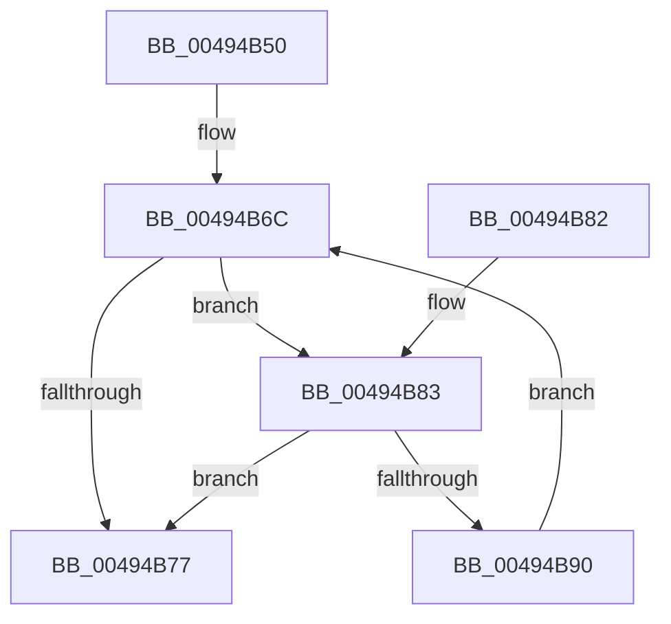

# PfTFullEventListAdd

- RVA: `0x00494B50`–`0x00494BB4` (길이 `100` bytes)
- VA: `0x0000000140494B50`
- 실행 섹션: `.text`
- PDB 이름 있음: `예`; PDB Function 태그: `아니요`
- unwind 정보 RVA: `0x000B34A4`
- 디코드: `27`개 명령, `100/100` bytes 표시
- 미해석 바이트: `0` (있으면 어셈블리에 `.byte`로 보존)

> 이 문서는 커널 이미지의 기계어와 PDB 기호를 분석해 생성했습니다. 4번과 5번은 함수 원형과 자료형을 바이너리 사용 방식에서 추정한 C 해석이며 원본 소스 복구 결과는 아닙니다.

## 1. Dependencies

- 직접 호출 지점: **3**; 고유 호출 대상: **3**
- 직접 호출자로 확인된 함수: **2**
- RIP 상대 이미지 참조: **0**

### Outgoing calls
- `0x00494B67` → [ExpInterlockedPushEntrySList](../6B/ExpInterlockedPushEntrySList_function_006BA5B0.md) (function, `0x006BA5B0`)
- `0x00494B86` → [ExpInterlockedPopEntrySList](../6B/ExpInterlockedPopEntrySList_function_006BA570.md) (function, `0x006BA570`)
- `0x00494BAD` → [PfFbBufferListInsertInFree](../48/PfFbBufferListInsertInFree_function_00484210.md) (function, `0x00484210`)

### Direct callers
- [PfpEventHandleFullBuffer](../34/PfpEventHandleFullBuffer_function_0034A640.md) at `0x0034A649`
- [PfpFlushEventBuffers](../../page/97/PfpFlushEventBuffers_function_0097BD4C.md) at `0x0097BE20`

### Static image references
- 디코드된 RIP-relative 메모리 참조가 없습니다.

## 2. Other-region calls and transfers

- 다른 실행 섹션으로 향하는 call: **0**
- 별도 외부 분기/꼬리 이동을 확인하지 못했습니다.

## 3. Assembly (complete function range)

```asm
00494B50  48 89 5C 24 08                  mov qword ptr [rsp + 8], rbx
00494B55  57                              push rdi
00494B56  48 83 EC 30                     sub rsp, 0x30
00494B5A  48 8D 99 20 02 00 00            lea rbx, [rcx + 0x220]
00494B61  48 8B F9                        mov rdi, rcx
00494B64  48 8B CB                        mov rcx, rbx
00494B67  E8 44 5A 22 00                  call 0x1406ba5b0
00494B6C  0F B7 03                        movzx eax, word ptr [rbx]
00494B6F  3B 87 30 02 00 00               cmp eax, dword ptr [rdi + 0x230]
00494B75  77 0C                           ja 0x140494b83
00494B77  48 8B 5C 24 40                  mov rbx, qword ptr [rsp + 0x40]
00494B7C  48 83 C4 30                     add rsp, 0x30
00494B80  5F                              pop rdi
00494B81  C3                              ret
00494B82  CC                              int3
00494B83  48 8B CB                        mov rcx, rbx
00494B86  E8 E5 59 22 00                  call 0x1406ba570
00494B8B  48 85 C0                        test rax, rax
00494B8E  74 E7                           je 0x140494b77
00494B90  44 8B 40 20                     mov r8d, dword ptr [rax + 0x20]
00494B94  48 8D 8F A0 01 00 00            lea rcx, [rdi + 0x1a0]
00494B9B  44 8B 48 2C                     mov r9d, dword ptr [rax + 0x2c]
00494B9F  44 2B C0                        sub r8d, eax
00494BA2  48 8B D0                        mov rdx, rax
00494BA5  C7 44 24 20 01 00 00 00         mov dword ptr [rsp + 0x20], 1
00494BAD  E8 5E F6 FE FF                  call 0x140484210
00494BB2  EB B8                           jmp 0x140494b6c
```

## 4. C-style interpretation (structured pseudocode)

```c
__int64 __fastcall PfTFullEventListAdd(__int64 a1)
{
    __int64 result;
    __int64 v_rsp;
    unsigned int v_stack_p20;
    unsigned __int64 v_stack_p8;

    v_stack_p8 = v_rbx;
    v_rsp = (v_rsp) - (48);
    result = ExpInterlockedPushEntrySList(a1 + 544, a2, a3, a4);
loc_00494B6C:
    if (((unsigned int)(*(unsigned __int16 *)(a1 + 544))) > (*(unsigned int *)(a1 + 560))) goto loc_00494B83;
loc_00494B77:
    v_rsp = (v_rsp) + (48);
    return *(unsigned __int16 *)(a1 + 544);
loc_00494B83:
    result = ExpInterlockedPopEntrySList(v_stack_p8, a2, a3, a4);
    if (result == 0) goto loc_00494B77;
    a3 = (unsigned int)(((unsigned int)(*(unsigned int *)(result + 32))) - ((unsigned int)(result)));
    v_stack_p20 = 1;
    result = PfFbBufferListInsertInFree(a1 + 416, result, a3, (unsigned int)(*(unsigned int *)(result + 44)));
    goto loc_00494B6C;
}
```

## 5. (Beta) C Style

```c
int64_t PfTFullEventListAdd(void *Arg1)
{
    uint8_t *arg1 = (uint8_t *)Arg1;

    int64_t result;
    int64_t local_rsp;
    uint32_t v_stack_p20;
    uint64_t v_stack_p8;

    v_stack_p8 = local_rbx;
    local_rsp = (local_rsp) - (48);
    result = ExpInterlockedPushEntrySList(Arg1 + 544, a2, a3, a4);
loc_00494B6C:
    if (((uint32_t)(*(uint16_t *)(arg1 + 0x220))) > (*(uint32_t *)(arg1 + 0x230))) goto loc_00494B83;
loc_00494B77:
    local_rsp = (local_rsp) + (48);
    return *(uint16_t *)(arg1 + 0x220);
loc_00494B83:
    result = ExpInterlockedPopEntrySList(v_stack_p8, a2, a3, a4);
    if (result == 0) goto loc_00494B77;
    a3 = (uint32_t)(((uint32_t)(*(uint32_t *)(result + 0x20))) - ((uint32_t)(result)));
    v_stack_p20 = 1;
    result = PfFbBufferListInsertInFree(Arg1 + 416, result, a3, (uint32_t)(*(uint32_t *)(result + 0x2C)));
    goto loc_00494B6C;
}
```

### 관측된 메모리 오프셋

구조체 형식이 확인되지 않은 접근은 인자 기준의 오프셋으로만 기록했습니다.

| 기준 인자 | 오프셋 표현 | 폭 (bit) | 접근 |
|---|---:|---:|---|
| `Arg1` | `+ 0x0` | `16` | `R` |
| `Arg1` | `+ 0x1A0` | `64` | `R` |
| `Arg1` | `+ 0x220` | `64` | `R` |
| `Arg1` | `+ 0x230` | `32` | `R` |

## 6. Execution-region graph

[열기: 2D/3D 그래프와 함수 탐색 컨트롤 패널](../../../control-panel.html?section=text&rva=0x00494B50&view=graph)

- 2D 그래프는 위에서 아래로 흐르고, 3D 그래프는 빈 공간을 드래그해 회전합니다. Shift+드래그는 이동, 휠은 확대·축소, 함수 노드 선택은 대상 보고서 이동입니다.

### Static fallback


