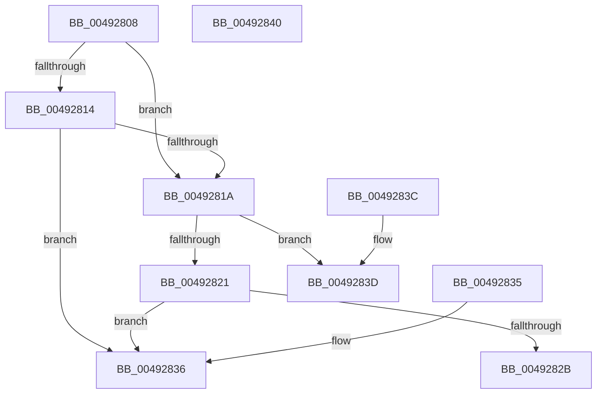

# PfpCheckPrefetchAbort

- RVA: `0x00492808`–`0x00492841` (길이 `57` bytes)
- VA: `0x0000000140492808`
- 실행 섹션: `.text`
- PDB 이름 있음: `예`; PDB Function 태그: `아니요`
- unwind 정보 RVA: `0x000DB714`
- 디코드: `23`개 명령, `57/57` bytes 표시
- 미해석 바이트: `0` (있으면 어셈블리에 `.byte`로 보존)

> 이 문서는 커널 이미지의 기계어와 PDB 기호를 분석해 생성했습니다. 4번과 5번은 함수 원형과 자료형을 바이너리 사용 방식에서 추정한 C 해석이며 원본 소스 복구 결과는 아닙니다.

## 1. Dependencies

- 직접 호출 지점: **0**; 고유 호출 대상: **0**
- 직접 호출자로 확인된 함수: **7**
- RIP 상대 이미지 참조: **0**

### Outgoing calls
- 직접 디코드된 call 명령이 없습니다.

### Direct callers
- [PfpOpenHandleCreate](../../page/8A/PfpOpenHandleCreate_function_008A9EDC.md) at `0x008AA082`
- [PfpVolumePrefetchMetadata](../../page/93/PfpVolumePrefetchMetadata_function_0093A158.md) at `0x0093A333`
- [PfpVolumePrefetchMetadata](../../page/93/PfpVolumePrefetchMetadata_function_0093A158.md) at `0x0093A3F2`
- [PfpPrefetchPrivatePages](../../page/93/PfpPrefetchPrivatePages_function_0093A7FC.md) at `0x0093A91B`
- [PfpPrefetchPrivatePages](../../page/93/PfpPrefetchPrivatePages_function_0093A7FC.md) at `0x0093A9A7`
- [PfpPrefetchDirectoryStream](../../page/93/PfpPrefetchDirectoryStream_function_0093AA94.md) at `0x0093ABF4`
- [PfpPrefetchFiles](../../page/93/PfpPrefetchFiles_function_0093AD58.md) at `0x0093AFF2`
- [PfpPrefetchFilesTrickle](../../page/93/PfpPrefetchFilesTrickle_function_0093C4E8.md) at `0x0093C670`
- [PfpPrefetchFilesTrickle](../../page/93/PfpPrefetchFilesTrickle_function_0093C4E8.md) at `0x0093C7E3`
- [sub_00B24FD6](../../page/B2/Unknown_function_00B24FD6.md) at `0x00B25074`

### Static image references
- 디코드된 RIP-relative 메모리 참조가 없습니다.

## 2. Other-region calls and transfers

- 다른 실행 섹션으로 향하는 call: **0**
- 별도 외부 분기/꼬리 이동을 확인하지 못했습니다.

## 3. Assembly (complete function range)

```asm
00492808  48 8B 11                        mov rdx, qword ptr [rcx]
0049280B  48 8B 42 48                     mov rax, qword ptr [rdx + 0x48]
0049280F  48 85 C0                        test rax, rax
00492812  74 06                           je 0x14049281a
00492814  83 78 04 00                     cmp dword ptr [rax + 4], 0
00492818  75 1C                           jne 0x140492836
0049281A  8B 42 50                        mov eax, dword ptr [rdx + 0x50]
0049281D  A8 04                           test al, 4
0049281F  74 1C                           je 0x14049283d
00492821  48 8B 41 28                     mov rax, qword ptr [rcx + 0x28]
00492825  83 78 48 00                     cmp dword ptr [rax + 0x48], 0
00492829  75 0B                           jne 0x140492836
0049282B  8B 40 44                        mov eax, dword ptr [rax + 0x44]
0049282E  C1 E8 02                        shr eax, 2
00492831  83 E0 01                        and eax, 1
00492834  C3                              ret
00492835  CC                              int3
00492836  B8 01 00 00 00                  mov eax, 1
0049283B  C3                              ret
0049283C  CC                              int3
0049283D  33 C0                           xor eax, eax
0049283F  C3                              ret
00492840  CC                              int3
```

## 4. C-style interpretation (structured pseudocode)

```c
__int64 __fastcall PfpCheckPrefetchAbort(__int64 a1)
{
    __int64 result;

    if (*(unsigned __int64 *)(*(unsigned __int64 *)(a1) + 72) == 0) goto loc_0049281A;
    if ((*(unsigned int *)(*(unsigned __int64 *)(*(unsigned __int64 *)(a1) + 72) + 4)) != 0) goto loc_00492836;
loc_0049281A:
    if ((((unsigned __int8)((unsigned int)(*(unsigned int *)(*(unsigned __int64 *)(a1) + 80)))) & (4)) == 0) goto loc_0049283D;
    if ((*(unsigned int *)(*(unsigned __int64 *)(a1 + 40) + 72)) != 0) goto loc_00492836;
    result = (unsigned int)(((unsigned int)(*(unsigned int *)(*(unsigned __int64 *)(a1 + 40) + 68))) >> (2));
    result = (unsigned int)((result) & (1));
    return result;
loc_00492836:
    return 1;
loc_0049283D:
    result = 0;
    return result;
}
```

## 5. (Beta) C Style

```c
int64_t PfpCheckPrefetchAbort(void *Arg1)
{
    uint8_t *arg1 = (uint8_t *)Arg1;

    int64_t result;

    if (*(uint64_t *)(*(uint64_t *)(arg1) + 0x48) == 0) goto loc_0049281A;
    if ((*(uint32_t *)(*(uint64_t *)(*(uint64_t *)(arg1) + 0x48) + 0x4)) != 0) goto loc_00492836;
loc_0049281A:
    if ((((uint8_t)((uint32_t)(*(uint32_t *)(*(uint64_t *)(arg1) + 0x50)))) & (4)) == 0) goto loc_0049283D;
    if ((*(uint32_t *)(*(uint64_t *)(arg1 + 0x28) + 0x48)) != 0) goto loc_00492836;
    result = (uint32_t)(((uint32_t)(*(uint32_t *)(*(uint64_t *)(arg1 + 0x28) + 0x44))) >> (2));
    result = (uint32_t)((result) & (1));
    return result;
loc_00492836:
    return 1;
loc_0049283D:
    result = 0;
    return result;
}
```

### 관측된 메모리 오프셋

구조체 형식이 확인되지 않은 접근은 인자 기준의 오프셋으로만 기록했습니다.

| 기준 인자 | 오프셋 표현 | 폭 (bit) | 접근 |
|---|---:|---:|---|
| `Arg1` | `+ 0x0` | `64` | `R` |
| `Arg1` | `+ 0x28` | `64` | `R` |

## 6. Execution-region graph

[열기: 2D/3D 그래프와 함수 탐색 컨트롤 패널](../../../control-panel.html?section=text&rva=0x00492808&view=graph)

- 2D 그래프는 위에서 아래로 흐르고, 3D 그래프는 빈 공간을 드래그해 회전합니다. Shift+드래그는 이동, 휠은 확대·축소, 함수 노드 선택은 대상 보고서 이동입니다.

### Static fallback


