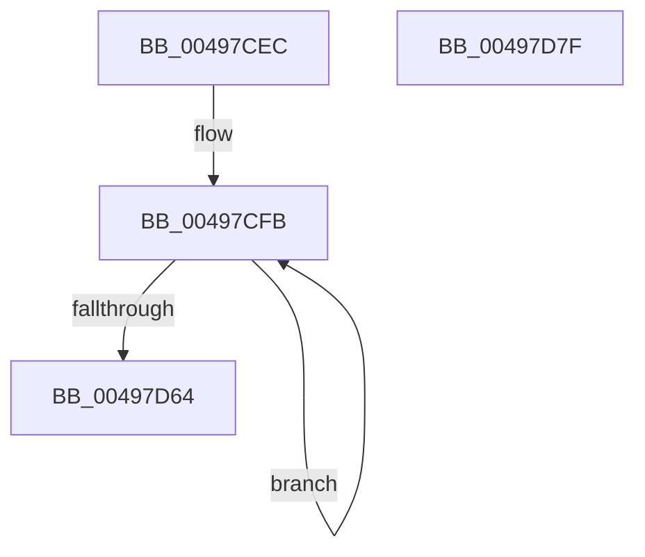

# PiUEventHashGuidIntoBucket

- RVA: `0x00497CEC`–`0x00497D80` (길이 `148` bytes)
- VA: `0x0000000140497CEC`
- 실행 섹션: `.text`
- PDB 이름 있음: `예`; PDB Function 태그: `아니요`
- unwind 정보 RVA: `0x000DB714`
- 디코드: `38`개 명령, `148/148` bytes 표시
- 미해석 바이트: `0` (있으면 어셈블리에 `.byte`로 보존)

> 이 문서는 커널 이미지의 기계어와 PDB 기호를 분석해 생성했습니다. 4번과 5번은 함수 원형과 자료형을 바이너리 사용 방식에서 추정한 C 해석이며 원본 소스 복구 결과는 아닙니다.

## 1. Dependencies

- 직접 호출 지점: **0**; 고유 호출 대상: **0**
- 직접 호출자로 확인된 함수: **2**
- RIP 상대 이미지 참조: **0**

### Outgoing calls
- 직접 디코드된 call 명령이 없습니다.

### Direct callers
- [PiUEventHandleRegistration](../../page/9C/PiUEventHandleRegistration_function_009C3304.md) at `0x009C368D`
- [PiUEventNotifyDeviceInterfaceChange](../../page/9C/PiUEventNotifyDeviceInterfaceChange_function_009C3CF4.md) at `0x009C3D4D`

### Static image references
- 디코드된 RIP-relative 메모리 참조가 없습니다.

## 2. Other-region calls and transfers

- 다른 실행 섹션으로 향하는 call: **0**
- 별도 외부 분기/꼬리 이동을 확인하지 못했습니다.

## 3. Assembly (complete function range)

```asm
00497CEC  4C 8B C9                        mov r9, rcx
00497CEF  41 B8 2F CB 04 00               mov r8d, 0x4cb2f
00497CF5  41 BA 02 00 00 00               mov r10d, 2
00497CFB  41 0F B6 01                     movzx eax, byte ptr [r9]
00497CFF  4D 8D 49 08                     lea r9, [r9 + 8]
00497D03  49 6B D0 25                     imul rdx, r8, 0x25
00497D07  48 03 D0                        add rdx, rax
00497D0A  41 0F B6 41 F9                  movzx eax, byte ptr [r9 - 7]
00497D0F  4C 6B C2 25                     imul r8, rdx, 0x25
00497D13  4C 03 C0                        add r8, rax
00497D16  41 0F B6 41 FA                  movzx eax, byte ptr [r9 - 6]
00497D1B  49 6B D0 25                     imul rdx, r8, 0x25
00497D1F  48 03 D0                        add rdx, rax
00497D22  41 0F B6 41 FB                  movzx eax, byte ptr [r9 - 5]
00497D27  48 6B CA 25                     imul rcx, rdx, 0x25
00497D2B  48 03 C8                        add rcx, rax
00497D2E  41 0F B6 41 FC                  movzx eax, byte ptr [r9 - 4]
00497D33  48 6B D1 25                     imul rdx, rcx, 0x25
00497D37  48 03 D0                        add rdx, rax
00497D3A  41 0F B6 41 FD                  movzx eax, byte ptr [r9 - 3]
00497D3F  48 6B CA 25                     imul rcx, rdx, 0x25
00497D43  48 03 C8                        add rcx, rax
00497D46  41 0F B6 41 FE                  movzx eax, byte ptr [r9 - 2]
00497D4B  48 6B D1 25                     imul rdx, rcx, 0x25
00497D4F  48 03 D0                        add rdx, rax
00497D52  41 0F B6 41 FF                  movzx eax, byte ptr [r9 - 1]
00497D57  4C 6B C2 25                     imul r8, rdx, 0x25
00497D5B  4C 03 C0                        add r8, rax
00497D5E  49 83 EA 01                     sub r10, 1
00497D62  75 97                           jne 0x140497cfb
00497D64  48 B8 C5 4E EC C4 4E EC C4 4E   movabs rax, 0x4ec4ec4ec4ec4ec5
00497D6E  49 F7 E0                        mul r8
00497D71  48 C1 EA 02                     shr rdx, 2
00497D75  6B CA 0D                        imul ecx, edx, 0xd
00497D78  44 2B C1                        sub r8d, ecx
00497D7B  41 8B C0                        mov eax, r8d
00497D7E  C3                              ret
00497D7F  CC                              int3
```

## 4. C-style interpretation (structured pseudocode)

```c
__int64 __fastcall PiUEventHashGuidIntoBucket(__int64 a1)
{
    __int64 v_r10;

loc_00497CFB:
    a2 = (a2) * ((unsigned int)(0x4CB2FULL));
    a2 = (a2) + (*(unsigned __int8 *)(a1));
    a3 = ((unsigned int)(0x4CB2FULL)) * (a2);
    a3 = (a3) + (*(unsigned __int8 *)(a1 + 8 - 7));
    a2 = (a2) * (a3);
    a2 = (a2) + (*(unsigned __int8 *)(a1 + 8 - 6));
    a1 = (a1) * (a2);
    a1 = (a1) + (*(unsigned __int8 *)(a1 + 8 - 5));
    a2 = (a2) * (a1);
    a2 = (a2) + (*(unsigned __int8 *)(a1 + 8 - 4));
    a1 = (a1) * (a2);
    a1 = (a1) + (*(unsigned __int8 *)(a1 + 8 - 3));
    a2 = (a2) * (a1);
    a2 = (a2) + (*(unsigned __int8 *)(a1 + 8 - 2));
    a3 = (a3) * (a2);
    a3 = (a3) + (*(unsigned __int8 *)(a1 + 8 - 1));
    v_r10 = (2) - (1);
    if (condition_is_not_equal) goto loc_00497CFB;
    a2 = (a2) >> (2);
    a1 = (unsigned int)((a1) * ((unsigned int)(a2)));
    a3 = (unsigned int)((a3) - ((unsigned int)(a1)));
    return (unsigned int)((unsigned int)(a3));
}
```

## 5. (Beta) C Style

```c
int64_t PiUEventHashGuidIntoBucket(void *Arg1)
{
    uint8_t *arg1 = (uint8_t *)Arg1;

    int64_t local_r10;

loc_00497CFB:
    a2 = (a2) * ((uint32_t)(0x4CB2FULL));
    a2 = (a2) + (*(uint8_t *)(arg1));
    a3 = ((uint32_t)(0x4CB2FULL)) * (a2);
    a3 = (a3) + (*(uint8_t *)(arg1 + 0x8 - 0x7));
    a2 = (a2) * (a3);
    a2 = (a2) + (*(uint8_t *)(arg1 + 0x8 - 0x6));
    Arg1 = (Arg1) * (a2);
    Arg1 = (Arg1) + (*(uint8_t *)(arg1 + 0x8 - 0x5));
    a2 = (a2) * (Arg1);
    a2 = (a2) + (*(uint8_t *)(arg1 + 0x8 - 0x4));
    Arg1 = (Arg1) * (a2);
    Arg1 = (Arg1) + (*(uint8_t *)(arg1 + 0x8 - 0x3));
    a2 = (a2) * (Arg1);
    a2 = (a2) + (*(uint8_t *)(arg1 + 0x8 - 0x2));
    a3 = (a3) * (a2);
    a3 = (a3) + (*(uint8_t *)(arg1 + 0x8 - 0x1));
    local_r10 = (2) - (1);
    if (condition_is_not_equal) goto loc_00497CFB;
    a2 = (a2) >> (2);
    Arg1 = (uint32_t)((Arg1) * ((uint32_t)(a2)));
    a3 = (uint32_t)((a3) - ((uint32_t)(Arg1)));
    return (uint32_t)((uint32_t)(a3));
}
```

### 관측된 메모리 오프셋

구조체 형식이 확인되지 않은 접근은 인자 기준의 오프셋으로만 기록했습니다.

| 기준 인자 | 오프셋 표현 | 폭 (bit) | 접근 |
|---|---:|---:|---|
| `Arg1` | `- 0x7` | `8` | `R` |
| `Arg1` | `- 0x6` | `8` | `R` |
| `Arg1` | `- 0x5` | `8` | `R` |
| `Arg1` | `- 0x4` | `8` | `R` |
| `Arg1` | `- 0x3` | `8` | `R` |
| `Arg1` | `- 0x2` | `8` | `R` |
| `Arg1` | `- 0x1` | `8` | `R` |
| `Arg1` | `+ 0x0` | `8` | `R` |
| `Arg1` | `+ 0x8` | `64` | `R` |

## 6. Execution-region graph

[열기: 2D/3D 그래프와 함수 탐색 컨트롤 패널](../../../control-panel.html?section=text&rva=0x00497CEC&view=graph)

- 2D 그래프는 위에서 아래로 흐르고, 3D 그래프는 빈 공간을 드래그해 회전합니다. Shift+드래그는 이동, 휠은 확대·축소, 함수 노드 선택은 대상 보고서 이동입니다.

### Static fallback


