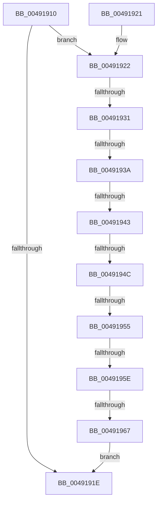

# PiUEventShouldQueueEvent

- RVA: `0x00491910`–`0x00491969` (길이 `89` bytes)
- VA: `0x0000000140491910`
- 실행 섹션: `.text`
- PDB 이름 있음: `예`; PDB Function 태그: `예`
- unwind 정보 RVA: `0x000DB714`
- 디코드: `23`개 명령, `89/89` bytes 표시
- 미해석 바이트: `0` (있으면 어셈블리에 `.byte`로 보존)

> 이 문서는 커널 이미지의 기계어와 PDB 기호를 분석해 생성했습니다. 4번과 5번은 함수 원형과 자료형을 바이너리 사용 방식에서 추정한 C 해석이며 원본 소스 복구 결과는 아닙니다.

## 1. Dependencies

- 직접 호출 지점: **0**; 고유 호출 대상: **0**
- 직접 호출자로 확인된 함수: **1**
- RIP 상대 이미지 참조: **1**

### Outgoing calls
- 직접 디코드된 call 명령이 없습니다.

### Direct callers
- [PiUEventNotifyUserMode](../../page/95/PiUEventNotifyUserMode_function_00954CB4.md) at `0x00954D72`

### Static image references
- `0x00491915` → RVA `0x00E66350` (`.data`; read)

## 2. Other-region calls and transfers

- 다른 실행 섹션으로 향하는 call: **0**
- call이 아닌 외부 분기/꼬리 이동: **7**
  - `0x0049192B` → `0x006F7059` (`tail-transfer`)
  - `0x00491934` → `0x006F7050` (`tail-transfer`)
  - `0x0049193D` → `0x006F7059` (`tail-transfer`)
  - `0x00491946` → `0x006F7047` (`tail-transfer`)
  - `0x0049194F` → `0x006F703E` (`tail-transfer`)
  - `0x00491958` → `0x006F7047` (`tail-transfer`)
  - `0x00491961` → `0x006F7047` (`tail-transfer`)

## 3. Assembly (complete function range)

```asm
00491910  45 33 C0                        xor r8d, r8d
00491913  B2 01                           mov dl, 1
00491915  44 38 05 34 4A 9D 00            cmp byte ptr [rip + 0x9d4a34], r8b
0049191C  74 04                           je 0x140491922
0049191E  8A C2                           mov al, dl
00491920  C3                              ret
00491921  CC                              int3
00491922  8B 89 88 00 00 00               mov ecx, dword ptr [rcx + 0x88]
00491928  83 E9 01                        sub ecx, 1
0049192B  0F 84 28 57 26 00               je 0x1406f7059
00491931  83 E9 01                        sub ecx, 1
00491934  0F 84 16 57 26 00               je 0x1406f7050
0049193A  83 E9 01                        sub ecx, 1
0049193D  0F 84 16 57 26 00               je 0x1406f7059
00491943  83 E9 01                        sub ecx, 1
00491946  0F 84 FB 56 26 00               je 0x1406f7047
0049194C  83 E9 05                        sub ecx, 5
0049194F  0F 84 E9 56 26 00               je 0x1406f703e
00491955  83 E9 01                        sub ecx, 1
00491958  0F 84 E9 56 26 00               je 0x1406f7047
0049195E  83 F9 01                        cmp ecx, 1
00491961  0F 84 E0 56 26 00               je 0x1406f7047
00491967  EB B5                           jmp 0x14049191e
```

## 4. C-style interpretation (structured pseudocode)

```c
__int64 __fastcall PiUEventShouldQueueEvent(__int64 a1, __int64 a2, int a3)
{
    a3 = 0;
    if ((*(unsigned __int8 *)(v_rip + 10308148)) == 0) goto loc_00491922;
loc_0049191E:
    return 1;
loc_00491922:
    a1 = (unsigned int)(((unsigned int)(*(unsigned int *)(a1 + 136))) - (1));
    a1 = (unsigned int)((a1) - (1));
    a1 = (unsigned int)((a1) - (1));
    a1 = (unsigned int)((a1) - (1));
    a1 = (unsigned int)((a1) - (5));
    a1 = (unsigned int)((a1) - (1));
    goto loc_0049191E;
}
```

## 5. (Beta) C Style

```c
int64_t PiUEventShouldQueueEvent(void *Arg1, int64_t Arg2, int32_t Arg3)
{
    uint8_t *arg1 = (uint8_t *)Arg1;

    Arg3 = 0;
    if ((*(uint8_t *)(v_rip + 0x9D4A34)) == 0) goto loc_00491922;
loc_0049191E:
    return 1;
loc_00491922:
    Arg1 = (uint32_t)(((uint32_t)(*(uint32_t *)(arg1 + 0x88))) - (1));
    Arg1 = (uint32_t)((Arg1) - (1));
    Arg1 = (uint32_t)((Arg1) - (1));
    Arg1 = (uint32_t)((Arg1) - (1));
    Arg1 = (uint32_t)((Arg1) - (5));
    Arg1 = (uint32_t)((Arg1) - (1));
    goto loc_0049191E;
}
```

### 관측된 메모리 오프셋

구조체 형식이 확인되지 않은 접근은 인자 기준의 오프셋으로만 기록했습니다.

| 기준 인자 | 오프셋 표현 | 폭 (bit) | 접근 |
|---|---:|---:|---|
| `Arg1` | `+ 0x88` | `32` | `R` |

## 6. Execution-region graph

[열기: 2D/3D 그래프와 함수 탐색 컨트롤 패널](../../../control-panel.html?section=text&rva=0x00491910&view=graph)

- 2D 그래프는 위에서 아래로 흐르고, 3D 그래프는 빈 공간을 드래그해 회전합니다. Shift+드래그는 이동, 휠은 확대·축소, 함수 노드 선택은 대상 보고서 이동입니다.

### Static fallback


