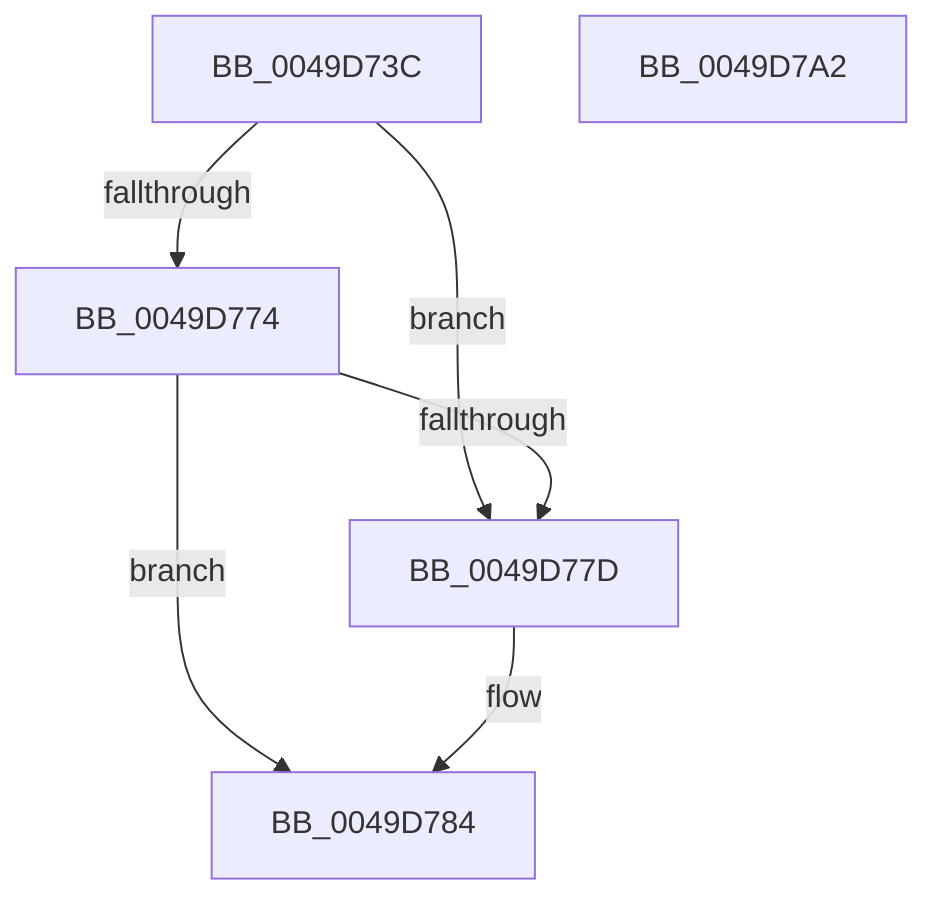

# PnpDeviceCompletionQueueRemoveCompletedRequest

- RVA: `0x0049D73C`–`0x0049D7A3` (길이 `103` bytes)
- VA: `0x000000014049D73C`
- 실행 섹션: `.text`
- PDB 이름 있음: `예`; PDB Function 태그: `아니요`
- unwind 정보 RVA: `0x00064C80`
- 디코드: `29`개 명령, `103/103` bytes 표시
- 미해석 바이트: `0` (있으면 어셈블리에 `.byte`로 보존)

> 이 문서는 커널 이미지의 기계어와 PDB 기호를 분석해 생성했습니다. 4번과 5번은 함수 원형과 자료형을 바이너리 사용 방식에서 추정한 C 해석이며 원본 소스 복구 결과는 아닙니다.

## 1. Dependencies

- 직접 호출 지점: **3**; 고유 호출 대상: **3**
- 직접 호출자로 확인된 함수: **2**
- RIP 상대 이미지 참조: **2**

### Outgoing calls
- `0x0049D75A` → [KeWaitForSingleObject](../20/KeWaitForSingleObject_function_0020E6B0.md) (function, `0x0020E6B0`)
- `0x0049D766` → [KeAcquireSpinLockRaiseToDpc](../20/KeAcquireSpinLockRaiseToDpc_function_00208470.md) (function, `0x00208470`)
- `0x0049D794` → [KeReleaseSpinLock](../39/KeReleaseSpinLock_function_00392BA0.md) (function, `0x00392BA0`)

### Direct callers
- [PipEnumerateDevice](../../page/8F/PipEnumerateDevice_function_008F99E4.md) at `0x008F9AC1`
- [PnpStartDeviceNode](../../page/8F/PnpStartDeviceNode_function_008FE38C.md) at `0x008FE566`

### Static image references
- `0x0049D748` → RVA `0x00F8C328` (`.data`; read)
- `0x0049D75F` → RVA `0x00F8C348` (`.data`; read)

## 2. Other-region calls and transfers

- 다른 실행 섹션으로 향하는 call: **0**
- 별도 외부 분기/꼬리 이동을 확인하지 못했습니다.

## 3. Assembly (complete function range)

```asm
0049D73C  40 53                           push rbx
0049D73E  48 83 EC 30                     sub rsp, 0x30
0049D742  48 83 64 24 20 00               and qword ptr [rsp + 0x20], 0
0049D748  48 8D 0D D9 EB AE 00            lea rcx, [rip + 0xaeebd9]
0049D74F  48 8B DA                        mov rbx, rdx
0049D752  45 33 C9                        xor r9d, r9d
0049D755  33 D2                           xor edx, edx
0049D757  45 33 C0                        xor r8d, r8d
0049D75A  E8 51 0F D7 FF                  call 0x14020e6b0
0049D75F  48 8D 0D E2 EB AE 00            lea rcx, [rip + 0xaeebe2]
0049D766  E8 05 AD D6 FF                  call 0x140208470
0049D76B  4C 8B 03                        mov r8, qword ptr [rbx]
0049D76E  49 39 58 08                     cmp qword ptr [r8 + 8], rbx
0049D772  75 09                           jne 0x14049d77d
0049D774  48 8B 53 08                     mov rdx, qword ptr [rbx + 8]
0049D778  48 39 1A                        cmp qword ptr [rdx], rbx
0049D77B  74 07                           je 0x14049d784
0049D77D  B9 03 00 00 00                  mov ecx, 3
0049D782  CD 29                           int 0x29
0049D784  4C 89 02                        mov qword ptr [rdx], r8
0049D787  48 8D 0D BA EB AE 00            lea rcx, [rip + 0xaeebba]
0049D78E  49 89 50 08                     mov qword ptr [r8 + 8], rdx
0049D792  8A D0                           mov dl, al
0049D794  E8 07 54 EF FF                  call 0x140392ba0
0049D799  48 8B C3                        mov rax, rbx
0049D79C  48 83 C4 30                     add rsp, 0x30
0049D7A0  5B                              pop rbx
0049D7A1  C3                              ret
0049D7A2  CC                              int3
```

## 4. C-style interpretation (structured pseudocode)

```c
__int64 __fastcall PnpDeviceCompletionQueueRemoveCompletedRequest(__int64 a1, __int64 a2, int a3, int a4)
{
    __int64 result;
    __int64 v_rsp;
    unsigned __int64 v_stack_m18;

    v_rsp = (v_rsp) - (48);
    a4 = 0;
    a2 = 0;
    a3 = 0;
    result = KeWaitForSingleObject(v_rip + 11463641, a2, a3, a4);
    result = KeAcquireSpinLockRaiseToDpc(v_rip + 11463650, a2, a3, a4);
    if ((*(unsigned __int64 *)(*(unsigned __int64 *)(a2) + 8)) != 0) goto loc_0049D77D;
    if ((*(unsigned __int64 *)(*(unsigned __int64 *)(a2 + 8))) != 0) {
        a1 = 3;
    }
    *(unsigned __int64 *)(*(unsigned __int64 *)(a2 + 8)) = *(unsigned __int64 *)(a2);
    *(unsigned __int64 *)(*(unsigned __int64 *)(a2) + 8) = *(unsigned __int64 *)(a2 + 8);
    result = KeReleaseSpinLock(v_rip + 11463610, (unsigned __int8)(result), *(unsigned __int64 *)(a2), a4);
    v_rsp = (v_rsp) + (48);
    return 0;
}
```

## 5. (Beta) C Style

```c
int64_t PnpDeviceCompletionQueueRemoveCompletedRequest(int64_t Arg1, void *Arg2, int32_t Arg3, int32_t Arg4)
{
    uint8_t *arg2 = (uint8_t *)Arg2;

    int64_t result;
    int64_t local_rsp;
    uint64_t v_stack_m18;

    local_rsp = (local_rsp) - (48);
    Arg4 = 0;
    Arg2 = 0;
    Arg3 = 0;
    result = KeWaitForSingleObject(v_rip + 11463641, Arg2, Arg3, Arg4);
    result = KeAcquireSpinLockRaiseToDpc(v_rip + 11463650, Arg2, Arg3, Arg4);
    if ((*(uint64_t *)(*(uint64_t *)(arg2) + 0x8)) != 0) goto loc_0049D77D;
    if ((*(uint64_t *)(*(uint64_t *)(arg2 + 0x8))) != 0) {
        Arg1 = 3;
    }
    *(uint64_t *)(*(uint64_t *)(arg2 + 0x8)) = *(uint64_t *)(arg2);
    *(uint64_t *)(*(uint64_t *)(arg2) + 0x8) = *(uint64_t *)(arg2 + 0x8);
    result = KeReleaseSpinLock(v_rip + 11463610, (uint8_t)(result), *(uint64_t *)(arg2), Arg4);
    local_rsp = (local_rsp) + (48);
    return 0;
}
```

### 관측된 메모리 오프셋

구조체 형식이 확인되지 않은 접근은 인자 기준의 오프셋으로만 기록했습니다.

| 기준 인자 | 오프셋 표현 | 폭 (bit) | 접근 |
|---|---:|---:|---|
| `Arg2` | `+ 0x0` | `64` | `R` |
| `Arg2` | `+ 0x8` | `64` | `R` |

## 6. Execution-region graph

[열기: 2D/3D 그래프와 함수 탐색 컨트롤 패널](../../../control-panel.html?section=text&rva=0x0049D73C&view=graph)

- 2D 그래프는 위에서 아래로 흐르고, 3D 그래프는 빈 공간을 드래그해 회전합니다. Shift+드래그는 이동, 휠은 확대·축소, 함수 노드 선택은 대상 보고서 이동입니다.

### Static fallback


