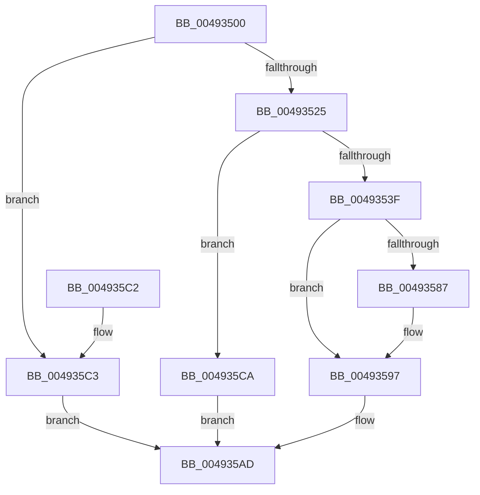

# PnpSetDeviceInstancePropertyChangeEventFromDeviceInstance

- RVA: `0x00493500`–`0x004935D1` (길이 `209` bytes)
- VA: `0x0000000140493500`
- 실행 섹션: `.text`
- PDB 이름 있음: `예`; PDB Function 태그: `아니요`
- unwind 정보 RVA: `0x0007A3F0`
- 디코드: `49`개 명령, `209/209` bytes 표시
- 미해석 바이트: `0` (있으면 어셈블리에 `.byte`로 보존)

> 이 문서는 커널 이미지의 기계어와 PDB 기호를 분석해 생성했습니다. 4번과 5번은 함수 원형과 자료형을 바이너리 사용 방식에서 추정한 C 해석이며 원본 소스 복구 결과는 아닙니다.

## 1. Dependencies

- 직접 호출 지점: **3**; 고유 호출 대상: **3**
- 직접 호출자로 확인된 함수: **4**
- RIP 상대 이미지 참조: **2**

### Outgoing calls
- `0x0049352E` → [PnpCreateDeviceEventEntry](../../page/95/PnpCreateDeviceEventEntry_function_00951B48.md) (function, `0x00951B48`)
- `0x00493592` → [memcpy](../6C/memcpy_function_006C6840.md) (function, `0x006C6840`)
- `0x004935A8` → [PnpInsertEventInQueue](../../page/95/PnpInsertEventInQueue_function_00951B78.md) (function, `0x00951B78`)

### Direct callers
- [PnpSetDeviceInstancePropertyChangeEvent](PnpSetDeviceInstancePropertyChangeEvent_function_004934E4.md) at `0x004934EC`
- [PiCMDeleteDeviceWorker](../../page/73/PiCMDeleteDeviceWorker_function_0073B420.md) at `0x0073B672`
- [PiCMSetObjectProperty](../../page/96/PiCMSetObjectProperty_function_00962564.md) at `0x009626E2`
- [PiCMSetRegistryProperty](../../page/96/PiCMSetRegistryProperty_function_00963118.md) at `0x00963285`

### Static image references
- `0x00493519` → RVA `0x00F8C5E4` (`.data`; read)
- `0x0049353F` → RVA `0x0001A800` (`.rdata`; read)

## 2. Other-region calls and transfers

- 다른 실행 섹션으로 향하는 call: **2**
  - `0x0049352E` → [PnpCreateDeviceEventEntry](../../page/95/PnpCreateDeviceEventEntry_function_00951B48.md) (`.text` → `PAGE`)
  - `0x004935A8` → [PnpInsertEventInQueue](../../page/95/PnpInsertEventInQueue_function_00951B78.md) (`.text` → `PAGE`)
- 별도 외부 분기/꼬리 이동을 확인하지 못했습니다.

## 3. Assembly (complete function range)

```asm
00493500  48 89 5C 24 08                  mov qword ptr [rsp + 8], rbx
00493505  48 89 6C 24 10                  mov qword ptr [rsp + 0x10], rbp
0049350A  48 89 74 24 18                  mov qword ptr [rsp + 0x18], rsi
0049350F  57                              push rdi
00493510  48 83 EC 20                     sub rsp, 0x20
00493514  33 ED                           xor ebp, ebp
00493516  48 8B F9                        mov rdi, rcx
00493519  39 2D C5 90 AF 00               cmp dword ptr [rip + 0xaf90c5], ebp
0049351F  0F 85 9E 00 00 00               jne 0x1404935c3
00493525  0F B7 31                        movzx esi, word ptr [rcx]
00493528  83 C6 52                        add esi, 0x52
0049352B  8D 4E 78                        lea ecx, [rsi + 0x78]
0049352E  E8 15 E6 4B 00                  call 0x140951b48
00493533  48 8B D8                        mov rbx, rax
00493536  48 85 C0                        test rax, rax
00493539  0F 84 8B 00 00 00               je 0x1404935ca
0049353F  0F 10 05 BA 72 B8 FF            movups xmm0, xmmword ptr [rip - 0x478d46]
00493546  48 89 68 18                     mov qword ptr [rax + 0x18], rbp
0049354A  89 68 10                        mov dword ptr [rax + 0x10], ebp
0049354D  F3 0F 7F 40 78                  movdqu xmmword ptr [rax + 0x78], xmm0
00493552  48 89 68 30                     mov qword ptr [rax + 0x30], rbp
00493556  48 89 68 38                     mov qword ptr [rax + 0x38], rbp
0049355A  C7 80 88 00 00 00 09 00 00 00   mov dword ptr [rax + 0x88], 9
00493564  48 89 A8 90 00 00 00            mov qword ptr [rax + 0x90], rbp
0049356B  89 A8 98 00 00 00               mov dword ptr [rax + 0x98], ebp
00493571  89 B0 9C 00 00 00               mov dword ptr [rax + 0x9c], esi
00493577  48 89 A8 A0 00 00 00            mov qword ptr [rax + 0xa0], rbp
0049357E  48 8B 57 08                     mov rdx, qword ptr [rdi + 8]
00493582  48 85 D2                        test rdx, rdx
00493585  74 10                           je 0x140493597
00493587  44 0F B7 07                     movzx r8d, word ptr [rdi]
0049358B  48 8D 88 A8 00 00 00            lea rcx, [rax + 0xa8]
00493592  E8 A9 32 23 00                  call 0x1406c6840
00493597  0F B7 07                        movzx eax, word ptr [rdi]
0049359A  48 8B CB                        mov rcx, rbx
0049359D  48 D1 E8                        shr rax, 1
004935A0  66 89 AC 43 A8 00 00 00         mov word ptr [rbx + rax*2 + 0xa8], bp
004935A8  E8 CB E5 4B 00                  call 0x140951b78
004935AD  48 8B 5C 24 30                  mov rbx, qword ptr [rsp + 0x30]
004935B2  48 8B 6C 24 38                  mov rbp, qword ptr [rsp + 0x38]
004935B7  48 8B 74 24 40                  mov rsi, qword ptr [rsp + 0x40]
004935BC  48 83 C4 20                     add rsp, 0x20
004935C0  5F                              pop rdi
004935C1  C3                              ret
004935C2  CC                              int3
004935C3  B8 89 01 00 C0                  mov eax, 0xc0000189
004935C8  EB E3                           jmp 0x1404935ad
004935CA  B8 9A 00 00 C0                  mov eax, 0xc000009a
004935CF  EB DC                           jmp 0x1404935ad
```

## 4. C-style interpretation (structured pseudocode)

```c
__int64 __fastcall PnpSetDeviceInstancePropertyChangeEventFromDeviceInstance(__int64 a1)
{
    __int64 result;
    __int64 v_rbp;
    __int64 v_rsi;
    __int64 v_rsp;
    unsigned __int64 v_stack_p10;
    unsigned __int64 v_stack_p18;
    unsigned __int64 v_stack_p8;

    v_stack_p8 = v_rbx;
    v_stack_p10 = v_rbp;
    v_stack_p18 = v_rsi;
    v_rsp = (v_rsp) - (32);
    v_rbp = 0;
    if ((*(unsigned int *)(v_rip + 11505861)) != 0) goto loc_004935C3;
    v_rsi = (unsigned int)((*(unsigned __int16 *)(a1)) + (82));
    result = PnpCreateDeviceEventEntry(v_rsi + 120, a2, a3, a4);
    if (result == 0) goto loc_004935CA;
    *(unsigned __int64 *)(result + 24) = 0;
    *(unsigned int *)(result + 16) = 0;
    *(unsigned __int64 *)(result + 120) = v_xmm0;
    *(unsigned __int64 *)(result + 48) = 0;
    *(unsigned __int64 *)(result + 56) = 0;
    *(unsigned int *)(result + 136) = 9;
    *(unsigned __int64 *)(result + 144) = 0;
    *(unsigned int *)(result + 152) = 0;
    *(unsigned int *)(result + 156) = (unsigned int)(v_rsi);
    *(unsigned __int64 *)(result + 160) = 0;
    if (*(unsigned __int64 *)(a1 + 8) != 0) {
        a3 = *(unsigned __int16 *)(a1);
        a1 = result + 168;
        result = memcpy(a1, *(unsigned __int64 *)(a1 + 8), a3, a4);
    }
    result = (*(unsigned __int16 *)(a1)) >> (1);
    *(unsigned __int16 *)(result + result * 2 + 168) = 0;
    result = PnpInsertEventInQueue(result, *(unsigned __int64 *)(a1 + 8), a3, a4);
loc_004935AD:
    v_rsp = (v_rsp) + (32);
    return result;
loc_004935C3:
    goto loc_004935AD;
loc_004935CA:
    goto loc_004935AD;
}
```

## 5. (Beta) C Style

```c
int64_t PnpSetDeviceInstancePropertyChangeEventFromDeviceInstance(void *Arg1)
{
    uint8_t *arg1 = (uint8_t *)Arg1;

    int64_t result;
    int64_t local_rbp;
    int64_t local_rsi;
    int64_t local_rsp;
    uint64_t v_stack_p10;
    uint64_t v_stack_p18;
    uint64_t v_stack_p8;

    v_stack_p8 = local_rbx;
    v_stack_p10 = local_rbp;
    v_stack_p18 = local_rsi;
    local_rsp = (local_rsp) - (32);
    local_rbp = 0;
    if ((*(uint32_t *)(v_rip + 0xAF90C5)) != 0) goto loc_004935C3;
    local_rsi = (uint32_t)((*(uint16_t *)(arg1)) + (82));
    result = PnpCreateDeviceEventEntry(local_rsi + 120, a2, a3, a4);
    if (result == 0) goto loc_004935CA;
    *(uint64_t *)(result + 0x18) = 0;
    *(uint32_t *)(result + 0x10) = 0;
    *(uint64_t *)(result + 0x78) = v_xmm0;
    *(uint64_t *)(result + 0x30) = 0;
    *(uint64_t *)(result + 0x38) = 0;
    *(uint32_t *)(result + 0x88) = 9;
    *(uint64_t *)(result + 0x90) = 0;
    *(uint32_t *)(result + 0x98) = 0;
    *(uint32_t *)(result + 0x9C) = (uint32_t)(local_rsi);
    *(uint64_t *)(result + 0xA0) = 0;
    if (*(uint64_t *)(arg1 + 0x8) != 0) {
        a3 = *(uint16_t *)(arg1);
        Arg1 = result + 168;
        result = memcpy(Arg1, *(uint64_t *)(arg1 + 0x8), a3, a4);
    }
    result = (*(uint16_t *)(arg1)) >> (1);
    *(uint16_t *)(result + result * 2 + 0xA8) = 0;
    result = PnpInsertEventInQueue(result, *(uint64_t *)(arg1 + 0x8), a3, a4);
loc_004935AD:
    local_rsp = (local_rsp) + (32);
    return result;
loc_004935C3:
    goto loc_004935AD;
loc_004935CA:
    goto loc_004935AD;
}
```

### 관측된 메모리 오프셋

구조체 형식이 확인되지 않은 접근은 인자 기준의 오프셋으로만 기록했습니다.

| 기준 인자 | 오프셋 표현 | 폭 (bit) | 접근 |
|---|---:|---:|---|
| `Arg1` | `+ 0x0` | `16` | `R` |
| `Arg1` | `+ 0x8` | `64` | `R` |

## 6. Execution-region graph

[열기: 2D/3D 그래프와 함수 탐색 컨트롤 패널](../../../control-panel.html?section=text&rva=0x00493500&view=graph)

- 2D 그래프는 위에서 아래로 흐르고, 3D 그래프는 빈 공간을 드래그해 회전합니다. Shift+드래그는 이동, 휠은 확대·축소, 함수 노드 선택은 대상 보고서 이동입니다.

### Static fallback


