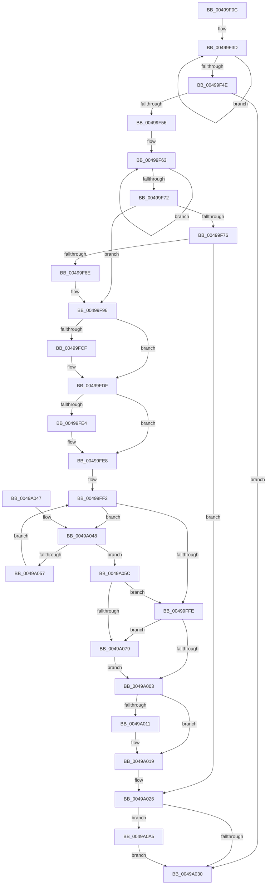

# PoFxPrepareDevice

- RVA: `0x00499F0C`–`0x0049A0C1` (길이 `437` bytes)
- VA: `0x0000000140499F0C`
- 실행 섹션: `.text`
- PDB 이름 있음: `예`; PDB Function 태그: `아니요`
- unwind 정보 RVA: `0x000B46A8`
- 디코드: `112`개 명령, `437/437` bytes 표시
- 미해석 바이트: `0` (있으면 어셈블리에 `.byte`로 보존)

> 이 문서는 커널 이미지의 기계어와 PDB 기호를 분석해 생성했습니다. 4번과 5번은 함수 원형과 자료형을 바이너리 사용 방식에서 추정한 C 해석이며 원본 소스 복구 결과는 아닙니다.

## 1. Dependencies

- 직접 호출 지점: **9**; 고유 호출 대상: **9**
- 직접 호출자로 확인된 함수: **3**
- RIP 상대 이미지 참조: **2**

### Outgoing calls
- `0x00499F7E` → [PopFxFindDeviceAndAllocateUniqueId](../../page/A9/PopFxFindDeviceAndAllocateUniqueId_function_00A90D8C.md) (function, `0x00A90D8C`)
- `0x00499FB6` → [KeAbPreAcquire](../21/KeAbPreAcquire_function_00210230.md) (function, `0x00210230`)
- `0x00499FDA` → [ExfAcquirePushLockSharedEx](../21/ExfAcquirePushLockSharedEx_function_0021044C.md) (function, `0x0021044C`)
- `0x0049A014` → [ExfReleasePushLockShared](../26/ExfReleasePushLockShared_function_00263440.md) (function, `0x00263440`)
- `0x0049A01C` → [KeAbPostRelease](../2E/KeAbPostRelease_function_002E1600.md) (function, `0x002E1600`)
- `0x0049A021` → [KeLeaveCriticalRegion](../25/KeLeaveCriticalRegion_function_0025D8B0.md) (function, `0x0025D8B0`)
- `0x0049A04E` → [PopPluginPrepareDevice](PopPluginPrepareDevice_function_0049A0C8.md) (function, `0x0049A0C8`)
- `0x0049A06C` → [PopDiagTraceFxDevicePreparation](../../page/A8/PopDiagTraceFxDevicePreparation_function_00A8AD78.md) (function, `0x00A8AD78`)
- `0x0049A0B7` → [IoReleaseRemoveLockEx](../33/IoReleaseRemoveLockEx_function_0033D330.md) (function, `0x0033D330`)

### Direct callers
- [PnpStartDevice](PnpStartDevice_function_00499E60.md) at `0x00499E95`
- [PiProcessAddBootDevices](../../page/72/PiProcessAddBootDevices_function_0072D434.md) at `0x0072D49D`
- [PipProcessDevNodeTree](../../page/8F/PipProcessDevNodeTree_function_008F9068.md) at `0x008F96C2`

### Static image references
- `0x00499F9F` → RVA `0x00F0E428` (`.data`; read)
- `0x00499FE8` → RVA `0x00F0E410` (`.data`; read)

## 2. Other-region calls and transfers

- 다른 실행 섹션으로 향하는 call: **2**
  - `0x00499F7E` → [PopFxFindDeviceAndAllocateUniqueId](../../page/A9/PopFxFindDeviceAndAllocateUniqueId_function_00A90D8C.md) (`.text` → `PAGE`)
  - `0x0049A06C` → [PopDiagTraceFxDevicePreparation](../../page/A8/PopDiagTraceFxDevicePreparation_function_00A8AD78.md) (`.text` → `PAGE`)
- 별도 외부 분기/꼬리 이동을 확인하지 못했습니다.

## 3. Assembly (complete function range)

```asm
00499F0C  48 89 5C 24 10                  mov qword ptr [rsp + 0x10], rbx
00499F11  48 89 6C 24 20                  mov qword ptr [rsp + 0x20], rbp
00499F16  56                              push rsi
00499F17  57                              push rdi
00499F18  41 54                           push r12
00499F1A  41 56                           push r14
00499F1C  41 57                           push r15
00499F1E  48 83 EC 20                     sub rsp, 0x20
00499F22  45 33 F6                        xor r14d, r14d
00499F25  40 8A EA                        mov bpl, dl
00499F28  4C 89 74 24 50                  mov qword ptr [rsp + 0x50], r14
00499F2D  48 8B D9                        mov rbx, rcx
00499F30  0F 0D 89 28 01 00 00            prefetchw byte ptr [rcx + 0x128]
00499F37  8B 81 28 01 00 00               mov eax, dword ptr [rcx + 0x128]
00499F3D  44 8B C0                        mov r8d, eax
00499F40  45 0B C6                        or r8d, r14d
00499F43  F0 44 0F B1 81 28 01 00 00      lock cmpxchg dword ptr [rcx + 0x128], r8d
00499F4C  75 EF                           jne 0x140499f3d
00499F4E  A8 01                           test al, 1
00499F50  0F 85 DA 00 00 00               jne 0x14049a030
00499F56  0F 0D 89 28 01 00 00            prefetchw byte ptr [rcx + 0x128]
00499F5D  8B 81 28 01 00 00               mov eax, dword ptr [rcx + 0x128]
00499F63  8B C8                           mov ecx, eax
00499F65  41 0B CE                        or ecx, r14d
00499F68  F0 0F B1 8B 28 01 00 00         lock cmpxchg dword ptr [rbx + 0x128], ecx
00499F70  75 F1                           jne 0x140499f63
00499F72  A8 02                           test al, 2
00499F74  75 20                           jne 0x140499f96
00499F76  48 8D 54 24 50                  lea rdx, [rsp + 0x50]
00499F7B  48 8B CB                        mov rcx, rbx
00499F7E  E8 09 6E 5F 00                  call 0x140a90d8c
00499F83  3D 56 00 00 C0                  cmp eax, 0xc0000056
00499F88  0F 84 98 00 00 00               je 0x14049a026
00499F8E  F0 83 8B 28 01 00 00 02         lock or dword ptr [rbx + 0x128], 2
00499F96  65 48 8B 04 25 88 01 00 00      mov rax, qword ptr gs:[0x188]
00499F9F  4C 8D 3D 82 44 A7 00            lea r15, [rip + 0xa74482]
00499FA6  45 33 C0                        xor r8d, r8d
00499FA9  33 D2                           xor edx, edx
00499FAB  49 8B CF                        mov rcx, r15
00499FAE  66 FF 88 E4 01 00 00            dec word ptr [rax + 0x1e4]
00499FB5  90                              nop
00499FB6  E8 75 62 D7 FF                  call 0x140210230
00499FBB  48 8B F8                        mov rdi, rax
00499FBE  33 C0                           xor eax, eax
00499FC0  44 8D 60 11                     lea r12d, [rax + 0x11]
00499FC4  F0 4C 0F B1 25 5B 44 A7 00      lock cmpxchg qword ptr [rip + 0xa7445b], r12
00499FCD  74 10                           je 0x140499fdf
00499FCF  4D 8B CF                        mov r9, r15
00499FD2  4C 8B C7                        mov r8, rdi
00499FD5  33 D2                           xor edx, edx
00499FD7  49 8B CF                        mov rcx, r15
00499FDA  E8 6D 64 D7 FF                  call 0x14021044c
00499FDF  48 85 FF                        test rdi, rdi
00499FE2  74 04                           je 0x140499fe8
00499FE4  C6 47 0A 01                     mov byte ptr [rdi + 0xa], 1
00499FE8  48 8B 3D 21 44 A7 00            mov rdi, qword ptr [rip + 0xa74421]
00499FEF  49 8B F6                        mov rsi, r14
00499FF2  48 8D 05 17 44 A7 00            lea rax, [rip + 0xa74417]
00499FF9  48 3B F8                        cmp rdi, rax
00499FFC  75 4A                           jne 0x14049a048
00499FFE  40 84 ED                        test bpl, bpl
0049A001  75 76                           jne 0x14049a079
0049A003  49 8B C4                        mov rax, r12
0049A006  F0 4C 0F B1 35 19 44 A7 00      lock cmpxchg qword ptr [rip + 0xa74419], r14
0049A00F  74 08                           je 0x14049a019
0049A011  49 8B CF                        mov rcx, r15
0049A014  E8 27 94 DC FF                  call 0x140263440
0049A019  49 8B CF                        mov rcx, r15
0049A01C  E8 DF 75 E4 FF                  call 0x1402e1600
0049A021  E8 8A 38 DC FF                  call 0x14025d8b0
0049A026  48 8B 4C 24 50                  mov rcx, qword ptr [rsp + 0x50]
0049A02B  48 85 C9                        test rcx, rcx
0049A02E  75 75                           jne 0x14049a0a5
0049A030  48 8B 5C 24 58                  mov rbx, qword ptr [rsp + 0x58]
0049A035  48 8B 6C 24 68                  mov rbp, qword ptr [rsp + 0x68]
0049A03A  48 83 C4 20                     add rsp, 0x20
0049A03E  41 5F                           pop r15
0049A040  41 5E                           pop r14
0049A042  41 5C                           pop r12
0049A044  5F                              pop rdi
0049A045  5E                              pop rsi
0049A046  C3                              ret
0049A047  CC                              int3
0049A048  48 8B D3                        mov rdx, rbx
0049A04B  48 8B CF                        mov rcx, rdi
0049A04E  E8 75 00 00 00                  call 0x14049a0c8
0049A053  84 C0                           test al, al
0049A055  75 05                           jne 0x14049a05c
0049A057  48 8B 3F                        mov rdi, qword ptr [rdi]
0049A05A  EB 96                           jmp 0x140499ff2
0049A05C  4C 8D 83 80 00 00 00            lea r8, [rbx + 0x80]
0049A063  41 B1 01                        mov r9b, 1
0049A066  48 8B D7                        mov rdx, rdi
0049A069  48 8B CB                        mov rcx, rbx
0049A06C  E8 07 0D 5F 00                  call 0x140a8ad78
0049A071  48 8B F7                        mov rsi, rdi
0049A074  48 85 FF                        test rdi, rdi
0049A077  74 85                           je 0x140499ffe
0049A079  48 89 B3 90 00 00 00            mov qword ptr [rbx + 0x90], rsi
0049A080  F0 83 8B 28 01 00 00 01         lock or dword ptr [rbx + 0x128], 1
0049A088  48 8D 53 68                     lea rdx, [rbx + 0x68]
0049A08C  66 44 89 73 60                  mov word ptr [rbx + 0x60], r14w
0049A091  C6 43 62 06                     mov byte ptr [rbx + 0x62], 6
0049A095  44 89 73 64                     mov dword ptr [rbx + 0x64], r14d
0049A099  48 89 52 08                     mov qword ptr [rdx + 8], rdx
0049A09D  48 89 12                        mov qword ptr [rdx], rdx
0049A0A0  E9 5E FF FF FF                  jmp 0x14049a003
0049A0A5  48 81 C1 38 01 00 00            add rcx, 0x138
0049A0AC  BA 50 6F 46 66                  mov edx, 0x66466f50
0049A0B1  41 B8 20 00 00 00               mov r8d, 0x20
0049A0B7  E8 74 32 EA FF                  call 0x14033d330
0049A0BC  E9 6F FF FF FF                  jmp 0x14049a030
```

## 4. C-style interpretation (structured pseudocode)

```c
__int64 __fastcall PoFxPrepareDevice(__int64 a1, unsigned __int8 a2)
{
    __int64 result;
    __int64 v_r14;
    __int64 v_rsp;
    unsigned __int64 v_stack_p10;
    unsigned __int64 v_stack_p20;
    unsigned __int64 v_stack_p8;

    v_stack_p10 = v_rbx;
    v_stack_p20 = v_rbp;
    v_rsp = (v_rsp) - (32);
    v_r14 = 0;
    v_stack_p8 = 0;
loc_00499F3D:
    a3 = (unsigned int)(((unsigned int)((unsigned int)((unsigned int)(*(unsigned int *)(a1 + 296))))) | (0));
    if (condition_is_not_equal) goto loc_00499F3D;
    if ((((unsigned __int8)((unsigned int)(*(unsigned int *)(a1 + 296)))) & (1)) != 0) goto loc_0049A030;
loc_00499F63:
    a1 = (unsigned int)(((unsigned int)((unsigned int)((unsigned int)(*(unsigned int *)(a1 + 296))))) | (0));
    if (condition_is_not_equal) goto loc_00499F63;
    if ((((unsigned __int8)((unsigned int)(*(unsigned int *)(a1 + 296)))) & (2)) != 0) goto loc_00499F96;
    result = PopFxFindDeviceAndAllocateUniqueId(a1, v_stack_p8, a3, a4);
    if (((unsigned int)(result)) == 0xC0000056ULL) goto loc_0049A026;
loc_00499F96:
    a3 = 0;
    a2 = 0;
    result = KeAbPreAcquire(v_rip + 10962050, a2, a3, a4);
    result = 0;
    if (!(condition_is_equal)) {
        a4 = v_rip + 10962050;
        a3 = 0;
        a2 = 0;
        a1 = v_rip + 10962050;
        result = ExfAcquirePushLockSharedEx(a1, a2, a3, a4);
    }
    if (result != 0) {
        *(unsigned __int8 *)(result + 10) = 1;
    }
loc_00499FF2:
    if ((*(unsigned __int64 *)(v_rip + 10961953)) != (v_rip + 10961943)) goto loc_0049A048;
loc_00499FFE:
    if (0 != 0) goto loc_0049A079;
loc_0049A003:
    result = result + 17;
    if (0 != 0) {
        a1 = v_rip + 10962050;
        result = ExfReleasePushLockShared(a1, a2, a3, a4);
    }
    result = KeAbPostRelease(v_rip + 10962050, a2, a3, a4);
    result = KeLeaveCriticalRegion(v_rip + 10962050, a2, a3, a4);
loc_0049A026:
    if (v_stack_p8 != 0) goto loc_0049A0A5;
loc_0049A030:
    v_rsp = (v_rsp) + (32);
    return result;
loc_0049A048:
    result = PopPluginPrepareDevice(*(unsigned __int64 *)(v_rip + 10961953), v_stack_p10, a3, a4);
    if ((unsigned __int8)(result) != 0) goto loc_0049A05C;
    goto loc_00499FF2;
loc_0049A05C:
    result = PopDiagTraceFxDevicePreparation(v_stack_p10, *(unsigned __int64 *)(*(unsigned __int64 *)(v_rip + 10961953)), v_stack_p10 + 128, 1);
    if (*(unsigned __int64 *)(*(unsigned __int64 *)(v_rip + 10961953)) == 0) goto loc_00499FFE;
loc_0049A079:
    *(unsigned __int64 *)(v_stack_p10 + 144) = *(unsigned __int64 *)(*(unsigned __int64 *)(v_rip + 10961953));
    *(unsigned __int16 *)(v_stack_p10 + 96) = 0;
    *(unsigned __int8 *)(v_stack_p10 + 98) = 6;
    *(unsigned int *)(v_stack_p10 + 100) = 0;
    *(unsigned __int64 *)(v_stack_p10 + 104 + 8) = v_stack_p10 + 104;
    *(unsigned __int64 *)(v_stack_p10 + 104) = v_stack_p10 + 104;
    goto loc_0049A003;
loc_0049A0A5:
    a1 = (v_stack_p10) + (312);
    result = IoReleaseRemoveLockEx(a1, (unsigned int)(0x66466F50ULL), 32, 1);
    goto loc_0049A030;
}
```

## 5. (Beta) C Style

```c
int64_t PoFxPrepareDevice(void *Arg1, uint8_t Arg2)
{
    uint8_t *arg1 = (uint8_t *)Arg1;

    int64_t result;
    int64_t local_r14;
    int64_t local_rsp;
    uint64_t v_stack_p10;
    uint64_t v_stack_p20;
    uint64_t v_stack_p8;

    v_stack_p10 = local_rbx;
    v_stack_p20 = local_rbp;
    local_rsp = (local_rsp) - (32);
    local_r14 = 0;
    v_stack_p8 = 0;
loc_00499F3D:
    a3 = (uint32_t)(((uint32_t)((uint32_t)((uint32_t)(*(uint32_t *)(arg1 + 0x128))))) | (0));
    if (condition_is_not_equal) goto loc_00499F3D;
    if ((((uint8_t)((uint32_t)(*(uint32_t *)(arg1 + 0x128)))) & (1)) != 0) goto loc_0049A030;
loc_00499F63:
    Arg1 = (uint32_t)(((uint32_t)((uint32_t)((uint32_t)(*(uint32_t *)(arg1 + 0x128))))) | (0));
    if (condition_is_not_equal) goto loc_00499F63;
    if ((((uint8_t)((uint32_t)(*(uint32_t *)(arg1 + 0x128)))) & (2)) != 0) goto loc_00499F96;
    result = PopFxFindDeviceAndAllocateUniqueId(Arg1, v_stack_p8, a3, a4);
    if (((uint32_t)(result)) == 0xC0000056ULL) goto loc_0049A026;
loc_00499F96:
    a3 = 0;
    Arg2 = 0;
    result = KeAbPreAcquire(v_rip + 10962050, Arg2, a3, a4);
    result = 0;
    if (!(condition_is_equal)) {
        a4 = v_rip + 10962050;
        a3 = 0;
        Arg2 = 0;
        Arg1 = v_rip + 10962050;
        result = ExfAcquirePushLockSharedEx(Arg1, Arg2, a3, a4);
    }
    if (result != 0) {
        *(uint8_t *)(result + 0xA) = 1;
    }
loc_00499FF2:
    if ((*(uint64_t *)(v_rip + 0xA74421)) != (v_rip + 10961943)) goto loc_0049A048;
loc_00499FFE:
    if (0 != 0) goto loc_0049A079;
loc_0049A003:
    result = result + 17;
    if (0 != 0) {
        Arg1 = v_rip + 10962050;
        result = ExfReleasePushLockShared(Arg1, Arg2, a3, a4);
    }
    result = KeAbPostRelease(v_rip + 10962050, Arg2, a3, a4);
    result = KeLeaveCriticalRegion(v_rip + 10962050, Arg2, a3, a4);
loc_0049A026:
    if (v_stack_p8 != 0) goto loc_0049A0A5;
loc_0049A030:
    local_rsp = (local_rsp) + (32);
    return result;
loc_0049A048:
    result = PopPluginPrepareDevice(*(uint64_t *)(v_rip + 0xA74421), v_stack_p10, a3, a4);
    if ((uint8_t)(result) != 0) goto loc_0049A05C;
    goto loc_00499FF2;
loc_0049A05C:
    result = PopDiagTraceFxDevicePreparation(v_stack_p10, *(uint64_t *)(*(uint64_t *)(v_rip + 0xA74421)), v_stack_p10 + 128, 1);
    if (*(uint64_t *)(*(uint64_t *)(v_rip + 0xA74421)) == 0) goto loc_00499FFE;
loc_0049A079:
    *(uint64_t *)(v_stack_p10 + 0x90) = *(uint64_t *)(*(uint64_t *)(v_rip + 0xA74421));
    *(uint16_t *)(v_stack_p10 + 0x60) = 0;
    *(uint8_t *)(v_stack_p10 + 0x62) = 6;
    *(uint32_t *)(v_stack_p10 + 0x64) = 0;
    *(uint64_t *)(v_stack_p10 + 0x68 + 0x8) = v_stack_p10 + 104;
    *(uint64_t *)(v_stack_p10 + 0x68) = v_stack_p10 + 104;
    goto loc_0049A003;
loc_0049A0A5:
    Arg1 = (v_stack_p10) + (312);
    result = IoReleaseRemoveLockEx(Arg1, (uint32_t)(0x66466F50ULL), 32, 1);
    goto loc_0049A030;
}
```

### 관측된 메모리 오프셋

구조체 형식이 확인되지 않은 접근은 인자 기준의 오프셋으로만 기록했습니다.

| 기준 인자 | 오프셋 표현 | 폭 (bit) | 접근 |
|---|---:|---:|---|
| `Arg1` | `+ 0x0` | `64` | `W` |
| `Arg1` | `+ 0x8` | `64` | `W` |
| `Arg1` | `+ 0x60` | `16` | `W` |
| `Arg1` | `+ 0x62` | `8` | `W` |
| `Arg1` | `+ 0x64` | `32` | `W` |
| `Arg1` | `+ 0x68` | `64` | `R` |
| `Arg1` | `+ 0x80` | `64` | `R` |
| `Arg1` | `+ 0x90` | `64` | `W` |
| `Arg1` | `+ 0x128` | `8` | `R` |
| `Arg1` | `+ 0x128` | `32` | `R` |
| `Arg1` | `+ 0x128` | `32` | `R/W` |

## 6. Execution-region graph

[열기: 2D/3D 그래프와 함수 탐색 컨트롤 패널](../../../control-panel.html?section=text&rva=0x00499F0C&view=graph)

- 2D 그래프는 위에서 아래로 흐르고, 3D 그래프는 빈 공간을 드래그해 회전합니다. Shift+드래그는 이동, 휠은 확대·축소, 함수 노드 선택은 대상 보고서 이동입니다.

### Static fallback


