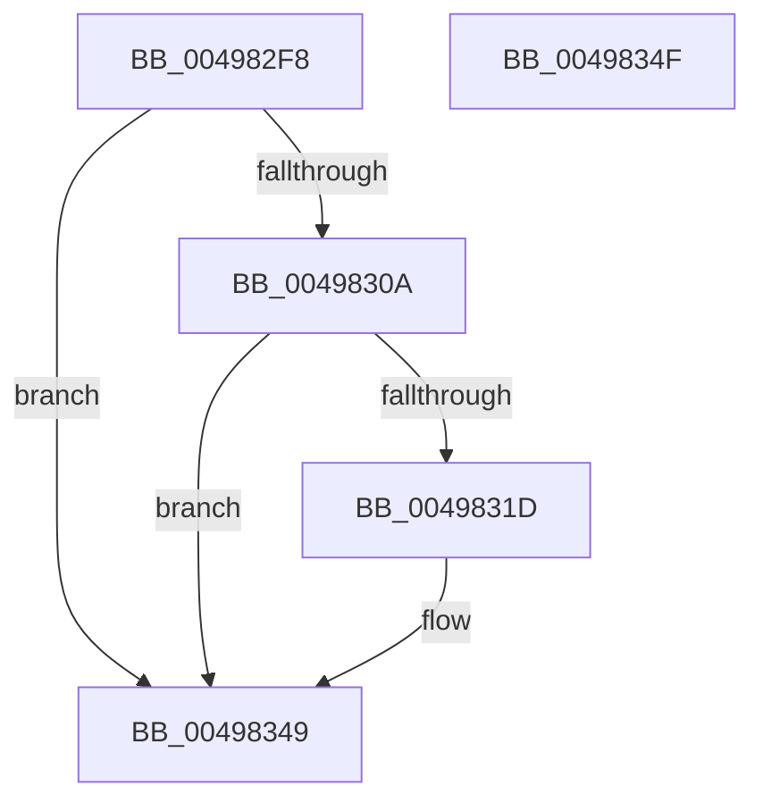

# PopDiagTraceEventNoPayload

- RVA: `0x004982F8`–`0x00498350` (길이 `88` bytes)
- VA: `0x00000001404982F8`
- 실행 섹션: `.text`
- PDB 이름 있음: `예`; PDB Function 태그: `아니요`
- unwind 정보 RVA: `0x000697A4`
- 디코드: `23`개 명령, `88/88` bytes 표시
- 미해석 바이트: `0` (있으면 어셈블리에 `.byte`로 보존)

> 이 문서는 커널 이미지의 기계어와 PDB 기호를 분석해 생성했습니다. 4번과 5번은 함수 원형과 자료형을 바이너리 사용 방식에서 추정한 C 해석이며 원본 소스 복구 결과는 아닙니다.

## 1. Dependencies

- 직접 호출 지점: **2**; 고유 호출 대상: **2**
- 직접 호출자로 확인된 함수: **26**
- RIP 상대 이미지 참조: **2**

### Outgoing calls
- `0x00498314` → [EtwEventEnabled](../39/EtwEventEnabled_function_00392450.md) (function, `0x00392450`)
- `0x00498344` → [EtwWriteEx](../25/EtwWriteEx_function_0025F0D0.md) (function, `0x0025F0D0`)

### Direct callers
- [PopScanIdleList](PopScanIdleList_function_00497F04.md) at `0x00497FE1`
- [PopScanIdleList](PopScanIdleList_function_00497F04.md) at `0x00498178`
- [PopThermalStandbyNotify](../5D/PopThermalStandbyNotify_function_005D55A0.md) at `0x005D55B7`
- [PopDiagTracePrepareSleepEnd](../../page/70/PopDiagTracePrepareSleepEnd_function_00705564.md) at `0x0070556F`
- [PopCoalescingNotify](../../page/75/PopCoalescingNotify_function_0075C0E0.md) at `0x0075C122`
- [PopResumeApps](../../page/75/PopResumeApps_function_0075EBFC.md) at `0x0075EC28`
- [PopResumeApps](../../page/75/PopResumeApps_function_0075EBFC.md) at `0x0075EC56`
- [PopSetSystemAwayMode](../../page/75/PopSetSystemAwayMode_function_0075EF00.md) at `0x0075EFC9`
- [PopSuspendApps](../../page/75/PopSuspendApps_function_0075F008.md) at `0x0075F018`
- [PopSuspendApps](../../page/75/PopSuspendApps_function_0075F008.md) at `0x0075F03F`
- [PopSuspendServices](../../page/75/PopSuspendServices_function_0075F05C.md) at `0x0075F074`
- [PopSuspendServices](../../page/75/PopSuspendServices_function_0075F05C.md) at `0x0075F09E`
- [PopDiagTraceDevicesWakeEnd](../../page/76/PopDiagTraceDevicesWakeEnd_function_007610B4.md) at `0x007610BF`
- [PopDiagTraceSuspendResumeNotification](../../page/76/PopDiagTraceSuspendResumeNotification_function_0076361C.md) at `0x00763671`
- [PopResumeServices](../../page/91/PopResumeServices_function_00912410.md) at `0x0091243D`
- [PopResumeServices](../../page/91/PopResumeServices_function_00912410.md) at `0x0091246E`
- [PopPowerInformationInternal](../../page/A8/PopPowerInformationInternal_function_00A8B7C0.md) at `0x00A8BF06`
- [PopDiagTraceIoCoalescingOff](../../page/AC/PopDiagTraceIoCoalescingOff_function_00AC0D50.md) at `0x00AC0D6C`
- [PopDispatchSuperfetchNotification](../../page/AC/PopDispatchSuperfetchNotification_function_00AC3FD8.md) at `0x00AC3FEE`
- [PopDispatchSuperfetchNotification](../../page/AC/PopDispatchSuperfetchNotification_function_00AC3FD8.md) at `0x00AC4019`
- [PopNotifyCallbacksPreSleep](../../page/AD/PopNotifyCallbacksPreSleep_function_00AD3440.md) at `0x00AD3455`
- [PopNotifyCallbacksPreSleep](../../page/AD/PopNotifyCallbacksPreSleep_function_00AD3440.md) at `0x00AD3474`
- [PopDiagTracePrepareSleep](../../page/AD/PopDiagTracePrepareSleep_function_00AD9658.md) at `0x00AD9663`
- [PopDiagTraceFlushSleepStudyLogger](../../pagelk/B5/PopDiagTraceFlushSleepStudyLogger_function_00B5B380.md) at `0x00B5B38B`
- [PopGracefulShutdown](../../pagelk/B6/PopGracefulShutdown_function_00B6BEC8.md) at `0x00B6BF00`
- [PopGracefulShutdown](../../pagelk/B6/PopGracefulShutdown_function_00B6BEC8.md) at `0x00B6BF11`
- [PopGracefulShutdown](../../pagelk/B6/PopGracefulShutdown_function_00B6BEC8.md) at `0x00B6C01E`
- [PopGracefulShutdown](../../pagelk/B6/PopGracefulShutdown_function_00B6BEC8.md) at `0x00B6C031`
- [PopGracefulShutdown](../../pagelk/B6/PopGracefulShutdown_function_00B6BEC8.md) at `0x00B6C046`
- [PopGracefulShutdown](../../pagelk/B6/PopGracefulShutdown_function_00B6BEC8.md) at `0x00B6C057`
- [PopGracefulShutdown](../../pagelk/B6/PopGracefulShutdown_function_00B6BEC8.md) at `0x00B6C074`
- [PopGracefulShutdown](../../pagelk/B6/PopGracefulShutdown_function_00B6BEC8.md) at `0x00B6C096`
- [PopGracefulShutdown](../../pagelk/B6/PopGracefulShutdown_function_00B6BEC8.md) at `0x00B6C101`
- [PopGracefulShutdown](../../pagelk/B6/PopGracefulShutdown_function_00B6BEC8.md) at `0x00B6C117`
- [PopDiagTraceGracefulShutdown](../../pagelk/B7/PopDiagTraceGracefulShutdown_function_00B71334.md) at `0x00B71347`
- [PopDiagTraceZeroHiberFile](../../pagelk/B7/PopDiagTraceZeroHiberFile_function_00B714D0.md) at `0x00B714DB`
- [PopDiagTraceZeroHiberFileEnd](../../pagelk/B7/PopDiagTraceZeroHiberFileEnd_function_00B714EC.md) at `0x00B714F7`
- [PoBroadcastSystemState](../../pagelk/B7/PoBroadcastSystemState_function_00B761B0.md) at `0x00B762F6`
- [PoBroadcastSystemState](../../pagelk/B7/PoBroadcastSystemState_function_00B761B0.md) at `0x00B76586`
- [PopBuildDeviceNotifyList](../../pagelk/B7/PopBuildDeviceNotifyList_function_00B789E8.md) at `0x00B78A7D`
- [PopBuildDeviceNotifyList](../../pagelk/B7/PopBuildDeviceNotifyList_function_00B789E8.md) at `0x00B78A93`
- [PopFlushVolumes](../../pagelk/B7/PopFlushVolumes_function_00B7B938.md) at `0x00B7B97A`
- [PopFlushVolumes](../../pagelk/B7/PopFlushVolumes_function_00B7B938.md) at `0x00B7BA4F`
- [PopDiagTraceFlushSleepStudyLoggerEnd](../../pagelk/B7/PopDiagTraceFlushSleepStudyLoggerEnd_function_00B7D904.md) at `0x00B7D90F`
- [sub_00B8053E](../../pagelk/B8/Unknown_function_00B8053E.md) at `0x00B80606`
- [sub_00B8053E](../../pagelk/B8/Unknown_function_00B8053E.md) at `0x00B80622`

### Static image references
- `0x004982FE` → RVA `0x00E67858` (`.data`; read)
- `0x0049830D` → RVA `0x00F0B408` (`.data`; read)

## 2. Other-region calls and transfers

- 다른 실행 섹션으로 향하는 call: **0**
- 별도 외부 분기/꼬리 이동을 확인하지 못했습니다.

## 3. Assembly (complete function range)

```asm
004982F8  40 53                           push rbx
004982FA  48 83 EC 40                     sub rsp, 0x40
004982FE  80 3D 53 F5 9C 00 00            cmp byte ptr [rip + 0x9cf553], 0
00498305  48 8B D9                        mov rbx, rcx
00498308  74 3F                           je 0x140498349
0049830A  48 8B D1                        mov rdx, rcx
0049830D  48 8B 0D F4 30 A7 00            mov rcx, qword ptr [rip + 0xa730f4]
00498314  E8 37 A1 EF FF                  call 0x140392450
00498319  84 C0                           test al, al
0049831B  74 2C                           je 0x140498349
0049831D  48 83 64 24 38 00               and qword ptr [rsp + 0x38], 0
00498323  45 33 C9                        xor r9d, r9d
00498326  83 64 24 30 00                  and dword ptr [rsp + 0x30], 0
0049832B  45 33 C0                        xor r8d, r8d
0049832E  48 83 64 24 28 00               and qword ptr [rsp + 0x28], 0
00498334  48 8B D3                        mov rdx, rbx
00498337  48 83 64 24 20 00               and qword ptr [rsp + 0x20], 0
0049833D  48 8B 0D C4 30 A7 00            mov rcx, qword ptr [rip + 0xa730c4]
00498344  E8 87 6D DC FF                  call 0x14025f0d0
00498349  48 83 C4 40                     add rsp, 0x40
0049834D  5B                              pop rbx
0049834E  C3                              ret
0049834F  CC                              int3
```

## 4. C-style interpretation (structured pseudocode)

```c
__int64 __fastcall PopDiagTraceEventNoPayload(__int64 a1, __int64 a2, int a3, int a4)
{
    __int64 result;
    __int64 v_rsp;
    unsigned __int64 v_stack_m10;
    unsigned int v_stack_m18;
    unsigned __int64 v_stack_m20;
    unsigned __int64 v_stack_m28;

    v_rsp = (v_rsp) - (64);
    if ((*(unsigned __int8 *)(v_rip + 10286419)) == 0) goto loc_00498349;
    result = EtwEventEnabled(*(unsigned __int64 *)(v_rip + 10957044), a1, a3, a4);
    if ((unsigned __int8)(result) != 0) {
        a4 = 0;
        a3 = 0;
        a2 = a1;
        a1 = *(unsigned __int64 *)(v_rip + 10956996);
        result = EtwWriteEx(a1, a2, a3, a4);
    }
    v_rsp = (v_rsp) + (64);
    return result;
}
```

## 5. (Beta) C Style

```c
int64_t PopDiagTraceEventNoPayload(int64_t Arg1, int64_t Arg2, int32_t Arg3, int32_t Arg4)
{
    int64_t result;
    int64_t local_rsp;
    uint64_t v_stack_m10;
    uint32_t v_stack_m18;
    uint64_t v_stack_m20;
    uint64_t v_stack_m28;

    local_rsp = (local_rsp) - (64);
    if ((*(uint8_t *)(v_rip + 0x9CF553)) == 0) goto loc_00498349;
    result = EtwEventEnabled(*(uint64_t *)(v_rip + 0xA730F4), Arg1, Arg3, Arg4);
    if ((uint8_t)(result) != 0) {
        Arg4 = 0;
        Arg3 = 0;
        Arg2 = Arg1;
        Arg1 = *(uint64_t *)(v_rip + 0xA730C4);
        result = EtwWriteEx(Arg1, Arg2, Arg3, Arg4);
    }
    local_rsp = (local_rsp) + (64);
    return result;
}
```

## 6. Execution-region graph

[열기: 2D/3D 그래프와 함수 탐색 컨트롤 패널](../../../control-panel.html?section=text&rva=0x004982F8&view=graph)

- 2D 그래프는 위에서 아래로 흐르고, 3D 그래프는 빈 공간을 드래그해 회전합니다. Shift+드래그는 이동, 휠은 확대·축소, 함수 노드 선택은 대상 보고서 이동입니다.

### Static fallback


