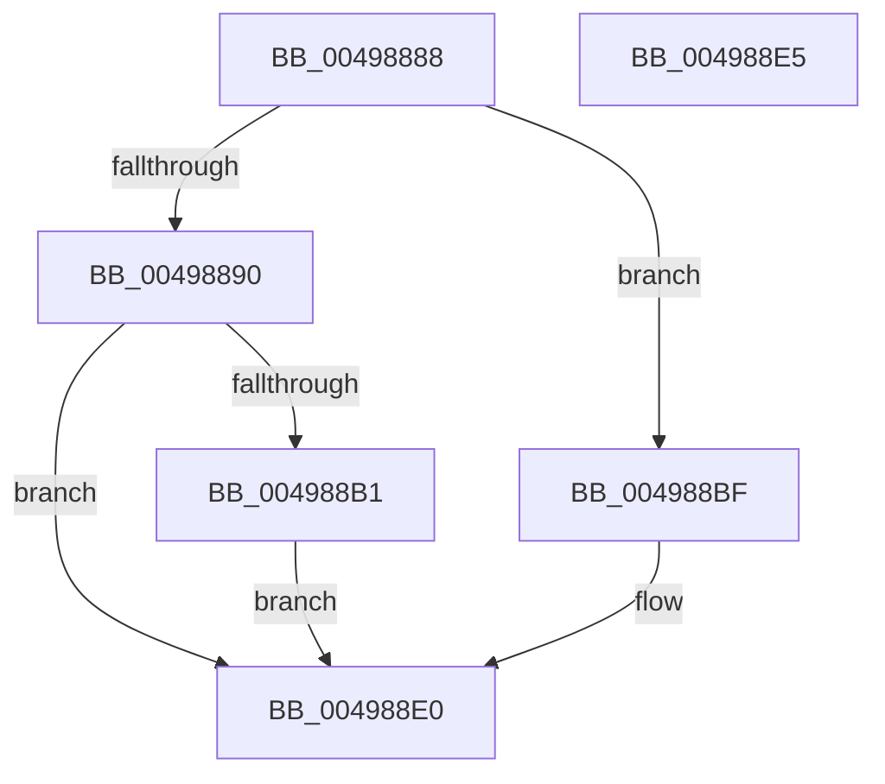

# PopDirectedDripsEngage

- RVA: `0x00498888`–`0x004988E6` (길이 `94` bytes)
- VA: `0x0000000140498888`
- 실행 섹션: `.text`
- PDB 이름 있음: `예`; PDB Function 태그: `아니요`
- unwind 정보 RVA: `0x0005C788`
- 디코드: `20`개 명령, `94/94` bytes 표시
- 미해석 바이트: `0` (있으면 어셈블리에 `.byte`로 보존)

> 이 문서는 커널 이미지의 기계어와 PDB 기호를 분석해 생성했습니다. 4번과 5번은 함수 원형과 자료형을 바이너리 사용 방식에서 추정한 C 해석이며 원본 소스 복구 결과는 아닙니다.

## 1. Dependencies

- 직접 호출 지점: **3**; 고유 호출 대상: **3**
- 직접 호출자로 확인된 함수: **1**
- RIP 상대 이미지 참조: **5**

### Outgoing calls
- `0x00498890` → [PopFxClearDirectedDripsCandidateDeviceList](PopFxClearDirectedDripsCandidateDeviceList_function_004988EC.md) (function, `0x004988EC`)
- `0x004988B8` → [PopDirectedDripsQueryEnabledMitigations](../../page/75/PopDirectedDripsQueryEnabledMitigations_function_00757A84.md) (function, `0x00757A84`)
- `0x004988DB` → [PopDirectedDripsNotifyAppsAndServices](../../page/75/PopDirectedDripsNotifyAppsAndServices_function_0075792C.md) (function, `0x0075792C`)

### Direct callers
- [PopDirectedDripsNotify](../../page/A8/PopDirectedDripsNotify_function_00A80850.md) at `0x00A80938`

### Static image references
- `0x00498895` → RVA `0x00F0ECF0` (`.data`; read/write)
- `0x0049889C` → RVA `0x00F0EAC0` (`.data`; read/write)
- `0x004988A7` → RVA `0x00F0EAF0` (`.data`; read)
- `0x004988B1` → RVA `0x00F0EAC0` (`.data`; read)
- `0x004988CD` → RVA `0x00F0EAF8` (`.data`; read)

## 2. Other-region calls and transfers

- 다른 실행 섹션으로 향하는 call: **2**
  - `0x004988B8` → [PopDirectedDripsQueryEnabledMitigations](../../page/75/PopDirectedDripsQueryEnabledMitigations_function_00757A84.md) (`.text` → `PAGE`)
  - `0x004988DB` → [PopDirectedDripsNotifyAppsAndServices](../../page/75/PopDirectedDripsNotifyAppsAndServices_function_0075792C.md) (`.text` → `PAGE`)
- 별도 외부 분기/꼬리 이동을 확인하지 못했습니다.

## 3. Assembly (complete function range)

```asm
00498888  48 83 EC 28                     sub rsp, 0x28
0049888C  84 D2                           test dl, dl
0049888E  75 2F                           jne 0x1404988bf
00498890  E8 57 00 00 00                  call 0x1404988ec
00498895  83 25 54 64 A7 00 00            and dword ptr [rip + 0xa76454], 0
0049889C  F0 81 25 19 62 A7 00 C7 C1 FF FF  lock and dword ptr [rip + 0xa76219], 0xffffc1c7
004988A7  8B 05 43 62 A7 00               mov eax, dword ptr [rip + 0xa76243]
004988AD  A8 04                           test al, 4
004988AF  74 2F                           je 0x1404988e0
004988B1  48 8D 0D 08 62 A7 00            lea rcx, [rip + 0xa76208]
004988B8  E8 C7 F1 2B 00                  call 0x140757a84
004988BD  EB 21                           jmp 0x1404988e0
004988BF  F0 81 0D F6 61 A7 00 00 0A 00 00  lock or dword ptr [rip + 0xa761f6], 0xa00
004988CA  41 B0 01                        mov r8b, 1
004988CD  48 8D 15 24 62 A7 00            lea rdx, [rip + 0xa76224]
004988D4  48 8D 0D E5 61 A7 00            lea rcx, [rip + 0xa761e5]
004988DB  E8 4C F0 2B 00                  call 0x14075792c
004988E0  48 83 C4 28                     add rsp, 0x28
004988E4  C3                              ret
004988E5  CC                              int3
```

## 4. C-style interpretation (structured pseudocode)

```c
__int64 __fastcall PopDirectedDripsEngage(__int64 a1, unsigned __int8 a2)
{
    __int64 result;
    __int64 v_rsp;

    v_rsp = (v_rsp) - (40);
    if (a2 != 0) goto loc_004988BF;
    result = PopFxClearDirectedDripsCandidateDeviceList(a1, a2, a3, a4);
    if ((((unsigned __int8)((unsigned int)(*(unsigned int *)(v_rip + 10969667)))) & (4)) == 0) goto loc_004988E0;
    result = PopDirectedDripsQueryEnabledMitigations(v_rip + 10969608, a2, a3, a4);
    goto loc_004988E0;
loc_004988BF:
    result = PopDirectedDripsNotifyAppsAndServices(v_rip + 10969573, v_rip + 10969636, 1, a4);
loc_004988E0:
    v_rsp = (v_rsp) + (40);
    return result;
}
```

## 5. (Beta) C Style

```c
int64_t PopDirectedDripsEngage(int64_t Arg1, uint8_t Arg2)
{
    int64_t result;
    int64_t local_rsp;

    local_rsp = (local_rsp) - (40);
    if (Arg2 != 0) goto loc_004988BF;
    result = PopFxClearDirectedDripsCandidateDeviceList(Arg1, Arg2, a3, a4);
    if ((((uint8_t)((uint32_t)(*(uint32_t *)(v_rip + 0xA76243)))) & (4)) == 0) goto loc_004988E0;
    result = PopDirectedDripsQueryEnabledMitigations(v_rip + 10969608, Arg2, a3, a4);
    goto loc_004988E0;
loc_004988BF:
    result = PopDirectedDripsNotifyAppsAndServices(v_rip + 10969573, v_rip + 10969636, 1, a4);
loc_004988E0:
    local_rsp = (local_rsp) + (40);
    return result;
}
```

## 6. Execution-region graph

[열기: 2D/3D 그래프와 함수 탐색 컨트롤 패널](../../../control-panel.html?section=text&rva=0x00498888&view=graph)

- 2D 그래프는 위에서 아래로 흐르고, 3D 그래프는 빈 공간을 드래그해 회전합니다. Shift+드래그는 이동, 휠은 확대·축소, 함수 노드 선택은 대상 보고서 이동입니다.

### Static fallback


