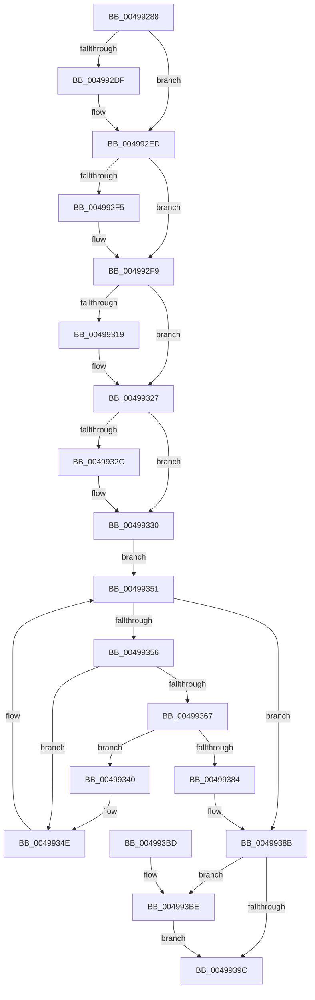

# PopFxBuildDirectedDripsCandidateDeviceList

- RVA: `0x00499288`–`0x004993C8` (길이 `320` bytes)
- VA: `0x0000000140499288`
- 실행 섹션: `.text`
- PDB 이름 있음: `예`; PDB Function 태그: `아니요`
- unwind 정보 RVA: `0x000B4420`
- 디코드: `86`개 명령, `320/320` bytes 표시
- 미해석 바이트: `0` (있으면 어셈블리에 `.byte`로 보존)

> 이 문서는 커널 이미지의 기계어와 PDB 기호를 분석해 생성했습니다. 4번과 5번은 함수 원형과 자료형을 바이너리 사용 방식에서 추정한 C 해석이며 원본 소스 복구 결과는 아닙니다.

## 1. Dependencies

- 직접 호출 지점: **7**; 고유 호출 대상: **5**
- 직접 호출자로 확인된 함수: **1**
- RIP 상대 이미지 참조: **4**

### Outgoing calls
- `0x004992CE` → [KeAbPreAcquire](../21/KeAbPreAcquire_function_00210230.md) (function, `0x00210230`)
- `0x004992E8` → [ExfAcquirePushLockExclusiveEx](../20/ExfAcquirePushLockExclusiveEx_function_0020FC90.md) (function, `0x0020FC90`)
- `0x00499308` → [KeAbPreAcquire](../21/KeAbPreAcquire_function_00210230.md) (function, `0x00210230`)
- `0x00499322` → [ExfAcquirePushLockExclusiveEx](../20/ExfAcquirePushLockExclusiveEx_function_0020FC90.md) (function, `0x0020FC90`)
- `0x0049936F` → [PopFxReferenceDevice](../2B/PopFxReferenceDevice_function_002BFD9C.md) (function, `0x002BFD9C`)
- `0x0049939F` → [KeAbPostRelease](../2E/KeAbPostRelease_function_002E1600.md) (function, `0x002E1600`)
- `0x004993C1` → [ExfTryToWakePushLock](../26/ExfTryToWakePushLock_function_00265DD0.md) (function, `0x00265DD0`)

### Direct callers
- [PopDirectedDripsInitializeBroadcast](../../page/A4/PopDirectedDripsInitializeBroadcast_function_00A4D634.md) at `0x00A4D6D6`

### Static image references
- `0x004992A4` → RVA `0x00F0E4C0` (`.data`; read)
- `0x004992F9` → RVA `0x00F0E408` (`.data`; read)
- `0x00499330` → RVA `0x00F0E3F0` (`.data`; read)
- `0x0049938B` → RVA `0x00F0E408` (`.data`; read/write)

## 2. Other-region calls and transfers

- 다른 실행 섹션으로 향하는 call: **0**
- 별도 외부 분기/꼬리 이동을 확인하지 못했습니다.

## 3. Assembly (complete function range)

```asm
00499288  48 89 5C 24 10                  mov qword ptr [rsp + 0x10], rbx
0049928D  48 89 6C 24 18                  mov qword ptr [rsp + 0x18], rbp
00499292  48 89 74 24 20                  mov qword ptr [rsp + 0x20], rsi
00499297  57                              push rdi
00499298  41 54                           push r12
0049929A  41 56                           push r14
0049929C  48 83 EC 20                     sub rsp, 0x20
004992A0  48 89 49 08                     mov qword ptr [rcx + 8], rcx
004992A4  48 8D 2D 15 52 A7 00            lea rbp, [rip + 0xa75215]
004992AB  48 89 09                        mov qword ptr [rcx], rcx
004992AE  48 8B F1                        mov rsi, rcx
004992B1  65 48 8B 04 25 88 01 00 00      mov rax, qword ptr gs:[0x188]
004992BA  48 83 CB FF                     or rbx, 0xffffffffffffffff
004992BE  45 33 C0                        xor r8d, r8d
004992C1  33 D2                           xor edx, edx
004992C3  48 8B CD                        mov rcx, rbp
004992C6  66 01 98 E4 01 00 00            add word ptr [rax + 0x1e4], bx
004992CD  90                              nop
004992CE  E8 5D 6F D7 FF                  call 0x140210230
004992D3  F0 48 0F BA 6D 00 00            lock bts qword ptr [rbp], 0
004992DA  48 8B F8                        mov rdi, rax
004992DD  73 0E                           jae 0x1404992ed
004992DF  4C 8B C5                        mov r8, rbp
004992E2  48 8B D0                        mov rdx, rax
004992E5  48 8B CD                        mov rcx, rbp
004992E8  E8 A3 69 D7 FF                  call 0x14020fc90
004992ED  45 33 F6                        xor r14d, r14d
004992F0  48 85 FF                        test rdi, rdi
004992F3  74 04                           je 0x1404992f9
004992F5  C6 47 0A 01                     mov byte ptr [rdi + 0xa], 1
004992F9  48 8D 2D 08 51 A7 00            lea rbp, [rip + 0xa75108]
00499300  45 33 C0                        xor r8d, r8d
00499303  48 8B CD                        mov rcx, rbp
00499306  33 D2                           xor edx, edx
00499308  E8 23 6F D7 FF                  call 0x140210230
0049930D  F0 48 0F BA 6D 00 00            lock bts qword ptr [rbp], 0
00499314  48 8B F8                        mov rdi, rax
00499317  73 0E                           jae 0x140499327
00499319  4C 8B C5                        mov r8, rbp
0049931C  48 8B D0                        mov rdx, rax
0049931F  48 8B CD                        mov rcx, rbp
00499322  E8 69 69 D7 FF                  call 0x14020fc90
00499327  48 85 FF                        test rdi, rdi
0049932A  74 04                           je 0x140499330
0049932C  C6 47 0A 01                     mov byte ptr [rdi + 0xa], 1
00499330  48 8B 3D B9 50 A7 00            mov rdi, qword ptr [rip + 0xa750b9]
00499337  4C 8D 25 B2 50 A7 00            lea r12, [rip + 0xa750b2]
0049933E  EB 11                           jmp 0x140499351
00499340  48 89 30                        mov qword ptr [rax], rsi
00499343  48 89 48 08                     mov qword ptr [rax + 8], rcx
00499347  48 89 01                        mov qword ptr [rcx], rax
0049934A  48 89 46 08                     mov qword ptr [rsi + 8], rax
0049934E  48 8B 3F                        mov rdi, qword ptr [rdi]
00499351  49 3B FC                        cmp rdi, r12
00499354  74 35                           je 0x14049938b
00499356  33 C0                           xor eax, eax
00499358  F0 44 0F B1 B7 60 03 00 00      lock cmpxchg dword ptr [rdi + 0x360], r14d
00499361  0F BA E0 06                     bt eax, 6
00499365  73 E7                           jae 0x14049934e
00499367  BA 03 00 00 00                  mov edx, 3
0049936C  48 8B CF                        mov rcx, rdi
0049936F  E8 28 6A E2 FF                  call 0x1402bfd9c
00499374  48 8B 4E 08                     mov rcx, qword ptr [rsi + 8]
00499378  48 8D 87 90 03 00 00            lea rax, [rdi + 0x390]
0049937F  48 39 31                        cmp qword ptr [rcx], rsi
00499382  74 BC                           je 0x140499340
00499384  B9 03 00 00 00                  mov ecx, 3
00499389  CD 29                           int 0x29
0049938B  F0 48 0F C1 1D 74 50 A7 00      lock xadd qword ptr [rip + 0xa75074], rbx
00499394  80 E3 06                        and bl, 6
00499397  80 FB 02                        cmp bl, 2
0049939A  74 22                           je 0x1404993be
0049939C  48 8B CD                        mov rcx, rbp
0049939F  E8 5C 82 E4 FF                  call 0x1402e1600
004993A4  48 8B 5C 24 48                  mov rbx, qword ptr [rsp + 0x48]
004993A9  48 8B 6C 24 50                  mov rbp, qword ptr [rsp + 0x50]
004993AE  48 8B 74 24 58                  mov rsi, qword ptr [rsp + 0x58]
004993B3  48 83 C4 20                     add rsp, 0x20
004993B7  41 5E                           pop r14
004993B9  41 5C                           pop r12
004993BB  5F                              pop rdi
004993BC  C3                              ret
004993BD  CC                              int3
004993BE  48 8B CD                        mov rcx, rbp
004993C1  E8 0A CA DC FF                  call 0x140265dd0
004993C6  EB D4                           jmp 0x14049939c
```

## 4. C-style interpretation (structured pseudocode)

```c
__int64 __fastcall PopFxBuildDirectedDripsCandidateDeviceList(__int64 a1, int a2, int a3)
{
    __int64 result;
    __int64 v_r14;
    __int64 v_rbx;
    __int64 v_rsp;
    unsigned __int64 v_stack_p10;
    unsigned __int64 v_stack_p18;
    unsigned __int64 v_stack_p20;

    v_stack_p10 = v_rbx;
    v_stack_p18 = v_rbp;
    v_stack_p20 = v_rsi;
    v_rsp = (v_rsp) - (32);
    *(unsigned __int64 *)(a1 + 8) = a1;
    *(unsigned __int64 *)(a1) = a1;
    v_rbx = (v_rbx) | (-1);
    a3 = 0;
    a2 = 0;
    result = KeAbPreAcquire(v_rip + 10965525, a2, a3, a4);
    if (!(condition_is_above_or_equal)) {
        a3 = v_rip + 10965525;
        a2 = result;
        a1 = v_rip + 10965525;
        result = ExfAcquirePushLockExclusiveEx(a1, a2, a3, a4);
    }
    v_r14 = 0;
    if (result != 0) {
        *(unsigned __int8 *)(result + 10) = 1;
    }
    a3 = 0;
    a2 = 0;
    result = KeAbPreAcquire(v_rip + 10965256, a2, a3, a4);
    if (!(condition_is_above_or_equal)) {
        a3 = v_rip + 10965256;
        a2 = result;
        a1 = v_rip + 10965256;
        result = ExfAcquirePushLockExclusiveEx(a1, a2, a3, a4);
    }
    if (result != 0) {
        *(unsigned __int8 *)(result + 10) = 1;
    }
    goto loc_00499351;
loc_00499340:
    *(unsigned __int64 *)(result) = a1;
    *(unsigned __int64 *)(result + 8) = a1;
    *(unsigned __int64 *)(a1) = result;
    *(unsigned __int64 *)(a1 + 8) = result;
loc_0049934E:
loc_00499351:
    if ((*(unsigned __int64 *)(*(unsigned __int64 *)(v_rip + 10965177))) == (v_rip + 10965170)) goto loc_0049938B;
    result = 0;
    if (condition_is_above_or_equal) goto loc_0049934E;
    result = PopFxReferenceDevice(*(unsigned __int64 *)(*(unsigned __int64 *)(v_rip + 10965177)), 3, a3, a4);
    if ((*(unsigned __int64 *)(*(unsigned __int64 *)(a1 + 8))) == a1) goto loc_00499340;
loc_0049938B:
    v_rbx = (unsigned __int8)((v_rbx) & (6));
    if (((unsigned __int8)(v_rbx)) == 2) goto loc_004993BE;
loc_0049939C:
    result = KeAbPostRelease(v_rip + 10965256, 3, a3, a4);
    v_rsp = (v_rsp) + (32);
    return result;
loc_004993BE:
    result = ExfTryToWakePushLock(v_stack_p18, 3, a3, a4);
    goto loc_0049939C;
}
```

## 5. (Beta) C Style

```c
int64_t PopFxBuildDirectedDripsCandidateDeviceList(void *Arg1, int32_t Arg2, int32_t Arg3)
{
    uint8_t *arg1 = (uint8_t *)Arg1;

    int64_t result;
    int64_t local_r14;
    int64_t local_rbx;
    int64_t local_rsp;
    uint64_t v_stack_p10;
    uint64_t v_stack_p18;
    uint64_t v_stack_p20;

    v_stack_p10 = local_rbx;
    v_stack_p18 = local_rbp;
    v_stack_p20 = local_rsi;
    local_rsp = (local_rsp) - (32);
    *(void **)(arg1 + 0x8) = Arg1;
    *(void **)(arg1) = Arg1;
    local_rbx = (local_rbx) | (-1);
    Arg3 = 0;
    Arg2 = 0;
    result = KeAbPreAcquire(v_rip + 10965525, Arg2, Arg3, a4);
    if (!(condition_is_above_or_equal)) {
        Arg3 = v_rip + 10965525;
        Arg2 = result;
        Arg1 = v_rip + 10965525;
        result = ExfAcquirePushLockExclusiveEx(Arg1, Arg2, Arg3, a4);
    }
    local_r14 = 0;
    if (result != 0) {
        *(uint8_t *)(result + 0xA) = 1;
    }
    Arg3 = 0;
    Arg2 = 0;
    result = KeAbPreAcquire(v_rip + 10965256, Arg2, Arg3, a4);
    if (!(condition_is_above_or_equal)) {
        Arg3 = v_rip + 10965256;
        Arg2 = result;
        Arg1 = v_rip + 10965256;
        result = ExfAcquirePushLockExclusiveEx(Arg1, Arg2, Arg3, a4);
    }
    if (result != 0) {
        *(uint8_t *)(result + 0xA) = 1;
    }
    goto loc_00499351;
loc_00499340:
    *(void **)(result) = Arg1;
    *(void **)(result + 0x8) = Arg1;
    *(uint64_t *)(arg1) = result;
    *(uint64_t *)(arg1 + 0x8) = result;
loc_0049934E:
loc_00499351:
    if ((*(uint64_t *)(*(uint64_t *)(v_rip + 0xA750B9))) == (v_rip + 10965170)) goto loc_0049938B;
    result = 0;
    if (condition_is_above_or_equal) goto loc_0049934E;
    result = PopFxReferenceDevice(*(uint64_t *)(*(uint64_t *)(v_rip + 0xA750B9)), 3, Arg3, a4);
    if ((*(uint64_t *)(*(uint64_t *)(arg1 + 0x8))) == Arg1) goto loc_00499340;
loc_0049938B:
    local_rbx = (uint8_t)((local_rbx) & (6));
    if (((uint8_t)(local_rbx)) == 2) goto loc_004993BE;
loc_0049939C:
    result = KeAbPostRelease(v_rip + 10965256, 3, Arg3, a4);
    local_rsp = (local_rsp) + (32);
    return result;
loc_004993BE:
    result = ExfTryToWakePushLock(v_stack_p18, 3, Arg3, a4);
    goto loc_0049939C;
}
```

### 관측된 메모리 오프셋

구조체 형식이 확인되지 않은 접근은 인자 기준의 오프셋으로만 기록했습니다.

| 기준 인자 | 오프셋 표현 | 폭 (bit) | 접근 |
|---|---:|---:|---|
| `Arg1` | `+ 0x0` | `64` | `W` |
| `Arg1` | `+ 0x8` | `64` | `R` |
| `Arg1` | `+ 0x8` | `64` | `W` |

## 6. Execution-region graph

[열기: 2D/3D 그래프와 함수 탐색 컨트롤 패널](../../../control-panel.html?section=text&rva=0x00499288&view=graph)

- 2D 그래프는 위에서 아래로 흐르고, 3D 그래프는 빈 공간을 드래그해 회전합니다. Shift+드래그는 이동, 휠은 확대·축소, 함수 노드 선택은 대상 보고서 이동입니다.

### Static fallback


