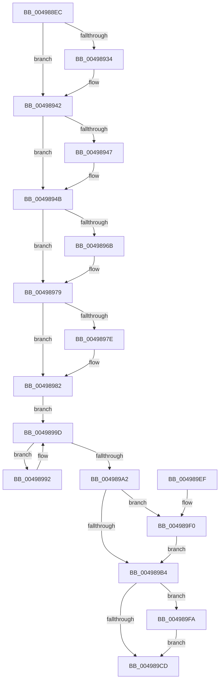

# PopFxClearDirectedDripsCandidateDeviceList

- RVA: `0x004988EC`–`0x00498A04` (길이 `280` bytes)
- VA: `0x00000001404988EC`
- 실행 섹션: `.text`
- PDB 이름 있음: `예`; PDB Function 태그: `아니요`
- unwind 정보 RVA: `0x000949B4`
- 디코드: `73`개 명령, `280/280` bytes 표시
- 미해석 바이트: `0` (있으면 어셈블리에 `.byte`로 보존)

> 이 문서는 커널 이미지의 기계어와 PDB 기호를 분석해 생성했습니다. 4번과 5번은 함수 원형과 자료형을 바이너리 사용 방식에서 추정한 C 해석이며 원본 소스 복구 결과는 아닙니다.

## 1. Dependencies

- 직접 호출 지점: **9**; 고유 호출 대상: **5**
- 직접 호출자로 확인된 함수: **2**
- RIP 상대 이미지 참조: **5**

### Outgoing calls
- `0x00498924` → [KeAbPreAcquire](../21/KeAbPreAcquire_function_00210230.md) (function, `0x00210230`)
- `0x0049893D` → [ExfAcquirePushLockExclusiveEx](../20/ExfAcquirePushLockExclusiveEx_function_0020FC90.md) (function, `0x0020FC90`)
- `0x0049895A` → [KeAbPreAcquire](../21/KeAbPreAcquire_function_00210230.md) (function, `0x00210230`)
- `0x00498974` → [ExfAcquirePushLockExclusiveEx](../20/ExfAcquirePushLockExclusiveEx_function_0020FC90.md) (function, `0x0020FC90`)
- `0x004989B7` → [KeAbPostRelease](../2E/KeAbPostRelease_function_002E1600.md) (function, `0x002E1600`)
- `0x004989D0` → [KeAbPostRelease](../2E/KeAbPostRelease_function_002E1600.md) (function, `0x002E1600`)
- `0x004989D5` → [KeLeaveCriticalRegion](../25/KeLeaveCriticalRegion_function_0025D8B0.md) (function, `0x0025D8B0`)
- `0x004989F3` → [ExfTryToWakePushLock](../26/ExfTryToWakePushLock_function_00265DD0.md) (function, `0x00265DD0`)
- `0x004989FD` → [ExfTryToWakePushLock](../26/ExfTryToWakePushLock_function_00265DD0.md) (function, `0x00265DD0`)

### Direct callers
- [PopDirectedDripsEngage](PopDirectedDripsEngage_function_00498888.md) at `0x00498890`
- [PopDirectedDripsResumeDevices](../../page/A4/PopDirectedDripsResumeDevices_function_00A4DB10.md) at `0x00A4DBD9`

### Static image references
- `0x00498909` → RVA `0x00F0E4C0` (`.data`; read)
- `0x0049894B` → RVA `0x00F0E408` (`.data`; read)
- `0x00498982` → RVA `0x00F0E3F0` (`.data`; read)
- `0x004989A5` → RVA `0x00F0E408` (`.data`; read/write)
- `0x004989BC` → RVA `0x00F0E4C0` (`.data`; read/write)

## 2. Other-region calls and transfers

- 다른 실행 섹션으로 향하는 call: **0**
- 별도 외부 분기/꼬리 이동을 확인하지 못했습니다.

## 3. Assembly (complete function range)

```asm
004988EC  48 89 5C 24 08                  mov qword ptr [rsp + 8], rbx
004988F1  48 89 6C 24 10                  mov qword ptr [rsp + 0x10], rbp
004988F6  48 89 74 24 18                  mov qword ptr [rsp + 0x18], rsi
004988FB  57                              push rdi
004988FC  48 83 EC 20                     sub rsp, 0x20
00498900  65 48 8B 04 25 88 01 00 00      mov rax, qword ptr gs:[0x188]
00498909  48 8D 35 B0 5B A7 00            lea rsi, [rip + 0xa75bb0]
00498910  48 83 CB FF                     or rbx, 0xffffffffffffffff
00498914  45 33 C0                        xor r8d, r8d
00498917  33 D2                           xor edx, edx
00498919  48 8B CE                        mov rcx, rsi
0049891C  66 01 98 E4 01 00 00            add word ptr [rax + 0x1e4], bx
00498923  90                              nop
00498924  E8 07 79 D7 FF                  call 0x140210230
00498929  F0 48 0F BA 2E 00               lock bts qword ptr [rsi], 0
0049892F  48 8B F8                        mov rdi, rax
00498932  73 0E                           jae 0x140498942
00498934  4C 8B C6                        mov r8, rsi
00498937  48 8B D0                        mov rdx, rax
0049893A  48 8B CE                        mov rcx, rsi
0049893D  E8 4E 73 D7 FF                  call 0x14020fc90
00498942  48 85 FF                        test rdi, rdi
00498945  74 04                           je 0x14049894b
00498947  C6 47 0A 01                     mov byte ptr [rdi + 0xa], 1
0049894B  48 8D 2D B6 5A A7 00            lea rbp, [rip + 0xa75ab6]
00498952  45 33 C0                        xor r8d, r8d
00498955  48 8B CD                        mov rcx, rbp
00498958  33 D2                           xor edx, edx
0049895A  E8 D1 78 D7 FF                  call 0x140210230
0049895F  F0 48 0F BA 6D 00 00            lock bts qword ptr [rbp], 0
00498966  48 8B F8                        mov rdi, rax
00498969  73 0E                           jae 0x140498979
0049896B  4C 8B C5                        mov r8, rbp
0049896E  48 8B D0                        mov rdx, rax
00498971  48 8B CD                        mov rcx, rbp
00498974  E8 17 73 D7 FF                  call 0x14020fc90
00498979  48 85 FF                        test rdi, rdi
0049897C  74 04                           je 0x140498982
0049897E  C6 47 0A 01                     mov byte ptr [rdi + 0xa], 1
00498982  48 8B 05 67 5A A7 00            mov rax, qword ptr [rip + 0xa75a67]
00498989  48 8D 0D 60 5A A7 00            lea rcx, [rip + 0xa75a60]
00498990  EB 0B                           jmp 0x14049899d
00498992  F0 83 A0 60 03 00 00 BF         lock and dword ptr [rax + 0x360], 0xffffffbf
0049899A  48 8B 00                        mov rax, qword ptr [rax]
0049899D  48 3B C1                        cmp rax, rcx
004989A0  75 F0                           jne 0x140498992
004989A2  48 8B C3                        mov rax, rbx
004989A5  F0 48 0F C1 05 5A 5A A7 00      lock xadd qword ptr [rip + 0xa75a5a], rax
004989AE  24 06                           and al, 6
004989B0  3C 02                           cmp al, 2
004989B2  74 3C                           je 0x1404989f0
004989B4  48 8B CD                        mov rcx, rbp
004989B7  E8 44 8C E4 FF                  call 0x1402e1600
004989BC  F0 48 0F C1 1D FB 5A A7 00      lock xadd qword ptr [rip + 0xa75afb], rbx
004989C5  80 E3 06                        and bl, 6
004989C8  80 FB 02                        cmp bl, 2
004989CB  74 2D                           je 0x1404989fa
004989CD  48 8B CE                        mov rcx, rsi
004989D0  E8 2B 8C E4 FF                  call 0x1402e1600
004989D5  E8 D6 4E DC FF                  call 0x14025d8b0
004989DA  48 8B 5C 24 30                  mov rbx, qword ptr [rsp + 0x30]
004989DF  48 8B 6C 24 38                  mov rbp, qword ptr [rsp + 0x38]
004989E4  48 8B 74 24 40                  mov rsi, qword ptr [rsp + 0x40]
004989E9  48 83 C4 20                     add rsp, 0x20
004989ED  5F                              pop rdi
004989EE  C3                              ret
004989EF  CC                              int3
004989F0  48 8B CD                        mov rcx, rbp
004989F3  E8 D8 D3 DC FF                  call 0x140265dd0
004989F8  EB BA                           jmp 0x1404989b4
004989FA  48 8B CE                        mov rcx, rsi
004989FD  E8 CE D3 DC FF                  call 0x140265dd0
00498A02  EB C9                           jmp 0x1404989cd
```

## 4. C-style interpretation (structured pseudocode)

```c
__int64 __fastcall PopFxClearDirectedDripsCandidateDeviceList(__int64 a1, int a2, int a3)
{
    __int64 result;
    __int64 v_rbx;
    __int64 v_rsp;
    unsigned __int64 v_stack_p10;
    unsigned __int64 v_stack_p18;
    unsigned __int64 v_stack_p8;

    v_stack_p8 = v_rbx;
    v_stack_p10 = v_rbp;
    v_stack_p18 = v_rsi;
    v_rsp = (v_rsp) - (32);
    v_rbx = (v_rbx) | (-1);
    a3 = 0;
    a2 = 0;
    result = KeAbPreAcquire(v_rip + 10967984, a2, a3, a4);
    if (!(condition_is_above_or_equal)) {
        a3 = v_rip + 10967984;
        a2 = result;
        a1 = v_rip + 10967984;
        result = ExfAcquirePushLockExclusiveEx(a1, a2, a3, a4);
    }
    if (result != 0) {
        *(unsigned __int8 *)(result + 10) = 1;
    }
    a3 = 0;
    a2 = 0;
    result = KeAbPreAcquire(v_rip + 10967734, a2, a3, a4);
    if (!(condition_is_above_or_equal)) {
        a3 = v_rip + 10967734;
        a2 = result;
        a1 = v_rip + 10967734;
        result = ExfAcquirePushLockExclusiveEx(a1, a2, a3, a4);
    }
    if (result != 0) {
        *(unsigned __int8 *)(result + 10) = 1;
    }
    goto loc_0049899D;
loc_00498992:
loc_0049899D:
    if ((*(unsigned __int64 *)(*(unsigned __int64 *)(v_rip + 10967655))) != (v_rip + 10967648)) goto loc_00498992;
    result = (unsigned __int8)((v_rbx) & (6));
    if (((unsigned __int8)(result)) == 2) goto loc_004989F0;
loc_004989B4:
    result = KeAbPostRelease(v_rip + 10967734, a2, a3, a4);
    v_rbx = (unsigned __int8)((v_rbx) & (6));
    if (((unsigned __int8)(v_rbx)) == 2) goto loc_004989FA;
loc_004989CD:
    result = KeAbPostRelease(v_rip + 10967984, a2, a3, a4);
    result = KeLeaveCriticalRegion(v_rip + 10967984, a2, a3, a4);
    v_rsp = (v_rsp) + (32);
    return result;
loc_004989F0:
    result = ExfTryToWakePushLock(v_stack_p10, a2, a3, a4);
    goto loc_004989B4;
loc_004989FA:
    result = ExfTryToWakePushLock(v_stack_p18, a2, a3, a4);
    goto loc_004989CD;
}
```

## 5. (Beta) C Style

```c
int64_t PopFxClearDirectedDripsCandidateDeviceList(int64_t Arg1, int32_t Arg2, int32_t Arg3)
{
    int64_t result;
    int64_t local_rbx;
    int64_t local_rsp;
    uint64_t v_stack_p10;
    uint64_t v_stack_p18;
    uint64_t v_stack_p8;

    v_stack_p8 = local_rbx;
    v_stack_p10 = local_rbp;
    v_stack_p18 = local_rsi;
    local_rsp = (local_rsp) - (32);
    local_rbx = (local_rbx) | (-1);
    Arg3 = 0;
    Arg2 = 0;
    result = KeAbPreAcquire(v_rip + 10967984, Arg2, Arg3, a4);
    if (!(condition_is_above_or_equal)) {
        Arg3 = v_rip + 10967984;
        Arg2 = result;
        Arg1 = v_rip + 10967984;
        result = ExfAcquirePushLockExclusiveEx(Arg1, Arg2, Arg3, a4);
    }
    if (result != 0) {
        *(uint8_t *)(result + 0xA) = 1;
    }
    Arg3 = 0;
    Arg2 = 0;
    result = KeAbPreAcquire(v_rip + 10967734, Arg2, Arg3, a4);
    if (!(condition_is_above_or_equal)) {
        Arg3 = v_rip + 10967734;
        Arg2 = result;
        Arg1 = v_rip + 10967734;
        result = ExfAcquirePushLockExclusiveEx(Arg1, Arg2, Arg3, a4);
    }
    if (result != 0) {
        *(uint8_t *)(result + 0xA) = 1;
    }
    goto loc_0049899D;
loc_00498992:
loc_0049899D:
    if ((*(uint64_t *)(*(uint64_t *)(v_rip + 0xA75A67))) != (v_rip + 10967648)) goto loc_00498992;
    result = (uint8_t)((local_rbx) & (6));
    if (((uint8_t)(result)) == 2) goto loc_004989F0;
loc_004989B4:
    result = KeAbPostRelease(v_rip + 10967734, Arg2, Arg3, a4);
    local_rbx = (uint8_t)((local_rbx) & (6));
    if (((uint8_t)(local_rbx)) == 2) goto loc_004989FA;
loc_004989CD:
    result = KeAbPostRelease(v_rip + 10967984, Arg2, Arg3, a4);
    result = KeLeaveCriticalRegion(v_rip + 10967984, Arg2, Arg3, a4);
    local_rsp = (local_rsp) + (32);
    return result;
loc_004989F0:
    result = ExfTryToWakePushLock(v_stack_p10, Arg2, Arg3, a4);
    goto loc_004989B4;
loc_004989FA:
    result = ExfTryToWakePushLock(v_stack_p18, Arg2, Arg3, a4);
    goto loc_004989CD;
}
```

## 6. Execution-region graph

[열기: 2D/3D 그래프와 함수 탐색 컨트롤 패널](../../../control-panel.html?section=text&rva=0x004988EC&view=graph)

- 2D 그래프는 위에서 아래로 흐르고, 3D 그래프는 빈 공간을 드래그해 회전합니다. Shift+드래그는 이동, 휠은 확대·축소, 함수 노드 선택은 대상 보고서 이동입니다.

### Static fallback


