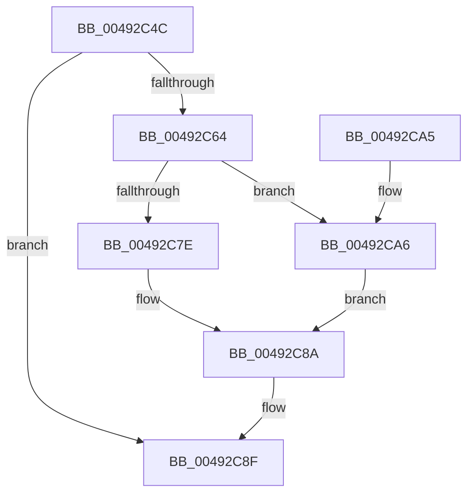

# PopFxDeliverDevicePowerRequired

- RVA: `0x00492C4C`–`0x00492CAC` (길이 `96` bytes)
- VA: `0x0000000140492C4C`
- 실행 섹션: `.text`
- PDB 이름 있음: `예`; PDB Function 태그: `아니요`
- unwind 정보 RVA: `0x0008AB4C`
- 디코드: `28`개 명령, `96/96` bytes 표시
- 미해석 바이트: `0` (있으면 어셈블리에 `.byte`로 보존)

> 이 문서는 커널 이미지의 기계어와 PDB 기호를 분석해 생성했습니다. 4번과 5번은 함수 원형과 자료형을 바이너리 사용 방식에서 추정한 C 해석이며 원본 소스 복구 결과는 아닙니다.

## 1. Dependencies

- 직접 호출 지점: **3**; 고유 호출 대상: **3**
- 직접 호출자로 확인된 함수: **3**
- RIP 상대 이미지 참조: **0**

### Outgoing calls
- `0x00492C6D` → [PopDiagTraceFxDevicePowerRequirement](../39/PopDiagTraceFxDevicePowerRequirement_function_00391780.md) (function, `0x00391780`)
- `0x00492C85` → [guard_dispatch_icall](../6B/guard_dispatch_icall_function_006BAAD0.md) (function, `0x006BAAD0`)
- `0x00492C95` → [PopFxCompleteDevicePowerRequired](../39/PopFxCompleteDevicePowerRequired_function_003908AC.md) (function, `0x003908AC`)

### Direct callers
- [sub_002BD95A](../2B/Unknown_function_002BD95A.md) at `0x002BDCC3`
- [PopFxIdleTimeoutDpcRoutine](PopFxIdleTimeoutDpcRoutine_function_00492B80.md) at `0x00492BBD`
- [PopFxDeviceWork](../5D/PopFxDeviceWork_function_005D27B0.md) at `0x005D27D8`

### Static image references
- 디코드된 RIP-relative 메모리 참조가 없습니다.

## 2. Other-region calls and transfers

- 다른 실행 섹션으로 향하는 call: **0**
- 별도 외부 분기/꼬리 이동을 확인하지 못했습니다.

## 3. Assembly (complete function range)

```asm
00492C4C  48 89 5C 24 08                  mov qword ptr [rsp + 8], rbx
00492C51  57                              push rdi
00492C52  48 83 EC 20                     sub rsp, 0x20
00492C56  8B 41 24                        mov eax, dword ptr [rcx + 0x24]
00492C59  48 8B FA                        mov rdi, rdx
00492C5C  48 8B D9                        mov rbx, rcx
00492C5F  83 F8 02                        cmp eax, 2
00492C62  75 2B                           jne 0x140492c8f
00492C64  48 8B 49 30                     mov rcx, qword ptr [rcx + 0x30]
00492C68  41 B0 01                        mov r8b, 1
00492C6B  33 D2                           xor edx, edx
00492C6D  E8 0E EB EF FF                  call 0x140391780
00492C72  48 8B 83 88 00 00 00            mov rax, qword ptr [rbx + 0x88]
00492C79  48 85 C0                        test rax, rax
00492C7C  74 28                           je 0x140492ca6
00492C7E  48 8B 8B C0 00 00 00            mov rcx, qword ptr [rbx + 0xc0]
00492C85  E8 46 7E 22 00                  call 0x1406baad0
00492C8A  F0 83 63 20 BF                  lock and dword ptr [rbx + 0x20], 0xffffffbf
00492C8F  48 8B D7                        mov rdx, rdi
00492C92  48 8B CB                        mov rcx, rbx
00492C95  E8 12 DC EF FF                  call 0x1403908ac
00492C9A  48 8B 5C 24 30                  mov rbx, qword ptr [rsp + 0x30]
00492C9F  48 83 C4 20                     add rsp, 0x20
00492CA3  5F                              pop rdi
00492CA4  C3                              ret
00492CA5  CC                              int3
00492CA6  F0 FF 4B 24                     lock dec dword ptr [rbx + 0x24]
00492CAA  EB DE                           jmp 0x140492c8a
```

## 4. C-style interpretation (structured pseudocode)

```c
__int64 __fastcall PopFxDeliverDevicePowerRequired(__int64 a1, __int64 a2)
{
    __int64 result;
    __int64 v_rsp;
    unsigned __int64 v_stack_p8;

    v_stack_p8 = v_rbx;
    v_rsp = (v_rsp) - (32);
    if (((unsigned int)((unsigned int)(*(unsigned int *)(a1 + 36)))) != 2) goto loc_00492C8F;
    a2 = 0;
    result = PopDiagTraceFxDevicePowerRequirement(*(unsigned __int64 *)(a1 + 48), a2, 1, a4);
    if (*(unsigned __int64 *)(a1 + 136) == 0) goto loc_00492CA6;
    result = guard_dispatch_icall(*(unsigned __int64 *)(a1 + 192), a2, 1, a4);
loc_00492C8A:
loc_00492C8F:
    result = PopFxCompleteDevicePowerRequired(a1, 0, 1, a4);
    v_rsp = (v_rsp) + (32);
    return result;
loc_00492CA6:
    goto loc_00492C8A;
}
```

## 5. (Beta) C Style

```c
int64_t PopFxDeliverDevicePowerRequired(void *Arg1, int64_t Arg2)
{
    uint8_t *arg1 = (uint8_t *)Arg1;

    int64_t result;
    int64_t local_rsp;
    uint64_t v_stack_p8;

    v_stack_p8 = local_rbx;
    local_rsp = (local_rsp) - (32);
    if (((uint32_t)((uint32_t)(*(uint32_t *)(arg1 + 0x24)))) != 2) goto loc_00492C8F;
    Arg2 = 0;
    result = PopDiagTraceFxDevicePowerRequirement(*(uint64_t *)(arg1 + 0x30), Arg2, 1, a4);
    if (*(uint64_t *)(arg1 + 0x88) == 0) goto loc_00492CA6;
    result = guard_dispatch_icall(*(uint64_t *)(arg1 + 0xC0), Arg2, 1, a4);
loc_00492C8A:
loc_00492C8F:
    result = PopFxCompleteDevicePowerRequired(Arg1, 0, 1, a4);
    local_rsp = (local_rsp) + (32);
    return result;
loc_00492CA6:
    goto loc_00492C8A;
}
```

### 관측된 메모리 오프셋

구조체 형식이 확인되지 않은 접근은 인자 기준의 오프셋으로만 기록했습니다.

| 기준 인자 | 오프셋 표현 | 폭 (bit) | 접근 |
|---|---:|---:|---|
| `Arg1` | `+ 0x20` | `32` | `R/W` |
| `Arg1` | `+ 0x24` | `32` | `R` |
| `Arg1` | `+ 0x24` | `32` | `R/W` |
| `Arg1` | `+ 0x30` | `64` | `R` |
| `Arg1` | `+ 0x88` | `64` | `R` |
| `Arg1` | `+ 0xC0` | `64` | `R` |

## 6. Execution-region graph

[열기: 2D/3D 그래프와 함수 탐색 컨트롤 패널](../../../control-panel.html?section=text&rva=0x00492C4C&view=graph)

- 2D 그래프는 위에서 아래로 흐르고, 3D 그래프는 빈 공간을 드래그해 회전합니다. Shift+드래그는 이동, 휠은 확대·축소, 함수 노드 선택은 대상 보고서 이동입니다.

### Static fallback


