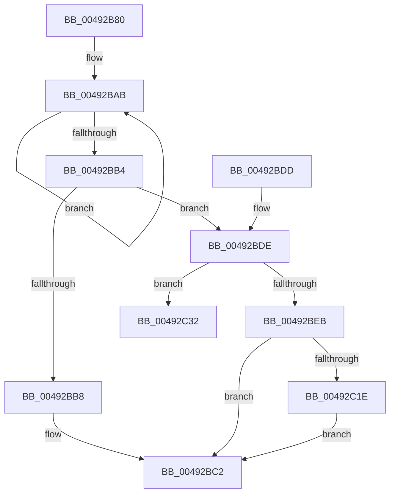

# PopFxIdleTimeoutDpcRoutine

- RVA: `0x00492B80`–`0x00492C46` (길이 `198` bytes)
- VA: `0x0000000140492B80`
- 실행 섹션: `.text`
- PDB 이름 있음: `예`; PDB Function 태그: `아니요`
- unwind 정보 RVA: `0x000B3040`
- 디코드: `56`개 명령, `198/198` bytes 표시
- 미해석 바이트: `0` (있으면 어셈블리에 `.byte`로 보존)

> 이 문서는 커널 이미지의 기계어와 PDB 기호를 분석해 생성했습니다. 4번과 5번은 함수 원형과 자료형을 바이너리 사용 방식에서 추정한 C 해석이며 원본 소스 복구 결과는 아닙니다.

## 1. Dependencies

- 직접 호출 지점: **7**; 고유 호출 대상: **7**
- 직접 호출자로 확인된 함수: **0**
- RIP 상대 이미지 참조: **0**

### Outgoing calls
- `0x00492B9C` → [KeAcquireSpinLockRaiseToDpc](../20/KeAcquireSpinLockRaiseToDpc_function_00208470.md) (function, `0x00208470`)
- `0x00492BBD` → [PopFxDeliverDevicePowerRequired](PopFxDeliverDevicePowerRequired_function_00492C4C.md) (function, `0x00492C4C`)
- `0x00492BC8` → [KeReleaseSpinLock](../39/KeReleaseSpinLock_function_00392BA0.md) (function, `0x00392BA0`)
- `0x00492BF4` → [PopDiagTraceFxDevicePowerRequirement](../39/PopDiagTraceFxDevicePowerRequirement_function_00391780.md) (function, `0x00391780`)
- `0x00492C07` → [guard_dispatch_icall](../6B/guard_dispatch_icall_function_006BAAD0.md) (function, `0x006BAAD0`)
- `0x00492C2B` → [PopFxAddLogEntry](../39/PopFxAddLogEntry_function_00390B94.md) (function, `0x00390B94`)
- `0x00492C40` → [PopFxBugCheck](../2B/PopFxBugCheck_function_002BFC6C.md) (function, `0x002BFC6C`)

### Direct callers
- 이 함수 시작 RVA로 연결되는 직접 call은 확인되지 않았습니다. 간접 호출은 완전히 역산할 수 없습니다.

### Static image references
- 디코드된 RIP-relative 메모리 참조가 없습니다.

## 2. Other-region calls and transfers

- 다른 실행 섹션으로 향하는 call: **0**
- 별도 외부 분기/꼬리 이동을 확인하지 못했습니다.

## 3. Assembly (complete function range)

```asm
00492B80  48 89 5C 24 08                  mov qword ptr [rsp + 8], rbx
00492B85  48 89 74 24 10                  mov qword ptr [rsp + 0x10], rsi
00492B8A  57                              push rdi
00492B8B  48 83 EC 20                     sub rsp, 0x20
00492B8F  48 8D BA 90 01 00 00            lea rdi, [rdx + 0x190]
00492B96  48 8B DA                        mov rbx, rdx
00492B99  48 8B CF                        mov rcx, rdi
00492B9C  E8 CF 58 D7 FF                  call 0x140208470
00492BA1  40 8A F0                        mov sil, al
00492BA4  0F 0D 4B 20                     prefetchw byte ptr [rbx + 0x20]
00492BA8  8B 43 20                        mov eax, dword ptr [rbx + 0x20]
00492BAB  8B C8                           mov ecx, eax
00492BAD  F0 0F B1 4B 20                  lock cmpxchg dword ptr [rbx + 0x20], ecx
00492BB2  75 F7                           jne 0x140492bab
00492BB4  A8 04                           test al, 4
00492BB6  75 26                           jne 0x140492bde
00492BB8  33 D2                           xor edx, edx
00492BBA  48 8B CB                        mov rcx, rbx
00492BBD  E8 8A 00 00 00                  call 0x140492c4c
00492BC2  40 8A D6                        mov dl, sil
00492BC5  48 8B CF                        mov rcx, rdi
00492BC8  E8 D3 FF EF FF                  call 0x140392ba0
00492BCD  48 8B 5C 24 30                  mov rbx, qword ptr [rsp + 0x30]
00492BD2  48 8B 74 24 38                  mov rsi, qword ptr [rsp + 0x38]
00492BD7  48 83 C4 20                     add rsp, 0x20
00492BDB  5F                              pop rdi
00492BDC  C3                              ret
00492BDD  CC                              int3
00492BDE  F0 83 63 20 FB                  lock and dword ptr [rbx + 0x20], 0xfffffffb
00492BE3  8B 43 28                        mov eax, dword ptr [rbx + 0x28]
00492BE6  83 F8 02                        cmp eax, 2
00492BE9  75 47                           jne 0x140492c32
00492BEB  48 8B 4B 30                     mov rcx, qword ptr [rbx + 0x30]
00492BEF  45 33 C0                        xor r8d, r8d
00492BF2  33 D2                           xor edx, edx
00492BF4  E8 87 EB EF FF                  call 0x140391780
00492BF9  48 8B 83 90 00 00 00            mov rax, qword ptr [rbx + 0x90]
00492C00  48 8B 8B C0 00 00 00            mov rcx, qword ptr [rbx + 0xc0]
00492C07  E8 C4 7E 22 00                  call 0x1406baad0
00492C0C  F0 83 4B 20 40                  lock or dword ptr [rbx + 0x20], 0x40
00492C11  83 C8 FF                        or eax, 0xffffffff
00492C14  F0 0F C1 43 28                  lock xadd dword ptr [rbx + 0x28], eax
00492C19  83 F8 01                        cmp eax, 1
00492C1C  74 A4                           je 0x140492bc2
00492C1E  48 8B 4B 30                     mov rcx, qword ptr [rbx + 0x30]
00492C22  45 33 C9                        xor r9d, r9d
00492C25  33 D2                           xor edx, edx
00492C27  45 8D 41 11                     lea r8d, [r9 + 0x11]
00492C2B  E8 64 DF EF FF                  call 0x140390b94
00492C30  EB 90                           jmp 0x140492bc2
00492C32  45 33 C9                        xor r9d, r9d
00492C35  45 33 C0                        xor r8d, r8d
00492C38  48 8B D3                        mov rdx, rbx
00492C3B  B9 13 06 00 00                  mov ecx, 0x613
00492C40  E8 27 D0 E2 FF                  call 0x1402bfc6c
00492C45  CC                              int3
```

## 4. C-style interpretation (structured pseudocode)

```c
__int64 __fastcall PopFxIdleTimeoutDpcRoutine(__int64 a1, __int64 a2, int a3, int a4)
{
    __int64 result;
    __int64 v_rsp;
    unsigned __int64 v_stack_p10;
    unsigned __int64 v_stack_p8;

    v_stack_p8 = v_rbx;
    v_stack_p10 = v_rsi;
    v_rsp = (v_rsp) - (32);
    result = KeAcquireSpinLockRaiseToDpc(a2 + 400, a2, a3, a4);
loc_00492BAB:
    if (condition_is_not_equal) goto loc_00492BAB;
    if ((((unsigned __int8)((unsigned int)(*(unsigned int *)(a2 + 32)))) & (4)) != 0) goto loc_00492BDE;
    a2 = 0;
    result = PopFxDeliverDevicePowerRequired(0, a2, a3, a4);
loc_00492BC2:
    result = KeReleaseSpinLock(a2 + 400, (unsigned __int8)((unsigned __int8)(result)), a3, a4);
    v_rsp = (v_rsp) + (32);
    return result;
loc_00492BDE:
    if (((unsigned int)((unsigned int)(*(unsigned int *)(v_stack_p8 + 40)))) != 2) goto loc_00492C32;
    a3 = 0;
    a2 = 0;
    result = PopDiagTraceFxDevicePowerRequirement(*(unsigned __int64 *)(v_stack_p8 + 48), a2, a3, a4);
    result = guard_dispatch_icall(*(unsigned __int64 *)(v_stack_p8 + 192), a2, a3, a4);
    result = (unsigned int)((result) | (0xFFFFFFFFULL));
    if (((unsigned int)(result)) == 1) goto loc_00492BC2;
    a4 = 0;
    a2 = 0;
    result = PopFxAddLogEntry(*(unsigned __int64 *)(v_stack_p8 + 48), a2, a4 + 17, a4);
    goto loc_00492BC2;
loc_00492C32:
    a4 = 0;
    a3 = 0;
    result = PopFxBugCheck((unsigned int)(0x613ULL), v_stack_p8, a3, a4);
    return result;
}
```

## 5. (Beta) C Style

```c
int64_t PopFxIdleTimeoutDpcRoutine(int64_t Arg1, void *Arg2, int32_t Arg3, int32_t Arg4)
{
    uint8_t *arg2 = (uint8_t *)Arg2;

    int64_t result;
    int64_t local_rsp;
    uint64_t v_stack_p10;
    uint64_t v_stack_p8;

    v_stack_p8 = local_rbx;
    v_stack_p10 = local_rsi;
    local_rsp = (local_rsp) - (32);
    result = KeAcquireSpinLockRaiseToDpc(Arg2 + 400, Arg2, Arg3, Arg4);
loc_00492BAB:
    if (condition_is_not_equal) goto loc_00492BAB;
    if ((((uint8_t)((uint32_t)(*(uint32_t *)(arg2 + 0x20)))) & (4)) != 0) goto loc_00492BDE;
    Arg2 = 0;
    result = PopFxDeliverDevicePowerRequired(0, Arg2, Arg3, Arg4);
loc_00492BC2:
    result = KeReleaseSpinLock(Arg2 + 400, (uint8_t)((uint8_t)(result)), Arg3, Arg4);
    local_rsp = (local_rsp) + (32);
    return result;
loc_00492BDE:
    if (((uint32_t)((uint32_t)(*(uint32_t *)(v_stack_p8 + 0x28)))) != 2) goto loc_00492C32;
    Arg3 = 0;
    Arg2 = 0;
    result = PopDiagTraceFxDevicePowerRequirement(*(uint64_t *)(v_stack_p8 + 0x30), Arg2, Arg3, Arg4);
    result = guard_dispatch_icall(*(uint64_t *)(v_stack_p8 + 0xC0), Arg2, Arg3, Arg4);
    result = (uint32_t)((result) | (0xFFFFFFFFULL));
    if (((uint32_t)(result)) == 1) goto loc_00492BC2;
    Arg4 = 0;
    Arg2 = 0;
    result = PopFxAddLogEntry(*(uint64_t *)(v_stack_p8 + 0x30), Arg2, Arg4 + 17, Arg4);
    goto loc_00492BC2;
loc_00492C32:
    Arg4 = 0;
    Arg3 = 0;
    result = PopFxBugCheck((uint32_t)(0x613ULL), v_stack_p8, Arg3, Arg4);
    return result;
}
```

### 관측된 메모리 오프셋

구조체 형식이 확인되지 않은 접근은 인자 기준의 오프셋으로만 기록했습니다.

| 기준 인자 | 오프셋 표현 | 폭 (bit) | 접근 |
|---|---:|---:|---|
| `Arg2` | `+ 0x20` | `8` | `R` |
| `Arg2` | `+ 0x20` | `32` | `R` |
| `Arg2` | `+ 0x20` | `32` | `R/W` |
| `Arg2` | `+ 0x28` | `32` | `R` |
| `Arg2` | `+ 0x28` | `32` | `R/W` |
| `Arg2` | `+ 0x30` | `64` | `R` |
| `Arg2` | `+ 0x90` | `64` | `R` |
| `Arg2` | `+ 0xC0` | `64` | `R` |
| `Arg2` | `+ 0x190` | `64` | `R` |

## 6. Execution-region graph

[열기: 2D/3D 그래프와 함수 탐색 컨트롤 패널](../../../control-panel.html?section=text&rva=0x00492B80&view=graph)

- 2D 그래프는 위에서 아래로 흐르고, 3D 그래프는 빈 공간을 드래그해 회전합니다. Shift+드래그는 이동, 휠은 확대·축소, 함수 노드 선택은 대상 보고서 이동입니다.

### Static fallback


