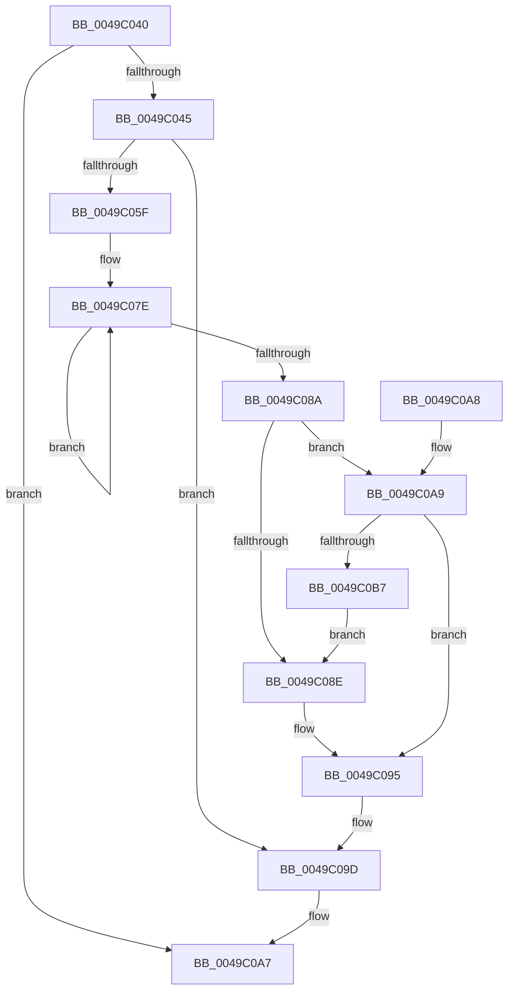

# PopFxIncrementDeviceSleepCount

- RVA: `0x0049C040`–`0x0049C0B9` (길이 `121` bytes)
- VA: `0x000000014049C040`
- 실행 섹션: `.text`
- PDB 이름 있음: `예`; PDB Function 태그: `아니요`
- unwind 정보 RVA: `0x000B4A10`
- 디코드: `35`개 명령, `121/121` bytes 표시
- 미해석 바이트: `0` (있으면 어셈블리에 `.byte`로 보존)

> 이 문서는 커널 이미지의 기계어와 PDB 기호를 분석해 생성했습니다. 4번과 5번은 함수 원형과 자료형을 바이너리 사용 방식에서 추정한 C 해석이며 원본 소스 복구 결과는 아닙니다.

## 1. Dependencies

- 직접 호출 지점: **2**; 고유 호출 대상: **2**
- 직접 호출자로 확인된 함수: **2**
- RIP 상대 이미지 참조: **0**

### Outgoing calls
- `0x0049C066` → [ExAcquireSpinLockExclusive](../24/ExAcquireSpinLockExclusive_function_00248690.md) (function, `0x00248690`)
- `0x0049C098` → [ExReleaseSpinLockExclusive](../2C/ExReleaseSpinLockExclusive_function_002C0EF0.md) (function, `0x002C0EF0`)

### Direct callers
- [PoFxStartDevicePowerManagement](../4B/PoFxStartDevicePowerManagement_function_004B5740.md) at `0x004B58C2`
- [PopSystemIrpCompletion](../../pagelk/B7/PopSystemIrpCompletion_function_00B70CC0.md) at `0x00B70E6F`

### Static image references
- 디코드된 RIP-relative 메모리 참조가 없습니다.

## 2. Other-region calls and transfers

- 다른 실행 섹션으로 향하는 call: **0**
- 별도 외부 분기/꼬리 이동을 확인하지 못했습니다.

## 3. Assembly (complete function range)

```asm
0049C040  48 85 C9                        test rcx, rcx
0049C043  74 62                           je 0x14049c0a7
0049C045  48 89 5C 24 08                  mov qword ptr [rsp + 8], rbx
0049C04A  57                              push rdi
0049C04B  48 83 EC 20                     sub rsp, 0x20
0049C04F  48 8B 81 38 01 00 00            mov rax, qword ptr [rcx + 0x138]
0049C056  48 8B 58 28                     mov rbx, qword ptr [rax + 0x28]
0049C05A  48 85 DB                        test rbx, rbx
0049C05D  74 3E                           je 0x14049c09d
0049C05F  48 8D 7B 58                     lea rdi, [rbx + 0x58]
0049C063  48 8B CF                        mov rcx, rdi
0049C066  E8 25 C6 DA FF                  call 0x140248690
0049C06B  44 8B 43 7C                     mov r8d, dword ptr [rbx + 0x7c]
0049C06F  8A D0                           mov dl, al
0049C071  0F 0D 8B 28 01 00 00            prefetchw byte ptr [rbx + 0x128]
0049C078  8B 83 28 01 00 00               mov eax, dword ptr [rbx + 0x128]
0049C07E  8B C8                           mov ecx, eax
0049C080  F0 0F B1 8B 28 01 00 00         lock cmpxchg dword ptr [rbx + 0x128], ecx
0049C088  75 F4                           jne 0x14049c07e
0049C08A  A8 04                           test al, 4
0049C08C  75 1B                           jne 0x14049c0a9
0049C08E  41 8D 40 01                     lea eax, [r8 + 1]
0049C092  89 43 7C                        mov dword ptr [rbx + 0x7c], eax
0049C095  48 8B CF                        mov rcx, rdi
0049C098  E8 53 4E E2 FF                  call 0x1402c0ef0
0049C09D  48 8B 5C 24 30                  mov rbx, qword ptr [rsp + 0x30]
0049C0A2  48 83 C4 20                     add rsp, 0x20
0049C0A6  5F                              pop rdi
0049C0A7  C3                              ret
0049C0A8  CC                              int3
0049C0A9  48 8B 43 50                     mov rax, qword ptr [rbx + 0x50]
0049C0AD  8B 80 60 03 00 00               mov eax, dword ptr [rax + 0x360]
0049C0B3  A8 01                           test al, 1
0049C0B5  75 DE                           jne 0x14049c095
0049C0B7  EB D5                           jmp 0x14049c08e
```

## 4. C-style interpretation (structured pseudocode)

```c
__int64 __fastcall PopFxIncrementDeviceSleepCount(__int64 a1)
{
    __int64 result;
    __int64 v_rsp;
    unsigned __int64 v_stack_p8;

    if (a1 == 0) goto loc_0049C0A7;
    v_stack_p8 = v_rbx;
    v_rsp = (v_rsp) - (32);
    if (*(unsigned __int64 *)(*(unsigned __int64 *)(a1 + 312) + 40) == 0) goto loc_0049C09D;
    result = ExAcquireSpinLockExclusive(*(unsigned __int64 *)(*(unsigned __int64 *)(a1 + 312) + 40) + 88, a2, a3, a4);
loc_0049C07E:
    if (*(unsigned __int64 *)(*(unsigned __int64 *)(a1 + 312) + 40) != 0) goto loc_0049C07E;
    if ((((unsigned __int8)((unsigned int)(*(unsigned int *)(*(unsigned __int64 *)(*(unsigned __int64 *)(a1 + 312) + 40) + 296)))) & (4)) != 0) goto loc_0049C0A9;
loc_0049C08E:
    *(unsigned int *)(*(unsigned __int64 *)(*(unsigned __int64 *)(a1 + 312) + 40) + 124) = (unsigned int)((unsigned int)(*(unsigned int *)(*(unsigned __int64 *)(*(unsigned __int64 *)(a1 + 312) + 40) + 124)) + 1);
loc_0049C095:
    result = ExReleaseSpinLockExclusive(*(unsigned __int64 *)(*(unsigned __int64 *)(a1 + 312) + 40) + 88, (unsigned __int8)(result), (unsigned int)(*(unsigned int *)(*(unsigned __int64 *)(*(unsigned __int64 *)(a1 + 312) + 40) + 124)), a4);
loc_0049C09D:
    v_rsp = (v_rsp) + (32);
loc_0049C0A7:
    return result;
loc_0049C0A9:
    if ((((unsigned __int8)((unsigned int)(*(unsigned int *)(*(unsigned __int64 *)(v_stack_p8 + 80) + 864)))) & (1)) != 0) goto loc_0049C095;
    goto loc_0049C08E;
}
```

## 5. (Beta) C Style

```c
int64_t PopFxIncrementDeviceSleepCount(int64_t Arg1)
{
    int64_t result;
    int64_t local_rsp;
    uint64_t v_stack_p8;

    if (Arg1 == 0) goto loc_0049C0A7;
    v_stack_p8 = local_rbx;
    local_rsp = (local_rsp) - (32);
    if (*(uint64_t *)(*(uint64_t *)(Arg1 + 0x138) + 0x28) == 0) goto loc_0049C09D;
    result = ExAcquireSpinLockExclusive(*(uint64_t *)(*(uint64_t *)(Arg1 + 0x138) + 0x28) + 88, a2, a3, a4);
loc_0049C07E:
    if (*(uint64_t *)(*(uint64_t *)(Arg1 + 0x138) + 0x28) != 0) goto loc_0049C07E;
    if ((((uint8_t)((uint32_t)(*(uint32_t *)(*(uint64_t *)(*(uint64_t *)(Arg1 + 0x138) + 0x28) + 0x128)))) & (4)) != 0) goto loc_0049C0A9;
loc_0049C08E:
    *(uint32_t *)(*(uint64_t *)(*(uint64_t *)(Arg1 + 0x138) + 0x28) + 0x7C) = (uint32_t)((uint32_t)(*(uint32_t *)(*(uint64_t *)(*(uint64_t *)(Arg1 + 0x138) + 0x28) + 0x7C)) + 1);
loc_0049C095:
    result = ExReleaseSpinLockExclusive(*(uint64_t *)(*(uint64_t *)(Arg1 + 0x138) + 0x28) + 88, (uint8_t)(result), (uint32_t)(*(uint32_t *)(*(uint64_t *)(*(uint64_t *)(Arg1 + 0x138) + 0x28) + 0x7C)), a4);
loc_0049C09D:
    local_rsp = (local_rsp) + (32);
loc_0049C0A7:
    return result;
loc_0049C0A9:
    if ((((uint8_t)((uint32_t)(*(uint32_t *)(*(uint64_t *)(v_stack_p8 + 0x50) + 0x360)))) & (1)) != 0) goto loc_0049C095;
    goto loc_0049C08E;
}
```

## 6. Execution-region graph

[열기: 2D/3D 그래프와 함수 탐색 컨트롤 패널](../../../control-panel.html?section=text&rva=0x0049C040&view=graph)

- 2D 그래프는 위에서 아래로 흐르고, 3D 그래프는 빈 공간을 드래그해 회전합니다. Shift+드래그는 이동, 휠은 확대·축소, 함수 노드 선택은 대상 보고서 이동입니다.

### Static fallback


