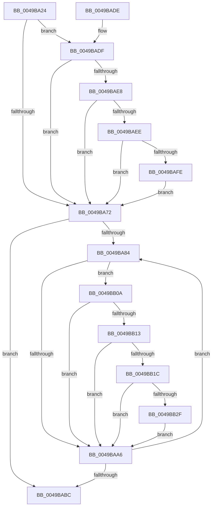

# PopFxIsDripsBlockingDevice

- RVA: `0x0049BA24`–`0x0049BB3A` (길이 `278` bytes)
- VA: `0x000000014049BA24`
- 실행 섹션: `.text`
- PDB 이름 있음: `예`; PDB Function 태그: `아니요`
- unwind 정보 RVA: `0x0007DE44`
- 디코드: `71`개 명령, `278/278` bytes 표시
- 미해석 바이트: `0` (있으면 어셈블리에 `.byte`로 보존)

> 이 문서는 커널 이미지의 기계어와 PDB 기호를 분석해 생성했습니다. 4번과 5번은 함수 원형과 자료형을 바이너리 사용 방식에서 추정한 C 해석이며 원본 소스 복구 결과는 아닙니다.

## 1. Dependencies

- 직접 호출 지점: **4**; 고유 호출 대상: **2**
- 직접 호출자로 확인된 함수: **1**
- RIP 상대 이미지 참조: **1**

### Outgoing calls
- `0x0049BA65` → [KeAcquireSpinLockRaiseToDpc](../20/KeAcquireSpinLockRaiseToDpc_function_00208470.md) (function, `0x00208470`)
- `0x0049BA75` → [KeReleaseSpinLock](../39/KeReleaseSpinLock_function_00392BA0.md) (function, `0x00392BA0`)
- `0x0049BA96` → [KeAcquireSpinLockRaiseToDpc](../20/KeAcquireSpinLockRaiseToDpc_function_00208470.md) (function, `0x00208470`)
- `0x0049BAAD` → [KeReleaseSpinLock](../39/KeReleaseSpinLock_function_00392BA0.md) (function, `0x00392BA0`)

### Direct callers
- [PopFxBuildDripsBlockingDeviceList](PopFxBuildDripsBlockingDeviceList_function_0049B5B0.md) at `0x0049B71E`

### Static image references
- `0x0049BADF` → RVA `0x00E0B3DC` (`.data`; read)

## 2. Other-region calls and transfers

- 다른 실행 섹션으로 향하는 call: **0**
- 별도 외부 분기/꼬리 이동을 확인하지 못했습니다.

## 3. Assembly (complete function range)

```asm
0049BA24  48 8B C4                        mov rax, rsp
0049BA27  48 89 58 08                     mov qword ptr [rax + 8], rbx
0049BA2B  48 89 68 10                     mov qword ptr [rax + 0x10], rbp
0049BA2F  48 89 70 18                     mov qword ptr [rax + 0x18], rsi
0049BA33  48 89 78 20                     mov qword ptr [rax + 0x20], rdi
0049BA37  41 54                           push r12
0049BA39  41 56                           push r14
0049BA3B  41 57                           push r15
0049BA3D  48 83 EC 20                     sub rsp, 0x20
0049BA41  48 8D 99 80 02 00 00            lea rbx, [rcx + 0x280]
0049BA48  48 8B E9                        mov rbp, rcx
0049BA4B  49 BC 08 00 00 00 80 F7 FF FF   movabs r12, 0xfffff78000000008
0049BA55  48 8B CB                        mov rcx, rbx
0049BA58  4D 8B F0                        mov r14, r8
0049BA5B  4C 8B FA                        mov r15, rdx
0049BA5E  40 32 F6                        xor sil, sil
0049BA61  4D 8B 24 24                     mov r12, qword ptr [r12]
0049BA65  E8 06 CA D6 FF                  call 0x140208470
0049BA6A  83 7B 10 02                     cmp dword ptr [rbx + 0x10], 2
0049BA6E  8A D0                           mov dl, al
0049BA70  74 6D                           je 0x14049badf
0049BA72  48 8B CB                        mov rcx, rbx
0049BA75  E8 26 71 EF FF                  call 0x140392ba0
0049BA7A  33 FF                           xor edi, edi
0049BA7C  39 BD 64 03 00 00               cmp dword ptr [rbp + 0x364], edi
0049BA82  76 38                           jbe 0x14049babc
0049BA84  48 8B 85 68 03 00 00            mov rax, qword ptr [rbp + 0x368]
0049BA8B  48 8B 1C F8                     mov rbx, qword ptr [rax + rdi*8]
0049BA8F  48 8D 8B C8 00 00 00            lea rcx, [rbx + 0xc8]
0049BA96  E8 D5 C9 D6 FF                  call 0x140208470
0049BA9B  83 BB D8 00 00 00 02            cmp dword ptr [rbx + 0xd8], 2
0049BAA2  8A D0                           mov dl, al
0049BAA4  74 64                           je 0x14049bb0a
0049BAA6  48 8D 8B C8 00 00 00            lea rcx, [rbx + 0xc8]
0049BAAD  E8 EE 70 EF FF                  call 0x140392ba0
0049BAB2  FF C7                           inc edi
0049BAB4  3B BD 64 03 00 00               cmp edi, dword ptr [rbp + 0x364]
0049BABA  72 C8                           jb 0x14049ba84
0049BABC  48 8B 5C 24 40                  mov rbx, qword ptr [rsp + 0x40]
0049BAC1  40 8A C6                        mov al, sil
0049BAC4  48 8B 74 24 50                  mov rsi, qword ptr [rsp + 0x50]
0049BAC9  48 8B 6C 24 48                  mov rbp, qword ptr [rsp + 0x48]
0049BACE  48 8B 7C 24 58                  mov rdi, qword ptr [rsp + 0x58]
0049BAD3  48 83 C4 20                     add rsp, 0x20
0049BAD7  41 5F                           pop r15
0049BAD9  41 5E                           pop r14
0049BADB  41 5C                           pop r12
0049BADD  C3                              ret
0049BADE  CC                              int3
0049BADF  40 38 35 F6 F8 96 00            cmp byte ptr [rip + 0x96f8f6], sil
0049BAE6  75 8A                           jne 0x14049ba72
0049BAE8  40 38 73 08                     cmp byte ptr [rbx + 8], sil
0049BAEC  74 84                           je 0x14049ba72
0049BAEE  49 8B C4                        mov rax, r12
0049BAF1  48 2B 43 18                     sub rax, qword ptr [rbx + 0x18]
0049BAF5  49 3B C7                        cmp rax, r15
0049BAF8  0F 82 74 FF FF FF               jb 0x14049ba72
0049BAFE  41 83 0E FF                     or dword ptr [r14], 0xffffffff
0049BB02  40 B6 01                        mov sil, 1
0049BB05  E9 68 FF FF FF                  jmp 0x14049ba72
0049BB0A  80 3D CB F8 96 00 00            cmp byte ptr [rip + 0x96f8cb], 0
0049BB11  75 93                           jne 0x14049baa6
0049BB13  80 BB D0 00 00 00 00            cmp byte ptr [rbx + 0xd0], 0
0049BB1A  74 8A                           je 0x14049baa6
0049BB1C  49 8B C4                        mov rax, r12
0049BB1F  48 2B 83 E0 00 00 00            sub rax, qword ptr [rbx + 0xe0]
0049BB26  49 3B C7                        cmp rax, r15
0049BB29  0F 82 77 FF FF FF               jb 0x14049baa6
0049BB2F  40 B6 01                        mov sil, 1
0049BB32  41 89 3E                        mov dword ptr [r14], edi
0049BB35  E9 6C FF FF FF                  jmp 0x14049baa6
```

## 4. C-style interpretation (structured pseudocode)

```c
__int64 __fastcall PopFxIsDripsBlockingDevice(__int64 a1, __int64 a2, __int64 a3)
{
    __int64 result;
    __int64 v_rdi;
    __int64 v_rsi;
    __int64 v_rsp;
    unsigned __int64 v_stack_p10;
    unsigned __int64 v_stack_p18;
    unsigned __int64 v_stack_p20;
    unsigned __int64 v_stack_p8;

    *(unsigned __int64 *)(v_rsp + 8) = v_rbx;
    *(unsigned __int64 *)(v_rsp + 16) = v_rbp;
    *(unsigned __int64 *)(v_rsp + 24) = v_rsi;
    *(unsigned __int64 *)(v_rsp + 32) = v_rdi;
    v_rsp = (v_rsp) - (32);
    v_rsi = 0;
    result = KeAcquireSpinLockRaiseToDpc(a1 + 640, a2, a3, a4);
    if ((*(unsigned int *)(a1 + 640 + 16)) == 2) goto loc_0049BADF;
loc_0049BA72:
    result = KeReleaseSpinLock(a1 + 640, (unsigned __int8)(result), a3, a4);
    v_rdi = 0;
    if ((*(unsigned int *)(a1 + 868)) <= 0) goto loc_0049BABC;
loc_0049BA84:
    result = KeAcquireSpinLockRaiseToDpc(*(unsigned __int64 *)(*(unsigned __int64 *)(a1 + 872) + v_rdi * 8) + 200, (unsigned __int8)(result), a3, a4);
    if ((*(unsigned int *)(*(unsigned __int64 *)(*(unsigned __int64 *)(a1 + 872) + v_rdi * 8) + 216)) == 2) goto loc_0049BB0A;
loc_0049BAA6:
    result = KeReleaseSpinLock(*(unsigned __int64 *)(*(unsigned __int64 *)(a1 + 872) + v_rdi * 8) + 200, (unsigned __int8)(result), a3, a4);
    v_rdi = (unsigned int)((v_rdi) + 1);
    if (((unsigned int)(v_rdi)) < (*(unsigned int *)(a1 + 868))) goto loc_0049BA84;
loc_0049BABC:
    v_rsp = (v_rsp) + (32);
    return 0;
loc_0049BADF:
    if ((*(unsigned __int8 *)(v_rip + 9894134)) != ((unsigned __int8)(v_stack_p18))) goto loc_0049BA72;
    if ((*(unsigned __int8 *)(v_stack_p8 + 8)) == ((unsigned __int8)(v_stack_p18))) goto loc_0049BA72;
    result = (*(unsigned __int64 *)(v_r12)) - (*(unsigned __int64 *)(v_stack_p8 + 24));
    if (result < a2) goto loc_0049BA72;
    goto loc_0049BA72;
loc_0049BB0A:
    if ((*(unsigned __int8 *)(v_rip + 9894091)) != 0) goto loc_0049BAA6;
    if ((*(unsigned __int8 *)(v_stack_p8 + 208)) == 0) goto loc_0049BAA6;
    result = (*(unsigned __int64 *)(v_r12)) - (*(unsigned __int64 *)(v_stack_p8 + 224));
    if (result < a2) goto loc_0049BAA6;
    *(unsigned int *)(a3) = (unsigned int)(v_stack_p20);
    goto loc_0049BAA6;
}
```

## 5. (Beta) C Style

```c
int64_t PopFxIsDripsBlockingDevice(void *Arg1, int64_t Arg2, void *Arg3)
{
    uint8_t *arg1 = (uint8_t *)Arg1;
    uint8_t *arg3 = (uint8_t *)Arg3;

    int64_t result;
    int64_t local_rdi;
    int64_t local_rsi;
    int64_t local_rsp;
    uint64_t v_stack_p10;
    uint64_t v_stack_p18;
    uint64_t v_stack_p20;
    uint64_t v_stack_p8;

    *(uint64_t *)(local_rsp + 0x8) = local_rbx;
    *(uint64_t *)(local_rsp + 0x10) = local_rbp;
    *(uint64_t *)(local_rsp + 0x18) = local_rsi;
    *(uint64_t *)(local_rsp + 0x20) = local_rdi;
    local_rsp = (local_rsp) - (32);
    local_rsi = 0;
    result = KeAcquireSpinLockRaiseToDpc(Arg1 + 640, Arg2, Arg3, a4);
    if ((*(uint32_t *)(arg1 + 0x280 + 0x10)) == 2) goto loc_0049BADF;
loc_0049BA72:
    result = KeReleaseSpinLock(Arg1 + 640, (uint8_t)(result), Arg3, a4);
    local_rdi = 0;
    if ((*(uint32_t *)(arg1 + 0x364)) <= 0) goto loc_0049BABC;
loc_0049BA84:
    result = KeAcquireSpinLockRaiseToDpc(*(uint64_t *)(*(uint64_t *)(arg1 + 0x368) + local_rdi * 8) + 200, (uint8_t)(result), Arg3, a4);
    if ((*(uint32_t *)(*(uint64_t *)(*(uint64_t *)(arg1 + 0x368) + local_rdi * 8) + 0xD8)) == 2) goto loc_0049BB0A;
loc_0049BAA6:
    result = KeReleaseSpinLock(*(uint64_t *)(*(uint64_t *)(arg1 + 0x368) + local_rdi * 8) + 200, (uint8_t)(result), Arg3, a4);
    local_rdi = (uint32_t)((local_rdi) + 1);
    if (((uint32_t)(local_rdi)) < (*(uint32_t *)(arg1 + 0x364))) goto loc_0049BA84;
loc_0049BABC:
    local_rsp = (local_rsp) + (32);
    return 0;
loc_0049BADF:
    if ((*(uint8_t *)(v_rip + 0x96F8F6)) != ((uint8_t)(v_stack_p18))) goto loc_0049BA72;
    if ((*(uint8_t *)(v_stack_p8 + 0x8)) == ((uint8_t)(v_stack_p18))) goto loc_0049BA72;
    result = (*(uint64_t *)(local_r12)) - (*(uint64_t *)(v_stack_p8 + 0x18));
    if (result < Arg2) goto loc_0049BA72;
    goto loc_0049BA72;
loc_0049BB0A:
    if ((*(uint8_t *)(v_rip + 0x96F8CB)) != 0) goto loc_0049BAA6;
    if ((*(uint8_t *)(v_stack_p8 + 0xD0)) == 0) goto loc_0049BAA6;
    result = (*(uint64_t *)(local_r12)) - (*(uint64_t *)(v_stack_p8 + 0xE0));
    if (result < Arg2) goto loc_0049BAA6;
    *(uint32_t *)(arg3) = (uint32_t)(v_stack_p20);
    goto loc_0049BAA6;
}
```

### 관측된 메모리 오프셋

구조체 형식이 확인되지 않은 접근은 인자 기준의 오프셋으로만 기록했습니다.

| 기준 인자 | 오프셋 표현 | 폭 (bit) | 접근 |
|---|---:|---:|---|
| `Arg1` | `+ 0x8` | `8` | `R` |
| `Arg1` | `+ 0x10` | `32` | `R` |
| `Arg1` | `+ 0x18` | `64` | `R` |
| `Arg1` | `+ 0x280` | `64` | `R` |
| `Arg1` | `+ 0x364` | `32` | `R` |
| `Arg1` | `+ 0x368` | `64` | `R` |
| `Arg3` | `+ 0x0` | `32` | `R/W` |
| `Arg3` | `+ 0x0` | `32` | `W` |

## 6. Execution-region graph

[열기: 2D/3D 그래프와 함수 탐색 컨트롤 패널](../../../control-panel.html?section=text&rva=0x0049BA24&view=graph)

- 2D 그래프는 위에서 아래로 흐르고, 3D 그래프는 빈 공간을 드래그해 회전합니다. Shift+드래그는 이동, 휠은 확대·축소, 함수 노드 선택은 대상 보고서 이동입니다.

### Static fallback


