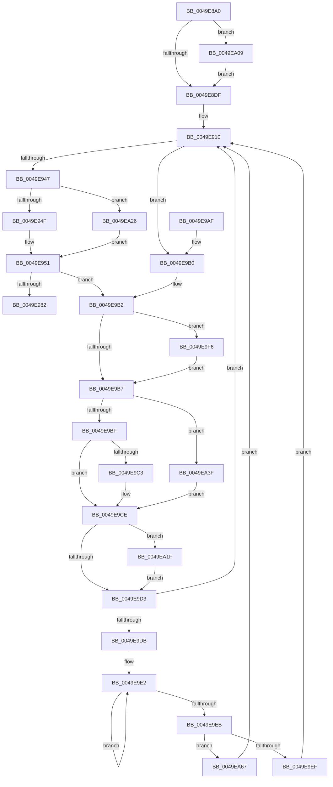

# PopFxProcessWorkPool

- RVA: `0x0049E8A0`–`0x0049EA75` (길이 `469` bytes)
- VA: `0x000000014049E8A0`
- 실행 섹션: `.text`
- PDB 이름 있음: `예`; PDB Function 태그: `아니요`
- unwind 정보 RVA: `0x000B5288`
- 디코드: `124`개 명령, `469/469` bytes 표시
- 미해석 바이트: `0` (있으면 어셈블리에 `.byte`로 보존)

> 이 문서는 커널 이미지의 기계어와 PDB 기호를 분석해 생성했습니다. 4번과 5번은 함수 원형과 자료형을 바이너리 사용 방식에서 추정한 C 해석이며 원본 소스 복구 결과는 아닙니다.

## 1. Dependencies

- 직접 호출 지점: **6**; 고유 호출 대상: **6**
- 직접 호출자로 확인된 함수: **2**
- RIP 상대 이미지 참조: **2**

### Outgoing calls
- `0x0049E93B` → [KeWaitForSingleObject](../20/KeWaitForSingleObject_function_0020E6B0.md) (function, `0x0020E6B0`)
- `0x0049E974` → [KeWaitForMultipleObjects](../20/KeWaitForMultipleObjects_function_0020D110.md) (function, `0x0020D110`)
- `0x0049E9C9` → [PopFxDispatchPluginWorkOnce](../2B/PopFxDispatchPluginWorkOnce_function_002BC69C.md) (function, `0x002BC69C`)
- `0x0049EA1F` → [KeLeaveGuardedRegion](../2E/KeLeaveGuardedRegion_function_002E2C40.md) (function, `0x002E2C40`)
- `0x0049EA47` → [ExInterlockedRemoveHeadList](../38/ExInterlockedRemoveHeadList_function_003867B0.md) (function, `0x003867B0`)
- `0x0049EA5D` → [guard_dispatch_icall](../6B/guard_dispatch_icall_function_006BAAD0.md) (function, `0x006BAAD0`)

### Direct callers
- [PopFxStaticWorkPoolThread](../5D/PopFxStaticWorkPoolThread_function_005D3690.md) at `0x005D36CF`
- [PopFxPluginWork](../../page/A1/PopFxPluginWork_function_00A17050.md) at `0x00A17075`

### Static image references
- `0x0049E8BA` → RVA `0x00F0E580` (`.data`; read)
- `0x0049E8DF` → RVA `0x00012290` (`.rdata`; read)

## 2. Other-region calls and transfers

- 다른 실행 섹션으로 향하는 call: **0**
- 별도 외부 분기/꼬리 이동을 확인하지 못했습니다.

## 3. Assembly (complete function range)

```asm
0049E8A0  48 89 5C 24 10                  mov qword ptr [rsp + 0x10], rbx
0049E8A5  48 89 6C 24 18                  mov qword ptr [rsp + 0x18], rbp
0049E8AA  56                              push rsi
0049E8AB  57                              push rdi
0049E8AC  41 54                           push r12
0049E8AE  41 55                           push r13
0049E8B0  41 56                           push r14
0049E8B2  48 83 EC 50                     sub rsp, 0x50
0049E8B6  33 ED                           xor ebp, ebp
0049E8B8  8B F2                           mov esi, edx
0049E8BA  4C 8D 25 BF FC A6 00            lea r12, [rip + 0xa6fcbf]
0049E8C1  48 8B D9                        mov rbx, rcx
0049E8C4  8D 7D 01                        lea edi, [rbp + 1]
0049E8C7  3B D7                           cmp edx, edi
0049E8C9  40 0F 93 C5                     setae bpl
0049E8CD  45 33 F6                        xor r14d, r14d
0049E8D0  49 3B CC                        cmp rcx, r12
0049E8D3  41 0F 94 C6                     sete r14b
0049E8D7  3B D7                           cmp edx, edi
0049E8D9  0F 83 2A 01 00 00               jae 0x14049ea09
0049E8DF  66 0F 6F 0D A9 39 B7 FF         movdqa xmm1, xmmword ptr [rip - 0x48c657]
0049E8E7  48 8D 43 20                     lea rax, [rbx + 0x20]
0049E8EB  0F 57 C0                        xorps xmm0, xmm0
0049E8EE  41 BD 02 00 00 00               mov r13d, 2
0049E8F4  66 0F 62 C8                     punpckldq xmm1, xmm0
0049E8F8  66 48 0F 6E C0                  movq xmm0, rax
0049E8FD  66 0F 6C C0                     punpcklqdq xmm0, xmm0
0049E901  66 0F 73 F1 05                  psllq xmm1, 5
0049E906  66 0F D4 C8                     paddq xmm1, xmm0
0049E90A  F3 0F 7F 4C 24 40               movdqu xmmword ptr [rsp + 0x40], xmm1
0049E910  48 83 A4 24 80 00 00 00 00      and qword ptr [rsp + 0x80], 0
0049E919  48 8D 84 24 80 00 00 00         lea rax, [rsp + 0x80]
0049E921  48 63 CD                        movsxd rcx, ebp
0049E924  45 33 C9                        xor r9d, r9d
0049E927  48 03 CF                        add rcx, rdi
0049E92A  48 89 44 24 20                  mov qword ptr [rsp + 0x20], rax
0049E92F  48 C1 E1 05                     shl rcx, 5
0049E933  45 33 C0                        xor r8d, r8d
0049E936  48 03 CB                        add rcx, rbx
0049E939  33 D2                           xor edx, edx
0049E93B  E8 70 FD D6 FF                  call 0x14020e6b0
0049E940  3D 02 01 00 00                  cmp eax, 0x102
0049E945  75 69                           jne 0x14049e9b0
0049E947  3B F7                           cmp esi, edi
0049E949  0F 83 D7 00 00 00               jae 0x14049ea26
0049E94F  33 C0                           xor eax, eax
0049E951  48 83 64 24 38 00               and qword ptr [rsp + 0x38], 0
0049E957  48 8D 54 24 40                  lea rdx, [rsp + 0x40]
0049E95C  48 89 44 24 30                  mov qword ptr [rsp + 0x30], rax
0049E961  45 33 C9                        xor r9d, r9d
0049E964  C6 44 24 28 00                  mov byte ptr [rsp + 0x28], 0
0049E969  44 8B C7                        mov r8d, edi
0049E96C  41 8B CD                        mov ecx, r13d
0049E96F  C6 44 24 20 00                  mov byte ptr [rsp + 0x20], 0
0049E974  E8 97 E7 D6 FF                  call 0x14020d110
0049E979  8B C8                           mov ecx, eax
0049E97B  3D 02 01 00 00                  cmp eax, 0x102
0049E980  75 30                           jne 0x14049e9b2
0049E982  48 83 A4 F3 08 01 00 00 00      and qword ptr [rbx + rsi*8 + 0x108], 0
0049E98B  8D 4E FF                        lea ecx, [rsi - 1]
0049E98E  D3 E7                           shl edi, cl
0049E990  F7 D7                           not edi
0049E992  F0 21 7B 60                     lock and dword ptr [rbx + 0x60], edi
0049E996  4C 8D 5C 24 50                  lea r11, [rsp + 0x50]
0049E99B  49 8B 5B 38                     mov rbx, qword ptr [r11 + 0x38]
0049E99F  49 8B 6B 40                     mov rbp, qword ptr [r11 + 0x40]
0049E9A3  49 8B E3                        mov rsp, r11
0049E9A6  41 5E                           pop r14
0049E9A8  41 5D                           pop r13
0049E9AA  41 5C                           pop r12
0049E9AC  5F                              pop rdi
0049E9AD  5E                              pop rsi
0049E9AE  C3                              ret
0049E9AF  CC                              int3
0049E9B0  8B CD                           mov ecx, ebp
0049E9B2  49 3B DC                        cmp rbx, r12
0049E9B5  74 3F                           je 0x14049e9f6
0049E9B7  85 C9                           test ecx, ecx
0049E9B9  0F 84 80 00 00 00               je 0x14049ea3f
0049E9BF  3B CF                           cmp ecx, edi
0049E9C1  75 0B                           jne 0x14049e9ce
0049E9C3  48 8B 0B                        mov rcx, qword ptr [rbx]
0049E9C6  41 8B D6                        mov edx, r14d
0049E9C9  E8 CE DC E1 FF                  call 0x1402bc69c
0049E9CE  49 3B DC                        cmp rbx, r12
0049E9D1  74 4C                           je 0x14049ea1f
0049E9D3  3B F7                           cmp esi, edi
0049E9D5  0F 83 35 FF FF FF               jae 0x14049e910
0049E9DB  0F 0D 4B 60                     prefetchw byte ptr [rbx + 0x60]
0049E9DF  8B 43 60                        mov eax, dword ptr [rbx + 0x60]
0049E9E2  8B C8                           mov ecx, eax
0049E9E4  F0 0F B1 4B 60                  lock cmpxchg dword ptr [rbx + 0x60], ecx
0049E9E9  75 F7                           jne 0x14049e9e2
0049E9EB  85 C0                           test eax, eax
0049E9ED  74 78                           je 0x14049ea67
0049E9EF  33 ED                           xor ebp, ebp
0049E9F1  E9 1A FF FF FF                  jmp 0x14049e910
0049E9F6  65 48 8B 04 25 88 01 00 00      mov rax, qword ptr gs:[0x188]
0049E9FF  66 FF 88 E6 01 00 00            dec word ptr [rax + 0x1e6]
0049EA06  90                              nop
0049EA07  EB AE                           jmp 0x14049e9b7
0049EA09  65 48 8B 0C 25 88 01 00 00      mov rcx, qword ptr gs:[0x188]
0049EA12  48 89 8C F3 08 01 00 00         mov qword ptr [rbx + rsi*8 + 0x108], rcx
0049EA1A  E9 C0 FE FF FF                  jmp 0x14049e8df
0049EA1F  E8 1C 42 E4 FF                  call 0x1402e2c40
0049EA24  EB AD                           jmp 0x14049e9d3
0049EA26  48 C7 84 24 80 00 00 00 B0 3C FF FF  mov qword ptr [rsp + 0x80], 0xffffffffffff3cb0
0049EA32  48 8D 84 24 80 00 00 00         lea rax, [rsp + 0x80]
0049EA3A  E9 12 FF FF FF                  jmp 0x14049e951
0049EA3F  48 8D 53 08                     lea rdx, [rbx + 8]
0049EA43  48 8D 4B 10                     lea rcx, [rbx + 0x10]
0049EA47  E8 64 7D EE FF                  call 0x1403867b0
0049EA4C  48 8B C8                        mov rcx, rax
0049EA4F  0F 57 C0                        xorps xmm0, xmm0
0049EA52  0F 11 00                        movups xmmword ptr [rax], xmm0
0049EA55  48 8B 49 18                     mov rcx, qword ptr [rcx + 0x18]
0049EA59  48 8B 40 10                     mov rax, qword ptr [rax + 0x10]
0049EA5D  E8 6E C0 21 00                  call 0x1406baad0
0049EA62  E9 67 FF FF FF                  jmp 0x14049e9ce
0049EA67  8D 45 01                        lea eax, [rbp + 1]
0049EA6A  99                              cdq
0049EA6B  41 F7 FD                        idiv r13d
0049EA6E  8B EA                           mov ebp, edx
0049EA70  E9 9B FE FF FF                  jmp 0x14049e910
```

## 4. C-style interpretation (structured pseudocode)

```c
__int64 __fastcall PopFxProcessWorkPool(__int64 a1, int a2, int a3, int a4)
{
    __int64 result;
    __int64 v_r14;
    __int64 v_rbp;
    __int64 v_rdi;
    __int64 v_rsp;
    unsigned __int64 v_stack_m28;
    unsigned __int64 v_stack_m38;
    unsigned __int64 v_stack_m40;
    unsigned __int64 v_stack_m48;
    unsigned __int8 v_stack_m50;
    unsigned __int64 v_stack_m58;
    unsigned __int64 v_stack_p10;
    unsigned __int64 v_stack_p18;
    unsigned __int64 v_stack_p30;
    unsigned __int64 v_stack_p8;

    v_stack_p10 = v_rbx;
    v_stack_p18 = v_rbp;
    v_rsp = (v_rsp) - (80);
    v_rbp = 0;
    v_rbp = (a2 >= ((unsigned int)(v_rbp + 1))) ? 1 : 0;
    v_r14 = 0;
    v_r14 = (a1 == (v_rip + 10943679)) ? 1 : 0;
    if (a2 >= ((unsigned int)(v_rbp + 1))) goto loc_0049EA09;
loc_0049E8DF:
    v_stack_m38 = v_xmm1;
loc_0049E910:
    a4 = 0;
    a1 = ((int)((unsigned int)(v_rbp))) + (v_rbp + 1);
    v_stack_m58 = v_stack_p8;
    a1 = (a1) << (5);
    a3 = 0;
    a1 = (a1) + (a1);
    a2 = 0;
    result = KeWaitForSingleObject(a1, a2, a3, a4);
    if (((unsigned int)(result)) != 258) goto loc_0049E9B0;
    if (((unsigned int)((unsigned int)(a2))) >= ((unsigned int)(v_rbp + 1))) goto loc_0049EA26;
    result = 0;
loc_0049E951:
    v_stack_m48 = 0;
    a4 = 0;
    v_stack_m50 = 0;
    v_stack_m58 = 0;
    result = KeWaitForMultipleObjects(2, v_stack_m38, (unsigned int)((unsigned int)(v_rbp + 1)), a4);
    if (((unsigned int)(result)) != 258) goto loc_0049E9B2;
    v_rdi = (unsigned int)((v_rbp + 1) << ((unsigned __int8)((unsigned int)(a2) - 1)));
    v_rdi = (unsigned int)(~(v_rdi));
    return result;
loc_0049E9B0:
loc_0049E9B2:
    if ((*(unsigned __int64 *)(v_stack_m28 + 56)) == (v_rip + 10943679)) goto loc_0049E9F6;
loc_0049E9B7:
    if ((unsigned int)((unsigned int)((unsigned int)(*(unsigned __int64 *)(v_stack_m28 + 64)))) == 0) goto loc_0049EA3F;
    if (((unsigned int)((unsigned int)((unsigned int)(*(unsigned __int64 *)(v_stack_m28 + 64))))) == ((unsigned int)(v_rdi))) {
        a1 = *(unsigned __int64 *)(*(unsigned __int64 *)(v_stack_m28 + 56));
        a2 = (unsigned int)(v_r14);
        result = PopFxDispatchPluginWorkOnce(a1, a2, (unsigned int)((unsigned int)(v_rbp + 1)), a4);
    }
    if ((*(unsigned __int64 *)(v_stack_m28 + 56)) == (v_rip + 10943679)) goto loc_0049EA1F;
loc_0049E9D3:
    if (((unsigned int)((unsigned int)(a2))) >= ((unsigned int)(v_rdi))) goto loc_0049E910;
loc_0049E9E2:
    if (((unsigned int)((unsigned int)(a2))) != ((unsigned int)(v_rdi))) goto loc_0049E9E2;
    if ((unsigned int)((unsigned int)(*(unsigned int *)(*(unsigned __int64 *)(v_stack_m28 + 56) + 96))) == 0) goto loc_0049EA67;
    v_rbp = 0;
    goto loc_0049E910;
loc_0049E9F6:
    goto loc_0049E9B7;
loc_0049EA09:
    *(unsigned __int64 *)(*(unsigned __int64 *)(v_stack_m28 + 56) + (unsigned int)(a2) * 8 + 264) = *(unsigned __int64 *)(gs_base + (0 + 392));
    goto loc_0049E8DF;
loc_0049EA1F:
    result = KeLeaveGuardedRegion(*(unsigned __int64 *)(gs_base + (0 + 392)), a2, (unsigned int)((unsigned int)(v_rbp + 1)), a4);
    goto loc_0049E9D3;
loc_0049EA26:
    v_stack_p30 = 0xFFFFFFFFFFFF3CB0ULL;
    goto loc_0049E951;
loc_0049EA3F:
    result = ExInterlockedRemoveHeadList(*(unsigned __int64 *)(v_stack_m28 + 56) + 16, *(unsigned __int64 *)(v_stack_m28 + 56) + 8, (unsigned int)((unsigned int)(v_rbp + 1)), a4);
    *(unsigned __int64 *)(result) = v_xmm0;
    result = guard_dispatch_icall(*(unsigned __int64 *)(result + 24), *(unsigned __int64 *)(v_stack_m28 + 56) + 8, (unsigned int)((unsigned int)(v_rbp + 1)), a4);
    goto loc_0049E9CE;
loc_0049EA67:
    goto loc_0049E910;
}
```

## 5. (Beta) C Style

```c
int64_t PopFxProcessWorkPool(void *Arg1, int32_t Arg2, int32_t Arg3, int32_t Arg4)
{
    uint8_t *arg1 = (uint8_t *)Arg1;

    int64_t result;
    int64_t local_r14;
    int64_t local_rbp;
    int64_t local_rdi;
    int64_t local_rsp;
    uint64_t v_stack_m28;
    uint64_t v_stack_m38;
    uint64_t v_stack_m40;
    uint64_t v_stack_m48;
    uint8_t v_stack_m50;
    uint64_t v_stack_m58;
    uint64_t v_stack_p10;
    uint64_t v_stack_p18;
    uint64_t v_stack_p30;
    uint64_t v_stack_p8;

    v_stack_p10 = local_rbx;
    v_stack_p18 = local_rbp;
    local_rsp = (local_rsp) - (80);
    local_rbp = 0;
    local_rbp = (Arg2 >= ((uint32_t)(local_rbp + 1))) ? 1 : 0;
    local_r14 = 0;
    local_r14 = (Arg1 == (v_rip + 10943679)) ? 1 : 0;
    if (Arg2 >= ((uint32_t)(local_rbp + 1))) goto loc_0049EA09;
loc_0049E8DF:
    v_stack_m38 = v_xmm1;
loc_0049E910:
    Arg4 = 0;
    Arg1 = ((int32_t)((uint32_t)(local_rbp))) + (local_rbp + 1);
    v_stack_m58 = v_stack_p8;
    Arg1 = (Arg1) << (5);
    Arg3 = 0;
    Arg1 = (Arg1) + (Arg1);
    Arg2 = 0;
    result = KeWaitForSingleObject(Arg1, Arg2, Arg3, Arg4);
    if (((uint32_t)(result)) != 258) goto loc_0049E9B0;
    if (((uint32_t)((uint32_t)(Arg2))) >= ((uint32_t)(local_rbp + 1))) goto loc_0049EA26;
    result = 0;
loc_0049E951:
    v_stack_m48 = 0;
    Arg4 = 0;
    v_stack_m50 = 0;
    v_stack_m58 = 0;
    result = KeWaitForMultipleObjects(2, v_stack_m38, (uint32_t)((uint32_t)(local_rbp + 1)), Arg4);
    if (((uint32_t)(result)) != 258) goto loc_0049E9B2;
    local_rdi = (uint32_t)((local_rbp + 1) << ((uint8_t)((uint32_t)(Arg2) - 1)));
    local_rdi = (uint32_t)(~(local_rdi));
    return result;
loc_0049E9B0:
loc_0049E9B2:
    if ((*(uint64_t *)(v_stack_m28 + 0x38)) == (v_rip + 10943679)) goto loc_0049E9F6;
loc_0049E9B7:
    if ((uint32_t)((uint32_t)((uint32_t)(*(uint64_t *)(v_stack_m28 + 0x40)))) == 0) goto loc_0049EA3F;
    if (((uint32_t)((uint32_t)((uint32_t)(*(uint64_t *)(v_stack_m28 + 0x40))))) == ((uint32_t)(local_rdi))) {
        Arg1 = *(uint64_t *)(*(uint64_t *)(v_stack_m28 + 0x38));
        Arg2 = (uint32_t)(local_r14);
        result = PopFxDispatchPluginWorkOnce(Arg1, Arg2, (uint32_t)((uint32_t)(local_rbp + 1)), Arg4);
    }
    if ((*(uint64_t *)(v_stack_m28 + 0x38)) == (v_rip + 10943679)) goto loc_0049EA1F;
loc_0049E9D3:
    if (((uint32_t)((uint32_t)(Arg2))) >= ((uint32_t)(local_rdi))) goto loc_0049E910;
loc_0049E9E2:
    if (((uint32_t)((uint32_t)(Arg2))) != ((uint32_t)(local_rdi))) goto loc_0049E9E2;
    if ((uint32_t)((uint32_t)(*(uint32_t *)(*(uint64_t *)(v_stack_m28 + 0x38) + 0x60))) == 0) goto loc_0049EA67;
    local_rbp = 0;
    goto loc_0049E910;
loc_0049E9F6:
    goto loc_0049E9B7;
loc_0049EA09:
    *(uint64_t *)(*(uint64_t *)(v_stack_m28 + 0x38) + (uint32_t)(Arg2) * 8 + 0x108) = *(uint64_t *)(gs_base + (0 + 0x188));
    goto loc_0049E8DF;
loc_0049EA1F:
    result = KeLeaveGuardedRegion(*(uint64_t *)(gs_base + (0 + 0x188)), Arg2, (uint32_t)((uint32_t)(local_rbp + 1)), Arg4);
    goto loc_0049E9D3;
loc_0049EA26:
    v_stack_p30 = 0xFFFFFFFFFFFF3CB0ULL;
    goto loc_0049E951;
loc_0049EA3F:
    result = ExInterlockedRemoveHeadList(*(uint64_t *)(v_stack_m28 + 0x38) + 16, *(uint64_t *)(v_stack_m28 + 0x38) + 8, (uint32_t)((uint32_t)(local_rbp + 1)), Arg4);
    *(uint64_t *)(result) = v_xmm0;
    result = guard_dispatch_icall(*(uint64_t *)(result + 0x18), *(uint64_t *)(v_stack_m28 + 0x38) + 8, (uint32_t)((uint32_t)(local_rbp + 1)), Arg4);
    goto loc_0049E9CE;
loc_0049EA67:
    goto loc_0049E910;
}
```

### 관측된 메모리 오프셋

구조체 형식이 확인되지 않은 접근은 인자 기준의 오프셋으로만 기록했습니다.

| 기준 인자 | 오프셋 표현 | 폭 (bit) | 접근 |
|---|---:|---:|---|
| `Arg1` | `+ 0x20` | `64` | `R` |
| `Arg1` | `+ 0x108 + rsi*8` | `64` | `W` |

## 6. Execution-region graph

[열기: 2D/3D 그래프와 함수 탐색 컨트롤 패널](../../../control-panel.html?section=text&rva=0x0049E8A0&view=graph)

- 2D 그래프는 위에서 아래로 흐르고, 3D 그래프는 빈 공간을 드래그해 회전합니다. Shift+드래그는 이동, 휠은 확대·축소, 함수 노드 선택은 대상 보고서 이동입니다.

### Static fallback


