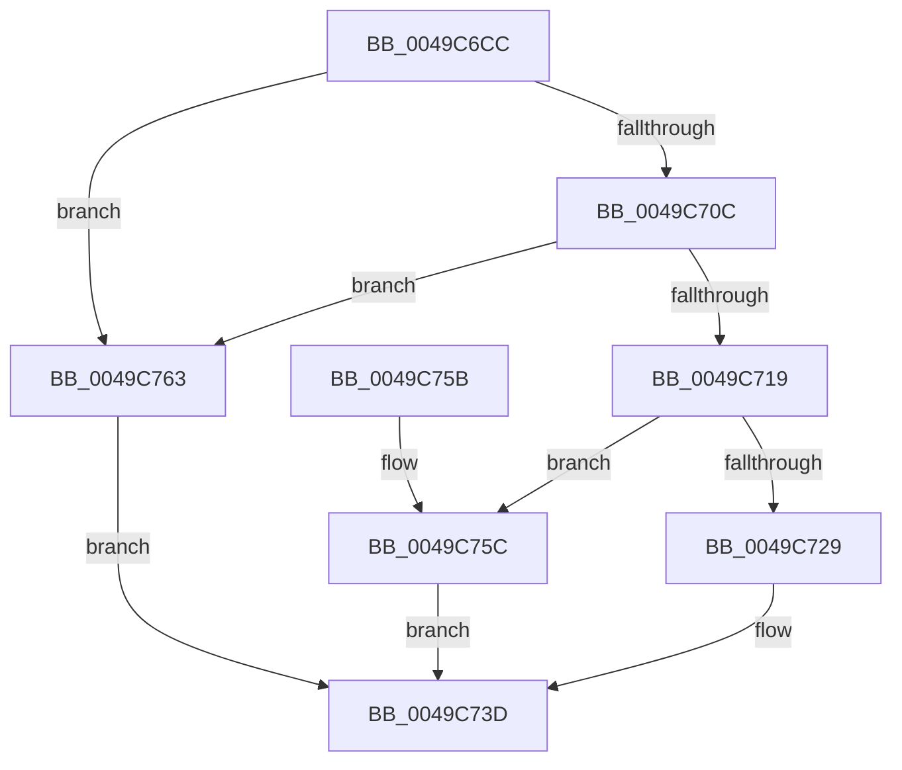

# PopGetPowerSettingValue

- RVA: `0x0049C6CC`–`0x0049C76A` (길이 `158` bytes)
- VA: `0x000000014049C6CC`
- 실행 섹션: `.text`
- PDB 이름 있음: `예`; PDB Function 태그: `아니요`
- unwind 정보 RVA: `0x00096B48`
- 디코드: `44`개 명령, `158/158` bytes 표시
- 미해석 바이트: `0` (있으면 어셈블리에 `.byte`로 보존)

> 이 문서는 커널 이미지의 기계어와 PDB 기호를 분석해 생성했습니다. 4번과 5번은 함수 원형과 자료형을 바이너리 사용 방식에서 추정한 C 해석이며 원본 소스 복구 결과는 아닙니다.

## 1. Dependencies

- 직접 호출 지점: **4**; 고유 호출 대상: **4**
- 직접 호출자로 확인된 함수: **4**
- RIP 상대 이미지 참조: **2**

### Outgoing calls
- `0x0049C6EB` → [ExAcquireFastMutex](../20/ExAcquireFastMutex_function_0020E5A0.md) (function, `0x0020E5A0`)
- `0x0049C700` → [PopFindPowerSettingConfiguration](../../page/91/PopFindPowerSettingConfiguration_function_009152E0.md) (function, `0x009152E0`)
- `0x0049C738` → [memcpy](../6C/memcpy_function_006C6840.md) (function, `0x006C6840`)
- `0x0049C744` → [ExReleaseFastMutex](../25/ExReleaseFastMutex_function_002519C0.md) (function, `0x002519C0`)

### Direct callers
- [PopCaptureSleepStudyStatistics](../43/PopCaptureSleepStudyStatistics_function_004399F4.md) at `0x00439C9D`
- [PopCaptureSleepStudyStatistics](../43/PopCaptureSleepStudyStatistics_function_004399F4.md) at `0x00439CD9`
- [PopCaptureSleepStudyStatistics](../43/PopCaptureSleepStudyStatistics_function_004399F4.md) at `0x00439D05`
- [PopCaptureSleepStudyStatistics](../43/PopCaptureSleepStudyStatistics_function_004399F4.md) at `0x00439D38`
- [PopCaptureSleepStudyStatistics](../43/PopCaptureSleepStudyStatistics_function_004399F4.md) at `0x00439DAD`
- [PopCaptureSleepStudyStatistics](../43/PopCaptureSleepStudyStatistics_function_004399F4.md) at `0x00439DD9`
- [PopCaptureSleepStudyStatistics](../43/PopCaptureSleepStudyStatistics_function_004399F4.md) at `0x00439E09`
- [PopCaptureSleepStudyStatistics](../43/PopCaptureSleepStudyStatistics_function_004399F4.md) at `0x00439E2A`
- [PopScanIdleList](PopScanIdleList_function_00497F04.md) at `0x0049822E`
- [PopScanIdleList](PopScanIdleList_function_00497F04.md) at `0x00498298`
- [PopBatteryUpdateAlarms](../../page/91/PopBatteryUpdateAlarms_function_00910058.md) at `0x00910195`
- [PopBatteryUpdateAlarms](../../page/91/PopBatteryUpdateAlarms_function_00910058.md) at `0x009101C4`
- [PopBatteryUpdateAlarms](../../page/91/PopBatteryUpdateAlarms_function_00910058.md) at `0x009101F3`
- [PopEsInStandbyEvaluate](../../page/A4/PopEsInStandbyEvaluate_function_00A4A260.md) at `0x00A4A29F`
- [PopEsInStandbyEvaluate](../../page/A4/PopEsInStandbyEvaluate_function_00A4A260.md) at `0x00A4A2C9`

### Static image references
- `0x0049C6E1` → RVA `0x00F0DF40` (`.data`; read)
- `0x0049C6F6` → RVA `0x00F0CE0C` (`.data`; read)

## 2. Other-region calls and transfers

- 다른 실행 섹션으로 향하는 call: **1**
  - `0x0049C700` → [PopFindPowerSettingConfiguration](../../page/91/PopFindPowerSettingConfiguration_function_009152E0.md) (`.text` → `PAGE`)
- 별도 외부 분기/꼬리 이동을 확인하지 못했습니다.

## 3. Assembly (complete function range)

```asm
0049C6CC  48 89 5C 24 08                  mov qword ptr [rsp + 8], rbx
0049C6D1  48 89 74 24 10                  mov qword ptr [rsp + 0x10], rsi
0049C6D6  57                              push rdi
0049C6D7  48 83 EC 20                     sub rsp, 0x20
0049C6DB  48 8B D9                        mov rbx, rcx
0049C6DE  49 8B F1                        mov rsi, r9
0049C6E1  48 8D 0D 58 18 A7 00            lea rcx, [rip + 0xa71858]
0049C6E8  41 8B F8                        mov edi, r8d
0049C6EB  E8 B0 1E D7 FF                  call 0x14020e5a0
0049C6F0  83 FF 01                        cmp edi, 1
0049C6F3  48 8B CB                        mov rcx, rbx
0049C6F6  0F 47 3D 0F 07 A7 00            cmova edi, dword ptr [rip + 0xa7070f]
0049C6FD  83 CA FF                        or edx, 0xffffffff
0049C700  E8 DB 8B 47 00                  call 0x1409152e0
0049C705  33 DB                           xor ebx, ebx
0049C707  48 85 C0                        test rax, rax
0049C70A  74 57                           je 0x14049c763
0049C70C  4C 63 CF                        movsxd r9, edi
0049C70F  4A 8B 54 C8 40                  mov rdx, qword ptr [rax + r9*8 + 0x40]
0049C714  48 85 D2                        test rdx, rdx
0049C717  74 4A                           je 0x14049c763
0049C719  8B 52 04                        mov edx, dword ptr [rdx + 4]
0049C71C  48 8B 4C 24 58                  mov rcx, qword ptr [rsp + 0x58]
0049C721  89 11                           mov dword ptr [rcx], edx
0049C723  39 54 24 50                     cmp dword ptr [rsp + 0x50], edx
0049C727  72 33                           jb 0x14049c75c
0049C729  44 8B C2                        mov r8d, edx
0049C72C  48 8B CE                        mov rcx, rsi
0049C72F  4A 8B 54 C8 40                  mov rdx, qword ptr [rax + r9*8 + 0x40]
0049C734  48 83 C2 0C                     add rdx, 0xc
0049C738  E8 03 A1 22 00                  call 0x1406c6840
0049C73D  48 8D 0D FC 17 A7 00            lea rcx, [rip + 0xa717fc]
0049C744  E8 77 52 DB FF                  call 0x1402519c0
0049C749  48 8B 74 24 38                  mov rsi, qword ptr [rsp + 0x38]
0049C74E  8B C3                           mov eax, ebx
0049C750  48 8B 5C 24 30                  mov rbx, qword ptr [rsp + 0x30]
0049C755  48 83 C4 20                     add rsp, 0x20
0049C759  5F                              pop rdi
0049C75A  C3                              ret
0049C75B  CC                              int3
0049C75C  BB 06 02 00 C0                  mov ebx, 0xc0000206
0049C761  EB DA                           jmp 0x14049c73d
0049C763  BB 0D 00 00 C0                  mov ebx, 0xc000000d
0049C768  EB D3                           jmp 0x14049c73d
```

## 4. C-style interpretation (structured pseudocode)

```c
__int64 __fastcall PopGetPowerSettingValue(__int64 a1, int a2, int a3, __int64 a4, unsigned int a5, __int64 a6)
{
    __int64 result;
    __int64 v_rbx;
    __int64 v_rdi;
    __int64 v_rsp;
    unsigned __int64 v_stack_p10;
    unsigned __int64 v_stack_p8;

    v_stack_p8 = v_rbx;
    v_stack_p10 = v_rsi;
    v_rsp = (v_rsp) - (32);
    result = ExAcquireFastMutex(v_rip + 10950744, a2, a3, a4);
    v_rdi = (unsigned int)(a3);
    if (((unsigned int)((unsigned int)(a3))) > 1) { v_rdi = *(unsigned int *)(v_rip + 10946319); }
    a2 = (unsigned int)((a2) | (0xFFFFFFFFULL));
    result = PopFindPowerSettingConfiguration(a1, a2, a3, a4);
    v_rbx = 0;
    if (result == 0) goto loc_0049C763;
    if (*(unsigned __int64 *)(result + (int)((unsigned int)(v_rdi)) * 8 + 64) == 0) goto loc_0049C763;
    *(unsigned int *)(a6) = (unsigned int)((unsigned int)(*(unsigned int *)(*(unsigned __int64 *)(result + (int)((unsigned int)(v_rdi)) * 8 + 64) + 4)));
    if (a5 < ((unsigned int)((unsigned int)(*(unsigned int *)(*(unsigned __int64 *)(result + (int)((unsigned int)(v_rdi)) * 8 + 64) + 4))))) goto loc_0049C75C;
    a2 = (*(unsigned __int64 *)(result + (int)((unsigned int)(v_rdi)) * 8 + 64)) + (12);
    result = memcpy(a4, a2, (unsigned int)((unsigned int)((unsigned int)(*(unsigned int *)(*(unsigned __int64 *)(result + (int)((unsigned int)(v_rdi)) * 8 + 64) + 4)))), (int)((unsigned int)(v_rdi)));
loc_0049C73D:
    result = ExReleaseFastMutex(v_rip + 10950652, a2, (unsigned int)((unsigned int)((unsigned int)(*(unsigned int *)(*(unsigned __int64 *)(result + (int)((unsigned int)(v_rdi)) * 8 + 64) + 4)))), (int)((unsigned int)(v_rdi)));
    v_rsp = (v_rsp) + (32);
    return 0;
loc_0049C75C:
    goto loc_0049C73D;
loc_0049C763:
    goto loc_0049C73D;
}
```

## 5. (Beta) C Style

```c
int64_t PopGetPowerSettingValue(int64_t Arg1, int32_t Arg2, int32_t Arg3, int64_t Arg4, uint32_t Arg5, void *Arg6)
{
    uint8_t *arg6 = (uint8_t *)Arg6;

    int64_t result;
    int64_t local_rbx;
    int64_t local_rdi;
    int64_t local_rsp;
    uint64_t v_stack_p10;
    uint64_t v_stack_p8;

    v_stack_p8 = local_rbx;
    v_stack_p10 = local_rsi;
    local_rsp = (local_rsp) - (32);
    result = ExAcquireFastMutex(v_rip + 10950744, Arg2, Arg3, Arg4);
    local_rdi = (uint32_t)(Arg3);
    if (((uint32_t)((uint32_t)(Arg3))) > 1) { local_rdi = *(uint32_t *)(v_rip + 0xA7070F); }
    Arg2 = (uint32_t)((Arg2) | (0xFFFFFFFFULL));
    result = PopFindPowerSettingConfiguration(Arg1, Arg2, Arg3, Arg4);
    local_rbx = 0;
    if (result == 0) goto loc_0049C763;
    if (*(uint64_t *)(result + (int32_t)((uint32_t)(local_rdi)) * 8 + 0x40) == 0) goto loc_0049C763;
    *(uint32_t *)(arg6) = (uint32_t)((uint32_t)(*(uint32_t *)(*(uint64_t *)(result + (int32_t)((uint32_t)(local_rdi)) * 8 + 0x40) + 0x4)));
    if (Arg5 < ((uint32_t)((uint32_t)(*(uint32_t *)(*(uint64_t *)(result + (int32_t)((uint32_t)(local_rdi)) * 8 + 0x40) + 0x4))))) goto loc_0049C75C;
    Arg2 = (*(uint64_t *)(result + (int32_t)((uint32_t)(local_rdi)) * 8 + 0x40)) + (12);
    result = memcpy(Arg4, Arg2, (uint32_t)((uint32_t)((uint32_t)(*(uint32_t *)(*(uint64_t *)(result + (int32_t)((uint32_t)(local_rdi)) * 8 + 0x40) + 0x4)))), (int32_t)((uint32_t)(local_rdi)));
loc_0049C73D:
    result = ExReleaseFastMutex(v_rip + 10950652, Arg2, (uint32_t)((uint32_t)((uint32_t)(*(uint32_t *)(*(uint64_t *)(result + (int32_t)((uint32_t)(local_rdi)) * 8 + 0x40) + 0x4)))), (int32_t)((uint32_t)(local_rdi)));
    local_rsp = (local_rsp) + (32);
    return 0;
loc_0049C75C:
    goto loc_0049C73D;
loc_0049C763:
    goto loc_0049C73D;
}
```

### 관측된 메모리 오프셋

구조체 형식이 확인되지 않은 접근은 인자 기준의 오프셋으로만 기록했습니다.

| 기준 인자 | 오프셋 표현 | 폭 (bit) | 접근 |
|---|---:|---:|---|
| `Arg6` | `+ 0x0` | `32` | `W` |

## 6. Execution-region graph

[열기: 2D/3D 그래프와 함수 탐색 컨트롤 패널](../../../control-panel.html?section=text&rva=0x0049C6CC&view=graph)

- 2D 그래프는 위에서 아래로 흐르고, 3D 그래프는 빈 공간을 드래그해 회전합니다. Shift+드래그는 이동, 휠은 확대·축소, 함수 노드 선택은 대상 보고서 이동입니다.

### Static fallback


