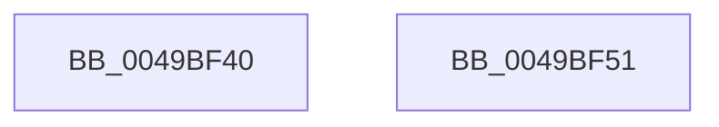

# PopIsPlatformAoAcCapable

- RVA: `0x0049BF40`–`0x0049BF52` (길이 `18` bytes)
- VA: `0x000000014049BF40`
- 실행 섹션: `.text`
- PDB 이름 있음: `예`; PDB Function 태그: `아니요`
- unwind 정보 RVA: `0x000DB714`
- 디코드: `6`개 명령, `18/18` bytes 표시
- 미해석 바이트: `0` (있으면 어셈블리에 `.byte`로 보존)

> 이 문서는 커널 이미지의 기계어와 PDB 기호를 분석해 생성했습니다. 4번과 5번은 함수 원형과 자료형을 바이너리 사용 방식에서 추정한 C 해석이며 원본 소스 복구 결과는 아닙니다.

## 1. Dependencies

- 직접 호출 지점: **0**; 고유 호출 대상: **0**
- 직접 호출자로 확인된 함수: **27**
- RIP 상대 이미지 참조: **2**

### Outgoing calls
- 직접 디코드된 call 명령이 없습니다.

### Direct callers
- [PopPdcRegister](../../page/70/PopPdcRegister_function_00704AD0.md) at `0x00704C8B`
- [PopBroadcastInputSuppressionCallback](../../page/76/PopBroadcastInputSuppressionCallback_function_007653D0.md) at `0x007653D4`
- [PopUsb4DisplayPresenceUpdatedWorker](../../page/76/PopUsb4DisplayPresenceUpdatedWorker_function_00765690.md) at `0x007656A6`
- [PopPowerButtonLidReliabilityUpdated](../../page/76/PopPowerButtonLidReliabilityUpdated_function_00765A68.md) at `0x00765A70`
- [PopWnfInSupCallback](../../page/76/PopWnfInSupCallback_function_00765B50.md) at `0x00765B5F`
- [PopSmartSuspendValidatePredictions](../../page/76/PopSmartSuspendValidatePredictions_function_007688EC.md) at `0x007688FB`
- [PopAdaptiveStandbyInitialize](../../page/76/PopAdaptiveStandbyInitialize_function_0076DDF8.md) at `0x0076DECB`
- [PopAdaptiveStandbyNotifyShellPhaseState](../../page/76/PopAdaptiveStandbyNotifyShellPhaseState_function_0076E2CC.md) at `0x0076E2FB`
- [PopUpdateSystemIdleContext](../../page/91/PopUpdateSystemIdleContext_function_00911BB4.md) at `0x00911C6D`
- [PopSystemIdleEventHandler](../../page/91/PopSystemIdleEventHandler_function_00912A70.md) at `0x00912AA9`
- [PopValidatePowerSettingData](../../page/91/PopValidatePowerSettingData_function_00915368.md) at `0x009153E2`
- [NtPowerInformation](../../page/95/NtPowerInformation_function_00955D80.md) at `0x00956D2D`
- [NtPowerInformation](../../page/95/NtPowerInformation_function_00955D80.md) at `0x0095761D`
- [NtPowerInformation](../../page/95/NtPowerInformation_function_00955D80.md) at `0x00957700`
- [NtPowerInformation](../../page/95/NtPowerInformation_function_00955D80.md) at `0x00957C08`
- [SleepstudyHelperBuildBlocker](../../page/A2/SleepstudyHelperBuildBlocker_function_00A2DAD0.md) at `0x00A2DB3F`
- [PopGenericEventHandler](../../page/A6/PopGenericEventHandler_function_00A69650.md) at `0x00A69666`
- [PopS0LowPowerIdleInfo](../../page/A7/PopS0LowPowerIdleInfo_function_00A7C330.md) at `0x00A7C34B`
- [PopPowerInformationInternal](../../page/A8/PopPowerInformationInternal_function_00A8B7C0.md) at `0x00A8BB0D`
- [PopPowerInformationInternal](../../page/A8/PopPowerInformationInternal_function_00A8B7C0.md) at `0x00A8BD21`
- [PopPowerInformationInternal](../../page/A8/PopPowerInformationInternal_function_00A8B7C0.md) at `0x00A8C633`
- [PopConnectedStandbySettingCallback](../../page/A8/PopConnectedStandbySettingCallback_function_00A8FF40.md) at `0x00A8FF71`
- [PopPdcCsDeviceNotification](../../page/AA/PopPdcCsDeviceNotification_function_00AA1B28.md) at `0x00AA1B46`
- [PopExternalMonitorUpdatedWorker](../../page/AB/PopExternalMonitorUpdatedWorker_function_00AB0B20.md) at `0x00AB0B42`
- [NtSetThreadExecutionState](../../page/AC/NtSetThreadExecutionState_function_00AC0A40.md) at `0x00AC0BBE`
- [NtSetThreadExecutionState](../../page/AC/NtSetThreadExecutionState_function_00AC0A40.md) at `0x00AC0CBF`
- [PopSqmBatteryUpdate](../../page/AC/PopSqmBatteryUpdate_function_00AC1794.md) at `0x00AC17AA`
- [PopNotifyLidStateChange](../../page/AC/PopNotifyLidStateChange_function_00AC34A8.md) at `0x00AC34D1`
- [PopSleepstudyStartNextSession](../../page/AC/PopSleepstudyStartNextSession_function_00AC4720.md) at `0x00AC49A5`
- [PopSleepstudyStartNextSession](../../page/AC/PopSleepstudyStartNextSession_function_00AC4720.md) at `0x00AC4BCB`
- [PopDiagTraceCsExitReason](../../page/AC/PopDiagTraceCsExitReason_function_00ACFB24.md) at `0x00AD01AD`
- [PopDiagTraceCsExitReason](../../page/AC/PopDiagTraceCsExitReason_function_00ACFB24.md) at `0x00AD01F7`
- [PopSmartSuspendMakePredictions](../../page/AD/PopSmartSuspendMakePredictions_function_00AD9168.md) at `0x00AD91CF`
- [PopPowerAggregatorHandleActiveIntent](../../page/AD/PopPowerAggregatorHandleActiveIntent_function_00ADFCB0.md) at `0x00ADFD13`
- [sub_00B4A29A](../../page/B4/Unknown_function_00B4A29A.md) at `0x00B4A2B5`

### Static image references
- `0x0049BF40` → RVA `0x00E673A0` (`.data`; read)
- `0x0049BF4A` → RVA `0x00E6739C` (`.data`; read)

## 2. Other-region calls and transfers

- 다른 실행 섹션으로 향하는 call: **0**
- 별도 외부 분기/꼬리 이동을 확인하지 못했습니다.

## 3. Assembly (complete function range)

```asm
0049BF40  8B 05 5A B4 9C 00               mov eax, dword ptr [rip + 0x9cb45a]
0049BF46  F7 D8                           neg eax
0049BF48  1A C0                           sbb al, al
0049BF4A  22 05 4C B4 9C 00               and al, byte ptr [rip + 0x9cb44c]
0049BF50  C3                              ret
0049BF51  CC                              int3
```

## 4. C-style interpretation (structured pseudocode)

```c
__int64 __fastcall PopIsPlatformAoAcCapable(void)
{
    __int64 result;

    result = (unsigned int)(-((unsigned int)(*(unsigned int *)(v_rip + 10269786))));
    result = (unsigned __int8)((result) & (*(unsigned __int8 *)(v_rip + 10269772)));
    return result;
}
```

## 5. (Beta) C Style

```c
void PopIsPlatformAoAcCapable(void)
{
    int64_t result;

    result = (uint32_t)(-((uint32_t)(*(uint32_t *)(v_rip + 0x9CB45A))));
    result = (uint8_t)((result) & (*(uint8_t *)(v_rip + 0x9CB44C)));
    return result;
}
```

## 6. Execution-region graph

[열기: 2D/3D 그래프와 함수 탐색 컨트롤 패널](../../../control-panel.html?section=text&rva=0x0049BF40&view=graph)

- 2D 그래프는 위에서 아래로 흐르고, 3D 그래프는 빈 공간을 드래그해 회전합니다. Shift+드래그는 이동, 휠은 확대·축소, 함수 노드 선택은 대상 보고서 이동입니다.

### Static fallback


