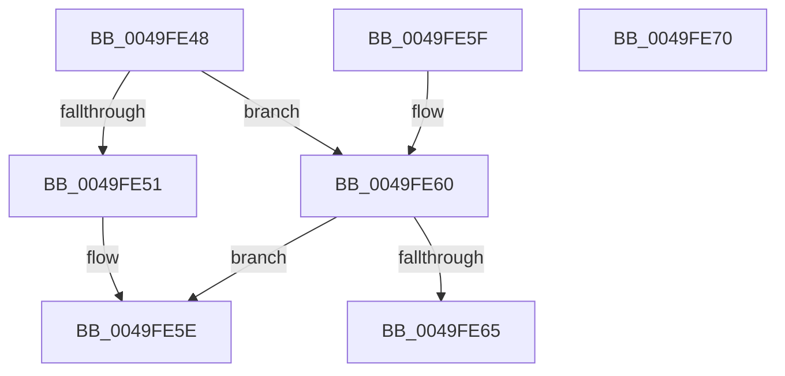

# PopMapInternalActionToIrpAction

- RVA: `0x0049FE48`–`0x0049FE71` (길이 `41` bytes)
- VA: `0x000000014049FE48`
- 실행 섹션: `.text`
- PDB 이름 있음: `예`; PDB Function 태그: `아니요`
- unwind 정보 RVA: `0x000DB714`
- 디코드: `17`개 명령, `41/41` bytes 표시
- 미해석 바이트: `0` (있으면 어셈블리에 `.byte`로 보존)

> 이 문서는 커널 이미지의 기계어와 PDB 기호를 분석해 생성했습니다. 4번과 5번은 함수 원형과 자료형을 바이너리 사용 방식에서 추정한 C 해석이며 원본 소스 복구 결과는 아닙니다.

## 1. Dependencies

- 직접 호출 지점: **0**; 고유 호출 대상: **0**
- 직접 호출자로 확인된 함수: **2**
- RIP 상대 이미지 참조: **0**

### Outgoing calls
- 직접 디코드된 call 명령이 없습니다.

### Direct callers
- [PopNotifyDevice](../../pagelk/B7/PopNotifyDevice_function_00B7DAAC.md) at `0x00B7DAF5`
- [sub_00B80364](../../pagelk/B8/Unknown_function_00B80364.md) at `0x00B80404`

### Static image references
- 디코드된 RIP-relative 메모리 참조가 없습니다.

## 2. Other-region calls and transfers

- 다른 실행 섹션으로 향하는 call: **0**
- 별도 외부 분기/꼬리 이동을 확인하지 못했습니다.

## 3. Assembly (complete function range)

```asm
0049FE48  B8 07 00 00 00                  mov eax, 7
0049FE4D  3B C8                           cmp ecx, eax
0049FE4F  74 0F                           je 0x14049fe60
0049FE51  44 8D 40 FC                     lea r8d, [rax - 4]
0049FE55  83 FA 05                        cmp edx, 5
0049FE58  41 0F 44 C8                     cmove ecx, r8d
0049FE5C  8B C1                           mov eax, ecx
0049FE5E  C3                              ret
0049FE5F  CC                              int3
0049FE60  45 84 C0                        test r8b, r8b
0049FE63  74 F9                           je 0x14049fe5e
0049FE65  83 EA 05                        sub edx, 5
0049FE68  F7 DA                           neg edx
0049FE6A  1B C0                           sbb eax, eax
0049FE6C  83 C0 03                        add eax, 3
0049FE6F  C3                              ret
0049FE70  CC                              int3
```

## 4. C-style interpretation (structured pseudocode)

```c
__int64 __fastcall PopMapInternalActionToIrpAction(int a1, int a2)
{
    __int64 result;

    if (a1 == 7) goto loc_0049FE60;
    if (a2 == 5) { a1 = (unsigned int)(7 - 4); }
loc_0049FE5E:
    return (unsigned int)(a1);
loc_0049FE60:
    if ((unsigned __int8)(7 - 4) == 0) goto loc_0049FE5E;
    a2 = (unsigned int)((a2) - (5));
    a2 = (unsigned int)(-(a2));
    result = (unsigned int)(((unsigned int)(a1)) + (3));
    return result;
}
```

## 5. (Beta) C Style

```c
int64_t PopMapInternalActionToIrpAction(int32_t Arg1, int32_t Arg2)
{
    int64_t result;

    if (Arg1 == 7) goto loc_0049FE60;
    if (Arg2 == 5) { Arg1 = (uint32_t)(7 - 4); }
loc_0049FE5E:
    return (uint32_t)(Arg1);
loc_0049FE60:
    if ((uint8_t)(7 - 4) == 0) goto loc_0049FE5E;
    Arg2 = (uint32_t)((Arg2) - (5));
    Arg2 = (uint32_t)(-(Arg2));
    result = (uint32_t)(((uint32_t)(Arg1)) + (3));
    return result;
}
```

## 6. Execution-region graph

[열기: 2D/3D 그래프와 함수 탐색 컨트롤 패널](../../../control-panel.html?section=text&rva=0x0049FE48&view=graph)

- 2D 그래프는 위에서 아래로 흐르고, 3D 그래프는 빈 공간을 드래그해 회전합니다. Shift+드래그는 이동, 휠은 확대·축소, 함수 노드 선택은 대상 보고서 이동입니다.

### Static fallback


