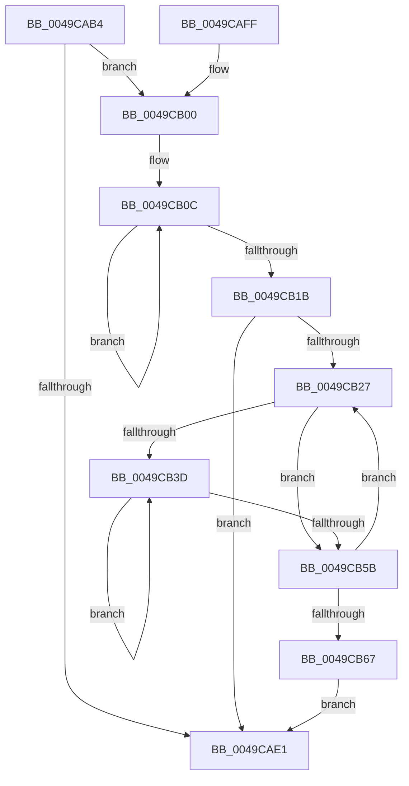

# PopPepGetDevicePlatformStateDependents

- RVA: `0x0049CAB4`–`0x0049CB6C` (길이 `184` bytes)
- VA: `0x000000014049CAB4`
- 실행 섹션: `.text`
- PDB 이름 있음: `예`; PDB Function 태그: `아니요`
- unwind 정보 RVA: `0x000B4CE0`
- 디코드: `48`개 명령, `184/184` bytes 표시
- 미해석 바이트: `0` (있으면 어셈블리에 `.byte`로 보존)

> 이 문서는 커널 이미지의 기계어와 PDB 기호를 분석해 생성했습니다. 4번과 5번은 함수 원형과 자료형을 바이너리 사용 방식에서 추정한 C 해석이며 원본 소스 복구 결과는 아닙니다.

## 1. Dependencies

- 직접 호출 지점: **2**; 고유 호출 대상: **2**
- 직접 호출자로 확인된 함수: **1**
- RIP 상대 이미지 참조: **0**

### Outgoing calls
- `0x0049CAD0` → [ExAcquireSpinLockShared](../24/ExAcquireSpinLockShared_function_0024DCE0.md) (function, `0x0024DCE0`)
- `0x0049CAE8` → [ExReleaseSpinLockShared](../2F/ExReleaseSpinLockShared_function_002F0EF0.md) (function, `0x002F0EF0`)

### Direct callers
- [PopDiagTraceDeviceVerboseRundown](../../page/A5/PopDiagTraceDeviceVerboseRundown_function_00A559E4.md) at `0x00A55A5B`

### Static image references
- 디코드된 RIP-relative 메모리 참조가 없습니다.

## 2. Other-region calls and transfers

- 다른 실행 섹션으로 향하는 call: **0**
- 별도 외부 분기/꼬리 이동을 확인하지 못했습니다.

## 3. Assembly (complete function range)

```asm
0049CAB4  48 89 5C 24 08                  mov qword ptr [rsp + 8], rbx
0049CAB9  48 89 74 24 10                  mov qword ptr [rsp + 0x10], rsi
0049CABE  57                              push rdi
0049CABF  48 83 EC 20                     sub rsp, 0x20
0049CAC3  83 22 00                        and dword ptr [rdx], 0
0049CAC6  48 8B D9                        mov rbx, rcx
0049CAC9  48 83 C1 40                     add rcx, 0x40
0049CACD  48 8B FA                        mov rdi, rdx
0049CAD0  E8 0B 12 DB FF                  call 0x14024dce0
0049CAD5  83 BB AC 00 00 00 02            cmp dword ptr [rbx + 0xac], 2
0049CADC  44 8A D0                        mov r10b, al
0049CADF  74 1F                           je 0x14049cb00
0049CAE1  41 8A D2                        mov dl, r10b
0049CAE4  48 8D 4B 40                     lea rcx, [rbx + 0x40]
0049CAE8  E8 03 44 E5 FF                  call 0x1402f0ef0
0049CAED  48 8B 5C 24 30                  mov rbx, qword ptr [rsp + 0x30]
0049CAF2  32 C0                           xor al, al
0049CAF4  48 8B 74 24 38                  mov rsi, qword ptr [rsp + 0x38]
0049CAF9  48 83 C4 20                     add rsp, 0x20
0049CAFD  5F                              pop rdi
0049CAFE  C3                              ret
0049CAFF  CC                              int3
0049CB00  4C 8D 83 90 00 00 00            lea r8, [rbx + 0x90]
0049CB07  BA 03 00 00 00                  mov edx, 3
0049CB0C  41 8B 08                        mov ecx, dword ptr [r8]
0049CB0F  4D 8D 40 04                     lea r8, [r8 + 4]
0049CB13  09 0F                           or dword ptr [rdi], ecx
0049CB15  48 83 EA 01                     sub rdx, 1
0049CB19  75 F1                           jne 0x14049cb0c
0049CB1B  45 33 C0                        xor r8d, r8d
0049CB1E  44 39 83 B4 00 00 00            cmp dword ptr [rbx + 0xb4], r8d
0049CB25  76 BA                           jbe 0x14049cae1
0049CB27  41 8B C0                        mov eax, r8d
0049CB2A  33 C9                           xor ecx, ecx
0049CB2C  4C 69 C8 D0 00 00 00            imul r9, rax, 0xd0
0049CB33  41 39 8C 19 7C 01 00 00         cmp dword ptr [r9 + rbx + 0x17c], ecx
0049CB3B  76 1E                           jbe 0x14049cb5b
0049CB3D  49 8B 84 19 88 01 00 00         mov rax, qword ptr [r9 + rbx + 0x188]
0049CB45  48 8D 14 49                     lea rdx, [rcx + rcx*2]
0049CB49  FF C1                           inc ecx
0049CB4B  8B 54 D0 10                     mov edx, dword ptr [rax + rdx*8 + 0x10]
0049CB4F  09 17                           or dword ptr [rdi], edx
0049CB51  41 3B 8C 19 7C 01 00 00         cmp ecx, dword ptr [r9 + rbx + 0x17c]
0049CB59  72 E2                           jb 0x14049cb3d
0049CB5B  41 FF C0                        inc r8d
0049CB5E  44 3B 83 B4 00 00 00            cmp r8d, dword ptr [rbx + 0xb4]
0049CB65  72 C0                           jb 0x14049cb27
0049CB67  E9 75 FF FF FF                  jmp 0x14049cae1
```

## 4. C-style interpretation (structured pseudocode)

```c
__int64 __fastcall PopPepGetDevicePlatformStateDependents(__int64 a1, __int64 a2)
{
    __int64 result;
    __int64 v_rsp;
    unsigned __int64 v_stack_p10;
    unsigned __int64 v_stack_p8;

    v_stack_p8 = v_rbx;
    v_stack_p10 = v_rsi;
    v_rsp = (v_rsp) - (32);
    a1 = (a1) + (64);
    result = ExAcquireSpinLockShared(a1, a2, a3, a4);
    if ((*(unsigned int *)(a1 + 172)) == 2) goto loc_0049CB00;
loc_0049CAE1:
    result = ExReleaseSpinLockShared(a1 + 64, (unsigned __int8)((unsigned __int8)(result)), a3, a4);
    result = 0;
    v_rsp = (v_rsp) + (32);
    return result;
loc_0049CB00:
loc_0049CB0C:
    a2 = (3) - (1);
    if (condition_is_not_equal) goto loc_0049CB0C;
    a3 = 0;
    if ((*(unsigned int *)(v_stack_p8 + 180)) <= 0) goto loc_0049CAE1;
loc_0049CB27:
    a1 = 0;
    a4 = (a4) * (0);
    if ((*(unsigned int *)(a4 + v_stack_p8 * 1 + 380)) <= 0) goto loc_0049CB5B;
loc_0049CB3D:
    a1 = (unsigned int)((a1) + 1);
    if (((unsigned int)(a1)) < (*(unsigned int *)(a4 + v_stack_p8 * 1 + 380))) goto loc_0049CB3D;
loc_0049CB5B:
    a3 = (unsigned int)((a3) + 1);
    if (((unsigned int)(a3)) < (*(unsigned int *)(v_stack_p8 + 180))) goto loc_0049CB27;
    goto loc_0049CAE1;
}
```

## 5. (Beta) C Style

```c
int64_t PopPepGetDevicePlatformStateDependents(void *Arg1, void *Arg2)
{
    uint8_t *arg1 = (uint8_t *)Arg1;
    uint8_t *arg2 = (uint8_t *)Arg2;

    int64_t result;
    int64_t local_rsp;
    uint64_t v_stack_p10;
    uint64_t v_stack_p8;

    v_stack_p8 = local_rbx;
    v_stack_p10 = local_rsi;
    local_rsp = (local_rsp) - (32);
    Arg1 = (Arg1) + (64);
    result = ExAcquireSpinLockShared(Arg1, Arg2, a3, a4);
    if ((*(uint32_t *)(arg1 + 0xAC)) == 2) goto loc_0049CB00;
loc_0049CAE1:
    result = ExReleaseSpinLockShared(Arg1 + 64, (uint8_t)((uint8_t)(result)), a3, a4);
    result = 0;
    local_rsp = (local_rsp) + (32);
    return result;
loc_0049CB00:
loc_0049CB0C:
    Arg2 = (3) - (1);
    if (condition_is_not_equal) goto loc_0049CB0C;
    a3 = 0;
    if ((*(uint32_t *)(v_stack_p8 + 0xB4)) <= 0) goto loc_0049CAE1;
loc_0049CB27:
    Arg1 = 0;
    a4 = (a4) * (0);
    if ((*(uint32_t *)(a4 + v_stack_p8 * 1 + 0x17C)) <= 0) goto loc_0049CB5B;
loc_0049CB3D:
    Arg1 = (uint32_t)((Arg1) + 1);
    if (((uint32_t)(Arg1)) < (*(uint32_t *)(a4 + v_stack_p8 * 1 + 0x17C))) goto loc_0049CB3D;
loc_0049CB5B:
    a3 = (uint32_t)((a3) + 1);
    if (((uint32_t)(a3)) < (*(uint32_t *)(v_stack_p8 + 0xB4))) goto loc_0049CB27;
    goto loc_0049CAE1;
}
```

### 관측된 메모리 오프셋

구조체 형식이 확인되지 않은 접근은 인자 기준의 오프셋으로만 기록했습니다.

| 기준 인자 | 오프셋 표현 | 폭 (bit) | 접근 |
|---|---:|---:|---|
| `Arg1` | `+ 0x0` | `32` | `R` |
| `Arg1` | `+ 0x4` | `64` | `R` |
| `Arg1` | `+ 0x40` | `64` | `R` |
| `Arg1` | `+ 0x90` | `64` | `R` |
| `Arg1` | `+ 0xAC` | `32` | `R` |
| `Arg1` | `+ 0xB4` | `32` | `R` |
| `Arg2` | `+ 0x0` | `32` | `R/W` |

## 6. Execution-region graph

[열기: 2D/3D 그래프와 함수 탐색 컨트롤 패널](../../../control-panel.html?section=text&rva=0x0049CAB4&view=graph)

- 2D 그래프는 위에서 아래로 흐르고, 3D 그래프는 빈 공간을 드래그해 회전합니다. Shift+드래그는 이동, 휠은 확대·축소, 함수 노드 선택은 대상 보고서 이동입니다.

### Static fallback


