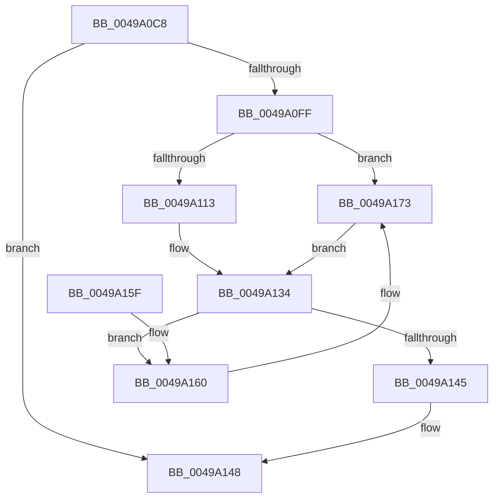

# PopPluginPrepareDevice

- RVA: `0x0049A0C8`–`0x0049A184` (길이 `188` bytes)
- VA: `0x000000014049A0C8`
- 실행 섹션: `.text`
- PDB 이름 있음: `예`; PDB Function 태그: `아니요`
- unwind 정보 RVA: `0x000B46C4`
- 디코드: `54`개 명령, `188/188` bytes 표시
- 미해석 바이트: `0` (있으면 어셈블리에 `.byte`로 보존)

> 이 문서는 커널 이미지의 기계어와 PDB 기호를 분석해 생성했습니다. 4번과 5번은 함수 원형과 자료형을 바이너리 사용 방식에서 추정한 C 해석이며 원본 소스 복구 결과는 아닙니다.

## 1. Dependencies

- 직접 호출 지점: **2**; 고유 호출 대상: **2**
- 직접 호출자로 확인된 함수: **1**
- RIP 상대 이미지 참조: **0**

### Outgoing calls
- `0x0049A13C` → [guard_dispatch_icall](../6B/guard_dispatch_icall_function_006BAAD0.md) (function, `0x006BAAD0`)
- `0x0049A16D` → [PopFxBugCheck](../2B/PopFxBugCheck_function_002BFC6C.md) (function, `0x002BFC6C`)

### Direct callers
- [PoFxPrepareDevice](PoFxPrepareDevice_function_00499F0C.md) at `0x0049A04E`

### Static image references
- 디코드된 RIP-relative 메모리 참조가 없습니다.

## 2. Other-region calls and transfers

- 다른 실행 섹션으로 향하는 call: **0**
- 별도 외부 분기/꼬리 이동을 확인하지 못했습니다.

## 3. Assembly (complete function range)

```asm
0049A0C8  4C 8B DC                        mov r11, rsp
0049A0CB  49 89 5B 10                     mov qword ptr [r11 + 0x10], rbx
0049A0CF  49 89 6B 18                     mov qword ptr [r11 + 0x18], rbp
0049A0D3  49 89 73 20                     mov qword ptr [r11 + 0x20], rsi
0049A0D7  57                              push rdi
0049A0D8  48 83 EC 50                     sub rsp, 0x50
0049A0DC  4C 8B 41 60                     mov r8, qword ptr [rcx + 0x60]
0049A0E0  0F 57 C9                        xorps xmm1, xmm1
0049A0E3  33 DB                           xor ebx, ebx
0049A0E5  0F 57 C0                        xorps xmm0, xmm0
0049A0E8  48 8B E9                        mov rbp, rcx
0049A0EB  0F 11 44 24 20                  movups xmmword ptr [rsp + 0x20], xmm0
0049A0F0  0F 11 4C 24 30                  movups xmmword ptr [rsp + 0x30], xmm1
0049A0F5  0F 11 4C 24 40                  movups xmmword ptr [rsp + 0x40], xmm1
0049A0FA  4D 85 C0                        test r8, r8
0049A0FD  74 49                           je 0x14049a148
0049A0FF  48 8D 41 18                     lea rax, [rcx + 0x18]
0049A103  8B 00                           mov eax, dword ptr [rax]
0049A105  48 8D 8A 80 00 00 00            lea rcx, [rdx + 0x80]
0049A10C  48 0F BA E0 1B                  bt rax, 0x1b
0049A111  73 60                           jae 0x14049a173
0049A113  48 8B 42 20                     mov rax, qword ptr [rdx + 0x20]
0049A117  49 8D 7B D8                     lea rdi, [r11 - 0x28]
0049A11B  49 89 43 E8                     mov qword ptr [r11 - 0x18], rax
0049A11F  BE 90 00 00 00                  mov esi, 0x90
0049A124  48 8B 42 10                     mov rax, qword ptr [rdx + 0x10]
0049A128  49 89 4B D8                     mov qword ptr [r11 - 0x28], rcx
0049A12C  48 8B 48 20                     mov rcx, qword ptr [rax + 0x20]
0049A130  49 89 4B F0                     mov qword ptr [r11 - 0x10], rcx
0049A134  48 8B D7                        mov rdx, rdi
0049A137  8B CE                           mov ecx, esi
0049A139  49 8B C0                        mov rax, r8
0049A13C  E8 8F 09 22 00                  call 0x1406baad0
0049A141  84 C0                           test al, al
0049A143  74 1B                           je 0x14049a160
0049A145  8A 5F 08                        mov bl, byte ptr [rdi + 8]
0049A148  48 8B 6C 24 70                  mov rbp, qword ptr [rsp + 0x70]
0049A14D  8A C3                           mov al, bl
0049A14F  48 8B 5C 24 68                  mov rbx, qword ptr [rsp + 0x68]
0049A154  48 8B 74 24 78                  mov rsi, qword ptr [rsp + 0x78]
0049A159  48 83 C4 50                     add rsp, 0x50
0049A15D  5F                              pop rdi
0049A15E  C3                              ret
0049A15F  CC                              int3
0049A160  8B D6                           mov edx, esi
0049A162  45 33 C9                        xor r9d, r9d
0049A165  4C 8B C5                        mov r8, rbp
0049A168  B9 05 06 00 00                  mov ecx, 0x605
0049A16D  E8 FA 5A E2 FF                  call 0x1402bfc6c
0049A172  CC                              int3
0049A173  48 89 4C 24 20                  mov qword ptr [rsp + 0x20], rcx
0049A178  48 8D 7C 24 20                  lea rdi, [rsp + 0x20]
0049A17D  BE 01 00 00 00                  mov esi, 1
0049A182  EB B0                           jmp 0x14049a134
```

## 4. C-style interpretation (structured pseudocode)

```c
__int64 __fastcall PopPluginPrepareDevice(__int64 a1, __int64 a2, __int64 a3, int a4)
{
    __int64 result;
    __int64 v_rbx;
    __int64 v_rsp;
    unsigned __int64 v_stack_m18;
    unsigned __int64 v_stack_m28;
    unsigned __int64 v_stack_m38;
    unsigned __int64 v_stack_p10;
    unsigned __int64 v_stack_p18;
    unsigned __int64 v_stack_p20;

    *(unsigned __int64 *)(v_rsp + 16) = v_rbx;
    *(unsigned __int64 *)(v_rsp + 24) = v_rbp;
    *(unsigned __int64 *)(v_rsp + 32) = v_rsi;
    v_rsp = (v_rsp) - (80);
    v_rbx = 0;
    v_stack_m38 = v_xmm0;
    v_stack_m28 = v_xmm1;
    v_stack_m18 = v_xmm1;
    if (*(unsigned __int64 *)(a1 + 96) == 0) goto loc_0049A148;
    if (condition_is_above_or_equal) goto loc_0049A173;
    *(unsigned __int64 *)(v_rsp - 24) = *(unsigned __int64 *)(a2 + 32);
    *(unsigned __int64 *)(v_rsp - 40) = a2 + 128;
    *(unsigned __int64 *)(v_rsp - 16) = *(unsigned __int64 *)(*(unsigned __int64 *)(a2 + 16) + 32);
loc_0049A134:
    result = guard_dispatch_icall(144, v_rsp - 40, *(unsigned __int64 *)(a1 + 96), a4);
    if ((unsigned __int8)(result) == 0) goto loc_0049A160;
loc_0049A148:
    v_rsp = (v_rsp) + (80);
    return (unsigned __int8)(*(unsigned __int8 *)(v_rsp - 40 + 8));
loc_0049A160:
    a4 = 0;
    result = PopFxBugCheck((unsigned int)(0x605ULL), (unsigned int)((unsigned int)(v_stack_p20)), v_stack_p18, a4);
loc_0049A173:
    v_stack_p20 = (unsigned int)(0x605ULL);
    goto loc_0049A134;
}
```

## 5. (Beta) C Style

```c
int64_t PopPluginPrepareDevice(void *Arg1, void *Arg2, int64_t Arg3, int32_t Arg4)
{
    uint8_t *arg1 = (uint8_t *)Arg1;
    uint8_t *arg2 = (uint8_t *)Arg2;

    int64_t result;
    int64_t local_rbx;
    int64_t local_rsp;
    uint64_t v_stack_m18;
    uint64_t v_stack_m28;
    uint64_t v_stack_m38;
    uint64_t v_stack_p10;
    uint64_t v_stack_p18;
    uint64_t v_stack_p20;

    *(uint64_t *)(local_rsp + 0x10) = local_rbx;
    *(uint64_t *)(local_rsp + 0x18) = local_rbp;
    *(uint64_t *)(local_rsp + 0x20) = local_rsi;
    local_rsp = (local_rsp) - (80);
    local_rbx = 0;
    v_stack_m38 = v_xmm0;
    v_stack_m28 = v_xmm1;
    v_stack_m18 = v_xmm1;
    if (*(uint64_t *)(arg1 + 0x60) == 0) goto loc_0049A148;
    if (condition_is_above_or_equal) goto loc_0049A173;
    *(uint64_t *)(local_rsp - 0x18) = *(uint64_t *)(arg2 + 0x20);
    *(void **)(local_rsp - 0x28) = Arg2 + 128;
    *(uint64_t *)(local_rsp - 0x10) = *(uint64_t *)(*(uint64_t *)(arg2 + 0x10) + 0x20);
loc_0049A134:
    result = guard_dispatch_icall(144, local_rsp - 40, *(uint64_t *)(arg1 + 0x60), Arg4);
    if ((uint8_t)(result) == 0) goto loc_0049A160;
loc_0049A148:
    local_rsp = (local_rsp) + (80);
    return (uint8_t)(*(uint8_t *)(local_rsp - 0x28 + 0x8));
loc_0049A160:
    Arg4 = 0;
    result = PopFxBugCheck((uint32_t)(0x605ULL), (uint32_t)((uint32_t)(v_stack_p20)), v_stack_p18, Arg4);
loc_0049A173:
    v_stack_p20 = (uint32_t)(0x605ULL);
    goto loc_0049A134;
}
```

### 관측된 메모리 오프셋

구조체 형식이 확인되지 않은 접근은 인자 기준의 오프셋으로만 기록했습니다.

| 기준 인자 | 오프셋 표현 | 폭 (bit) | 접근 |
|---|---:|---:|---|
| `Arg1` | `+ 0x0` | `32` | `R` |
| `Arg1` | `+ 0x18` | `64` | `R` |
| `Arg1` | `+ 0x60` | `64` | `R` |
| `Arg2` | `+ 0x10` | `64` | `R` |
| `Arg2` | `+ 0x20` | `64` | `R` |
| `Arg2` | `+ 0x80` | `64` | `R` |

## 6. Execution-region graph

[열기: 2D/3D 그래프와 함수 탐색 컨트롤 패널](../../../control-panel.html?section=text&rva=0x0049A0C8&view=graph)

- 2D 그래프는 위에서 아래로 흐르고, 3D 그래프는 빈 공간을 드래그해 회전합니다. Shift+드래그는 이동, 휠은 확대·축소, 함수 노드 선택은 대상 보고서 이동입니다.

### Static fallback


