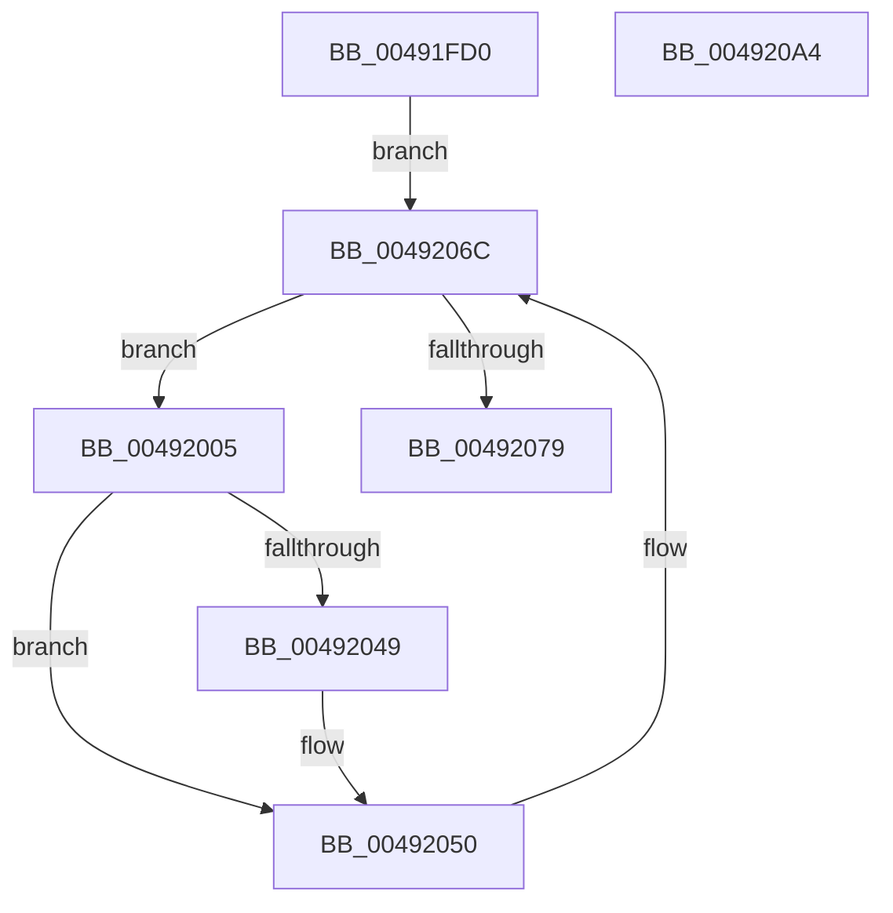

# PopPolicyWorkerThread

- RVA: `0x00491FD0`–`0x004920A5` (길이 `213` bytes)
- VA: `0x0000000140491FD0`
- 실행 섹션: `.text`
- PDB 이름 있음: `예`; PDB Function 태그: `아니요`
- unwind 정보 RVA: `0x0006C8E8`
- 디코드: `55`개 명령, `213/213` bytes 표시
- 미해석 바이트: `0` (있으면 어셈블리에 `.byte`로 보존)

> 이 문서는 커널 이미지의 기계어와 PDB 기호를 분석해 생성했습니다. 4번과 5번은 함수 원형과 자료형을 바이너리 사용 방식에서 추정한 C 해석이며 원본 소스 복구 결과는 아닙니다.

## 1. Dependencies

- 직접 호출 지점: **5**; 고유 호출 대상: **3**
- 직접 호출자로 확인된 함수: **0**
- RIP 상대 이미지 참조: **6**

### Outgoing calls
- `0x00491FEE` → [KeAcquireSpinLockRaiseToDpc](../20/KeAcquireSpinLockRaiseToDpc_function_00208470.md) (function, `0x00208470`)
- `0x00492034` → [KeReleaseSpinLock](../39/KeReleaseSpinLock_function_00392BA0.md) (function, `0x00392BA0`)
- `0x00492049` → [guard_dispatch_icall](../6B/guard_dispatch_icall_function_006BAAD0.md) (function, `0x006BAAD0`)
- `0x00492057` → [KeAcquireSpinLockRaiseToDpc](../20/KeAcquireSpinLockRaiseToDpc_function_00208470.md) (function, `0x00208470`)
- `0x0049208A` → [KeReleaseSpinLock](../39/KeReleaseSpinLock_function_00392BA0.md) (function, `0x00392BA0`)

### Direct callers
- 이 함수 시작 RVA로 연결되는 직접 call은 확인되지 않았습니다. 간접 호출은 완전히 역산할 수 없습니다.

### Static image references
- `0x00491FE7` → RVA `0x00F0CB80` (`.data`; read)
- `0x00491FF3` → RVA `0x00F0CB48` (`.data`; read)
- `0x00491FF9` → RVA `0x00F0CB48` (`.data`; write)
- `0x00492025` → RVA `0x00F0C8C4` (`.data`; write)
- `0x00492039` → RVA `0x00002F60` (`.rdata`; read)
- `0x0049206C` → RVA `0x00F0C8C4` (`.data`; read)

## 2. Other-region calls and transfers

- 다른 실행 섹션으로 향하는 call: **0**
- 별도 외부 분기/꼬리 이동을 확인하지 못했습니다.

## 3. Assembly (complete function range)

```asm
00491FD0  48 89 5C 24 10                  mov qword ptr [rsp + 0x10], rbx
00491FD5  48 89 6C 24 18                  mov qword ptr [rsp + 0x18], rbp
00491FDA  48 89 74 24 20                  mov qword ptr [rsp + 0x20], rsi
00491FDF  57                              push rdi
00491FE0  48 83 EC 20                     sub rsp, 0x20
00491FE4  48 8B F1                        mov rsi, rcx
00491FE7  48 8D 0D 92 AB A7 00            lea rcx, [rip + 0xa7ab92]
00491FEE  E8 7D 64 D7 FF                  call 0x140208470
00491FF3  0B 35 4F AB A7 00               or esi, dword ptr [rip + 0xa7ab4f]
00491FF9  89 35 49 AB A7 00               mov dword ptr [rip + 0xa7ab49], esi
00491FFF  33 ED                           xor ebp, ebp
00492001  8B CE                           mov ecx, esi
00492003  EB 67                           jmp 0x14049206c
00492005  83 64 24 30 00                  and dword ptr [rsp + 0x30], 0
0049200A  BF 01 00 00 00                  mov edi, 1
0049200F  0F BC D9                        bsf ebx, ecx
00492012  8B CB                           mov ecx, ebx
00492014  D3 E7                           shl edi, cl
00492016  48 8D 0D 63 AB A7 00            lea rcx, [rip + 0xa7ab63]
0049201D  8B C7                           mov eax, edi
0049201F  F7 D0                           not eax
00492021  23 D0                           and edx, eax
00492023  23 C6                           and eax, esi
00492025  89 15 99 A8 A7 00               mov dword ptr [rip + 0xa7a899], edx
0049202B  41 8A D0                        mov dl, r8b
0049202E  89 05 14 AB A7 00               mov dword ptr [rip + 0xa7ab14], eax
00492034  E8 67 0B F0 FF                  call 0x140392ba0
00492039  48 8D 0D 20 0F B7 FF            lea rcx, [rip - 0x48f0e0]
00492040  48 8B 04 D9                     mov rax, qword ptr [rcx + rbx*8]
00492044  48 85 C0                        test rax, rax
00492047  74 07                           je 0x140492050
00492049  E8 82 8A 22 00                  call 0x1406baad0
0049204E  0B E8                           or ebp, eax
00492050  48 8D 0D 29 AB A7 00            lea rcx, [rip + 0xa7ab29]
00492057  E8 14 64 D7 FF                  call 0x140208470
0049205C  0B 3D E6 AA A7 00               or edi, dword ptr [rip + 0xa7aae6]
00492062  89 3D E0 AA A7 00               mov dword ptr [rip + 0xa7aae0], edi
00492068  8B CF                           mov ecx, edi
0049206A  8B F7                           mov esi, edi
0049206C  8B 15 52 A8 A7 00               mov edx, dword ptr [rip + 0xa7a852]
00492072  44 8A C0                        mov r8b, al
00492075  23 CA                           and ecx, edx
00492077  75 8C                           jne 0x140492005
00492079  0B D5                           or edx, ebp
0049207B  48 8D 0D FE AA A7 00            lea rcx, [rip + 0xa7aafe]
00492082  89 15 3C A8 A7 00               mov dword ptr [rip + 0xa7a83c], edx
00492088  8A D0                           mov dl, al
0049208A  E8 11 0B F0 FF                  call 0x140392ba0
0049208F  48 8B 5C 24 38                  mov rbx, qword ptr [rsp + 0x38]
00492094  48 8B 6C 24 40                  mov rbp, qword ptr [rsp + 0x40]
00492099  48 8B 74 24 48                  mov rsi, qword ptr [rsp + 0x48]
0049209E  48 83 C4 20                     add rsp, 0x20
004920A2  5F                              pop rdi
004920A3  C3                              ret
004920A4  CC                              int3
```

## 4. C-style interpretation (structured pseudocode)

```c
__int64 __fastcall PopPolicyWorkerThread(__int64 a1, int a2, unsigned __int8 a3)
{
    __int64 result;
    __int64 v_rbp;
    __int64 v_rdi;
    __int64 v_rsi;
    __int64 v_rsp;
    unsigned __int64 v_stack_p10;
    unsigned __int64 v_stack_p18;
    unsigned __int64 v_stack_p20;
    unsigned int v_stack_p8;

    v_stack_p10 = v_rbx;
    v_stack_p18 = v_rbp;
    v_stack_p20 = v_rsi;
    v_rsp = (v_rsp) - (32);
    result = KeAcquireSpinLockRaiseToDpc(v_rip + 10988434, a2, a3, a4);
    v_rsi = (unsigned int)((a1) | (*(unsigned int *)(v_rip + 10988367)));
    *(unsigned int *)(v_rip + 10988361) = (unsigned int)(v_rsi);
    v_rbp = 0;
    goto loc_0049206C;
loc_00492005:
    v_rdi = (unsigned int)((1) << ((unsigned __int8)((unsigned int)((unsigned int)(v_rbx)))));
    result = (unsigned int)(~((unsigned int)((unsigned int)(v_rdi))));
    a2 = (unsigned int)((a2) & ((unsigned int)(result)));
    result = (unsigned int)((result) & ((unsigned int)(v_rsi)));
    *(unsigned int *)(v_rip + 10987673) = a2;
    *(unsigned int *)(v_rip + 10988308) = (unsigned int)(result);
    result = KeReleaseSpinLock(v_rip + 10988387, a3, a3, a4);
    result = *(unsigned __int64 *)(v_rip - 4780256 + v_rbx * 8);
    if (*(unsigned __int64 *)(v_rip - 4780256 + v_rbx * 8) != 0) {
        result = guard_dispatch_icall(v_rip - 4780256, a3, a3, a4);
        v_rbp = (unsigned int)((v_rbp) | ((unsigned int)(result)));
    }
    result = KeAcquireSpinLockRaiseToDpc(v_rip + 10988329, a3, a3, a4);
    v_rdi = (unsigned int)((v_rdi) | (*(unsigned int *)(v_rip + 10988262)));
    *(unsigned int *)(v_rip + 10988256) = (unsigned int)(v_rdi);
loc_0049206C:
    a1 = (unsigned int)(((unsigned int)((unsigned int)(v_rdi))) & ((unsigned int)((unsigned int)(*(unsigned int *)(v_rip + 10987602)))));
    if (condition_is_not_equal) goto loc_00492005;
    a2 = (unsigned int)(((unsigned int)(*(unsigned int *)(v_rip + 10987602))) | ((unsigned int)(v_rbp)));
    *(unsigned int *)(v_rip + 10987580) = a2;
    result = KeReleaseSpinLock(v_rip + 10988286, (unsigned __int8)(result), (unsigned __int8)(result), a4);
    v_rsp = (v_rsp) + (32);
    return result;
}
```

## 5. (Beta) C Style

```c
int64_t PopPolicyWorkerThread(int64_t Arg1, int32_t Arg2, uint8_t Arg3)
{
    int64_t result;
    int64_t local_rbp;
    int64_t local_rdi;
    int64_t local_rsi;
    int64_t local_rsp;
    uint64_t v_stack_p10;
    uint64_t v_stack_p18;
    uint64_t v_stack_p20;
    uint32_t v_stack_p8;

    v_stack_p10 = local_rbx;
    v_stack_p18 = local_rbp;
    v_stack_p20 = local_rsi;
    local_rsp = (local_rsp) - (32);
    result = KeAcquireSpinLockRaiseToDpc(v_rip + 10988434, Arg2, Arg3, a4);
    local_rsi = (uint32_t)((Arg1) | (*(uint32_t *)(v_rip + 0xA7AB4F)));
    *(uint32_t *)(v_rip + 0xA7AB49) = (uint32_t)(local_rsi);
    local_rbp = 0;
    goto loc_0049206C;
loc_00492005:
    local_rdi = (uint32_t)((1) << ((uint8_t)((uint32_t)((uint32_t)(local_rbx)))));
    result = (uint32_t)(~((uint32_t)((uint32_t)(local_rdi))));
    Arg2 = (uint32_t)((Arg2) & ((uint32_t)(result)));
    result = (uint32_t)((result) & ((uint32_t)(local_rsi)));
    *(uint32_t *)(v_rip + 0xA7A899) = Arg2;
    *(uint32_t *)(v_rip + 0xA7AB14) = (uint32_t)(result);
    result = KeReleaseSpinLock(v_rip + 10988387, Arg3, Arg3, a4);
    result = *(uint64_t *)(v_rip - 0x48F0E0 + local_rbx * 8);
    if (*(uint64_t *)(v_rip - 0x48F0E0 + local_rbx * 8) != 0) {
        result = guard_dispatch_icall(v_rip - 4780256, Arg3, Arg3, a4);
        local_rbp = (uint32_t)((local_rbp) | ((uint32_t)(result)));
    }
    result = KeAcquireSpinLockRaiseToDpc(v_rip + 10988329, Arg3, Arg3, a4);
    local_rdi = (uint32_t)((local_rdi) | (*(uint32_t *)(v_rip + 0xA7AAE6)));
    *(uint32_t *)(v_rip + 0xA7AAE0) = (uint32_t)(local_rdi);
loc_0049206C:
    Arg1 = (uint32_t)(((uint32_t)((uint32_t)(local_rdi))) & ((uint32_t)((uint32_t)(*(uint32_t *)(v_rip + 0xA7A852)))));
    if (condition_is_not_equal) goto loc_00492005;
    Arg2 = (uint32_t)(((uint32_t)(*(uint32_t *)(v_rip + 0xA7A852))) | ((uint32_t)(local_rbp)));
    *(uint32_t *)(v_rip + 0xA7A83C) = Arg2;
    result = KeReleaseSpinLock(v_rip + 10988286, (uint8_t)(result), (uint8_t)(result), a4);
    local_rsp = (local_rsp) + (32);
    return result;
}
```

## 6. Execution-region graph

[열기: 2D/3D 그래프와 함수 탐색 컨트롤 패널](../../../control-panel.html?section=text&rva=0x00491FD0&view=graph)

- 2D 그래프는 위에서 아래로 흐르고, 3D 그래프는 빈 공간을 드래그해 회전합니다. Shift+드래그는 이동, 휠은 확대·축소, 함수 노드 선택은 대상 보고서 이동입니다.

### Static fallback


