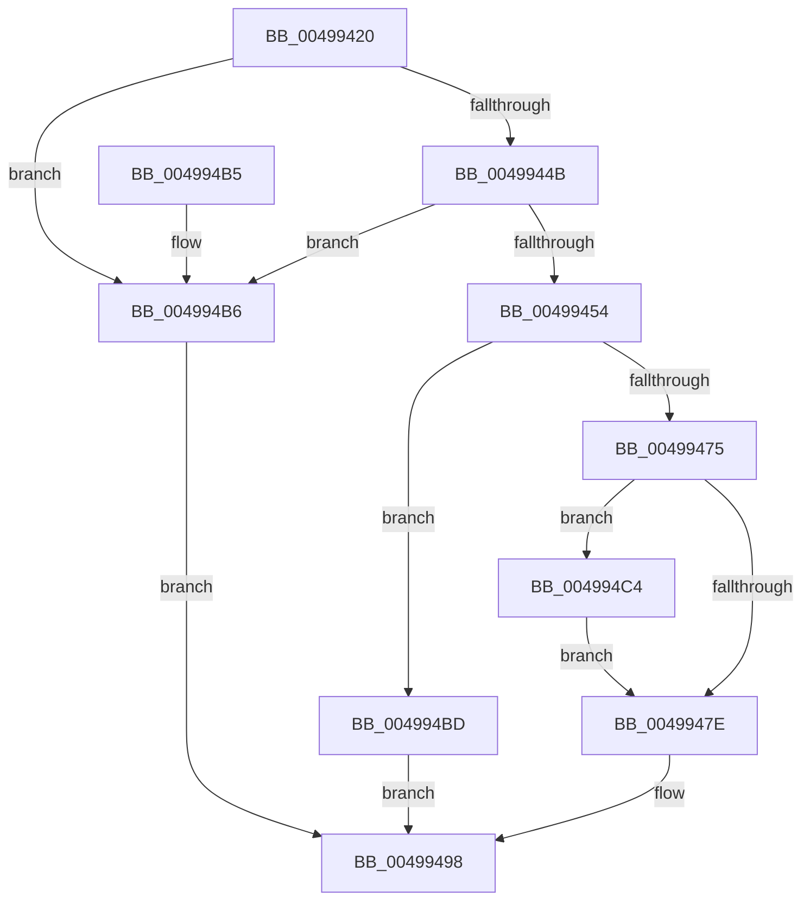

# PopProcessorQueryPlatformStateNotification

- RVA: `0x00499420`–`0x004994D1` (길이 `177` bytes)
- VA: `0x0000000140499420`
- 실행 섹션: `.text`
- PDB 이름 있음: `예`; PDB Function 태그: `아니요`
- unwind 정보 RVA: `0x000B443C`
- 디코드: `53`개 명령, `177/177` bytes 표시
- 미해석 바이트: `0` (있으면 어셈블리에 `.byte`로 보존)

> 이 문서는 커널 이미지의 기계어와 PDB 기호를 분석해 생성했습니다. 4번과 5번은 함수 원형과 자료형을 바이너리 사용 방식에서 추정한 C 해석이며 원본 소스 복구 결과는 아닙니다.

## 1. Dependencies

- 직접 호출 지점: **2**; 고유 호출 대상: **2**
- 직접 호출자로 확인된 함수: **0**
- RIP 상대 이미지 참조: **0**

### Outgoing calls
- `0x0049946C` → [guard_dispatch_icall](../6B/guard_dispatch_icall_function_006BAAD0.md) (function, `0x006BAAD0`)
- `0x00499493` → [PopTranslateDependencyArray](PopTranslateDependencyArray_function_004994D8.md) (function, `0x004994D8`)

### Direct callers
- 이 함수 시작 RVA로 연결되는 직접 call은 확인되지 않았습니다. 간접 호출은 완전히 역산할 수 없습니다.

### Static image references
- 디코드된 RIP-relative 메모리 참조가 없습니다.

## 2. Other-region calls and transfers

- 다른 실행 섹션으로 향하는 call: **0**
- 별도 외부 분기/꼬리 이동을 확인하지 못했습니다.

## 3. Assembly (complete function range)

```asm
00499420  48 8B C4                        mov rax, rsp
00499423  48 89 58 08                     mov qword ptr [rax + 8], rbx
00499427  48 89 68 10                     mov qword ptr [rax + 0x10], rbp
0049942B  48 89 70 18                     mov qword ptr [rax + 0x18], rsi
0049942F  48 89 78 20                     mov qword ptr [rax + 0x20], rdi
00499433  41 56                           push r14
00499435  48 83 EC 30                     sub rsp, 0x30
00499439  48 8B 41 40                     mov rax, qword ptr [rcx + 0x40]
0049943D  33 DB                           xor ebx, ebx
0049943F  48 8B 71 48                     mov rsi, qword ptr [rcx + 0x48]
00499443  48 8B FA                        mov rdi, rdx
00499446  48 85 C0                        test rax, rax
00499449  74 6B                           je 0x1404994b6
0049944B  48 8B 40 68                     mov rax, qword ptr [rax + 0x68]
0049944F  48 85 C0                        test rax, rax
00499452  74 62                           je 0x1404994b6
00499454  8B 6A 20                        mov ebp, dword ptr [rdx + 0x20]
00499457  4C 8D 72 28                     lea r14, [rdx + 0x28]
0049945B  41 F6 D8                        neg r8b
0049945E  48 8B CE                        mov rcx, rsi
00499461  4C 8B C7                        mov r8, rdi
00499464  1B D2                           sbb edx, edx
00499466  83 E2 03                        and edx, 3
00499469  83 C2 13                        add edx, 0x13
0049946C  E8 5F 16 22 00                  call 0x1406baad0
00499471  84 C0                           test al, al
00499473  74 48                           je 0x1404994bd
00499475  48 8B 47 08                     mov rax, qword ptr [rdi + 8]
00499479  48 85 C0                        test rax, rax
0049947C  75 46                           jne 0x1404994c4
0049947E  8B 47 1C                        mov eax, dword ptr [rdi + 0x1c]
00499481  44 8B CD                        mov r9d, ebp
00499484  4C 89 74 24 28                  mov qword ptr [rsp + 0x28], r14
00499489  48 8B D7                        mov rdx, rdi
0049948C  48 8B CE                        mov rcx, rsi
0049948F  89 44 24 20                     mov dword ptr [rsp + 0x20], eax
00499493  E8 40 00 00 00                  call 0x1404994d8
00499498  48 8B 6C 24 48                  mov rbp, qword ptr [rsp + 0x48]
0049949D  8B C3                           mov eax, ebx
0049949F  48 8B 5C 24 40                  mov rbx, qword ptr [rsp + 0x40]
004994A4  48 8B 74 24 50                  mov rsi, qword ptr [rsp + 0x50]
004994A9  48 8B 7C 24 58                  mov rdi, qword ptr [rsp + 0x58]
004994AE  48 83 C4 30                     add rsp, 0x30
004994B2  41 5E                           pop r14
004994B4  C3                              ret
004994B5  CC                              int3
004994B6  BB 02 00 00 C0                  mov ebx, 0xc0000002
004994BB  EB DB                           jmp 0x140499498
004994BD  BB BB 00 00 C0                  mov ebx, 0xc00000bb
004994C2  EB D4                           jmp 0x140499498
004994C4  48 8B 80 C0 00 00 00            mov rax, qword ptr [rax + 0xc0]
004994CB  48 89 47 08                     mov qword ptr [rdi + 8], rax
004994CF  EB AD                           jmp 0x14049947e
```

## 4. C-style interpretation (structured pseudocode)

```c
__int64 __fastcall PopProcessorQueryPlatformStateNotification(__int64 a1, __int64 a2, unsigned __int8 a3)
{
    __int64 result;
    __int64 v_rbx;
    __int64 v_rsp;
    unsigned __int64 v_stack_m10;
    unsigned int v_stack_m18;
    unsigned __int64 v_stack_p10;
    unsigned __int64 v_stack_p18;
    unsigned __int64 v_stack_p20;
    unsigned __int64 v_stack_p8;

    *(unsigned __int64 *)(v_rsp + 8) = v_rbx;
    *(unsigned __int64 *)(v_rsp + 16) = v_rbp;
    *(unsigned __int64 *)(v_rsp + 24) = v_rsi;
    *(unsigned __int64 *)(v_rsp + 32) = v_rdi;
    v_rsp = (v_rsp) - (48);
    v_rbx = 0;
    if (*(unsigned __int64 *)(a1 + 64) == 0) goto loc_004994B6;
    if (*(unsigned __int64 *)(*(unsigned __int64 *)(a1 + 64) + 104) == 0) goto loc_004994B6;
    a3 = (unsigned __int8)(-(a3));
    a2 = (unsigned int)((a2) & (3));
    a2 = (unsigned int)((a2) + (19));
    result = guard_dispatch_icall(*(unsigned __int64 *)(a1 + 72), a2, a2, a4);
    if ((unsigned __int8)(result) == 0) goto loc_004994BD;
    if (*(unsigned __int64 *)(a2 + 8) != 0) goto loc_004994C4;
loc_0049947E:
    v_stack_m10 = a2 + 40;
    v_stack_m18 = (unsigned int)((unsigned int)(*(unsigned int *)(a2 + 28)));
    result = PopTranslateDependencyArray(*(unsigned __int64 *)(a1 + 72), a2, a2, (unsigned int)((unsigned int)((unsigned int)(*(unsigned int *)(a2 + 32)))));
loc_00499498:
    v_rsp = (v_rsp) + (48);
    return 0;
loc_004994B6:
    goto loc_00499498;
loc_004994BD:
    goto loc_00499498;
loc_004994C4:
    *(unsigned __int64 *)(v_stack_p20 + 8) = *(unsigned __int64 *)(0 + 192);
    goto loc_0049947E;
}
```

## 5. (Beta) C Style

```c
int64_t PopProcessorQueryPlatformStateNotification(void *Arg1, void *Arg2, uint8_t Arg3)
{
    uint8_t *arg1 = (uint8_t *)Arg1;
    uint8_t *arg2 = (uint8_t *)Arg2;

    int64_t result;
    int64_t local_rbx;
    int64_t local_rsp;
    uint64_t v_stack_m10;
    uint32_t v_stack_m18;
    uint64_t v_stack_p10;
    uint64_t v_stack_p18;
    uint64_t v_stack_p20;
    uint64_t v_stack_p8;

    *(uint64_t *)(local_rsp + 0x8) = local_rbx;
    *(uint64_t *)(local_rsp + 0x10) = local_rbp;
    *(uint64_t *)(local_rsp + 0x18) = local_rsi;
    *(uint64_t *)(local_rsp + 0x20) = local_rdi;
    local_rsp = (local_rsp) - (48);
    local_rbx = 0;
    if (*(uint64_t *)(arg1 + 0x40) == 0) goto loc_004994B6;
    if (*(uint64_t *)(*(uint64_t *)(arg1 + 0x40) + 0x68) == 0) goto loc_004994B6;
    Arg3 = (uint8_t)(-(Arg3));
    Arg2 = (uint32_t)((Arg2) & (3));
    Arg2 = (uint32_t)((Arg2) + (19));
    result = guard_dispatch_icall(*(uint64_t *)(arg1 + 0x48), Arg2, Arg2, a4);
    if ((uint8_t)(result) == 0) goto loc_004994BD;
    if (*(uint64_t *)(arg2 + 0x8) != 0) goto loc_004994C4;
loc_0049947E:
    v_stack_m10 = Arg2 + 40;
    v_stack_m18 = (uint32_t)((uint32_t)(*(uint32_t *)(arg2 + 0x1C)));
    result = PopTranslateDependencyArray(*(uint64_t *)(arg1 + 0x48), Arg2, Arg2, (uint32_t)((uint32_t)((uint32_t)(*(uint32_t *)(arg2 + 0x20)))));
loc_00499498:
    local_rsp = (local_rsp) + (48);
    return 0;
loc_004994B6:
    goto loc_00499498;
loc_004994BD:
    goto loc_00499498;
loc_004994C4:
    *(uint64_t *)(v_stack_p20 + 0x8) = *(uint64_t *)(0 + 0xC0);
    goto loc_0049947E;
}
```

### 관측된 메모리 오프셋

구조체 형식이 확인되지 않은 접근은 인자 기준의 오프셋으로만 기록했습니다.

| 기준 인자 | 오프셋 표현 | 폭 (bit) | 접근 |
|---|---:|---:|---|
| `Arg1` | `+ 0x40` | `64` | `R` |
| `Arg1` | `+ 0x48` | `64` | `R` |
| `Arg2` | `+ 0x8` | `64` | `R` |
| `Arg2` | `+ 0x8` | `64` | `W` |
| `Arg2` | `+ 0x1C` | `32` | `R` |
| `Arg2` | `+ 0x20` | `32` | `R` |
| `Arg2` | `+ 0x28` | `64` | `R` |

## 6. Execution-region graph

[열기: 2D/3D 그래프와 함수 탐색 컨트롤 패널](../../../control-panel.html?section=text&rva=0x00499420&view=graph)

- 2D 그래프는 위에서 아래로 흐르고, 3D 그래프는 빈 공간을 드래그해 회전합니다. Shift+드래그는 이동, 휠은 확대·축소, 함수 노드 선택은 대상 보고서 이동입니다.

### Static fallback


