# PopScanIdleList

- RVA: `0x00497F04`–`0x004982EF` (길이 `1,003` bytes)
- VA: `0x0000000140497F04`
- 실행 섹션: `.text`
- PDB 이름 있음: `예`; PDB Function 태그: `아니요`
- unwind 정보 RVA: `0x000B40C8`
- 디코드: `274`개 명령, `1,003/1,003` bytes 표시
- 미해석 바이트: `0` (있으면 어셈블리에 `.byte`로 보존)

> 이 문서는 커널 이미지의 기계어와 PDB 기호를 분석해 생성했습니다. 4번과 5번은 함수 원형과 자료형을 바이너리 사용 방식에서 추정한 C 해석이며 원본 소스 복구 결과는 아닙니다.

## 1. Dependencies

- 직접 호출 지점: **14**; 고유 호출 대상: **11**
- 직접 호출자로 확인된 함수: **1**
- RIP 상대 이미지 참조: **25**

### Outgoing calls
- `0x00497FB6` → [KeAcquireSpinLockRaiseToDpc](../20/KeAcquireSpinLockRaiseToDpc_function_00208470.md) (function, `0x00208470`)
- `0x00497FD0` → [KeReleaseSpinLock](../39/KeReleaseSpinLock_function_00392BA0.md) (function, `0x00392BA0`)
- `0x00497FE1` → [PopDiagTraceEventNoPayload](PopDiagTraceEventNoPayload_function_004982F8.md) (function, `0x004982F8`)
- `0x0049805F` → [PopCoalescingCheck](../5D/PopCoalescingCheck_function_005D4614.md) (function, `0x005D4614`)
- `0x004980DE` → [PopDiagTraceIoCoalescingDiskIdle](../5D/PopDiagTraceIoCoalescingDiskIdle_function_005D6D18.md) (function, `0x005D6D18`)
- `0x00498105` → [PopRequestPowerIrp](../27/PopRequestPowerIrp_function_00270ED4.md) (function, `0x00270ED4`)
- `0x00498137` → [PopDiagTraceDeviceIdleCheck](../4A/PopDiagTraceDeviceIdleCheck_function_004AB30C.md) (function, `0x004AB30C`)
- `0x0049814A` → [PopDiagTraceDiskIdleCheck](../4B/PopDiagTraceDiskIdleCheck_function_004BDE08.md) (function, `0x004BDE08`)
- `0x00498178` → [PopDiagTraceEventNoPayload](PopDiagTraceEventNoPayload_function_004982F8.md) (function, `0x004982F8`)
- `0x00498187` → [KeReleaseSpinLock](../39/KeReleaseSpinLock_function_00392BA0.md) (function, `0x00392BA0`)
- `0x0049822E` → [PopGetPowerSettingValue](PopGetPowerSettingValue_function_0049C6CC.md) (function, `0x0049C6CC`)
- `0x00498243` → [PopSetPowerSettingValueAcDc](../../page/91/PopSetPowerSettingValueAcDc_function_00914D6C.md) (function, `0x00914D6C`)
- `0x00498298` → [PopGetPowerSettingValue](PopGetPowerSettingValue_function_0049C6CC.md) (function, `0x0049C6CC`)
- `0x004982B9` → [PopSetPowerSettingValue](../../page/91/PopSetPowerSettingValue_function_00914E54.md) (function, `0x00914E54`)

### Direct callers
- [PopSystemIdleWorker](../../page/A3/PopSystemIdleWorker_function_00A31A60.md) at `0x00A31B6B`

### Static image references
- `0x00497F20` → RVA `0x00F0CE28` (`.data`; read)
- `0x00497F29` → RVA `0x00F0CE24` (`.data`; read)
- `0x00497F38` → RVA `0x00F0CE68` (`.data`; read)
- `0x00497F76` → RVA `0x00F0E780` (`.data`; read)
- `0x00497F7D` → RVA `0x00FC6CCC` (`ALMOSTRO`; read)
- `0x00497F95` → RVA `0x00F0E780` (`.data`; write)
- `0x00497FA3` → RVA `0x00F0CBA0` (`.data`; read)
- `0x00497FBB` → RVA `0x00E676A4` (`.data`; read)
- `0x00497FDA` → RVA `0x0001AB18` (`.rdata`; read)
- `0x00497FE6` → RVA `0x00F0CB90` (`.data`; read)
- `0x004980C9` → RVA `0x00F0CF0C` (`.data`; read)
- `0x004980E9` → RVA `0x005D1580` (`PopDeviceIdleCompletion`; read)
- `0x00498115` → RVA `0x00E676A0` (`.data`; read/write)
- `0x00498171` → RVA `0x0001AB28` (`.rdata`; read)
- `0x0049818C` → RVA `0x00F0E78C` (`.data`; read)
- `0x004981A1` → RVA `0x00F0E78C` (`.data`; write)
- `0x004981A8` → RVA `0x00F0E788` (`.data`; read)
- `0x004981B5` → RVA `0x00F0E788` (`.data`; write)
- `0x004981C0` → RVA `0x00E0B558` (`.data`; read)
- `0x004981DE` → RVA `0x00E676A8` (`.data`; write)
- `0x0049820A` → RVA `0x00F0CE0C` (`.data`; read)
- `0x00498227` → RVA `0x0001BCC8` (`.rdata`; read)
- `0x0049826B` → RVA `0x00F0BC60` (`.data`; read)
- `0x00498274` → RVA `0x00E676A8` (`.data`; read)
- `0x0049828D` → RVA `0x0001BCB8` (`.rdata`; read)

## 2. Other-region calls and transfers

- 다른 실행 섹션으로 향하는 call: **2**
  - `0x00498243` → [PopSetPowerSettingValueAcDc](../../page/91/PopSetPowerSettingValueAcDc_function_00914D6C.md) (`.text` → `PAGE`)
  - `0x004982B9` → [PopSetPowerSettingValue](../../page/91/PopSetPowerSettingValue_function_00914E54.md) (`.text` → `PAGE`)
- 별도 외부 분기/꼬리 이동을 확인하지 못했습니다.

## 3. Assembly (complete function range)

```asm
00497F04  48 89 54 24 10                  mov qword ptr [rsp + 0x10], rdx
00497F09  89 4C 24 08                     mov dword ptr [rsp + 8], ecx
00497F0D  55                              push rbp
00497F0E  53                              push rbx
00497F0F  56                              push rsi
00497F10  57                              push rdi
00497F11  41 54                           push r12
00497F13  41 55                           push r13
00497F15  41 56                           push r14
00497F17  41 57                           push r15
00497F19  48 8B EC                        mov rbp, rsp
00497F1C  48 83 EC 78                     sub rsp, 0x78
00497F20  8B 05 02 4F A7 00               mov eax, dword ptr [rip + 0xa74f02]
00497F26  44 8B F9                        mov r15d, ecx
00497F29  8B 0D F5 4E A7 00               mov ecx, dword ptr [rip + 0xa74ef5]
00497F2F  45 33 F6                        xor r14d, r14d
00497F32  89 45 D0                        mov dword ptr [rbp - 0x30], eax
00497F35  48 8B FA                        mov rdi, rdx
00497F38  48 8B 05 29 4F A7 00            mov rax, qword ptr [rip + 0xa74f29]
00497F3F  49 B9 BD 42 7A E5 D5 94 BF D6   movabs r9, 0xd6bf94d5e57a42bd
00497F49  89 4D DC                        mov dword ptr [rbp - 0x24], ecx
00497F4C  49 B8 08 00 00 00 80 F7 FF FF   movabs r8, 0xfffff78000000008
00497F56  41 8B DE                        mov ebx, r14d
00497F59  44 89 75 60                     mov dword ptr [rbp + 0x60], r14d
00497F5D  44 89 75 CC                     mov dword ptr [rbp - 0x34], r14d
00497F61  45 8A E6                        mov r12b, r14b
00497F64  8B 80 D4 00 00 00               mov eax, dword ptr [rax + 0xd4]
00497F6A  45 8B EE                        mov r13d, r14d
00497F6D  4D 8B 00                        mov r8, qword ptr [r8]
00497F70  89 45 D4                        mov dword ptr [rbp - 0x2c], eax
00497F73  49 8B C8                        mov rcx, r8
00497F76  48 2B 0D 03 68 A7 00            sub rcx, qword ptr [rip + 0xa76803]
00497F7D  8B 05 49 ED B2 00               mov eax, dword ptr [rip + 0xb2ed49]
00497F83  89 45 D8                        mov dword ptr [rbp - 0x28], eax
00497F86  49 8B C1                        mov rax, r9
00497F89  49 F7 E0                        mul r8
00497F8C  49 8B C1                        mov rax, r9
00497F8F  89 5D C8                        mov dword ptr [rbp - 0x38], ebx
00497F92  48 8B F2                        mov rsi, rdx
00497F95  4C 89 05 E4 67 A7 00            mov qword ptr [rip + 0xa767e4], r8
00497F9C  48 F7 E1                        mul rcx
00497F9F  48 C1 EE 17                     shr rsi, 0x17
00497FA3  48 8D 0D F6 4B A7 00            lea rcx, [rip + 0xa74bf6]
00497FAA  48 C1 EA 17                     shr rdx, 0x17
00497FAE  48 89 55 E8                     mov qword ptr [rbp - 0x18], rdx
00497FB2  48 89 75 E0                     mov qword ptr [rbp - 0x20], rsi
00497FB6  E8 B5 04 D7 FF                  call 0x140208470
00497FBB  44 38 35 E2 F6 9C 00            cmp byte ptr [rip + 0x9cf6e2], r14b
00497FC2  88 45 58                        mov byte ptr [rbp + 0x58], al
00497FC5  74 13                           je 0x140497fda
00497FC7  8A D0                           mov dl, al
00497FC9  48 8D 0D D0 4B A7 00            lea rcx, [rip + 0xa74bd0]
00497FD0  E8 CB AB EF FF                  call 0x140392ba0
00497FD5  E9 01 03 00 00                  jmp 0x1404982db
00497FDA  48 8D 0D 37 2B B8 FF            lea rcx, [rip - 0x47d4c9]
00497FE1  E8 12 03 00 00                  call 0x1404982f8
00497FE6  4C 8B 35 A3 4B A7 00            mov r14, qword ptr [rip + 0xa74ba3]
00497FED  48 8D 05 9C 4B A7 00            lea rax, [rip + 0xa74b9c]
00497FF4  BA 01 00 00 00                  mov edx, 1
00497FF9  4C 3B F0                        cmp r14, rax
00497FFC  75 0A                           jne 0x140498008
00497FFE  E9 6E 01 00 00                  jmp 0x140498171
00498003  BA 01 00 00 00                  mov edx, 1
00498008  49 8D 5E E0                     lea rbx, [r14 - 0x20]
0049800C  45 33 FF                        xor r15d, r15d
0049800F  44 87 7B 04                     xchg dword ptr [rbx + 4], r15d
00498013  44 01 7B 0C                     add dword ptr [rbx + 0xc], r15d
00498017  45 85 FF                        test r15d, r15d
0049801A  75 07                           jne 0x140498023
0049801C  8B 43 08                        mov eax, dword ptr [rbx + 8]
0049801F  85 C0                           test eax, eax
00498021  74 06                           je 0x140498029
00498023  C7 03 00 00 00 00               mov dword ptr [rbx], 0
00498029  33 C0                           xor eax, eax
0049802B  F0 0F B1 33                     lock cmpxchg dword ptr [rbx], esi
0049802F  8B F0                           mov esi, eax
00498031  74 07                           je 0x14049803a
00498033  8B 75 E0                        mov esi, dword ptr [rbp - 0x20]
00498036  2B F0                           sub esi, eax
00498038  75 03                           jne 0x14049803d
0049803A  89 53 38                        mov dword ptr [rbx + 0x38], edx
0049803D  39 55 D0                        cmp dword ptr [rbp - 0x30], edx
00498040  75 05                           jne 0x140498047
00498042  8B 7B 10                        mov edi, dword ptr [rbx + 0x10]
00498045  EB 03                           jmp 0x14049804a
00498047  8B 7B 14                        mov edi, dword ptr [rbx + 0x14]
0049804A  83 7B 30 01                     cmp dword ptr [rbx + 0x30], 1
0049804E  44 8B C6                        mov r8d, esi
00498051  75 64                           jne 0x1404980b7
00498053  8B 4D D8                        mov ecx, dword ptr [rbp - 0x28]
00498056  83 FF FF                        cmp edi, -1
00498059  0F 44 7D D4                     cmove edi, dword ptr [rbp - 0x2c]
0049805D  8B D7                           mov edx, edi
0049805F  E8 B0 C5 13 00                  call 0x1405d4614
00498064  8B F8                           mov edi, eax
00498066  85 C0                           test eax, eax
00498068  74 03                           je 0x14049806d
0049806A  FF 45 C8                        inc dword ptr [rbp - 0x38]
0049806D  44 8B 6D DC                     mov r13d, dword ptr [rbp - 0x24]
00498071  44 3B E8                        cmp r13d, eax
00498074  44 8B 43 60                     mov r8d, dword ptr [rbx + 0x60]
00498078  48 8B 4D E8                     mov rcx, qword ptr [rbp - 0x18]
0049807C  44 0F 47 E8                     cmova r13d, eax
00498080  8B 53 64                        mov edx, dword ptr [rbx + 0x64]
00498083  44 03 C1                        add r8d, ecx
00498086  85 F6                           test esi, esi
00498088  75 17                           jne 0x1404980a1
0049808A  03 CA                           add ecx, edx
0049808C  41 8B C5                        mov eax, r13d
0049808F  41 3B CD                        cmp ecx, r13d
00498092  41 8B D5                        mov edx, r13d
00498095  41 0F 46 C0                     cmovbe eax, r8d
00498099  0F 46 D1                        cmovbe edx, ecx
0049809C  44 8B C0                        mov r8d, eax
0049809F  EB 0A                           jmp 0x1404980ab
004980A1  3B D1                           cmp edx, ecx
004980A3  76 04                           jbe 0x1404980a9
004980A5  2B D1                           sub edx, ecx
004980A7  EB 02                           jmp 0x1404980ab
004980A9  33 D2                           xor edx, edx
004980AB  89 53 64                        mov dword ptr [rbx + 0x64], edx
004980AE  BA 01 00 00 00                  mov edx, 1
004980B3  44 89 43 60                     mov dword ptr [rbx + 0x60], r8d
004980B7  85 FF                           test edi, edi
004980B9  74 65                           je 0x140498120
004980BB  44 3B C7                        cmp r8d, edi
004980BE  72 60                           jb 0x140498120
004980C0  39 53 38                        cmp dword ptr [rbx + 0x38], edx
004980C3  75 5B                           jne 0x140498120
004980C5  85 F6                           test esi, esi
004980C7  75 0C                           jne 0x1404980d5
004980C9  F7 05 39 4E A7 00 00 00 00 02   test dword ptr [rip + 0xa74e39], 0x2000000
004980D3  74 4B                           je 0x140498120
004980D5  39 53 30                        cmp dword ptr [rbx + 0x30], edx
004980D8  75 09                           jne 0x1404980e3
004980DA  48 8B 4B 18                     mov rcx, qword ptr [rbx + 0x18]
004980DE  E8 35 EC 13 00                  call 0x1405d6d18
004980E3  48 83 64 24 30 00               and qword ptr [rsp + 0x30], 0
004980E9  4C 8D 0D 90 94 13 00            lea r9, [rip + 0x139490]
004980F0  44 8B 43 34                     mov r8d, dword ptr [rbx + 0x34]
004980F4  B2 02                           mov dl, 2
004980F6  48 8B 4B 18                     mov rcx, qword ptr [rbx + 0x18]
004980FA  C6 44 24 28 00                  mov byte ptr [rsp + 0x28], 0
004980FF  48 83 64 24 20 00               and qword ptr [rsp + 0x20], 0
00498105  E8 CA 8D DD FF                  call 0x140270ed4
0049810A  85 C0                           test eax, eax
0049810C  78 21                           js 0x14049812f
0049810E  83 63 0C 00                     and dword ptr [rbx + 0xc], 0
00498112  8B 43 34                        mov eax, dword ptr [rbx + 0x34]
00498115  FF 05 85 F5 9C 00               inc dword ptr [rip + 0x9cf585]
0049811B  89 43 38                        mov dword ptr [rbx + 0x38], eax
0049811E  EB 0F                           jmp 0x14049812f
00498120  39 53 30                        cmp dword ptr [rbx + 0x30], edx
00498123  75 0A                           jne 0x14049812f
00498125  85 F6                           test esi, esi
00498127  45 0F B6 E4                     movzx r12d, r12b
0049812B  44 0F 44 E2                     cmove r12d, edx
0049812F  45 8B C7                        mov r8d, r15d
00498132  8B D6                           mov edx, esi
00498134  48 8B CB                        mov rcx, rbx
00498137  E8 D0 31 01 00                  call 0x1404ab30c
0049813C  83 7B 30 01                     cmp dword ptr [rbx + 0x30], 1
00498140  75 0D                           jne 0x14049814f
00498142  45 8B C5                        mov r8d, r13d
00498145  8B D7                           mov edx, edi
00498147  48 8B CB                        mov rcx, rbx
0049814A  E8 B9 5C 02 00                  call 0x1404bde08
0049814F  4D 8B 36                        mov r14, qword ptr [r14]
00498152  48 8D 05 37 4A A7 00            lea rax, [rip + 0xa74a37]
00498159  48 8B 75 E0                     mov rsi, qword ptr [rbp - 0x20]
0049815D  4C 3B F0                        cmp r14, rax
00498160  0F 85 9D FE FF FF               jne 0x140498003
00498166  8B 5D C8                        mov ebx, dword ptr [rbp - 0x38]
00498169  48 8B 7D 50                     mov rdi, qword ptr [rbp + 0x50]
0049816D  44 8B 7D 48                     mov r15d, dword ptr [rbp + 0x48]
00498171  48 8D 0D B0 29 B8 FF            lea rcx, [rip - 0x47d650]
00498178  E8 7B 01 00 00                  call 0x1404982f8
0049817D  8A 55 58                        mov dl, byte ptr [rbp + 0x58]
00498180  48 8D 0D 19 4A A7 00            lea rcx, [rip + 0xa74a19]
00498187  E8 14 AA EF FF                  call 0x140392ba0
0049818C  44 8B 05 F9 65 A7 00            mov r8d, dword ptr [rip + 0xa765f9]
00498193  33 F6                           xor esi, esi
00498195  41 83 CE FF                     or r14d, 0xffffffff
00498199  45 85 C0                        test r8d, r8d
0049819C  74 0A                           je 0x1404981a8
0049819E  45 03 C6                        add r8d, r14d
004981A1  44 89 05 E4 65 A7 00            mov dword ptr [rip + 0xa765e4], r8d
004981A8  8B 05 DA 65 A7 00               mov eax, dword ptr [rip + 0xa765da]
004981AE  85 C0                           test eax, eax
004981B0  74 09                           je 0x1404981bb
004981B2  41 03 C6                        add eax, r14d
004981B5  89 05 CD 65 A7 00               mov dword ptr [rip + 0xa765cd], eax
004981BB  45 85 FF                        test r15d, r15d
004981BE  74 27                           je 0x1404981e7
004981C0  8B 0D 92 33 97 00               mov ecx, dword ptr [rip + 0x973392]
004981C6  33 D2                           xor edx, edx
004981C8  8D 81 B3 00 00 00               lea eax, [rcx + 0xb3]
004981CE  F7 F1                           div ecx
004981D0  8B C8                           mov ecx, eax
004981D2  48 3B F9                        cmp rdi, rcx
004981D5  74 10                           je 0x1404981e7
004981D7  BF 01 00 00 00                  mov edi, 1
004981DC  73 15                           jae 0x1404981f3
004981DE  40 88 35 C3 F4 9C 00            mov byte ptr [rip + 0x9cf4c3], sil
004981E5  EB 0C                           jmp 0x1404981f3
004981E7  BF 01 00 00 00                  mov edi, 1
004981EC  40 88 3D B5 F4 9C 00            mov byte ptr [rip + 0x9cf4b5], dil
004981F3  85 DB                           test ebx, ebx
004981F5  74 09                           je 0x140498200
004981F7  45 84 E4                        test r12b, r12b
004981FA  0F 84 DB 00 00 00               je 0x1404982db
00498200  BB 04 00 00 00                  mov ebx, 4
00498205  45 85 C0                        test r8d, r8d
00498208  75 51                           jne 0x14049825b
0049820A  39 35 FC 4B A7 00               cmp dword ptr [rip + 0xa74bfc], esi
00498210  75 49                           jne 0x14049825b
00498212  48 8D 45 CC                     lea rax, [rbp - 0x34]
00498216  48 89 44 24 28                  mov qword ptr [rsp + 0x28], rax
0049821B  4C 8D 4D 60                     lea r9, [rbp + 0x60]
0049821F  44 8D 43 FF                     lea r8d, [rbx - 1]
00498223  89 5C 24 20                     mov dword ptr [rsp + 0x20], ebx
00498227  48 8D 0D 9A 3A B8 FF            lea rcx, [rip - 0x47c566]
0049822E  E8 99 44 00 00                  call 0x14049c6cc
00498233  01 7D 60                        add dword ptr [rbp + 0x60], edi
00498236  4C 8D 45 60                     lea r8, [rbp + 0x60]
0049823A  8B D3                           mov edx, ebx
0049823C  48 8D 0D 85 3A B8 FF            lea rcx, [rip - 0x47c57b]
00498243  E8 24 CB 47 00                  call 0x140914d6c
00498248  8B 0D 0A 33 97 00               mov ecx, dword ptr [rip + 0x97330a]
0049824E  33 D2                           xor edx, edx
00498250  8D 41 3B                        lea eax, [rcx + 0x3b]
00498253  F7 F1                           div ecx
00498255  89 05 31 65 A7 00               mov dword ptr [rip + 0xa76531], eax
0049825B  39 35 27 65 A7 00               cmp dword ptr [rip + 0xa76527], esi
00498261  75 78                           jne 0x1404982db
00498263  39 35 A3 4B A7 00               cmp dword ptr [rip + 0xa74ba3], esi
00498269  75 70                           jne 0x1404982db
0049826B  83 3D EE 39 A7 00 32            cmp dword ptr [rip + 0xa739ee], 0x32
00498272  7C 67                           jl 0x1404982db
00498274  40 38 35 2D F4 9C 00            cmp byte ptr [rip + 0x9cf42d], sil
0049827B  74 5E                           je 0x1404982db
0049827D  48 8D 45 CC                     lea rax, [rbp - 0x34]
00498281  45 33 C0                        xor r8d, r8d
00498284  48 89 44 24 28                  mov qword ptr [rsp + 0x28], rax
00498289  4C 8D 4D 60                     lea r9, [rbp + 0x60]
0049828D  48 8D 0D 24 3A B8 FF            lea rcx, [rip - 0x47c5dc]
00498294  89 5C 24 20                     mov dword ptr [rsp + 0x20], ebx
00498298  E8 2F 44 00 00                  call 0x14049c6cc
0049829D  01 7D 60                        add dword ptr [rbp + 0x60], edi
004982A0  48 8D 45 60                     lea rax, [rbp + 0x60]
004982A4  44 8B CB                        mov r9d, ebx
004982A7  48 89 44 24 20                  mov qword ptr [rsp + 0x20], rax
004982AC  45 33 C0                        xor r8d, r8d
004982AF  48 8D 0D 02 3A B8 FF            lea rcx, [rip - 0x47c5fe]
004982B6  41 8B D6                        mov edx, r14d
004982B9  E8 96 CB 47 00                  call 0x140914e54
004982BE  8B 0D 94 32 97 00               mov ecx, dword ptr [rip + 0x973294]
004982C4  33 D2                           xor edx, edx
004982C6  40 88 35 DB F3 9C 00            mov byte ptr [rip + 0x9cf3db], sil
004982CD  8D 81 B3 00 00 00               lea eax, [rcx + 0xb3]
004982D3  F7 F1                           div ecx
004982D5  89 05 AD 64 A7 00               mov dword ptr [rip + 0xa764ad], eax
004982DB  33 C0                           xor eax, eax
004982DD  48 83 C4 78                     add rsp, 0x78
004982E1  41 5F                           pop r15
004982E3  41 5E                           pop r14
004982E5  41 5D                           pop r13
004982E7  41 5C                           pop r12
004982E9  5F                              pop rdi
004982EA  5E                              pop rsi
004982EB  5B                              pop rbx
004982EC  5D                              pop rbp
004982ED  C3                              ret
004982EE  CC                              int3
```

## 4. C-style interpretation (structured pseudocode)

```c
__int64 __fastcall PopScanIdleList(int a1, __int64 a2)
{
    __int64 result;
    __int64 v_r12;
    __int64 v_r13;
    __int64 v_r14;
    __int64 v_r15;
    __int64 v_rdi;
    __int64 v_rsi;
    __int64 v_rsp;
    unsigned __int64 v_stack_m58;
    unsigned __int64 v_stack_m60;
    unsigned int v_stack_m64;
    unsigned int v_stack_m68;
    unsigned int v_stack_m6C;
    unsigned int v_stack_m70;
    unsigned int v_stack_m74;
    unsigned int v_stack_m78;
    unsigned __int64 v_stack_m88;
    unsigned __int8 v_stack_m90;
    unsigned __int64 v_stack_m98;
    unsigned __int64 v_stack_p10;
    unsigned __int8 v_stack_p18;
    unsigned int v_stack_p20;
    unsigned int v_stack_p8;

    v_stack_p10 = a2;
    v_stack_p8 = a1;
    v_rsp = (v_rsp) - (120);
    v_r14 = 0;
    v_stack_m70 = (unsigned int)((unsigned int)(*(unsigned int *)(v_rip + 10964738)));
    v_stack_m64 = (unsigned int)((unsigned int)(*(unsigned int *)(v_rip + 10964725)));
    v_stack_p20 = 0;
    v_stack_m74 = 0;
    v_stack_m6C = (unsigned int)((unsigned int)(*(unsigned int *)(*(unsigned __int64 *)(v_rip + 10964777) + 212)));
    a1 = (*(unsigned __int64 *)(a3)) - (*(unsigned __int64 *)(v_rip + 10971139));
    v_stack_m68 = (unsigned int)((unsigned int)(*(unsigned int *)(v_rip + 11726153)));
    v_stack_m78 = 0;
    *(unsigned __int64 *)(v_rip + 10971108) = *(unsigned __int64 *)(a3);
    v_rsi = (a2) >> (23);
    a2 = (a2) >> (23);
    v_stack_m58 = a2;
    v_stack_m60 = v_rsi;
    result = KeAcquireSpinLockRaiseToDpc(v_rip + 10963958, a2, *(unsigned __int64 *)(a3), a4);
    v_stack_p18 = (unsigned __int8)(result);
    if ((*(unsigned __int8 *)(v_rip + 10286818)) == 0) goto loc_00497FDA;
    result = KeReleaseSpinLock(v_rip + 10963920, (unsigned __int8)(result), *(unsigned __int64 *)(a3), a4);
    goto loc_004982DB;
loc_00497FDA:
    result = PopDiagTraceEventNoPayload(v_rip - 4707529, (unsigned __int8)(result), *(unsigned __int64 *)(a3), a4);
    if ((*(unsigned __int64 *)(v_rip + 10963875)) != (v_rip + 10963868)) goto loc_00498008;
    goto loc_00498171;
loc_00498003:
loc_00498008:
    v_r15 = 0;
    if (0 != 0) goto loc_00498023;
    if ((unsigned int)((unsigned int)(*(unsigned int *)(*(unsigned __int64 *)(v_rip + 10963875) - 32 + 8))) != 0) {
        *(unsigned int *)(*(unsigned __int64 *)(v_rip + 10963875) - 32) = 0;
    }
    result = 0;
    if (condition_is_equal) goto loc_0049803A;
    v_rsi = (unsigned int)(((unsigned int)(v_stack_m60)) - (0));
    if (!(condition_is_not_equal)) {
        *(unsigned int *)(*(unsigned __int64 *)(v_rip + 10963875) - 32 + 56) = 1;
    }
    if (v_stack_m70 != 1) goto loc_00498047;
    goto loc_0049804A;
loc_00498047:
loc_0049804A:
    if ((*(unsigned int *)(*(unsigned __int64 *)(v_rip + 10963875) - 32 + 48)) != 1) goto loc_004980B7;
    v_rdi = (unsigned int)(*(unsigned int *)(*(unsigned __int64 *)(v_rip + 10963875) - 32 + 20));
    if (((unsigned int)((unsigned int)(*(unsigned int *)(*(unsigned __int64 *)(v_rip + 10963875) - 32 + 20)))) == -1) { v_rdi = v_stack_m6C; }
    result = PopCoalescingCheck((unsigned int)(v_stack_m68), (unsigned int)((unsigned int)(v_rdi)), (unsigned int)((unsigned int)(v_rsi)), a4);
    if ((unsigned int)(result) != 0) {
    }
    v_r13 = (unsigned int)(v_stack_m64);
    if (((unsigned int)((unsigned int)(v_stack_m64))) > ((unsigned int)(result))) { v_r13 = (unsigned int)(result); }
    a3 = (unsigned int)(((unsigned int)(*(unsigned int *)(*(unsigned __int64 *)(v_rip + 10963875) - 32 + 96))) + ((unsigned int)(v_stack_m58)));
    if ((unsigned int)(v_rsi) != 0) goto loc_004980A1;
    a1 = (unsigned int)((v_stack_m58) + ((unsigned int)((unsigned int)(*(unsigned int *)(*(unsigned __int64 *)(v_rip + 10963875) - 32 + 100)))));
    result = (unsigned int)((unsigned int)(v_r13));
    if (a1 <= ((unsigned int)(v_r13))) { result = (unsigned int)(a3); }
    a2 = (unsigned int)((unsigned int)(v_r13));
    if (a1 <= ((unsigned int)(v_r13))) { a2 = a1; }
    goto loc_004980AB;
loc_004980A1:
    if (((unsigned int)(a2)) <= a1) goto loc_004980A9;
    a2 = (unsigned int)((a2) - (a1));
    goto loc_004980AB;
loc_004980A9:
    a2 = 0;
loc_004980AB:
    *(unsigned int *)(*(unsigned __int64 *)(v_rip + 10963875) - 32 + 100) = 0;
    *(unsigned int *)(*(unsigned __int64 *)(v_rip + 10963875) - 32 + 96) = (unsigned int)((unsigned int)((unsigned int)(result)));
loc_004980B7:
    if ((unsigned int)((unsigned int)((unsigned int)(result))) == 0) goto loc_00498120;
    if (((unsigned int)((unsigned int)((unsigned int)(result)))) < ((unsigned int)((unsigned int)((unsigned int)(result))))) goto loc_00498120;
    if ((*(unsigned int *)(*(unsigned __int64 *)(v_rip + 10963875) - 32 + 56)) != 1) goto loc_00498120;
    if ((unsigned int)(v_rsi) != 0) goto loc_004980D5;
    if (((*(unsigned int *)(v_rip + 10964537)) & (0x2000000ULL)) == 0) goto loc_00498120;
loc_004980D5:
    if ((*(unsigned int *)(*(unsigned __int64 *)(v_rip + 10963875) - 32 + 48)) == 1) {
        a1 = *(unsigned __int64 *)(*(unsigned __int64 *)(v_rip + 10963875) - 32 + 24);
        result = PopDiagTraceIoCoalescingDiskIdle(a1, 1, (unsigned int)((unsigned int)(result)), a4);
    }
    v_stack_m90 = 0;
    result = PopRequestPowerIrp(*(unsigned __int64 *)(*(unsigned __int64 *)(v_rip + 10963875) - 32 + 24), 2, (unsigned int)(*(unsigned int *)(*(unsigned __int64 *)(v_rip + 10963875) - 32 + 52)), v_rip + 1283216);
    if (sign_flag) goto loc_0049812F;
    *(unsigned int *)(*(unsigned __int64 *)(v_rip + 10963875) - 32 + 56) = (unsigned int)((unsigned int)(*(unsigned int *)(*(unsigned __int64 *)(v_rip + 10963875) - 32 + 52)));
    goto loc_0049812F;
loc_00498120:
    v_r12 = 0;
    if ((*(unsigned int *)(*(unsigned __int64 *)(v_rip + 10963875) - 32 + 48)) == 2) {
        v_r12 = 0;
        if ((unsigned int)(v_rsi) == 0) { v_r12 = 2; }
    }
    result = PopDiagTraceDeviceIdleCheck(*(unsigned __int64 *)(v_rip + 10963875) - 32, (unsigned int)((unsigned int)(v_rsi)), 0, v_rip + 1283216);
    if ((*(unsigned int *)(*(unsigned __int64 *)(v_rip + 10963875) - 32 + 48)) == 1) {
        a3 = (unsigned int)(v_r13);
        a2 = (unsigned int)((unsigned int)((unsigned int)(result)));
        a1 = *(unsigned __int64 *)(v_rip + 10963875) - 32;
        result = PopDiagTraceDiskIdleCheck(a1, a2, a3, v_rip + 1283216);
    }
    if ((*(unsigned __int64 *)(*(unsigned __int64 *)(v_rip + 10963875))) != (v_rip + 10963511)) goto loc_00498003;
loc_00498171:
    result = PopDiagTraceEventNoPayload(v_rip - 4707920, a2, a3, v_rip + 1283216);
    result = KeReleaseSpinLock(v_rip + 10963481, v_stack_p18, a3, v_rip + 1283216);
    v_rsi = 0;
    v_r14 = (unsigned int)((*(unsigned __int64 *)(*(unsigned __int64 *)(v_rip + 10963875))) | (0xFFFFFFFFULL));
    if ((unsigned int)((unsigned int)(*(unsigned int *)(v_rip + 10970617))) != 0) {
        a3 = (unsigned int)(((unsigned int)(*(unsigned int *)(v_rip + 10970617))) + ((unsigned int)(v_r14)));
        *(unsigned int *)(v_rip + 10970596) = (unsigned int)(a3);
    }
    result = (unsigned int)(*(unsigned int *)(v_rip + 10970586));
    if ((unsigned int)((unsigned int)(*(unsigned int *)(v_rip + 10970586))) != 0) {
        result = (unsigned int)(((unsigned int)(*(unsigned int *)(v_rip + 10970586))) + ((unsigned int)(v_r14)));
        *(unsigned int *)(v_rip + 10970573) = (unsigned int)(result);
    }
    if ((unsigned int)((unsigned int)(v_stack_p8)) == 0) goto loc_004981E7;
    a2 = 0;
    if (v_stack_p10 == ((unsigned int)((unsigned int)((unsigned int)(*(unsigned int *)(v_rip + 9909138)) + 179)))) goto loc_004981E7;
    if (v_stack_p10 >= ((unsigned int)((unsigned int)((unsigned int)(*(unsigned int *)(v_rip + 9909138)) + 179)))) goto loc_004981F3;
    *(unsigned __int8 *)(v_rip + 10286275) = 0;
    goto loc_004981F3;
loc_004981E7:
    *(unsigned __int8 *)(v_rip + 10286261) = 1;
loc_004981F3:
    if ((unsigned int)((unsigned int)(v_stack_m78)) == 0) goto loc_00498200;
    if ((unsigned __int8)(v_r12) == 0) goto loc_004982DB;
loc_00498200:
    if ((unsigned int)(a3) != 0) goto loc_0049825B;
    result = (unsigned int)(*(unsigned int *)(v_rip + 9909138)) + 179;
    if ((*(unsigned int *)(v_rip + 10963964)) == 0) {
        result = v_stack_m74;
        v_stack_m90 = result;
        a4 = v_stack_p20;
        a3 = 4 - 1;
        v_stack_m98 = 4;
        a1 = v_rip - 4703590;
        result = PopGetPowerSettingValue(a1, a2, a3, a4);
        a3 = v_stack_p20;
        a2 = 4;
        a1 = v_rip - 4703611;
        result = PopSetPowerSettingValueAcDc(a1, a2, a3, a4);
        a1 = *(unsigned int *)(v_rip + 9909002);
        a2 = 0;
        result = a1 + 59;
        *(unsigned int *)(v_rip + 10970417) = (unsigned int)(result);
    }
    if ((*(unsigned int *)(v_rip + 10970407)) != 0) goto loc_004982DB;
    if ((*(unsigned int *)(v_rip + 10963875)) != 0) goto loc_004982DB;
    if ((*(unsigned int *)(v_rip + 10959342)) < 50) goto loc_004982DB;
    if ((*(unsigned __int8 *)(v_rip + 10286125)) != 0) {
        result = v_stack_m74;
        a3 = 0;
        v_stack_m90 = result;
        a4 = v_stack_p20;
        a1 = v_rip - 4703708;
        v_stack_m98 = 4;
        result = PopGetPowerSettingValue(a1, a2, a3, a4);
        result = v_stack_p20;
        a4 = 4;
        v_stack_m98 = result;
        a3 = 0;
        a1 = v_rip - 4703742;
        a2 = (unsigned int)(v_r14);
        result = PopSetPowerSettingValue(a1, a2, a3, a4);
        a1 = *(unsigned int *)(v_rip + 9908884);
        a2 = 0;
        *(unsigned __int8 *)(v_rip + 10286043) = 0;
        result = a1 + 179;
        *(unsigned int *)(v_rip + 10970285) = (unsigned int)(result);
    }
    result = 0;
    v_rsp = (v_rsp) + (120);
    return result;
}
```

## 5. (Beta) C Style

```c
int64_t PopScanIdleList(int32_t Arg1, int64_t Arg2)
{
    int64_t result;
    int64_t local_r12;
    int64_t local_r13;
    int64_t local_r14;
    int64_t local_r15;
    int64_t local_rdi;
    int64_t local_rsi;
    int64_t local_rsp;
    uint64_t v_stack_m58;
    uint64_t v_stack_m60;
    uint32_t v_stack_m64;
    uint32_t v_stack_m68;
    uint32_t v_stack_m6C;
    uint32_t v_stack_m70;
    uint32_t v_stack_m74;
    uint32_t v_stack_m78;
    uint64_t v_stack_m88;
    uint8_t v_stack_m90;
    uint64_t v_stack_m98;
    uint64_t v_stack_p10;
    uint8_t v_stack_p18;
    uint32_t v_stack_p20;
    uint32_t v_stack_p8;

    v_stack_p10 = Arg2;
    v_stack_p8 = Arg1;
    local_rsp = (local_rsp) - (120);
    local_r14 = 0;
    v_stack_m70 = (uint32_t)((uint32_t)(*(uint32_t *)(v_rip + 0xA74F02)));
    v_stack_m64 = (uint32_t)((uint32_t)(*(uint32_t *)(v_rip + 0xA74EF5)));
    v_stack_p20 = 0;
    v_stack_m74 = 0;
    v_stack_m6C = (uint32_t)((uint32_t)(*(uint32_t *)(*(uint64_t *)(v_rip + 0xA74F29) + 0xD4)));
    Arg1 = (*(uint64_t *)(a3)) - (*(uint64_t *)(v_rip + 0xA76803));
    v_stack_m68 = (uint32_t)((uint32_t)(*(uint32_t *)(v_rip + 0xB2ED49)));
    v_stack_m78 = 0;
    *(uint64_t *)(v_rip + 0xA767E4) = *(uint64_t *)(a3);
    local_rsi = (Arg2) >> (23);
    Arg2 = (Arg2) >> (23);
    v_stack_m58 = Arg2;
    v_stack_m60 = local_rsi;
    result = KeAcquireSpinLockRaiseToDpc(v_rip + 10963958, Arg2, *(uint64_t *)(a3), a4);
    v_stack_p18 = (uint8_t)(result);
    if ((*(uint8_t *)(v_rip + 0x9CF6E2)) == 0) goto loc_00497FDA;
    result = KeReleaseSpinLock(v_rip + 10963920, (uint8_t)(result), *(uint64_t *)(a3), a4);
    goto loc_004982DB;
loc_00497FDA:
    result = PopDiagTraceEventNoPayload(v_rip - 4707529, (uint8_t)(result), *(uint64_t *)(a3), a4);
    if ((*(uint64_t *)(v_rip + 0xA74BA3)) != (v_rip + 10963868)) goto loc_00498008;
    goto loc_00498171;
loc_00498003:
loc_00498008:
    local_r15 = 0;
    if (0 != 0) goto loc_00498023;
    if ((uint32_t)((uint32_t)(*(uint32_t *)(*(uint64_t *)(v_rip + 0xA74BA3) - 0x20 + 0x8))) != 0) {
        *(uint32_t *)(*(uint64_t *)(v_rip + 0xA74BA3) - 0x20) = 0;
    }
    result = 0;
    if (condition_is_equal) goto loc_0049803A;
    local_rsi = (uint32_t)(((uint32_t)(v_stack_m60)) - (0));
    if (!(condition_is_not_equal)) {
        *(uint32_t *)(*(uint64_t *)(v_rip + 0xA74BA3) - 0x20 + 0x38) = 1;
    }
    if (v_stack_m70 != 1) goto loc_00498047;
    goto loc_0049804A;
loc_00498047:
loc_0049804A:
    if ((*(uint32_t *)(*(uint64_t *)(v_rip + 0xA74BA3) - 0x20 + 0x30)) != 1) goto loc_004980B7;
    local_rdi = (uint32_t)(*(uint32_t *)(*(uint64_t *)(v_rip + 0xA74BA3) - 0x20 + 0x14));
    if (((uint32_t)((uint32_t)(*(uint32_t *)(*(uint64_t *)(v_rip + 0xA74BA3) - 0x20 + 0x14)))) == -1) { local_rdi = v_stack_m6C; }
    result = PopCoalescingCheck((uint32_t)(v_stack_m68), (uint32_t)((uint32_t)(local_rdi)), (uint32_t)((uint32_t)(local_rsi)), a4);
    if ((uint32_t)(result) != 0) {
    }
    local_r13 = (uint32_t)(v_stack_m64);
    if (((uint32_t)((uint32_t)(v_stack_m64))) > ((uint32_t)(result))) { local_r13 = (uint32_t)(result); }
    a3 = (uint32_t)(((uint32_t)(*(uint32_t *)(*(uint64_t *)(v_rip + 0xA74BA3) - 0x20 + 0x60))) + ((uint32_t)(v_stack_m58)));
    if ((uint32_t)(local_rsi) != 0) goto loc_004980A1;
    Arg1 = (uint32_t)((v_stack_m58) + ((uint32_t)((uint32_t)(*(uint32_t *)(*(uint64_t *)(v_rip + 0xA74BA3) - 0x20 + 0x64)))));
    result = (uint32_t)((uint32_t)(local_r13));
    if (Arg1 <= ((uint32_t)(local_r13))) { result = (uint32_t)(a3); }
    Arg2 = (uint32_t)((uint32_t)(local_r13));
    if (Arg1 <= ((uint32_t)(local_r13))) { Arg2 = Arg1; }
    goto loc_004980AB;
loc_004980A1:
    if (((uint32_t)(Arg2)) <= Arg1) goto loc_004980A9;
    Arg2 = (uint32_t)((Arg2) - (Arg1));
    goto loc_004980AB;
loc_004980A9:
    Arg2 = 0;
loc_004980AB:
    *(uint32_t *)(*(uint64_t *)(v_rip + 0xA74BA3) - 0x20 + 0x64) = 0;
    *(uint32_t *)(*(uint64_t *)(v_rip + 0xA74BA3) - 0x20 + 0x60) = (uint32_t)((uint32_t)((uint32_t)(result)));
loc_004980B7:
    if ((uint32_t)((uint32_t)((uint32_t)(result))) == 0) goto loc_00498120;
    if (((uint32_t)((uint32_t)((uint32_t)(result)))) < ((uint32_t)((uint32_t)((uint32_t)(result))))) goto loc_00498120;
    if ((*(uint32_t *)(*(uint64_t *)(v_rip + 0xA74BA3) - 0x20 + 0x38)) != 1) goto loc_00498120;
    if ((uint32_t)(local_rsi) != 0) goto loc_004980D5;
    if (((*(uint32_t *)(v_rip + 0xA74E39)) & (0x2000000ULL)) == 0) goto loc_00498120;
loc_004980D5:
    if ((*(uint32_t *)(*(uint64_t *)(v_rip + 0xA74BA3) - 0x20 + 0x30)) == 1) {
        Arg1 = *(uint64_t *)(*(uint64_t *)(v_rip + 0xA74BA3) - 0x20 + 0x18);
        result = PopDiagTraceIoCoalescingDiskIdle(Arg1, 1, (uint32_t)((uint32_t)(result)), a4);
    }
    v_stack_m90 = 0;
    result = PopRequestPowerIrp(*(uint64_t *)(*(uint64_t *)(v_rip + 0xA74BA3) - 0x20 + 0x18), 2, (uint32_t)(*(uint32_t *)(*(uint64_t *)(v_rip + 0xA74BA3) - 0x20 + 0x34)), v_rip + 1283216);
    if (sign_flag) goto loc_0049812F;
    *(uint32_t *)(*(uint64_t *)(v_rip + 0xA74BA3) - 0x20 + 0x38) = (uint32_t)((uint32_t)(*(uint32_t *)(*(uint64_t *)(v_rip + 0xA74BA3) - 0x20 + 0x34)));
    goto loc_0049812F;
loc_00498120:
    local_r12 = 0;
    if ((*(uint32_t *)(*(uint64_t *)(v_rip + 0xA74BA3) - 0x20 + 0x30)) == 2) {
        local_r12 = 0;
        if ((uint32_t)(local_rsi) == 0) { local_r12 = 2; }
    }
    result = PopDiagTraceDeviceIdleCheck(*(uint64_t *)(v_rip + 0xA74BA3) - 32, (uint32_t)((uint32_t)(local_rsi)), 0, v_rip + 1283216);
    if ((*(uint32_t *)(*(uint64_t *)(v_rip + 0xA74BA3) - 0x20 + 0x30)) == 1) {
        a3 = (uint32_t)(local_r13);
        Arg2 = (uint32_t)((uint32_t)((uint32_t)(result)));
        Arg1 = *(uint64_t *)(v_rip + 0xA74BA3) - 32;
        result = PopDiagTraceDiskIdleCheck(Arg1, Arg2, a3, v_rip + 1283216);
    }
    if ((*(uint64_t *)(*(uint64_t *)(v_rip + 0xA74BA3))) != (v_rip + 10963511)) goto loc_00498003;
loc_00498171:
    result = PopDiagTraceEventNoPayload(v_rip - 4707920, Arg2, a3, v_rip + 1283216);
    result = KeReleaseSpinLock(v_rip + 10963481, v_stack_p18, a3, v_rip + 1283216);
    local_rsi = 0;
    local_r14 = (uint32_t)((*(uint64_t *)(*(uint64_t *)(v_rip + 0xA74BA3))) | (0xFFFFFFFFULL));
    if ((uint32_t)((uint32_t)(*(uint32_t *)(v_rip + 0xA765F9))) != 0) {
        a3 = (uint32_t)(((uint32_t)(*(uint32_t *)(v_rip + 0xA765F9))) + ((uint32_t)(local_r14)));
        *(uint32_t *)(v_rip + 0xA765E4) = (uint32_t)(a3);
    }
    result = (uint32_t)(*(uint32_t *)(v_rip + 0xA765DA));
    if ((uint32_t)((uint32_t)(*(uint32_t *)(v_rip + 0xA765DA))) != 0) {
        result = (uint32_t)(((uint32_t)(*(uint32_t *)(v_rip + 0xA765DA))) + ((uint32_t)(local_r14)));
        *(uint32_t *)(v_rip + 0xA765CD) = (uint32_t)(result);
    }
    if ((uint32_t)((uint32_t)(v_stack_p8)) == 0) goto loc_004981E7;
    Arg2 = 0;
    if (v_stack_p10 == ((uint32_t)((uint32_t)((uint32_t)(*(uint32_t *)(v_rip + 0x973392)) + 179)))) goto loc_004981E7;
    if (v_stack_p10 >= ((uint32_t)((uint32_t)((uint32_t)(*(uint32_t *)(v_rip + 0x973392)) + 179)))) goto loc_004981F3;
    *(uint8_t *)(v_rip + 0x9CF4C3) = 0;
    goto loc_004981F3;
loc_004981E7:
    *(uint8_t *)(v_rip + 0x9CF4B5) = 1;
loc_004981F3:
    if ((uint32_t)((uint32_t)(v_stack_m78)) == 0) goto loc_00498200;
    if ((uint8_t)(local_r12) == 0) goto loc_004982DB;
loc_00498200:
    if ((uint32_t)(a3) != 0) goto loc_0049825B;
    result = (uint32_t)(*(uint32_t *)(v_rip + 0x973392)) + 179;
    if ((*(uint32_t *)(v_rip + 0xA74BFC)) == 0) {
        result = v_stack_m74;
        v_stack_m90 = result;
        a4 = v_stack_p20;
        a3 = 4 - 1;
        v_stack_m98 = 4;
        Arg1 = v_rip - 4703590;
        result = PopGetPowerSettingValue(Arg1, Arg2, a3, a4);
        a3 = v_stack_p20;
        Arg2 = 4;
        Arg1 = v_rip - 4703611;
        result = PopSetPowerSettingValueAcDc(Arg1, Arg2, a3, a4);
        Arg1 = *(uint32_t *)(v_rip + 0x97330A);
        Arg2 = 0;
        result = Arg1 + 59;
        *(uint32_t *)(v_rip + 0xA76531) = (uint32_t)(result);
    }
    if ((*(uint32_t *)(v_rip + 0xA76527)) != 0) goto loc_004982DB;
    if ((*(uint32_t *)(v_rip + 0xA74BA3)) != 0) goto loc_004982DB;
    if ((*(uint32_t *)(v_rip + 0xA739EE)) < 50) goto loc_004982DB;
    if ((*(uint8_t *)(v_rip + 0x9CF42D)) != 0) {
        result = v_stack_m74;
        a3 = 0;
        v_stack_m90 = result;
        a4 = v_stack_p20;
        Arg1 = v_rip - 4703708;
        v_stack_m98 = 4;
        result = PopGetPowerSettingValue(Arg1, Arg2, a3, a4);
        result = v_stack_p20;
        a4 = 4;
        v_stack_m98 = result;
        a3 = 0;
        Arg1 = v_rip - 4703742;
        Arg2 = (uint32_t)(local_r14);
        result = PopSetPowerSettingValue(Arg1, Arg2, a3, a4);
        Arg1 = *(uint32_t *)(v_rip + 0x973294);
        Arg2 = 0;
        *(uint8_t *)(v_rip + 0x9CF3DB) = 0;
        result = Arg1 + 179;
        *(uint32_t *)(v_rip + 0xA764AD) = (uint32_t)(result);
    }
    result = 0;
    local_rsp = (local_rsp) + (120);
    return result;
}
```

## 6. Execution-region graph

[열기: 2D/3D 그래프와 함수 탐색 컨트롤 패널](../../../control-panel.html?section=text&rva=0x00497F04&view=graph)

- 2D 그래프는 위에서 아래로 흐르고, 3D 그래프는 빈 공간을 드래그해 회전합니다. Shift+드래그는 이동, 휠은 확대·축소, 함수 노드 선택은 대상 보고서 이동입니다.

### Static fallback

```mermaid
flowchart TD
  bb_00497F04[BB_00497F04]
  bb_00497FC7[BB_00497FC7]
  bb_00497FDA[BB_00497FDA]
  bb_00497FFE[BB_00497FFE]
  bb_00498003[BB_00498003]
  bb_00498008[BB_00498008]
  bb_0049801C[BB_0049801C]
  bb_00498023[BB_00498023]
  bb_00498029[BB_00498029]
  bb_00498033[BB_00498033]
  bb_0049803A[BB_0049803A]
  bb_0049803D[BB_0049803D]
  bb_00498042[BB_00498042]
  bb_00498047[BB_00498047]
  bb_0049804A[BB_0049804A]
  bb_00498053[BB_00498053]
  bb_0049806A[BB_0049806A]
  bb_0049806D[BB_0049806D]
  bb_0049808A[BB_0049808A]
  bb_004980A1[BB_004980A1]
  bb_004980A5[BB_004980A5]
  bb_004980A9[BB_004980A9]
  bb_004980AB[BB_004980AB]
  bb_004980B7[BB_004980B7]
  bb_004980BB[BB_004980BB]
  bb_004980C0[BB_004980C0]
  bb_004980C5[BB_004980C5]
  bb_004980C9[BB_004980C9]
  bb_004980D5[BB_004980D5]
  bb_004980DA[BB_004980DA]
  bb_004980E3[BB_004980E3]
  bb_0049810E[BB_0049810E]
  bb_00498120[BB_00498120]
  bb_00498125[BB_00498125]
  bb_0049812F[BB_0049812F]
  bb_00498142[BB_00498142]
  bb_0049814F[BB_0049814F]
  bb_00498166[BB_00498166]
  bb_00498171[BB_00498171]
  bb_0049819E[BB_0049819E]
  bb_004981A8[BB_004981A8]
  bb_004981B2[BB_004981B2]
  bb_004981BB[BB_004981BB]
  bb_004981C0[BB_004981C0]
  bb_004981D7[BB_004981D7]
  bb_004981DE[BB_004981DE]
  bb_004981E7[BB_004981E7]
  bb_004981F3[BB_004981F3]
  bb_004981F7[BB_004981F7]
  bb_00498200[BB_00498200]
  bb_0049820A[BB_0049820A]
  bb_00498212[BB_00498212]
  bb_0049825B[BB_0049825B]
  bb_00498263[BB_00498263]
  bb_0049826B[BB_0049826B]
  bb_00498274[BB_00498274]
  bb_0049827D[BB_0049827D]
  bb_004982DB[BB_004982DB]
  bb_004982EE[BB_004982EE]
  bb_00497F04 -->|branch| bb_00497FDA
  bb_00497F04 -->|fallthrough| bb_00497FC7
  bb_00497FC7 -->|branch| bb_004982DB
  bb_00497FDA -->|branch| bb_00498008
  bb_00497FDA -->|fallthrough| bb_00497FFE
  bb_00497FFE -->|branch| bb_00498171
  bb_00498003 -->|flow| bb_00498008
  bb_00498008 -->|branch| bb_00498023
  bb_00498008 -->|fallthrough| bb_0049801C
  bb_0049801C -->|branch| bb_00498029
  bb_0049801C -->|fallthrough| bb_00498023
  bb_00498023 -->|flow| bb_00498029
  bb_00498029 -->|branch| bb_0049803A
  bb_00498029 -->|fallthrough| bb_00498033
  bb_00498033 -->|branch| bb_0049803D
  bb_00498033 -->|fallthrough| bb_0049803A
  bb_0049803A -->|flow| bb_0049803D
  bb_0049803D -->|branch| bb_00498047
  bb_0049803D -->|fallthrough| bb_00498042
  bb_00498042 -->|branch| bb_0049804A
  bb_00498047 -->|flow| bb_0049804A
  bb_0049804A -->|branch| bb_004980B7
  bb_0049804A -->|fallthrough| bb_00498053
  bb_00498053 -->|branch| bb_0049806D
  bb_00498053 -->|fallthrough| bb_0049806A
  bb_0049806A -->|flow| bb_0049806D
  bb_0049806D -->|branch| bb_004980A1
  bb_0049806D -->|fallthrough| bb_0049808A
  bb_0049808A -->|branch| bb_004980AB
  bb_004980A1 -->|branch| bb_004980A9
  bb_004980A1 -->|fallthrough| bb_004980A5
  bb_004980A5 -->|branch| bb_004980AB
  bb_004980A9 -->|flow| bb_004980AB
  bb_004980AB -->|flow| bb_004980B7
  bb_004980B7 -->|branch| bb_00498120
  bb_004980B7 -->|fallthrough| bb_004980BB
  bb_004980BB -->|branch| bb_00498120
  bb_004980BB -->|fallthrough| bb_004980C0
  bb_004980C0 -->|branch| bb_00498120
  bb_004980C0 -->|fallthrough| bb_004980C5
  bb_004980C5 -->|branch| bb_004980D5
  bb_004980C5 -->|fallthrough| bb_004980C9
  bb_004980C9 -->|branch| bb_00498120
  bb_004980C9 -->|fallthrough| bb_004980D5
  bb_004980D5 -->|branch| bb_004980E3
  bb_004980D5 -->|fallthrough| bb_004980DA
  bb_004980DA -->|flow| bb_004980E3
  bb_004980E3 -->|branch| bb_0049812F
  bb_004980E3 -->|fallthrough| bb_0049810E
  bb_0049810E -->|branch| bb_0049812F
  bb_00498120 -->|branch| bb_0049812F
  bb_00498120 -->|fallthrough| bb_00498125
  bb_00498125 -->|flow| bb_0049812F
  bb_0049812F -->|branch| bb_0049814F
  bb_0049812F -->|fallthrough| bb_00498142
  bb_00498142 -->|flow| bb_0049814F
  bb_0049814F -->|branch| bb_00498003
  bb_0049814F -->|fallthrough| bb_00498166
  bb_00498166 -->|flow| bb_00498171
  bb_00498171 -->|branch| bb_004981A8
  bb_00498171 -->|fallthrough| bb_0049819E
  bb_0049819E -->|flow| bb_004981A8
  bb_004981A8 -->|branch| bb_004981BB
  bb_004981A8 -->|fallthrough| bb_004981B2
  bb_004981B2 -->|flow| bb_004981BB
  bb_004981BB -->|branch| bb_004981E7
  bb_004981BB -->|fallthrough| bb_004981C0
  bb_004981C0 -->|branch| bb_004981E7
  bb_004981C0 -->|fallthrough| bb_004981D7
  bb_004981D7 -->|branch| bb_004981F3
  bb_004981D7 -->|fallthrough| bb_004981DE
  bb_004981DE -->|branch| bb_004981F3
  bb_004981E7 -->|flow| bb_004981F3
  bb_004981F3 -->|branch| bb_00498200
  bb_004981F3 -->|fallthrough| bb_004981F7
  bb_004981F7 -->|branch| bb_004982DB
  bb_004981F7 -->|fallthrough| bb_00498200
  bb_00498200 -->|branch| bb_0049825B
  bb_00498200 -->|fallthrough| bb_0049820A
  bb_0049820A -->|branch| bb_0049825B
  bb_0049820A -->|fallthrough| bb_00498212
  bb_00498212 -->|flow| bb_0049825B
  bb_0049825B -->|branch| bb_004982DB
  bb_0049825B -->|fallthrough| bb_00498263
  bb_00498263 -->|branch| bb_004982DB
  bb_00498263 -->|fallthrough| bb_0049826B
  bb_0049826B -->|branch| bb_004982DB
  bb_0049826B -->|fallthrough| bb_00498274
  bb_00498274 -->|branch| bb_004982DB
  bb_00498274 -->|fallthrough| bb_0049827D
  bb_0049827D -->|flow| bb_004982DB
```


