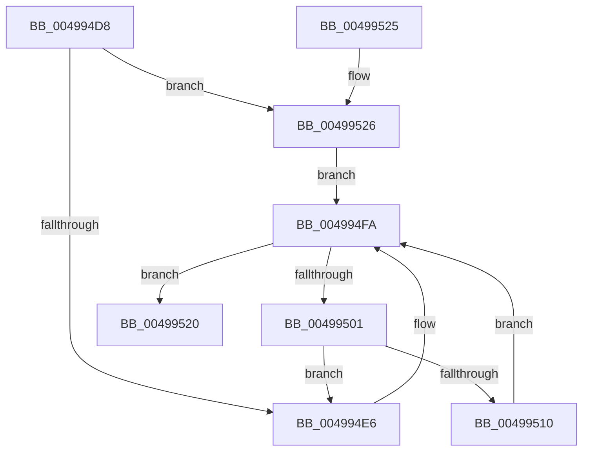

# PopTranslateDependencyArray

- RVA: `0x004994D8`–`0x00499530` (길이 `88` bytes)
- VA: `0x00000001404994D8`
- 실행 섹션: `.text`
- PDB 이름 있음: `예`; PDB Function 태그: `아니요`
- unwind 정보 RVA: `0x0005F758`
- 디코드: `27`개 명령, `88/88` bytes 표시
- 미해석 바이트: `0` (있으면 어셈블리에 `.byte`로 보존)

> 이 문서는 커널 이미지의 기계어와 PDB 기호를 분석해 생성했습니다. 4번과 5번은 함수 원형과 자료형을 바이너리 사용 방식에서 추정한 C 해석이며 원본 소스 복구 결과는 아닙니다.

## 1. Dependencies

- 직접 호출 지점: **1**; 고유 호출 대상: **1**
- 직접 호출자로 확인된 함수: **1**
- RIP 상대 이미지 참조: **0**

### Outgoing calls
- `0x004994F4` → [PopFxBugCheck](../2B/PopFxBugCheck_function_002BFC6C.md) (function, `0x002BFC6C`)

### Direct callers
- [PopProcessorQueryPlatformStateNotification](PopProcessorQueryPlatformStateNotification_function_00499420.md) at `0x00499493`

### Static image references
- 디코드된 RIP-relative 메모리 참조가 없습니다.

## 2. Other-region calls and transfers

- 다른 실행 섹션으로 향하는 call: **0**
- 별도 외부 분기/꼬리 이동을 확인하지 못했습니다.

## 3. Assembly (complete function range)

```asm
004994D8  48 83 EC 28                     sub rsp, 0x28
004994DC  4C 8B D1                        mov r10, rcx
004994DF  44 39 4C 24 50                  cmp dword ptr [rsp + 0x50], r9d
004994E4  76 40                           jbe 0x140499526
004994E6  4C 8B C2                        mov r8, rdx
004994E9  45 33 C9                        xor r9d, r9d
004994EC  49 8B D2                        mov rdx, r10
004994EF  B9 03 07 00 00                  mov ecx, 0x703
004994F4  E8 73 67 E2 FF                  call 0x1402bfc6c
004994F9  CC                              int3
004994FA  44 3B 44 24 50                  cmp r8d, dword ptr [rsp + 0x50]
004994FF  73 1F                           jae 0x140499520
00499501  41 8B C8                        mov ecx, r8d
00499504  48 03 C9                        add rcx, rcx
00499507  49 8B 04 C9                     mov rax, qword ptr [r9 + rcx*8]
0049950B  48 85 C0                        test rax, rax
0049950E  74 D6                           je 0x1404994e6
00499510  48 8B 80 C0 00 00 00            mov rax, qword ptr [rax + 0xc0]
00499517  41 FF C0                        inc r8d
0049951A  49 89 04 C9                     mov qword ptr [r9 + rcx*8], rax
0049951E  EB DA                           jmp 0x1404994fa
00499520  48 83 C4 28                     add rsp, 0x28
00499524  C3                              ret
00499525  CC                              int3
00499526  4C 8B 4C 24 58                  mov r9, qword ptr [rsp + 0x58]
0049952B  45 33 C0                        xor r8d, r8d
0049952E  EB CA                           jmp 0x1404994fa
```

## 4. C-style interpretation (structured pseudocode)

```c
__int64 __fastcall PopTranslateDependencyArray(__int64 a1, __int64 a2, __int64 a3, int a4, unsigned int a5, __int64 a6)
{
    __int64 result;
    __int64 v_rsp;

    v_rsp = (v_rsp) - (40);
    if (a5 <= a4) goto loc_00499526;
loc_004994E6:
    a4 = 0;
    result = PopFxBugCheck((unsigned int)(0x703ULL), a1, a2, a4);
loc_004994FA:
    if (((unsigned int)(a2)) >= a5) goto loc_00499520;
    a1 = ((unsigned int)((unsigned int)(a2))) + ((unsigned int)((unsigned int)(a2)));
    if (*(unsigned __int64 *)(a4 + a1 * 8) == 0) goto loc_004994E6;
    a3 = (unsigned int)((a2) + 1);
    *(unsigned __int64 *)(a4 + a1 * 8) = *(unsigned __int64 *)(*(unsigned __int64 *)(a4 + a1 * 8) + 192);
    goto loc_004994FA;
loc_00499520:
    v_rsp = (v_rsp) + (40);
    return *(unsigned __int64 *)(*(unsigned __int64 *)(a4 + a1 * 8) + 192);
loc_00499526:
    a3 = 0;
    goto loc_004994FA;
}
```

## 5. (Beta) C Style

```c
int64_t PopTranslateDependencyArray(int64_t Arg1, int64_t Arg2, int64_t Arg3, int32_t Arg4, uint32_t Arg5, int64_t Arg6)
{
    int64_t result;
    int64_t local_rsp;

    local_rsp = (local_rsp) - (40);
    if (Arg5 <= Arg4) goto loc_00499526;
loc_004994E6:
    Arg4 = 0;
    result = PopFxBugCheck((uint32_t)(0x703ULL), Arg1, Arg2, Arg4);
loc_004994FA:
    if (((uint32_t)(Arg2)) >= Arg5) goto loc_00499520;
    Arg1 = ((uint32_t)((uint32_t)(Arg2))) + ((uint32_t)((uint32_t)(Arg2)));
    if (*(uint64_t *)(Arg4 + Arg1 * 8) == 0) goto loc_004994E6;
    Arg3 = (uint32_t)((Arg2) + 1);
    *(uint64_t *)(Arg4 + Arg1 * 8) = *(uint64_t *)(*(uint64_t *)(Arg4 + Arg1 * 8) + 0xC0);
    goto loc_004994FA;
loc_00499520:
    local_rsp = (local_rsp) + (40);
    return *(uint64_t *)(*(uint64_t *)(Arg4 + Arg1 * 8) + 0xC0);
loc_00499526:
    Arg3 = 0;
    goto loc_004994FA;
}
```

## 6. Execution-region graph

[열기: 2D/3D 그래프와 함수 탐색 컨트롤 패널](../../../control-panel.html?section=text&rva=0x004994D8&view=graph)

- 2D 그래프는 위에서 아래로 흐르고, 3D 그래프는 빈 공간을 드래그해 회전합니다. Shift+드래그는 이동, 휠은 확대·축소, 함수 노드 선택은 대상 보고서 이동입니다.

### Static fallback


