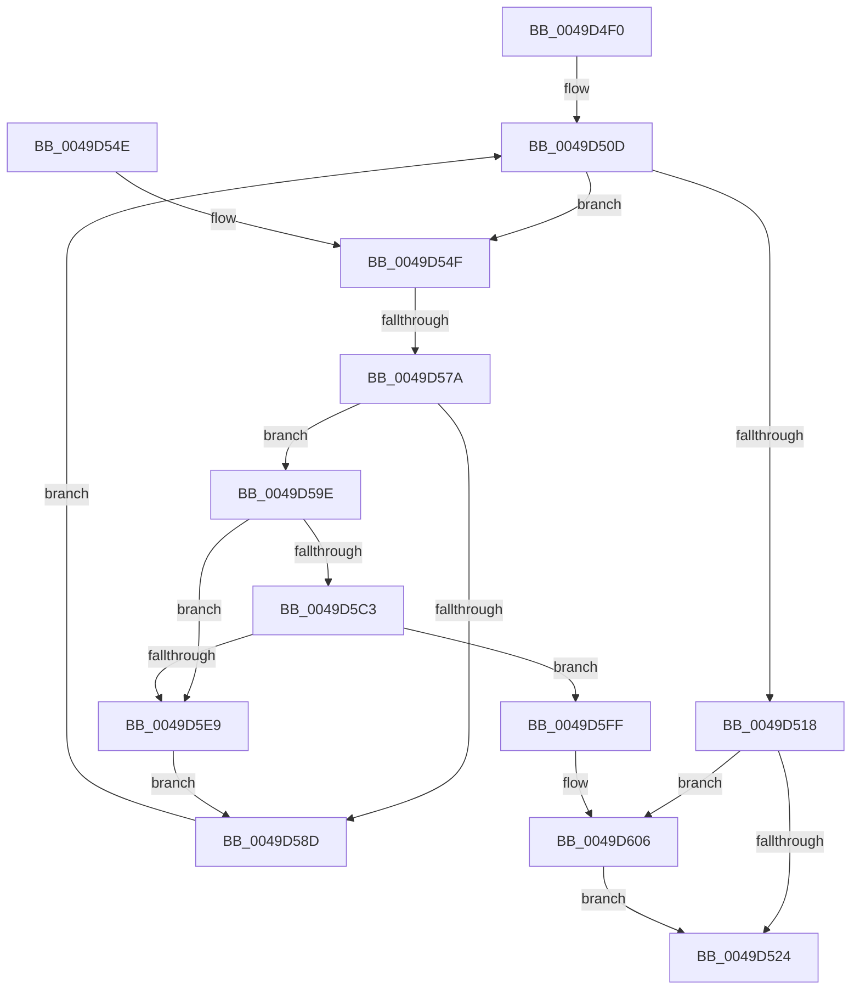

# PopUserPresentSetWorker

- RVA: `0x0049D4F0`–`0x0049D61C` (길이 `300` bytes)
- VA: `0x000000014049D4F0`
- 실행 섹션: `.text`
- PDB 이름 있음: `예`; PDB Function 태그: `예`
- unwind 정보 RVA: `0x000B4F4C`
- 디코드: `66`개 명령, `300/300` bytes 표시
- 미해석 바이트: `0` (있으면 어셈블리에 `.byte`로 보존)

> 이 문서는 커널 이미지의 기계어와 PDB 기호를 분석해 생성했습니다. 4번과 5번은 함수 원형과 자료형을 바이너리 사용 방식에서 추정한 C 해석이며 원본 소스 복구 결과는 아닙니다.

## 1. Dependencies

- 직접 호출 지점: **10**; 고유 호출 대상: **8**
- 직접 호출자로 확인된 함수: **0**
- RIP 상대 이미지 참조: **11**

### Outgoing calls
- `0x0049D506` → [KeAcquireSpinLockRaiseToDpc](../20/KeAcquireSpinLockRaiseToDpc_function_00208470.md) (function, `0x00208470`)
- `0x0049D539` → [KeReleaseSpinLock](../39/KeReleaseSpinLock_function_00392BA0.md) (function, `0x00392BA0`)
- `0x0049D568` → [KeReleaseSpinLock](../39/KeReleaseSpinLock_function_00392BA0.md) (function, `0x00392BA0`)
- `0x0049D57E` → [PopNotifyConsoleUserPresent](../../page/91/PopNotifyConsoleUserPresent_function_00913C50.md) (function, `0x00913C50`)
- `0x0049D594` → [KeAcquireSpinLockRaiseToDpc](../20/KeAcquireSpinLockRaiseToDpc_function_00208470.md) (function, `0x00208470`)
- `0x0049D5D3` → [PopInvokeWin32Callout](../../page/91/PopInvokeWin32Callout_function_009125F4.md) (function, `0x009125F4`)
- `0x0049D5E9` → [PopAcquirePolicyLock](../../pagelk/B7/PopAcquirePolicyLock_function_00B783C0.md) (function, `0x00B783C0`)
- `0x0049D5F3` → [PopUpdateSystemIdleContext](../../page/91/PopUpdateSystemIdleContext_function_00911BB4.md) (function, `0x00911BB4`)
- `0x0049D5F8` → [PopReleasePolicyLock](../../pagelk/B7/PopReleasePolicyLock_function_00B78410.md) (function, `0x00B78410`)
- `0x0049D612` → [KeSetEvent](../33/KeSetEvent_function_0033F310.md) (function, `0x0033F310`)

### Direct callers
- 이 함수 시작 RVA로 연결되는 직접 call은 확인되지 않았습니다. 간접 호출은 완전히 역산할 수 없습니다.

### Static image references
- `0x0049D4FF` → RVA `0x00F0DEF8` (`.data`; read)
- `0x0049D50D` → RVA `0x00E676E4` (`.data`; read)
- `0x0049D518` → RVA `0x00F0CE14` (`.data`; read)
- `0x0049D526` → RVA `0x00E676E4` (`.data`; write)
- `0x0049D533` → RVA `0x00E676E8` (`.data`; write)
- `0x0049D54F` → RVA `0x00E676E8` (`.data`; read)
- `0x0049D56D` → RVA `0x00F0CE11` (`.data`; read)
- `0x0049D583` → RVA `0x00F0CCE8` (`.data`; read)
- `0x0049D59E` → RVA `0x00F0CCE8` (`.data`; read/write)
- `0x0049D5A6` → RVA `0x00F06628` (`.data`; read)
- `0x0049D609` → RVA `0x00F0D160` (`.data`; read)

## 2. Other-region calls and transfers

- 다른 실행 섹션으로 향하는 call: **5**
  - `0x0049D57E` → [PopNotifyConsoleUserPresent](../../page/91/PopNotifyConsoleUserPresent_function_00913C50.md) (`.text` → `PAGE`)
  - `0x0049D5D3` → [PopInvokeWin32Callout](../../page/91/PopInvokeWin32Callout_function_009125F4.md) (`.text` → `PAGE`)
  - `0x0049D5E9` → [PopAcquirePolicyLock](../../pagelk/B7/PopAcquirePolicyLock_function_00B783C0.md) (`.text` → `PAGELK`)
  - `0x0049D5F3` → [PopUpdateSystemIdleContext](../../page/91/PopUpdateSystemIdleContext_function_00911BB4.md) (`.text` → `PAGE`)
  - `0x0049D5F8` → [PopReleasePolicyLock](../../pagelk/B7/PopReleasePolicyLock_function_00B78410.md) (`.text` → `PAGELK`)
- call이 아닌 외부 분기/꼬리 이동: **1**
  - `0x0049D574` → [sub_006F8088](../6F/Unknown_function_006F8088.md) (`tail-transfer`)

## 3. Assembly (complete function range)

```asm
0049D4F0  48 89 5C 24 08                  mov qword ptr [rsp + 8], rbx
0049D4F5  48 89 74 24 10                  mov qword ptr [rsp + 0x10], rsi
0049D4FA  57                              push rdi
0049D4FB  48 83 EC 50                     sub rsp, 0x50
0049D4FF  48 8D 0D F2 09 A7 00            lea rcx, [rip + 0xa709f2]
0049D506  E8 65 AF D6 FF                  call 0x140208470
0049D50B  33 F6                           xor esi, esi
0049D50D  83 3D D0 A1 9C 00 01            cmp dword ptr [rip + 0x9ca1d0], 1
0049D514  8A D8                           mov bl, al
0049D516  74 37                           je 0x14049d54f
0049D518  39 35 F6 F8 A6 00               cmp dword ptr [rip + 0xa6f8f6], esi
0049D51E  0F 85 E2 00 00 00               jne 0x14049d606
0049D524  8A D3                           mov dl, bl
0049D526  89 35 B8 A1 9C 00               mov dword ptr [rip + 0x9ca1b8], esi
0049D52C  48 8D 0D C5 09 A7 00            lea rcx, [rip + 0xa709c5]
0049D533  89 35 AF A1 9C 00               mov dword ptr [rip + 0x9ca1af], esi
0049D539  E8 62 56 EF FF                  call 0x140392ba0
0049D53E  48 8B 5C 24 60                  mov rbx, qword ptr [rsp + 0x60]
0049D543  48 8B 74 24 68                  mov rsi, qword ptr [rsp + 0x68]
0049D548  48 83 C4 50                     add rsp, 0x50
0049D54C  5F                              pop rdi
0049D54D  C3                              ret
0049D54E  CC                              int3
0049D54F  8B 3D 93 A1 9C 00               mov edi, dword ptr [rip + 0x9ca193]
0049D555  48 8D 0D 9C 09 A7 00            lea rcx, [rip + 0xa7099c]
0049D55C  8A D3                           mov dl, bl
0049D55E  C7 05 7C A1 9C 00 02 00 00 00   mov dword ptr [rip + 0x9ca17c], 2
0049D568  E8 33 56 EF FF                  call 0x140392ba0
0049D56D  40 38 35 9D F8 A6 00            cmp byte ptr [rip + 0xa6f89d], sil
0049D574  0F 85 0E AB 25 00               jne 0x1406f8088
0049D57A  8B D7                           mov edx, edi
0049D57C  33 C9                           xor ecx, ecx
0049D57E  E8 CD 66 47 00                  call 0x140913c50
0049D583  8B 05 5F F7 A6 00               mov eax, dword ptr [rip + 0xa6f75f]
0049D589  A8 03                           test al, 3
0049D58B  74 11                           je 0x14049d59e
0049D58D  48 8D 0D 64 09 A7 00            lea rcx, [rip + 0xa70964]
0049D594  E8 D7 AE D6 FF                  call 0x140208470
0049D599  E9 6F FF FF FF                  jmp 0x14049d50d
0049D59E  F0 83 0D 42 F7 A6 00 03         lock or dword ptr [rip + 0xa6f742], 3
0049D5A6  40 38 35 7B 90 A6 00            cmp byte ptr [rip + 0xa6907b], sil
0049D5AD  48 89 74 24 30                  mov qword ptr [rsp + 0x30], rsi
0049D5B2  48 89 74 24 38                  mov qword ptr [rsp + 0x38], rsi
0049D5B7  48 89 74 24 40                  mov qword ptr [rsp + 0x40], rsi
0049D5BC  48 89 74 24 48                  mov qword ptr [rsp + 0x48], rsi
0049D5C1  74 26                           je 0x14049d5e9
0049D5C3  45 33 C9                        xor r9d, r9d
0049D5C6  48 8D 54 24 30                  lea rdx, [rsp + 0x30]
0049D5CB  45 8D 41 02                     lea r8d, [r9 + 2]
0049D5CF  41 8D 49 03                     lea ecx, [r9 + 3]
0049D5D3  E8 1C 50 47 00                  call 0x1409125f4
0049D5D8  65 48 8B 04 25 88 01 00 00      mov rax, qword ptr gs:[0x188]
0049D5E1  39 B0 E4 01 00 00               cmp dword ptr [rax + 0x1e4], esi
0049D5E7  75 16                           jne 0x14049d5ff
0049D5E9  E8 D2 AD 6D 00                  call 0x140b783c0
0049D5EE  B9 04 00 00 00                  mov ecx, 4
0049D5F3  E8 BC 45 47 00                  call 0x140911bb4
0049D5F8  E8 13 AE 6D 00                  call 0x140b78410
0049D5FD  EB 8E                           jmp 0x14049d58d
0049D5FF  B9 20 00 00 00                  mov ecx, 0x20
0049D604  CD 29                           int 0x29
0049D606  45 33 C0                        xor r8d, r8d
0049D609  48 8D 0D 50 FB A6 00            lea rcx, [rip + 0xa6fb50]
0049D610  33 D2                           xor edx, edx
0049D612  E8 F9 1C EA FF                  call 0x14033f310
0049D617  E9 08 FF FF FF                  jmp 0x14049d524
```

## 4. C-style interpretation (structured pseudocode)

```c
__int64 __fastcall PopUserPresentSetWorker(__int64 a1, __int64 a2, __int64 a3, int a4)
{
    __int64 result;
    __int64 v_rsi;
    __int64 v_rsp;
    unsigned __int64 v_stack_p10;
    unsigned __int64 v_stack_p30;
    unsigned __int64 v_stack_p38;
    unsigned __int64 v_stack_p40;
    unsigned __int64 v_stack_p48;
    unsigned __int64 v_stack_p8;

    v_stack_p8 = v_rbx;
    v_stack_p10 = v_rsi;
    v_rsp = (v_rsp) - (80);
    result = KeAcquireSpinLockRaiseToDpc(v_rip + 10947058, a2, a3, a4);
    v_rsi = 0;
loc_0049D50D:
    if ((*(unsigned int *)(v_rip + 10265040)) == 1) goto loc_0049D54F;
    if ((*(unsigned int *)(v_rip + 10942710)) != 0) goto loc_0049D606;
loc_0049D524:
    *(unsigned int *)(v_rip + 10265016) = 0;
    *(unsigned int *)(v_rip + 10265007) = 0;
    result = KeReleaseSpinLock(v_rip + 10947013, (unsigned __int8)((unsigned __int8)(result)), a3, a4);
    v_rsp = (v_rsp) + (80);
    return result;
loc_0049D54F:
    *(unsigned int *)(v_rip + 10264956) = 2;
    result = KeReleaseSpinLock(v_rip + 10946972, (unsigned __int8)(v_stack_p8), a3, a4);
    a1 = 0;
    result = PopNotifyConsoleUserPresent(a1, (unsigned int)((unsigned int)((unsigned int)(*(unsigned int *)(v_rip + 10264979)))), a3, a4);
    if ((((unsigned __int8)((unsigned int)(*(unsigned int *)(v_rip + 10942303)))) & (3)) == 0) goto loc_0049D59E;
loc_0049D58D:
    result = KeAcquireSpinLockRaiseToDpc(v_rip + 10946916, (unsigned int)((unsigned int)((unsigned int)(*(unsigned int *)(v_rip + 10264979)))), a3, a4);
    goto loc_0049D50D;
loc_0049D59E:
    v_stack_p30 = v_stack_p10;
    v_stack_p38 = v_stack_p10;
    v_stack_p40 = v_stack_p10;
    v_stack_p48 = v_stack_p10;
    if ((*(unsigned __int8 *)(v_rip + 10915963)) == ((unsigned __int8)(v_stack_p10))) goto loc_0049D5E9;
    a4 = 0;
    result = PopInvokeWin32Callout(a4 + 3, v_stack_p30, a4 + 2, a4);
    if ((*(unsigned int *)(*(unsigned __int64 *)(gs_base + (0 + 392)) + 484)) != ((unsigned int)(v_stack_p10))) goto loc_0049D5FF;
loc_0049D5E9:
    result = PopAcquirePolicyLock(a4 + 3, v_stack_p30, a4 + 2, a4);
    result = PopUpdateSystemIdleContext(4, v_stack_p30, a4 + 2, a4);
    result = PopReleasePolicyLock(4, v_stack_p30, a4 + 2, a4);
    goto loc_0049D58D;
loc_0049D5FF:
loc_0049D606:
    a3 = 0;
    a2 = 0;
    result = KeSetEvent(v_rip + 10943312, a2, a3, a4);
    goto loc_0049D524;
}
```

## 5. (Beta) C Style

```c
int64_t PopUserPresentSetWorker(int64_t Arg1, int64_t Arg2, int64_t Arg3, int32_t Arg4)
{
    int64_t result;
    int64_t local_rsi;
    int64_t local_rsp;
    uint64_t v_stack_p10;
    uint64_t v_stack_p30;
    uint64_t v_stack_p38;
    uint64_t v_stack_p40;
    uint64_t v_stack_p48;
    uint64_t v_stack_p8;

    v_stack_p8 = local_rbx;
    v_stack_p10 = local_rsi;
    local_rsp = (local_rsp) - (80);
    result = KeAcquireSpinLockRaiseToDpc(v_rip + 10947058, Arg2, Arg3, Arg4);
    local_rsi = 0;
loc_0049D50D:
    if ((*(uint32_t *)(v_rip + 0x9CA1D0)) == 1) goto loc_0049D54F;
    if ((*(uint32_t *)(v_rip + 0xA6F8F6)) != 0) goto loc_0049D606;
loc_0049D524:
    *(uint32_t *)(v_rip + 0x9CA1B8) = 0;
    *(uint32_t *)(v_rip + 0x9CA1AF) = 0;
    result = KeReleaseSpinLock(v_rip + 10947013, (uint8_t)((uint8_t)(result)), Arg3, Arg4);
    local_rsp = (local_rsp) + (80);
    return result;
loc_0049D54F:
    *(uint32_t *)(v_rip + 0x9CA17C) = 2;
    result = KeReleaseSpinLock(v_rip + 10946972, (uint8_t)(v_stack_p8), Arg3, Arg4);
    Arg1 = 0;
    result = PopNotifyConsoleUserPresent(Arg1, (uint32_t)((uint32_t)((uint32_t)(*(uint32_t *)(v_rip + 0x9CA193)))), Arg3, Arg4);
    if ((((uint8_t)((uint32_t)(*(uint32_t *)(v_rip + 0xA6F75F)))) & (3)) == 0) goto loc_0049D59E;
loc_0049D58D:
    result = KeAcquireSpinLockRaiseToDpc(v_rip + 10946916, (uint32_t)((uint32_t)((uint32_t)(*(uint32_t *)(v_rip + 0x9CA193)))), Arg3, Arg4);
    goto loc_0049D50D;
loc_0049D59E:
    v_stack_p30 = v_stack_p10;
    v_stack_p38 = v_stack_p10;
    v_stack_p40 = v_stack_p10;
    v_stack_p48 = v_stack_p10;
    if ((*(uint8_t *)(v_rip + 0xA6907B)) == ((uint8_t)(v_stack_p10))) goto loc_0049D5E9;
    Arg4 = 0;
    result = PopInvokeWin32Callout(Arg4 + 3, v_stack_p30, Arg4 + 2, Arg4);
    if ((*(uint32_t *)(*(uint64_t *)(gs_base + (0 + 0x188)) + 0x1E4)) != ((uint32_t)(v_stack_p10))) goto loc_0049D5FF;
loc_0049D5E9:
    result = PopAcquirePolicyLock(Arg4 + 3, v_stack_p30, Arg4 + 2, Arg4);
    result = PopUpdateSystemIdleContext(4, v_stack_p30, Arg4 + 2, Arg4);
    result = PopReleasePolicyLock(4, v_stack_p30, Arg4 + 2, Arg4);
    goto loc_0049D58D;
loc_0049D5FF:
loc_0049D606:
    Arg3 = 0;
    Arg2 = 0;
    result = KeSetEvent(v_rip + 10943312, Arg2, Arg3, Arg4);
    goto loc_0049D524;
}
```

## 6. Execution-region graph

[열기: 2D/3D 그래프와 함수 탐색 컨트롤 패널](../../../control-panel.html?section=text&rva=0x0049D4F0&view=graph)

- 2D 그래프는 위에서 아래로 흐르고, 3D 그래프는 빈 공간을 드래그해 회전합니다. Shift+드래그는 이동, 휠은 확대·축소, 함수 노드 선택은 대상 보고서 이동입니다.

### Static fallback


