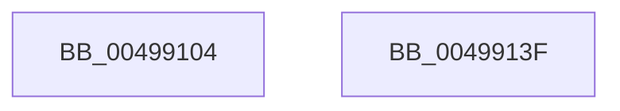

# PpmCheckPausePpmEngineForSx

- RVA: `0x00499104`–`0x00499140` (길이 `60` bytes)
- VA: `0x0000000140499104`
- 실행 섹션: `.text`
- PDB 이름 있음: `예`; PDB Function 태그: `아니요`
- unwind 정보 RVA: `0x0005C788`
- 디코드: `13`개 명령, `60/60` bytes 표시
- 미해석 바이트: `0` (있으면 어셈블리에 `.byte`로 보존)

> 이 문서는 커널 이미지의 기계어와 PDB 기호를 분석해 생성했습니다. 4번과 5번은 함수 원형과 자료형을 바이너리 사용 방식에서 추정한 C 해석이며 원본 소스 복구 결과는 아닙니다.

## 1. Dependencies

- 직접 호출 지점: **4**; 고유 호출 대상: **4**
- 직접 호출자로 확인된 함수: **1**
- RIP 상대 이미지 참조: **3**

### Outgoing calls
- `0x0049910F` → [PpmAcquireLock](../2D/PpmAcquireLock_function_002D9AA4.md) (function, `0x002D9AA4`)
- `0x00499116` → [PpmPerfUpdateQosDisableReasons](PpmPerfUpdateQosDisableReasons_function_004991F0.md) (function, `0x004991F0`)
- `0x00499129` → [PpmCheckReInit](../../page/A8/PpmCheckReInit_function_00A84DD8.md) (function, `0x00A84DD8`)
- `0x00499135` → [PpmReleaseLock](../2D/PpmReleaseLock_function_002DA428.md) (function, `0x002DA428`)

### Direct callers
- [PopTransitionSystemPowerStateEx](../../pagelk/B7/PopTransitionSystemPowerStateEx_function_00B7E8C0.md) at `0x00B7F66A`

### Static image references
- `0x00499108` → RVA `0x00F0CC00` (`.data`; read)
- `0x0049911B` → RVA `0x00FC77C8` (`ALMOSTRO`; write)
- `0x00499122` → RVA `0x00F0B300` (`.data`; write)

## 2. Other-region calls and transfers

- 다른 실행 섹션으로 향하는 call: **1**
  - `0x00499129` → [PpmCheckReInit](../../page/A8/PpmCheckReInit_function_00A84DD8.md) (`.text` → `PAGE`)
- 별도 외부 분기/꼬리 이동을 확인하지 못했습니다.

## 3. Assembly (complete function range)

```asm
00499104  48 83 EC 28                     sub rsp, 0x28
00499108  48 8D 0D F1 3A A7 00            lea rcx, [rip + 0xa73af1]
0049910F  E8 90 09 E4 FF                  call 0x1402d9aa4
00499114  33 C9                           xor ecx, ecx
00499116  E8 D5 00 00 00                  call 0x1404991f0
0049911B  C6 05 A6 E6 B2 00 01            mov byte ptr [rip + 0xb2e6a6], 1
00499122  C6 05 D7 21 A7 00 01            mov byte ptr [rip + 0xa721d7], 1
00499129  E8 AA BC 5E 00                  call 0x140a84dd8
0049912E  48 8D 0D CB 3A A7 00            lea rcx, [rip + 0xa73acb]
00499135  E8 EE 12 E4 FF                  call 0x1402da428
0049913A  48 83 C4 28                     add rsp, 0x28
0049913E  C3                              ret
0049913F  CC                              int3
```

## 4. C-style interpretation (structured pseudocode)

```c
__int64 __fastcall PpmCheckPausePpmEngineForSx(void)
{
    __int64 result;
    __int64 v_rsp;

    v_rsp = (v_rsp) - (40);
    result = PpmAcquireLock(v_rip + 10959601, a2, a3, a4);
    a1 = 0;
    result = PpmPerfUpdateQosDisableReasons(a1, a2, a3, a4);
    *(unsigned __int8 *)(v_rip + 11724454) = 1;
    *(unsigned __int8 *)(v_rip + 10953175) = 1;
    result = PpmCheckReInit(a1, a2, a3, a4);
    result = PpmReleaseLock(v_rip + 10959563, a2, a3, a4);
    v_rsp = (v_rsp) + (40);
    return result;
}
```

## 5. (Beta) C Style

```c
void PpmCheckPausePpmEngineForSx(void)
{
    int64_t result;
    int64_t local_rsp;

    local_rsp = (local_rsp) - (40);
    result = PpmAcquireLock(v_rip + 10959601, a2, a3, a4);
    a1 = 0;
    result = PpmPerfUpdateQosDisableReasons(a1, a2, a3, a4);
    *(uint8_t *)(v_rip + 0xB2E6A6) = 1;
    *(uint8_t *)(v_rip + 0xA721D7) = 1;
    result = PpmCheckReInit(a1, a2, a3, a4);
    result = PpmReleaseLock(v_rip + 10959563, a2, a3, a4);
    local_rsp = (local_rsp) + (40);
    return result;
}
```

## 6. Execution-region graph

[열기: 2D/3D 그래프와 함수 탐색 컨트롤 패널](../../../control-panel.html?section=text&rva=0x00499104&view=graph)

- 2D 그래프는 위에서 아래로 흐르고, 3D 그래프는 빈 공간을 드래그해 회전합니다. Shift+드래그는 이동, 휠은 확대·축소, 함수 노드 선택은 대상 보고서 이동입니다.

### Static fallback


