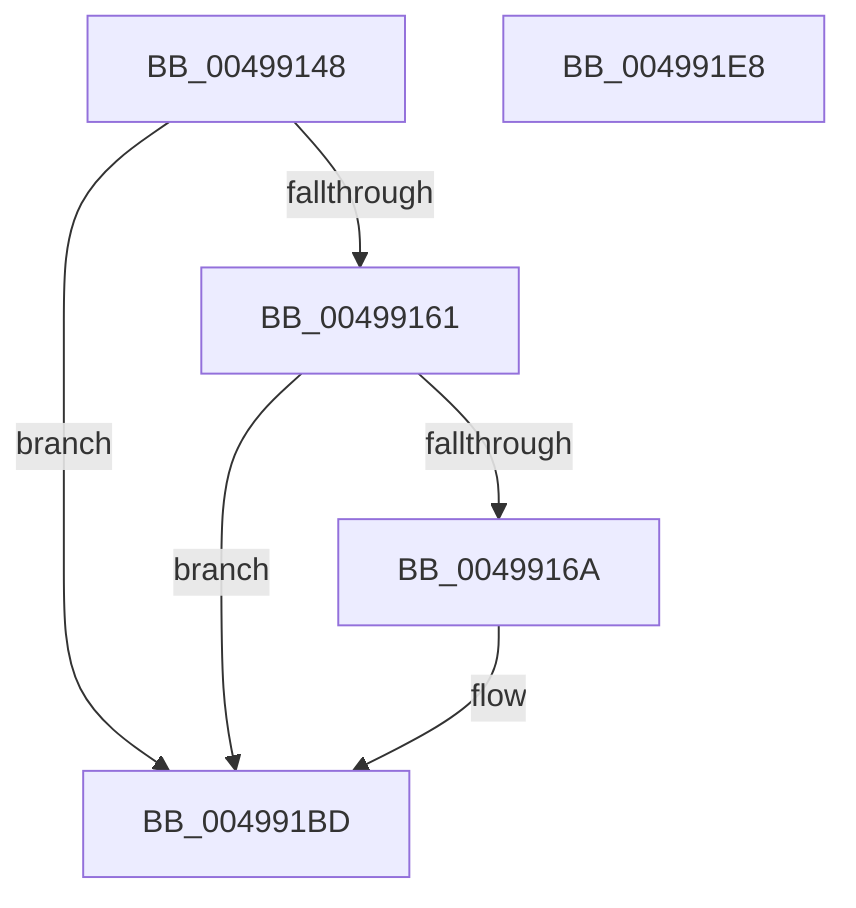

# PpmCheckResumePpmEngineFromSx

- RVA: `0x00499148`–`0x004991E9` (길이 `161` bytes)
- VA: `0x0000000140499148`
- 실행 섹션: `.text`
- PDB 이름 있음: `예`; PDB Function 태그: `아니요`
- unwind 정보 RVA: `0x0005C788`
- 디코드: `36`개 명령, `161/161` bytes 표시
- 미해석 바이트: `0` (있으면 어셈블리에 `.byte`로 보존)

> 이 문서는 커널 이미지의 기계어와 PDB 기호를 분석해 생성했습니다. 4번과 5번은 함수 원형과 자료형을 바이너리 사용 방식에서 추정한 C 해석이며 원본 소스 복구 결과는 아닙니다.

## 1. Dependencies

- 직접 호출 지점: **4**; 고유 호출 대상: **4**
- 직접 호출자로 확인된 함수: **1**
- RIP 상대 이미지 참조: **7**

### Outgoing calls
- `0x00499153` → [PpmAcquireLock](../2D/PpmAcquireLock_function_002D9AA4.md) (function, `0x002D9AA4`)
- `0x004991C4` → [PpmCheckReInit](../../page/A8/PpmCheckReInit_function_00A84DD8.md) (function, `0x00A84DD8`)
- `0x004991CB` → [PpmPerfUpdateQosDisableReasons](PpmPerfUpdateQosDisableReasons_function_004991F0.md) (function, `0x004991F0`)
- `0x004991DE` → [PpmReleaseLock](../2D/PpmReleaseLock_function_002DA428.md) (function, `0x002DA428`)

### Direct callers
- [PopTransitionSystemPowerStateEx](../../pagelk/B7/PopTransitionSystemPowerStateEx_function_00B7E8C0.md) at `0x00B7EF6F`

### Static image references
- `0x0049914C` → RVA `0x00F0CC00` (`.data`; read)
- `0x00499158` → RVA `0x00FC6A94` (`ALMOSTRO`; read)
- `0x00499161` → RVA `0x00FC5003` (`ALMOSTRO`; read)
- `0x0049916A` → RVA `0x00FC72E8` (`ALMOSTRO`; read)
- `0x0049919A` → RVA `0x00FC6A96` (`ALMOSTRO`; read)
- `0x004991BD` → RVA `0x00F0B300` (`.data`; write)
- `0x004991D7` → RVA `0x00FC77C8` (`ALMOSTRO`; write)

## 2. Other-region calls and transfers

- 다른 실행 섹션으로 향하는 call: **1**
  - `0x004991C4` → [PpmCheckReInit](../../page/A8/PpmCheckReInit_function_00A84DD8.md) (`.text` → `PAGE`)
- 별도 외부 분기/꼬리 이동을 확인하지 못했습니다.

## 3. Assembly (complete function range)

```asm
00499148  48 83 EC 28                     sub rsp, 0x28
0049914C  48 8D 0D AD 3A A7 00            lea rcx, [rip + 0xa73aad]
00499153  E8 4C 09 E4 FF                  call 0x1402d9aa4
00499158  80 3D 35 D9 B2 00 00            cmp byte ptr [rip + 0xb2d935], 0
0049915F  74 5C                           je 0x1404991bd
00499161  80 3D 9B BE B2 00 02            cmp byte ptr [rip + 0xb2be9b], 2
00499168  75 53                           jne 0x1404991bd
0049916A  48 8B 05 77 E1 B2 00            mov rax, qword ptr [rip + 0xb2e177]
00499171  41 B8 01 00 00 00               mov r8d, 1
00499177  B9 D0 17 00 00                  mov ecx, 0x17d0
0049917C  48 8B 50 30                     mov rdx, qword ptr [rax + 0x30]
00499180  48 C1 E2 0C                     shl rdx, 0xc
00499184  49 0B D0                        or rdx, r8
00499187  48 8B C2                        mov rax, rdx
0049918A  48 C1 EA 20                     shr rdx, 0x20
0049918E  0F 30                           wrmsr
00499190  48 83 64 24 30 00               and qword ptr [rsp + 0x30], 0
00499196  41 8D 40 02                     lea eax, [r8 + 2]
0049919A  80 3D F5 D8 B2 00 00            cmp byte ptr [rip + 0xb2d8f5], 0
004991A1  B9 D1 17 00 00                  mov ecx, 0x17d1
004991A6  44 0F 45 C0                     cmovne r8d, eax
004991AA  44 89 44 24 30                  mov dword ptr [rsp + 0x30], r8d
004991AF  48 8B 54 24 30                  mov rdx, qword ptr [rsp + 0x30]
004991B4  48 8B C2                        mov rax, rdx
004991B7  48 C1 EA 20                     shr rdx, 0x20
004991BB  0F 30                           wrmsr
004991BD  C6 05 3C 21 A7 00 00            mov byte ptr [rip + 0xa7213c], 0
004991C4  E8 0F BC 5E 00                  call 0x140a84dd8
004991C9  33 C9                           xor ecx, ecx
004991CB  E8 20 00 00 00                  call 0x1404991f0
004991D0  48 8D 0D 29 3A A7 00            lea rcx, [rip + 0xa73a29]
004991D7  C6 05 EA E5 B2 00 00            mov byte ptr [rip + 0xb2e5ea], 0
004991DE  E8 45 12 E4 FF                  call 0x1402da428
004991E3  48 83 C4 28                     add rsp, 0x28
004991E7  C3                              ret
004991E8  CC                              int3
```

## 4. C-style interpretation (structured pseudocode)

```c
__int64 __fastcall PpmCheckResumePpmEngineFromSx(void)
{
    __int64 result;
    __int64 v_rsp;
    unsigned __int64 v_stack_p8;

    v_rsp = (v_rsp) - (40);
    result = PpmAcquireLock(v_rip + 10959533, a2, a3, a4);
    if ((*(unsigned __int8 *)(v_rip + 11721013)) == 0) goto loc_004991BD;
    if ((*(unsigned __int8 *)(v_rip + 11714203)) == 2) {
        result = *(unsigned __int64 *)(v_rip + 11723127);
        a3 = 1;
        a1 = 0x17D0ULL;
        a2 = *(unsigned __int64 *)(result + 48);
        a2 = (a2) << (12);
        a2 = (a2) | (a3);
        result = a2;
        a2 = (a2) >> (32);
        result = a3 + 2;
        a1 = 0x17D1ULL;
        if ((*(unsigned __int8 *)(v_rip + 11720949)) != 0) { a3 = (unsigned int)(result); }
        v_stack_p8 = (unsigned int)(a3);
        a2 = v_stack_p8;
        result = a2;
        a2 = (a2) >> (32);
    }
    *(unsigned __int8 *)(v_rip + 10953020) = 0;
    result = PpmCheckReInit(a1, a2, a3, a4);
    a1 = 0;
    result = PpmPerfUpdateQosDisableReasons(a1, a2, a3, a4);
    *(unsigned __int8 *)(v_rip + 11724266) = 0;
    result = PpmReleaseLock(v_rip + 10959401, a2, a3, a4);
    v_rsp = (v_rsp) + (40);
    return result;
}
```

## 5. (Beta) C Style

```c
void PpmCheckResumePpmEngineFromSx(void)
{
    int64_t result;
    int64_t local_rsp;
    uint64_t v_stack_p8;

    local_rsp = (local_rsp) - (40);
    result = PpmAcquireLock(v_rip + 10959533, a2, a3, a4);
    if ((*(uint8_t *)(v_rip + 0xB2D935)) == 0) goto loc_004991BD;
    if ((*(uint8_t *)(v_rip + 0xB2BE9B)) == 2) {
        result = *(uint64_t *)(v_rip + 0xB2E177);
        a3 = 1;
        a1 = 0x17D0ULL;
        a2 = *(uint64_t *)(result + 0x30);
        a2 = (a2) << (12);
        a2 = (a2) | (a3);
        result = a2;
        a2 = (a2) >> (32);
        result = a3 + 2;
        a1 = 0x17D1ULL;
        if ((*(uint8_t *)(v_rip + 0xB2D8F5)) != 0) { a3 = (uint32_t)(result); }
        v_stack_p8 = (uint32_t)(a3);
        a2 = v_stack_p8;
        result = a2;
        a2 = (a2) >> (32);
    }
    *(uint8_t *)(v_rip + 0xA7213C) = 0;
    result = PpmCheckReInit(a1, a2, a3, a4);
    a1 = 0;
    result = PpmPerfUpdateQosDisableReasons(a1, a2, a3, a4);
    *(uint8_t *)(v_rip + 0xB2E5EA) = 0;
    result = PpmReleaseLock(v_rip + 10959401, a2, a3, a4);
    local_rsp = (local_rsp) + (40);
    return result;
}
```

## 6. Execution-region graph

[열기: 2D/3D 그래프와 함수 탐색 컨트롤 패널](../../../control-panel.html?section=text&rva=0x00499148&view=graph)

- 2D 그래프는 위에서 아래로 흐르고, 3D 그래프는 빈 공간을 드래그해 회전합니다. Shift+드래그는 이동, 휠은 확대·축소, 함수 노드 선택은 대상 보고서 이동입니다.

### Static fallback


