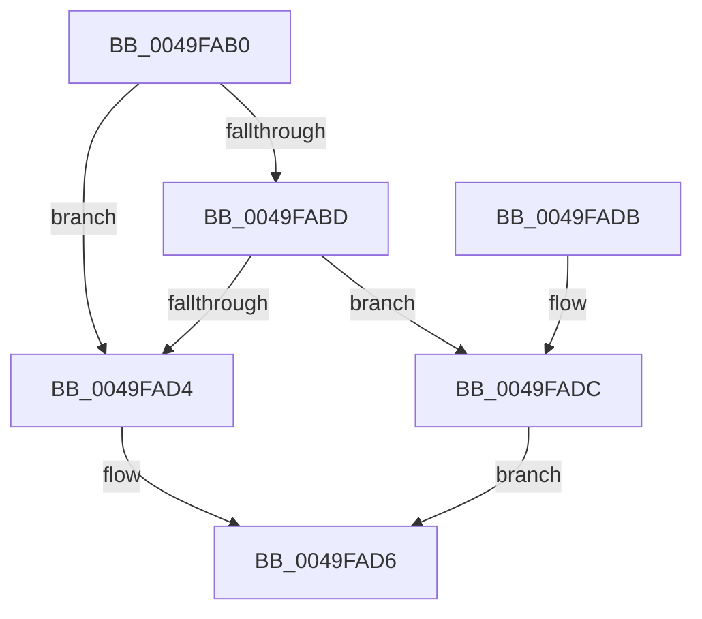

# PpmCheckUpdateDeliveredPerformanceIfTracingEnabled

- RVA: `0x0049FAB0`–`0x0049FAE3` (길이 `51` bytes)
- VA: `0x000000014049FAB0`
- 실행 섹션: `.text`
- PDB 이름 있음: `예`; PDB Function 태그: `아니요`
- unwind 정보 RVA: `0x0005CEE8`
- 디코드: `14`개 명령, `51/51` bytes 표시
- 미해석 바이트: `0` (있으면 어셈블리에 `.byte`로 보존)

> 이 문서는 커널 이미지의 기계어와 PDB 기호를 분석해 생성했습니다. 4번과 5번은 함수 원형과 자료형을 바이너리 사용 방식에서 추정한 C 해석이며 원본 소스 복구 결과는 아닙니다.

## 1. Dependencies

- 직접 호출 지점: **2**; 고유 호출 대상: **2**
- 직접 호출자로 확인된 함수: **0**
- RIP 상대 이미지 참조: **3**

### Outgoing calls
- `0x0049FACB` → [EtwEventEnabled](../39/EtwEventEnabled_function_00392450.md) (function, `0x00392450`)
- `0x0049FADC` → [PpmCheckSnapAllDeliveredPerformance](../2D/PpmCheckSnapAllDeliveredPerformance_function_002D7AA0.md) (function, `0x002D7AA0`)

### Direct callers
- 이 함수 시작 RVA로 연결되는 직접 call은 확인되지 않았습니다. 간접 호출은 완전히 역산할 수 없습니다.

### Static image references
- `0x0049FAB4` → RVA `0x00E67A39` (`.data`; read)
- `0x0049FABD` → RVA `0x00F083E8` (`.data`; read)
- `0x0049FAC4` → RVA `0x000146C0` (`.rdata`; read)

## 2. Other-region calls and transfers

- 다른 실행 섹션으로 향하는 call: **0**
- 별도 외부 분기/꼬리 이동을 확인하지 못했습니다.

## 3. Assembly (complete function range)

```asm
0049FAB0  48 83 EC 28                     sub rsp, 0x28
0049FAB4  80 3D 7E 7F 9C 00 00            cmp byte ptr [rip + 0x9c7f7e], 0
0049FABB  74 17                           je 0x14049fad4
0049FABD  48 8B 0D 24 89 A6 00            mov rcx, qword ptr [rip + 0xa68924]
0049FAC4  48 8D 15 F5 4B B7 FF            lea rdx, [rip - 0x48b40b]
0049FACB  E8 80 29 EF FF                  call 0x140392450
0049FAD0  84 C0                           test al, al
0049FAD2  75 08                           jne 0x14049fadc
0049FAD4  B0 01                           mov al, 1
0049FAD6  48 83 C4 28                     add rsp, 0x28
0049FADA  C3                              ret
0049FADB  CC                              int3
0049FADC  E8 BF 7F E3 FF                  call 0x1402d7aa0
0049FAE1  EB F3                           jmp 0x14049fad6
```

## 4. C-style interpretation (structured pseudocode)

```c
__int64 __fastcall PpmCheckUpdateDeliveredPerformanceIfTracingEnabled(void)
{
    __int64 result;
    __int64 v_rsp;

    v_rsp = (v_rsp) - (40);
    if ((*(unsigned __int8 *)(v_rip + 10256254)) == 0) goto loc_0049FAD4;
    result = EtwEventEnabled(*(unsigned __int64 *)(v_rip + 10914084), v_rip - 4764683, a3, a4);
    if ((unsigned __int8)(result) != 0) goto loc_0049FADC;
loc_0049FAD4:
loc_0049FAD6:
    v_rsp = (v_rsp) + (40);
    return 1;
loc_0049FADC:
    result = PpmCheckSnapAllDeliveredPerformance(*(unsigned __int64 *)(v_rip + 10914084), v_rip - 4764683, a3, a4);
    goto loc_0049FAD6;
}
```

## 5. (Beta) C Style

```c
void PpmCheckUpdateDeliveredPerformanceIfTracingEnabled(void)
{
    int64_t result;
    int64_t local_rsp;

    local_rsp = (local_rsp) - (40);
    if ((*(uint8_t *)(v_rip + 0x9C7F7E)) == 0) goto loc_0049FAD4;
    result = EtwEventEnabled(*(uint64_t *)(v_rip + 0xA68924), v_rip - 4764683, a3, a4);
    if ((uint8_t)(result) != 0) goto loc_0049FADC;
loc_0049FAD4:
loc_0049FAD6:
    local_rsp = (local_rsp) + (40);
    return 1;
loc_0049FADC:
    result = PpmCheckSnapAllDeliveredPerformance(*(uint64_t *)(v_rip + 0xA68924), v_rip - 4764683, a3, a4);
    goto loc_0049FAD6;
}
```

## 6. Execution-region graph

[열기: 2D/3D 그래프와 함수 탐색 컨트롤 패널](../../../control-panel.html?section=text&rva=0x0049FAB0&view=graph)

- 2D 그래프는 위에서 아래로 흐르고, 3D 그래프는 빈 공간을 드래그해 회전합니다. Shift+드래그는 이동, 휠은 확대·축소, 함수 노드 선택은 대상 보고서 이동입니다.

### Static fallback


