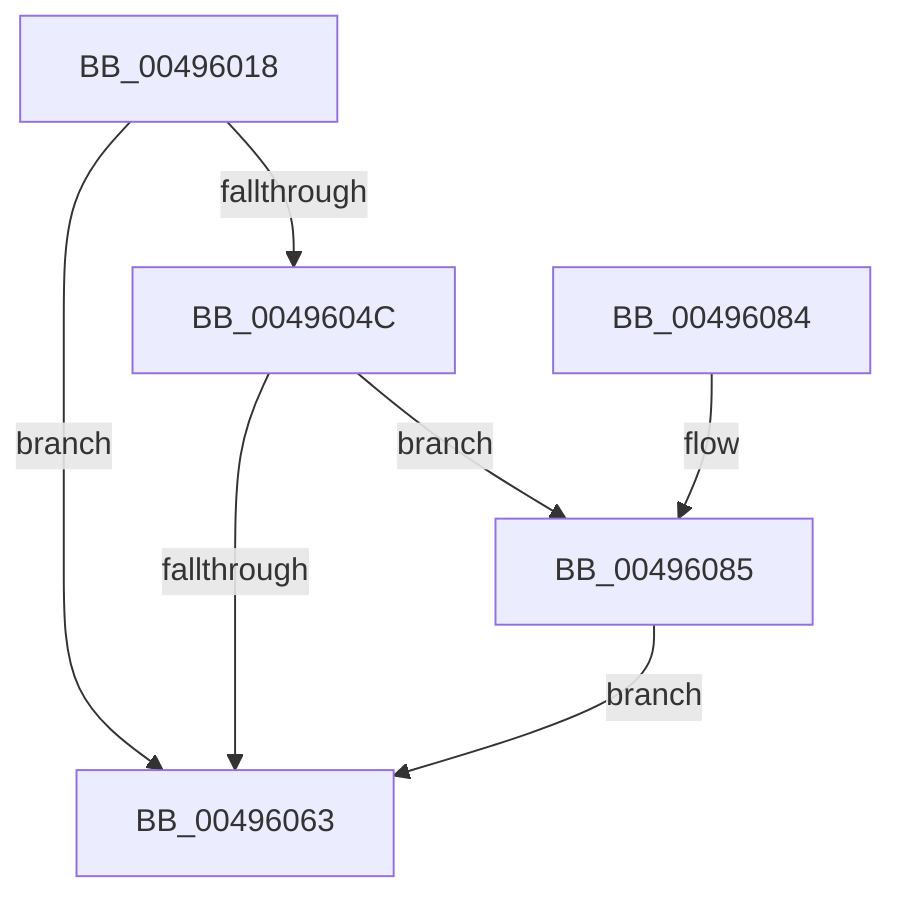

# PpmEventCoreParkingStateChangeEx

- RVA: `0x00496018`–`0x00496125` (길이 `269` bytes)
- VA: `0x0000000140496018`
- 실행 섹션: `.text`
- PDB 이름 있음: `예`; PDB Function 태그: `아니요`
- unwind 정보 RVA: `0x0009E4D4`
- 디코드: `61`개 명령, `269/269` bytes 표시
- 미해석 바이트: `0` (있으면 어셈블리에 `.byte`로 보존)

> 이 문서는 커널 이미지의 기계어와 PDB 기호를 분석해 생성했습니다. 4번과 5번은 함수 원형과 자료형을 바이너리 사용 방식에서 추정한 C 해석이며 원본 소스 복구 결과는 아닙니다.

## 1. Dependencies

- 직접 호출 지점: **3**; 고유 호출 대상: **3**
- 직접 호출자로 확인된 함수: **1**
- RIP 상대 이미지 참조: **5**

### Outgoing calls
- `0x0049605A` → [EtwEventEnabled](../39/EtwEventEnabled_function_00392450.md) (function, `0x00392450`)
- `0x0049606A` → [_security_check_cookie](../6A/_security_check_cookie_function_006AC640.md) (function, `0x006AC640`)
- `0x0049611B` → [EtwWriteEx](../25/EtwWriteEx_function_0025F0D0.md) (function, `0x0025F0D0`)

### Direct callers
- [PpmParkReportParkedCore](../2D/PpmParkReportParkedCore_function_002D8488.md) at `0x002D854B`

### Static image references
- `0x0049602F` → RVA `0x00E0A740` (`.data`; read)
- `0x0049603D` → RVA `0x00E67A39` (`.data`; read)
- `0x0049604C` → RVA `0x00F083E8` (`.data`; read)
- `0x00496053` → RVA `0x0001A878` (`.rdata`; read)
- `0x00496089` → RVA `0x00F0B260` (`.data`; read)

## 2. Other-region calls and transfers

- 다른 실행 섹션으로 향하는 call: **0**
- 별도 외부 분기/꼬리 이동을 확인하지 못했습니다.

## 3. Assembly (complete function range)

```asm
00496018  48 89 5C 24 08                  mov qword ptr [rsp + 8], rbx
0049601D  48 89 7C 24 10                  mov qword ptr [rsp + 0x10], rdi
00496022  55                              push rbp
00496023  48 8D 6C 24 A9                  lea rbp, [rsp - 0x57]
00496028  48 81 EC A0 00 00 00            sub rsp, 0xa0
0049602F  48 8B 05 0A 47 97 00            mov rax, qword ptr [rip + 0x97470a]
00496036  48 33 C4                        xor rax, rsp
00496039  48 89 45 47                     mov qword ptr [rbp + 0x47], rax
0049603D  80 3D F5 19 9D 00 00            cmp byte ptr [rip + 0x9d19f5], 0
00496044  40 8A FA                        mov dil, dl
00496047  48 8B D9                        mov rbx, rcx
0049604A  74 17                           je 0x140496063
0049604C  48 8B 0D 95 23 A7 00            mov rcx, qword ptr [rip + 0xa72395]
00496053  48 8D 15 1E 48 B8 FF            lea rdx, [rip - 0x47b7e2]
0049605A  E8 F1 C3 EF FF                  call 0x140392450
0049605F  84 C0                           test al, al
00496061  75 22                           jne 0x140496085
00496063  48 8B 4D 47                     mov rcx, qword ptr [rbp + 0x47]
00496067  48 33 CC                        xor rcx, rsp
0049606A  E8 D1 65 21 00                  call 0x1406ac640
0049606F  4C 8D 9C 24 A0 00 00 00         lea r11, [rsp + 0xa0]
00496077  49 8B 5B 10                     mov rbx, qword ptr [r11 + 0x10]
0049607B  49 8B 7B 18                     mov rdi, qword ptr [r11 + 0x18]
0049607F  49 8B E3                        mov rsp, r11
00496082  5D                              pop rbp
00496083  C3                              ret
00496084  CC                              int3
00496085  83 65 13 00                     and dword ptr [rbp + 0x13], 0
00496089  48 8D 05 D0 51 A7 00            lea rax, [rip + 0xa751d0]
00496090  83 65 23 00                     and dword ptr [rbp + 0x23], 0
00496094  48 8D 15 DD 47 B8 FF            lea rdx, [rip - 0x47b823]
0049609B  83 65 33 00                     and dword ptr [rbp + 0x33], 0
0049609F  B9 04 00 00 00                  mov ecx, 4
004960A4  48 89 45 07                     mov qword ptr [rbp + 7], rax
004960A8  0F B6 83 D0 00 00 00            movzx eax, byte ptr [rbx + 0xd0]
004960AF  66 89 45 F7                     mov word ptr [rbp - 9], ax
004960B3  48 8D 45 F7                     lea rax, [rbp - 9]
004960B7  48 89 45 17                     mov qword ptr [rbp + 0x17], rax
004960BB  48 8D 83 D1 00 00 00            lea rax, [rbx + 0xd1]
004960C2  48 89 45 27                     mov qword ptr [rbp + 0x27], rax
004960C6  33 C0                           xor eax, eax
004960C8  40 84 FF                        test dil, dil
004960CB  89 4D 3F                        mov dword ptr [rbp + 0x3f], ecx
004960CE  C7 45 0F 08 00 00 00            mov dword ptr [rbp + 0xf], 8
004960D5  0F 95 C0                        setne al
004960D8  C7 45 1F 02 00 00 00            mov dword ptr [rbp + 0x1f], 2
004960DF  83 65 43 00                     and dword ptr [rbp + 0x43], 0
004960E3  45 33 C9                        xor r9d, r9d
004960E6  89 45 FB                        mov dword ptr [rbp - 5], eax
004960E9  45 33 C0                        xor r8d, r8d
004960EC  48 8D 45 FB                     lea rax, [rbp - 5]
004960F0  C7 45 2F 01 00 00 00            mov dword ptr [rbp + 0x2f], 1
004960F7  48 89 45 37                     mov qword ptr [rbp + 0x37], rax
004960FB  48 8D 45 07                     lea rax, [rbp + 7]
004960FF  48 89 44 24 38                  mov qword ptr [rsp + 0x38], rax
00496104  89 4C 24 30                     mov dword ptr [rsp + 0x30], ecx
00496108  48 83 64 24 28 00               and qword ptr [rsp + 0x28], 0
0049610E  48 83 64 24 20 00               and qword ptr [rsp + 0x20], 0
00496114  48 8B 0D CD 22 A7 00            mov rcx, qword ptr [rip + 0xa722cd]
0049611B  E8 B0 8F DC FF                  call 0x14025f0d0
00496120  E9 3E FF FF FF                  jmp 0x140496063
```

## 4. C-style interpretation (structured pseudocode)

```c
__int64 __fastcall PpmEventCoreParkingStateChangeEx(__int64 a1, unsigned __int8 a2, int a3, int a4)
{
    __int64 result;
    __int64 v_rsp;
    unsigned __int64 v_stack_m18;
    unsigned int v_stack_m1C;
    unsigned int v_stack_m20;
    unsigned __int64 v_stack_m28;
    unsigned int v_stack_m2C;
    unsigned int v_stack_m30;
    unsigned __int64 v_stack_m38;
    unsigned int v_stack_m3C;
    unsigned int v_stack_m40;
    unsigned __int64 v_stack_m48;
    unsigned int v_stack_m4C;
    unsigned int v_stack_m50;
    unsigned __int64 v_stack_m58;
    unsigned __int64 v_stack_m5F;
    unsigned int v_stack_m64;
    unsigned __int16 v_stack_m68;
    unsigned int v_stack_m70;
    unsigned __int64 v_stack_m78;
    unsigned __int64 v_stack_m8;
    unsigned __int64 v_stack_m80;
    unsigned __int64 v_stack_p10;
    unsigned __int64 v_stack_p8;

    v_stack_p8 = v_rbx;
    v_stack_p10 = v_rdi;
    v_rsp = (v_rsp) - (160);
    result = (*(unsigned __int64 *)(v_rip + 9914122)) ^ (v_rsp);
    v_stack_m18 = result;
    if ((*(unsigned __int8 *)(v_rip + 10295797)) == 0) goto loc_00496063;
    result = EtwEventEnabled(*(unsigned __int64 *)(v_rip + 10953621), v_rip - 4700130, a3, a4);
    if ((unsigned __int8)(result) != 0) goto loc_00496085;
loc_00496063:
    a1 = (v_stack_m18) ^ (v_rsp);
    result = _security_check_cookie(a1, v_rip - 4700130, a3, a4);
    return result;
loc_00496085:
    v_stack_m58 = v_rip + 10965456;
    v_stack_m68 = (unsigned __int16)(*(unsigned __int8 *)(*(unsigned __int64 *)(v_stack_m8 + 16) + 208));
    v_stack_m48 = v_stack_m68;
    v_stack_m38 = *(unsigned __int64 *)(v_stack_m8 + 16) + 209;
    result = 0;
    v_stack_m20 = 4;
    v_stack_m50 = 8;
    result = ((unsigned __int8)(*(unsigned __int64 *)(v_stack_m8 + 24)) != 0) ? 1 : 0;
    v_stack_m40 = 2;
    a4 = 0;
    v_stack_m64 = (unsigned int)(result);
    a3 = 0;
    v_stack_m30 = 1;
    v_stack_m28 = v_stack_m64;
    v_stack_m68 = v_stack_m58;
    v_stack_m70 = 4;
    result = EtwWriteEx(*(unsigned __int64 *)(v_rip + 10953421), v_rip - 4700195, a3, a4);
    goto loc_00496063;
}
```

## 5. (Beta) C Style

```c
int64_t PpmEventCoreParkingStateChangeEx(void *Arg1, uint8_t Arg2, int32_t Arg3, int32_t Arg4)
{
    uint8_t *arg1 = (uint8_t *)Arg1;

    int64_t result;
    int64_t local_rsp;
    uint64_t v_stack_m18;
    uint32_t v_stack_m1C;
    uint32_t v_stack_m20;
    uint64_t v_stack_m28;
    uint32_t v_stack_m2C;
    uint32_t v_stack_m30;
    uint64_t v_stack_m38;
    uint32_t v_stack_m3C;
    uint32_t v_stack_m40;
    uint64_t v_stack_m48;
    uint32_t v_stack_m4C;
    uint32_t v_stack_m50;
    uint64_t v_stack_m58;
    uint64_t v_stack_m5F;
    uint32_t v_stack_m64;
    uint16_t v_stack_m68;
    uint32_t v_stack_m70;
    uint64_t v_stack_m78;
    uint64_t v_stack_m8;
    uint64_t v_stack_m80;
    uint64_t v_stack_p10;
    uint64_t v_stack_p8;

    v_stack_p8 = local_rbx;
    v_stack_p10 = local_rdi;
    local_rsp = (local_rsp) - (160);
    result = (*(uint64_t *)(v_rip + 0x97470A)) ^ (local_rsp);
    v_stack_m18 = result;
    if ((*(uint8_t *)(v_rip + 0x9D19F5)) == 0) goto loc_00496063;
    result = EtwEventEnabled(*(uint64_t *)(v_rip + 0xA72395), v_rip - 4700130, Arg3, Arg4);
    if ((uint8_t)(result) != 0) goto loc_00496085;
loc_00496063:
    Arg1 = (v_stack_m18) ^ (local_rsp);
    result = _security_check_cookie(Arg1, v_rip - 4700130, Arg3, Arg4);
    return result;
loc_00496085:
    v_stack_m58 = v_rip + 10965456;
    v_stack_m68 = (uint16_t)(*(uint8_t *)(*(uint64_t *)(v_stack_m8 + 0x10) + 0xD0));
    v_stack_m48 = v_stack_m68;
    v_stack_m38 = *(uint64_t *)(v_stack_m8 + 0x10) + 209;
    result = 0;
    v_stack_m20 = 4;
    v_stack_m50 = 8;
    result = ((uint8_t)(*(uint64_t *)(v_stack_m8 + 0x18)) != 0) ? 1 : 0;
    v_stack_m40 = 2;
    Arg4 = 0;
    v_stack_m64 = (uint32_t)(result);
    Arg3 = 0;
    v_stack_m30 = 1;
    v_stack_m28 = v_stack_m64;
    v_stack_m68 = v_stack_m58;
    v_stack_m70 = 4;
    result = EtwWriteEx(*(uint64_t *)(v_rip + 0xA722CD), v_rip - 4700195, Arg3, Arg4);
    goto loc_00496063;
}
```

### 관측된 메모리 오프셋

구조체 형식이 확인되지 않은 접근은 인자 기준의 오프셋으로만 기록했습니다.

| 기준 인자 | 오프셋 표현 | 폭 (bit) | 접근 |
|---|---:|---:|---|
| `Arg1` | `+ 0xD0` | `8` | `R` |
| `Arg1` | `+ 0xD1` | `64` | `R` |

## 6. Execution-region graph

[열기: 2D/3D 그래프와 함수 탐색 컨트롤 패널](../../../control-panel.html?section=text&rva=0x00496018&view=graph)

- 2D 그래프는 위에서 아래로 흐르고, 3D 그래프는 빈 공간을 드래그해 회전합니다. Shift+드래그는 이동, 휠은 확대·축소, 함수 노드 선택은 대상 보고서 이동입니다.

### Static fallback


