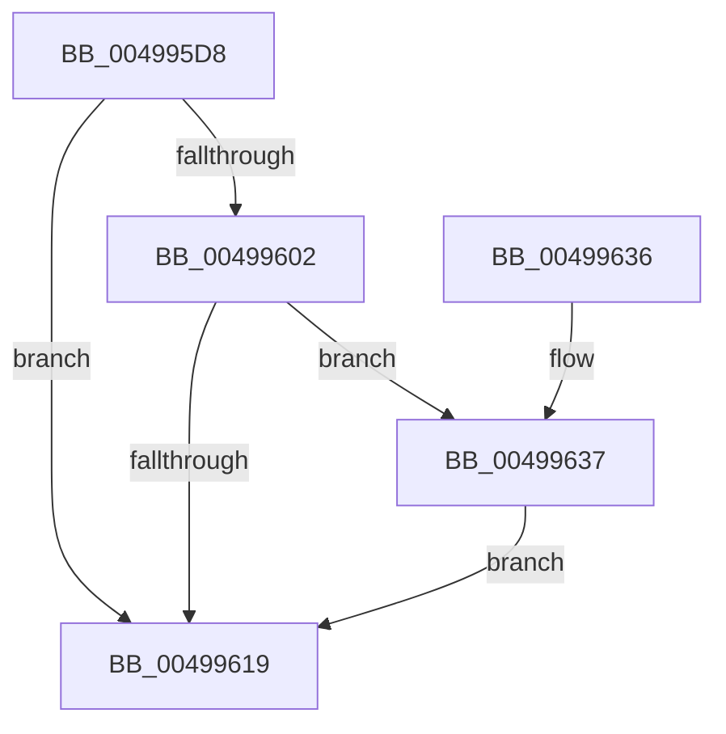

# PpmEventCoreParkingStateChange

- RVA: `0x004995D8`–`0x004996BC` (길이 `228` bytes)
- VA: `0x00000001404995D8`
- 실행 섹션: `.text`
- PDB 이름 있음: `예`; PDB Function 태그: `아니요`
- unwind 정보 RVA: `0x000B44C8`
- 디코드: `48`개 명령, `228/228` bytes 표시
- 미해석 바이트: `0` (있으면 어셈블리에 `.byte`로 보존)

> 이 문서는 커널 이미지의 기계어와 PDB 기호를 분석해 생성했습니다. 4번과 5번은 함수 원형과 자료형을 바이너리 사용 방식에서 추정한 C 해석이며 원본 소스 복구 결과는 아닙니다.

## 1. Dependencies

- 직접 호출 지점: **3**; 고유 호출 대상: **3**
- 직접 호출자로 확인된 함수: **1**
- RIP 상대 이미지 참조: **5**

### Outgoing calls
- `0x00499610` → [EtwEventEnabled](../39/EtwEventEnabled_function_00392450.md) (function, `0x00392450`)
- `0x00499620` → [_security_check_cookie](../6A/_security_check_cookie_function_006AC640.md) (function, `0x006AC640`)
- `0x004996B2` → [EtwWriteEx](../25/EtwWriteEx_function_0025F0D0.md) (function, `0x0025F0D0`)

### Direct callers
- [PpmParkReportUnparkedCore](../2D/PpmParkReportUnparkedCore_function_002D82E0.md) at `0x002D8337`

### Static image references
- `0x004995E8` → RVA `0x00E0A740` (`.data`; read)
- `0x004995F6` → RVA `0x00E67A39` (`.data`; read)
- `0x00499602` → RVA `0x00F083E8` (`.data`; read)
- `0x00499609` → RVA `0x0001AB38` (`.rdata`; read)
- `0x0049963B` → RVA `0x00F0B260` (`.data`; read)

## 2. Other-region calls and transfers

- 다른 실행 섹션으로 향하는 call: **0**
- 별도 외부 분기/꼬리 이동을 확인하지 못했습니다.

## 3. Assembly (complete function range)

```asm
004995D8  48 89 5C 24 08                  mov qword ptr [rsp + 8], rbx
004995DD  55                              push rbp
004995DE  48 8B EC                        mov rbp, rsp
004995E1  48 81 EC 80 00 00 00            sub rsp, 0x80
004995E8  48 8B 05 51 11 97 00            mov rax, qword ptr [rip + 0x971151]
004995EF  48 33 C4                        xor rax, rsp
004995F2  48 89 45 F8                     mov qword ptr [rbp - 8], rax
004995F6  80 3D 3C E4 9C 00 00            cmp byte ptr [rip + 0x9ce43c], 0
004995FD  48 8B D9                        mov rbx, rcx
00499600  74 17                           je 0x140499619
00499602  48 8B 0D DF ED A6 00            mov rcx, qword ptr [rip + 0xa6eddf]
00499609  48 8D 15 28 15 B8 FF            lea rdx, [rip - 0x47ead8]
00499610  E8 3B 8E EF FF                  call 0x140392450
00499615  84 C0                           test al, al
00499617  75 1E                           jne 0x140499637
00499619  48 8B 4D F8                     mov rcx, qword ptr [rbp - 8]
0049961D  48 33 CC                        xor rcx, rsp
00499620  E8 1B 30 21 00                  call 0x1406ac640
00499625  48 8B 9C 24 90 00 00 00         mov rbx, qword ptr [rsp + 0x90]
0049962D  48 81 C4 80 00 00 00            add rsp, 0x80
00499634  5D                              pop rbp
00499635  C3                              ret
00499636  CC                              int3
00499637  83 65 D4 00                     and dword ptr [rbp - 0x2c], 0
0049963B  48 8D 05 1E 1C A7 00            lea rax, [rip + 0xa71c1e]
00499642  83 65 E4 00                     and dword ptr [rbp - 0x1c], 0
00499646  48 8D 15 EB 14 B8 FF            lea rdx, [rip - 0x47eb15]
0049964D  83 65 F4 00                     and dword ptr [rbp - 0xc], 0
00499651  45 33 C9                        xor r9d, r9d
00499654  48 8B 0D 8D ED A6 00            mov rcx, qword ptr [rip + 0xa6ed8d]
0049965B  45 33 C0                        xor r8d, r8d
0049965E  48 89 45 C8                     mov qword ptr [rbp - 0x38], rax
00499662  0F B6 83 D0 00 00 00            movzx eax, byte ptr [rbx + 0xd0]
00499669  66 89 45 C0                     mov word ptr [rbp - 0x40], ax
0049966D  48 8D 45 C0                     lea rax, [rbp - 0x40]
00499671  48 89 45 D8                     mov qword ptr [rbp - 0x28], rax
00499675  48 8D 83 D1 00 00 00            lea rax, [rbx + 0xd1]
0049967C  48 89 45 E8                     mov qword ptr [rbp - 0x18], rax
00499680  48 8D 45 C8                     lea rax, [rbp - 0x38]
00499684  48 89 44 24 38                  mov qword ptr [rsp + 0x38], rax
00499689  C7 44 24 30 03 00 00 00         mov dword ptr [rsp + 0x30], 3
00499691  48 83 64 24 28 00               and qword ptr [rsp + 0x28], 0
00499697  48 83 64 24 20 00               and qword ptr [rsp + 0x20], 0
0049969D  C7 45 D0 08 00 00 00            mov dword ptr [rbp - 0x30], 8
004996A4  C7 45 E0 02 00 00 00            mov dword ptr [rbp - 0x20], 2
004996AB  C7 45 F0 01 00 00 00            mov dword ptr [rbp - 0x10], 1
004996B2  E8 19 5A DC FF                  call 0x14025f0d0
004996B7  E9 5D FF FF FF                  jmp 0x140499619
```

## 4. C-style interpretation (structured pseudocode)

```c
__int64 __fastcall PpmEventCoreParkingStateChange(__int64 a1, __int64 a2, int a3, int a4)
{
    __int64 result;
    __int64 v_rsp;
    unsigned __int64 v_stack_m10;
    unsigned int v_stack_m14;
    unsigned int v_stack_m18;
    unsigned __int64 v_stack_m20;
    unsigned int v_stack_m24;
    unsigned int v_stack_m28;
    unsigned __int64 v_stack_m30;
    unsigned int v_stack_m34;
    unsigned int v_stack_m38;
    unsigned __int64 v_stack_m40;
    unsigned __int16 v_stack_m48;
    unsigned __int64 v_stack_p20;
    unsigned __int64 v_stack_p28;
    unsigned int v_stack_p30;
    unsigned __int64 v_stack_p38;
    unsigned __int64 v_stack_p8;

    v_stack_p8 = v_rbx;
    v_rsp = (v_rsp) - (128);
    result = (*(unsigned __int64 *)(v_rip + 9900369)) ^ (v_rsp);
    v_stack_m10 = result;
    if ((*(unsigned __int8 *)(v_rip + 10282044)) == 0) goto loc_00499619;
    result = EtwEventEnabled(*(unsigned __int64 *)(v_rip + 10939871), v_rip - 4713176, a3, a4);
    if ((unsigned __int8)(result) != 0) goto loc_00499637;
loc_00499619:
    a1 = (v_stack_m10) ^ (v_rsp);
    result = _security_check_cookie(a1, v_rip - 4713176, a3, a4);
    v_rsp = (v_rsp) + (128);
    return result;
loc_00499637:
    a4 = 0;
    a3 = 0;
    v_stack_m40 = v_rip + 10951710;
    v_stack_m48 = (unsigned __int16)(*(unsigned __int8 *)(v_stack_p8 + 208));
    v_stack_m30 = v_stack_m48;
    v_stack_m20 = v_stack_p8 + 209;
    v_stack_p38 = v_stack_m40;
    v_stack_p30 = 3;
    v_stack_m38 = 8;
    v_stack_m28 = 2;
    v_stack_m18 = 1;
    result = EtwWriteEx(*(unsigned __int64 *)(v_rip + 10939789), v_rip - 4713237, a3, a4);
    goto loc_00499619;
}
```

## 5. (Beta) C Style

```c
int64_t PpmEventCoreParkingStateChange(void *Arg1, int64_t Arg2, int32_t Arg3, int32_t Arg4)
{
    uint8_t *arg1 = (uint8_t *)Arg1;

    int64_t result;
    int64_t local_rsp;
    uint64_t v_stack_m10;
    uint32_t v_stack_m14;
    uint32_t v_stack_m18;
    uint64_t v_stack_m20;
    uint32_t v_stack_m24;
    uint32_t v_stack_m28;
    uint64_t v_stack_m30;
    uint32_t v_stack_m34;
    uint32_t v_stack_m38;
    uint64_t v_stack_m40;
    uint16_t v_stack_m48;
    uint64_t v_stack_p20;
    uint64_t v_stack_p28;
    uint32_t v_stack_p30;
    uint64_t v_stack_p38;
    uint64_t v_stack_p8;

    v_stack_p8 = local_rbx;
    local_rsp = (local_rsp) - (128);
    result = (*(uint64_t *)(v_rip + 0x971151)) ^ (local_rsp);
    v_stack_m10 = result;
    if ((*(uint8_t *)(v_rip + 0x9CE43C)) == 0) goto loc_00499619;
    result = EtwEventEnabled(*(uint64_t *)(v_rip + 0xA6EDDF), v_rip - 4713176, Arg3, Arg4);
    if ((uint8_t)(result) != 0) goto loc_00499637;
loc_00499619:
    Arg1 = (v_stack_m10) ^ (local_rsp);
    result = _security_check_cookie(Arg1, v_rip - 4713176, Arg3, Arg4);
    local_rsp = (local_rsp) + (128);
    return result;
loc_00499637:
    Arg4 = 0;
    Arg3 = 0;
    v_stack_m40 = v_rip + 10951710;
    v_stack_m48 = (uint16_t)(*(uint8_t *)(v_stack_p8 + 0xD0));
    v_stack_m30 = v_stack_m48;
    v_stack_m20 = v_stack_p8 + 209;
    v_stack_p38 = v_stack_m40;
    v_stack_p30 = 3;
    v_stack_m38 = 8;
    v_stack_m28 = 2;
    v_stack_m18 = 1;
    result = EtwWriteEx(*(uint64_t *)(v_rip + 0xA6ED8D), v_rip - 4713237, Arg3, Arg4);
    goto loc_00499619;
}
```

### 관측된 메모리 오프셋

구조체 형식이 확인되지 않은 접근은 인자 기준의 오프셋으로만 기록했습니다.

| 기준 인자 | 오프셋 표현 | 폭 (bit) | 접근 |
|---|---:|---:|---|
| `Arg1` | `+ 0xD0` | `8` | `R` |
| `Arg1` | `+ 0xD1` | `64` | `R` |

## 6. Execution-region graph

[열기: 2D/3D 그래프와 함수 탐색 컨트롤 패널](../../../control-panel.html?section=text&rva=0x004995D8&view=graph)

- 2D 그래프는 위에서 아래로 흐르고, 3D 그래프는 빈 공간을 드래그해 회전합니다. Shift+드래그는 이동, 휠은 확대·축소, 함수 노드 선택은 대상 보고서 이동입니다.

### Static fallback


