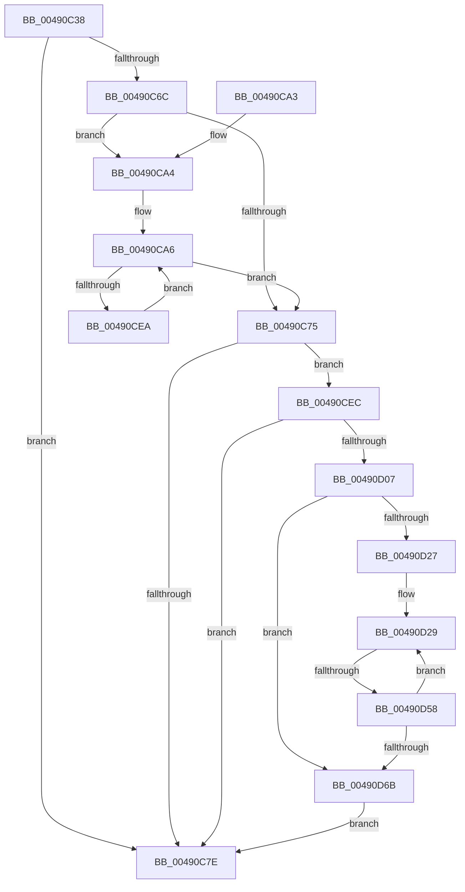

# PpmEventPlatformVetoRundown

- RVA: `0x00490C38`–`0x00490D7F` (길이 `327` bytes)
- VA: `0x0000000140490C38`
- 실행 섹션: `.text`
- PDB 이름 있음: `예`; PDB Function 태그: `예`
- unwind 정보 RVA: `0x000B2BB8`
- 디코드: `81`개 명령, `327/327` bytes 표시
- 미해석 바이트: `0` (있으면 어셈블리에 `.byte`로 보존)

> 이 문서는 커널 이미지의 기계어와 PDB 기호를 분석해 생성했습니다. 4번과 5번은 함수 원형과 자료형을 바이너리 사용 방식에서 추정한 C 해석이며 원본 소스 복구 결과는 아닙니다.

## 1. Dependencies

- 직접 호출 지점: **5**; 고유 호출 대상: **5**
- 직접 호출자로 확인된 함수: **1**
- RIP 상대 이미지 참조: **7**

### Outgoing calls
- `0x00490C85` → [_security_check_cookie](../6A/_security_check_cookie_function_006AC640.md) (function, `0x006AC640`)
- `0x00490CD2` → [PpmEventTracePreVetoAccounting](PpmEventTracePreVetoAccounting_function_00490F88.md) (function, `0x00490F88`)
- `0x00490CFA` → [EtwEventEnabled](../39/EtwEventEnabled_function_00392450.md) (function, `0x00392450`)
- `0x00490D0E` → [KeAcquireSpinLockRaiseToDpc](../20/KeAcquireSpinLockRaiseToDpc_function_00208470.md) (function, `0x00208470`)
- `0x00490D75` → [KeReleaseSpinLock](../39/KeReleaseSpinLock_function_00392BA0.md) (function, `0x00392BA0`)

### Direct callers
- [PpmEventTraceControlCallback](../../page/A5/PpmEventTraceControlCallback_function_00A51F60.md) at `0x00A522D0`

### Static image references
- `0x00490C52` → RVA `0x00E0A740` (`.data`; read)
- `0x00490C60` → RVA `0x00FC6AD0` (`ALMOSTRO`; read)
- `0x00490C75` → RVA `0x00E67A39` (`.data`; read)
- `0x00490CCB` → RVA `0x0001A7C0` (`.rdata`; read)
- `0x00490CEC` → RVA `0x00F083E8` (`.data`; read)
- `0x00490CF3` → RVA `0x0001A7D0` (`.rdata`; read)
- `0x00490D07` → RVA `0x00F0CA68` (`.data`; read)

## 2. Other-region calls and transfers

- 다른 실행 섹션으로 향하는 call: **0**
- call이 아닌 외부 분기/꼬리 이동: **1**
  - `0x00490D52` → [sub_006F6FD2](../6F/Unknown_function_006F6FD2.md) (`tail-transfer`)

## 3. Assembly (complete function range)

```asm
00490C38  48 89 5C 24 08                  mov qword ptr [rsp + 8], rbx
00490C3D  48 89 74 24 10                  mov qword ptr [rsp + 0x10], rsi
00490C42  48 89 7C 24 18                  mov qword ptr [rsp + 0x18], rdi
00490C47  55                              push rbp
00490C48  48 8B EC                        mov rbp, rsp
00490C4B  48 81 EC 80 00 00 00            sub rsp, 0x80
00490C52  48 8B 05 E7 9A 97 00            mov rax, qword ptr [rip + 0x979ae7]
00490C59  48 33 C4                        xor rax, rsp
00490C5C  48 89 45 F8                     mov qword ptr [rbp - 8], rax
00490C60  48 8B 15 69 5E B3 00            mov rdx, qword ptr [rip + 0xb35e69]
00490C67  48 85 D2                        test rdx, rdx
00490C6A  74 12                           je 0x140490c7e
00490C6C  83 65 C0 00                     and dword ptr [rbp - 0x40], 0
00490C70  83 3A 00                        cmp dword ptr [rdx], 0
00490C73  77 2F                           ja 0x140490ca4
00490C75  80 3D BD 6D 9D 00 00            cmp byte ptr [rip + 0x9d6dbd], 0
00490C7C  75 6E                           jne 0x140490cec
00490C7E  48 8B 4D F8                     mov rcx, qword ptr [rbp - 8]
00490C82  48 33 CC                        xor rcx, rsp
00490C85  E8 B6 B9 21 00                  call 0x1406ac640
00490C8A  4C 8D 9C 24 80 00 00 00         lea r11, [rsp + 0x80]
00490C92  49 8B 5B 10                     mov rbx, qword ptr [r11 + 0x10]
00490C96  49 8B 73 18                     mov rsi, qword ptr [r11 + 0x18]
00490C9A  49 8B 7B 20                     mov rdi, qword ptr [r11 + 0x20]
00490C9E  49 8B E3                        mov rsp, r11
00490CA1  5D                              pop rbp
00490CA2  C3                              ret
00490CA3  CC                              int3
00490CA4  33 C0                           xor eax, eax
00490CA6  83 65 D4 00                     and dword ptr [rbp - 0x2c], 0
00490CAA  4C 8D 42 50                     lea r8, [rdx + 0x50]
00490CAE  48 8D 4D C0                     lea rcx, [rbp - 0x40]
00490CB2  C7 45 D0 04 00 00 00            mov dword ptr [rbp - 0x30], 4
00490CB9  48 89 4D C8                     mov qword ptr [rbp - 0x38], rcx
00490CBD  48 8D 55 C8                     lea rdx, [rbp - 0x38]
00490CC1  48 69 C8 C0 01 00 00            imul rcx, rax, 0x1c0
00490CC8  4C 03 C1                        add r8, rcx
00490CCB  48 8D 0D EE 9A B8 FF            lea rcx, [rip - 0x476512]
00490CD2  E8 B1 02 00 00                  call 0x140490f88
00490CD7  8B 45 C0                        mov eax, dword ptr [rbp - 0x40]
00490CDA  48 8B 15 EF 5D B3 00            mov rdx, qword ptr [rip + 0xb35def]
00490CE1  FF C0                           inc eax
00490CE3  89 45 C0                        mov dword ptr [rbp - 0x40], eax
00490CE6  3B 02                           cmp eax, dword ptr [rdx]
00490CE8  73 8B                           jae 0x140490c75
00490CEA  EB BA                           jmp 0x140490ca6
00490CEC  48 8B 0D F5 76 A7 00            mov rcx, qword ptr [rip + 0xa776f5]
00490CF3  48 8D 15 D6 9A B8 FF            lea rdx, [rip - 0x47652a]
00490CFA  E8 51 17 F0 FF                  call 0x140392450
00490CFF  84 C0                           test al, al
00490D01  0F 84 77 FF FF FF               je 0x140490c7e
00490D07  48 8D 0D 5A BD A7 00            lea rcx, [rip + 0xa7bd5a]
00490D0E  E8 5D 77 D7 FF                  call 0x140208470
00490D13  4C 8B 05 B6 5D B3 00            mov r8, qword ptr [rip + 0xb35db6]
00490D1A  33 D2                           xor edx, edx
00490D1C  89 55 C0                        mov dword ptr [rbp - 0x40], edx
00490D1F  40 8A F0                        mov sil, al
00490D22  41 39 10                        cmp dword ptr [r8], edx
00490D25  76 44                           jbe 0x140490d6b
00490D27  33 C9                           xor ecx, ecx
00490D29  83 65 D4 00                     and dword ptr [rbp - 0x2c], 0
00490D2D  48 8D 45 C0                     lea rax, [rbp - 0x40]
00490D31  48 89 45 C8                     mov qword ptr [rbp - 0x38], rax
00490D35  49 8D 78 58                     lea rdi, [r8 + 0x58]
00490D39  8B C1                           mov eax, ecx
00490D3B  48 69 C8 C0 01 00 00            imul rcx, rax, 0x1c0
00490D42  C7 45 D0 04 00 00 00            mov dword ptr [rbp - 0x30], 4
00490D49  48 03 F9                        add rdi, rcx
00490D4C  48 8B 1F                        mov rbx, qword ptr [rdi]
00490D4F  48 3B DF                        cmp rbx, rdi
00490D52  0F 85 7A 62 26 00               jne 0x1406f6fd2
00490D58  4C 8B 05 71 5D B3 00            mov r8, qword ptr [rip + 0xb35d71]
00490D5F  FF C2                           inc edx
00490D61  89 55 C0                        mov dword ptr [rbp - 0x40], edx
00490D64  8B CA                           mov ecx, edx
00490D66  41 3B 10                        cmp edx, dword ptr [r8]
00490D69  72 BE                           jb 0x140490d29
00490D6B  40 8A D6                        mov dl, sil
00490D6E  48 8D 0D F3 BC A7 00            lea rcx, [rip + 0xa7bcf3]
00490D75  E8 26 1E F0 FF                  call 0x140392ba0
00490D7A  E9 FF FE FF FF                  jmp 0x140490c7e
```

## 4. C-style interpretation (structured pseudocode)

```c
__int64 __fastcall PpmEventPlatformVetoRundown(void)
{
    __int64 result;
    __int64 v_rdi;
    __int64 v_rsp;
    unsigned __int64 v_stack_m10;
    unsigned int v_stack_m34;
    unsigned int v_stack_m38;
    unsigned __int64 v_stack_m40;
    unsigned int v_stack_m48;
    unsigned __int64 v_stack_m8;
    unsigned __int64 v_stack_p10;
    unsigned __int64 v_stack_p18;
    unsigned __int64 v_stack_p8;

    v_stack_p8 = v_rbx;
    v_stack_p10 = v_rsi;
    v_stack_p18 = v_rdi;
    v_rsp = (v_rsp) - (128);
    result = (*(unsigned __int64 *)(v_rip + 9935591)) ^ (v_rsp);
    v_stack_m10 = result;
    if (*(unsigned __int64 *)(v_rip + 11755113) == 0) goto loc_00490C7E;
    if ((*(unsigned int *)(*(unsigned __int64 *)(v_rip + 11755113))) > 0) goto loc_00490CA4;
loc_00490C75:
    if ((*(unsigned __int8 *)(v_rip + 10317245)) != 0) goto loc_00490CEC;
loc_00490C7E:
    a1 = (v_stack_m10) ^ (v_rsp);
    result = _security_check_cookie(a1, *(unsigned __int64 *)(v_rip + 11755113), a3, a4);
    return result;
loc_00490CA4:
    result = 0;
loc_00490CA6:
    v_stack_m38 = 4;
    v_stack_m40 = v_stack_m48;
    a1 = (v_stack_m48) * (0);
    a3 = (*(unsigned __int64 *)(v_rip + 11755113) + 80) + (a1);
    result = PpmEventTracePreVetoAccounting(v_rip - 4678930, v_stack_m40, a3, a4);
    result = (unsigned int)(((unsigned int)(v_stack_m48)) + 1);
    v_stack_m48 = (unsigned int)(result);
    if (((unsigned int)(result)) >= (*(unsigned int *)(*(unsigned __int64 *)(v_rip + 11754991)))) goto loc_00490C75;
    goto loc_00490CA6;
loc_00490CEC:
    result = EtwEventEnabled(*(unsigned __int64 *)(v_rip + 10974965), v_rip - 4678954, a3, a4);
    if ((unsigned __int8)(result) == 0) goto loc_00490C7E;
    result = KeAcquireSpinLockRaiseToDpc(v_rip + 10992986, v_rip - 4678954, a3, a4);
    a2 = 0;
    v_stack_m48 = 0;
    if ((*(unsigned int *)(*(unsigned __int64 *)(v_rip + 11754934))) <= 0) goto loc_00490D6B;
    a1 = 0;
loc_00490D29:
    v_stack_m40 = v_stack_m48;
    a1 = (a1) * (0);
    v_stack_m38 = 4;
    v_rdi = (*(unsigned __int64 *)(v_rip + 11754934) + 88) + (a1);
    a2 = (unsigned int)((a2) + 1);
    v_stack_m48 = (unsigned int)(a2);
    if (((unsigned int)(a2)) < (*(unsigned int *)(*(unsigned __int64 *)(v_rip + 11754865)))) goto loc_00490D29;
loc_00490D6B:
    result = KeReleaseSpinLock(v_rip + 10992883, (unsigned __int8)((unsigned __int8)(result)), *(unsigned __int64 *)(v_rip + 11754865), a4);
    goto loc_00490C7E;
}
```

## 5. (Beta) C Style

```c
void PpmEventPlatformVetoRundown(void)
{
    int64_t result;
    int64_t local_rdi;
    int64_t local_rsp;
    uint64_t v_stack_m10;
    uint32_t v_stack_m34;
    uint32_t v_stack_m38;
    uint64_t v_stack_m40;
    uint32_t v_stack_m48;
    uint64_t v_stack_m8;
    uint64_t v_stack_p10;
    uint64_t v_stack_p18;
    uint64_t v_stack_p8;

    v_stack_p8 = local_rbx;
    v_stack_p10 = local_rsi;
    v_stack_p18 = local_rdi;
    local_rsp = (local_rsp) - (128);
    result = (*(uint64_t *)(v_rip + 0x979AE7)) ^ (local_rsp);
    v_stack_m10 = result;
    if (*(uint64_t *)(v_rip + 0xB35E69) == 0) goto loc_00490C7E;
    if ((*(uint32_t *)(*(uint64_t *)(v_rip + 0xB35E69))) > 0) goto loc_00490CA4;
loc_00490C75:
    if ((*(uint8_t *)(v_rip + 0x9D6DBD)) != 0) goto loc_00490CEC;
loc_00490C7E:
    a1 = (v_stack_m10) ^ (local_rsp);
    result = _security_check_cookie(a1, *(uint64_t *)(v_rip + 0xB35E69), a3, a4);
    return result;
loc_00490CA4:
    result = 0;
loc_00490CA6:
    v_stack_m38 = 4;
    v_stack_m40 = v_stack_m48;
    a1 = (v_stack_m48) * (0);
    a3 = (*(uint64_t *)(v_rip + 0xB35E69) + 80) + (a1);
    result = PpmEventTracePreVetoAccounting(v_rip - 4678930, v_stack_m40, a3, a4);
    result = (uint32_t)(((uint32_t)(v_stack_m48)) + 1);
    v_stack_m48 = (uint32_t)(result);
    if (((uint32_t)(result)) >= (*(uint32_t *)(*(uint64_t *)(v_rip + 0xB35DEF)))) goto loc_00490C75;
    goto loc_00490CA6;
loc_00490CEC:
    result = EtwEventEnabled(*(uint64_t *)(v_rip + 0xA776F5), v_rip - 4678954, a3, a4);
    if ((uint8_t)(result) == 0) goto loc_00490C7E;
    result = KeAcquireSpinLockRaiseToDpc(v_rip + 10992986, v_rip - 4678954, a3, a4);
    a2 = 0;
    v_stack_m48 = 0;
    if ((*(uint32_t *)(*(uint64_t *)(v_rip + 0xB35DB6))) <= 0) goto loc_00490D6B;
    a1 = 0;
loc_00490D29:
    v_stack_m40 = v_stack_m48;
    a1 = (a1) * (0);
    v_stack_m38 = 4;
    local_rdi = (*(uint64_t *)(v_rip + 0xB35DB6) + 88) + (a1);
    a2 = (uint32_t)((a2) + 1);
    v_stack_m48 = (uint32_t)(a2);
    if (((uint32_t)(a2)) < (*(uint32_t *)(*(uint64_t *)(v_rip + 0xB35D71)))) goto loc_00490D29;
loc_00490D6B:
    result = KeReleaseSpinLock(v_rip + 10992883, (uint8_t)((uint8_t)(result)), *(uint64_t *)(v_rip + 0xB35D71), a4);
    goto loc_00490C7E;
}
```

## 6. Execution-region graph

[열기: 2D/3D 그래프와 함수 탐색 컨트롤 패널](../../../control-panel.html?section=text&rva=0x00490C38&view=graph)

- 2D 그래프는 위에서 아래로 흐르고, 3D 그래프는 빈 공간을 드래그해 회전합니다. Shift+드래그는 이동, 휠은 확대·축소, 함수 노드 선택은 대상 보고서 이동입니다.

### Static fallback


