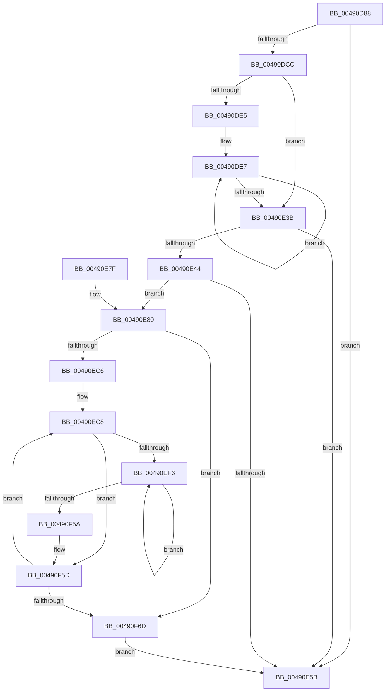

# PpmEventProcessorVetoRundown

- RVA: `0x00490D88`–`0x00490F81` (길이 `505` bytes)
- VA: `0x0000000140490D88`
- 실행 섹션: `.text`
- PDB 이름 있음: `예`; PDB Function 태그: `아니요`
- unwind 정보 RVA: `0x000B2BE8`
- 디코드: `124`개 명령, `505/505` bytes 표시
- 미해석 바이트: `0` (있으면 어셈블리에 `.byte`로 보존)

> 이 문서는 커널 이미지의 기계어와 PDB 기호를 분석해 생성했습니다. 4번과 5번은 함수 원형과 자료형을 바이너리 사용 방식에서 추정한 C 해석이며 원본 소스 복구 결과는 아닙니다.

## 1. Dependencies

- 직접 호출 지점: **6**; 고유 호출 대상: **6**
- 직접 호출자로 확인된 함수: **1**
- RIP 상대 이미지 참조: **6**

### Outgoing calls
- `0x00490E27` → [PpmEventTracePreVetoAccounting](PpmEventTracePreVetoAccounting_function_00490F88.md) (function, `0x00490F88`)
- `0x00490E52` → [EtwEventEnabled](../39/EtwEventEnabled_function_00392450.md) (function, `0x00392450`)
- `0x00490E62` → [_security_check_cookie](../6A/_security_check_cookie_function_006AC640.md) (function, `0x006AC640`)
- `0x00490EB0` → [KeAcquireSpinLockRaiseToDpc](../20/KeAcquireSpinLockRaiseToDpc_function_00208470.md) (function, `0x00208470`)
- `0x00490F4D` → [EtwWriteEx](../25/EtwWriteEx_function_0025F0D0.md) (function, `0x0025F0D0`)
- `0x00490F77` → [KeReleaseSpinLock](../39/KeReleaseSpinLock_function_00392BA0.md) (function, `0x00392BA0`)

### Direct callers
- [PpmEventTraceControlCallback](../../page/A5/PpmEventTraceControlCallback_function_00A51F60.md) at `0x00A522FD`

### Static image references
- `0x00490DA2` → RVA `0x00E0A740` (`.data`; read)
- `0x00490E01` → RVA `0x0001A7A0` (`.rdata`; read)
- `0x00490E3B` → RVA `0x00E67A39` (`.data`; read)
- `0x00490E44` → RVA `0x00F083E8` (`.data`; read)
- `0x00490E4B` → RVA `0x0001A7B0` (`.rdata`; read)
- `0x00490E83` → RVA `0x00F0CA68` (`.data`; read)

## 2. Other-region calls and transfers

- 다른 실행 섹션으로 향하는 call: **0**
- 별도 외부 분기/꼬리 이동을 확인하지 못했습니다.

## 3. Assembly (complete function range)

```asm
00490D88  48 89 5C 24 10                  mov qword ptr [rsp + 0x10], rbx
00490D8D  48 89 74 24 18                  mov qword ptr [rsp + 0x18], rsi
00490D92  55                              push rbp
00490D93  57                              push rdi
00490D94  41 56                           push r14
00490D96  48 8D 6C 24 B9                  lea rbp, [rsp - 0x47]
00490D9B  48 81 EC B0 00 00 00            sub rsp, 0xb0
00490DA2  48 8B 05 97 99 97 00            mov rax, qword ptr [rip + 0x979997]
00490DA9  48 33 C4                        xor rax, rsp
00490DAC  48 89 45 37                     mov qword ptr [rbp + 0x37], rax
00490DB0  48 8B 99 40 88 00 00            mov rbx, qword ptr [rcx + 0x8840]
00490DB7  33 C0                           xor eax, eax
00490DB9  89 45 DF                        mov dword ptr [rbp - 0x21], eax
00490DBC  66 89 45 E3                     mov word ptr [rbp - 0x1d], ax
00490DC0  88 45 E5                        mov byte ptr [rbp - 0x1b], al
00490DC3  48 85 DB                        test rbx, rbx
00490DC6  0F 84 8F 00 00 00               je 0x140490e5b
00490DCC  8D 50 01                        lea edx, [rax + 1]
00490DCF  89 55 D7                        mov dword ptr [rbp - 0x29], edx
00490DD2  48 8D B1 D0 00 00 00            lea rsi, [rcx + 0xd0]
00490DD9  48 8D B9 D1 00 00 00            lea rdi, [rcx + 0xd1]
00490DE0  39 53 28                        cmp dword ptr [rbx + 0x28], edx
00490DE3  76 56                           jbe 0x140490e3b
00490DE5  8B CA                           mov ecx, edx
00490DE7  0F B6 06                        movzx eax, byte ptr [rsi]
00490DEA  83 65 F3 00                     and dword ptr [rbp - 0xd], 0
00490DEE  66 89 45 DF                     mov word ptr [rbp - 0x21], ax
00490DF2  8A 07                           mov al, byte ptr [rdi]
00490DF4  88 45 E1                        mov byte ptr [rbp - 0x1f], al
00490DF7  48 8D 45 DF                     lea rax, [rbp - 0x21]
00490DFB  48 89 45 E7                     mov qword ptr [rbp - 0x19], rax
00490DFF  8B C1                           mov eax, ecx
00490E01  48 8D 0D 98 99 B8 FF            lea rcx, [rip - 0x476668]
00490E08  4C 69 C0 58 01 00 00            imul r8, rax, 0x158
00490E0F  89 55 E2                        mov dword ptr [rbp - 0x1e], edx
00490E12  48 8D 55 E7                     lea rdx, [rbp - 0x19]
00490E16  49 81 C0 48 05 00 00            add r8, 0x548
00490E1D  C7 45 EF 07 00 00 00            mov dword ptr [rbp - 0x11], 7
00490E24  4C 03 C3                        add r8, rbx
00490E27  E8 5C 01 00 00                  call 0x140490f88
00490E2C  8B 55 D7                        mov edx, dword ptr [rbp - 0x29]
00490E2F  FF C2                           inc edx
00490E31  89 55 D7                        mov dword ptr [rbp - 0x29], edx
00490E34  8B CA                           mov ecx, edx
00490E36  3B 53 28                        cmp edx, dword ptr [rbx + 0x28]
00490E39  72 AC                           jb 0x140490de7
00490E3B  80 3D F7 6B 9D 00 00            cmp byte ptr [rip + 0x9d6bf7], 0
00490E42  74 17                           je 0x140490e5b
00490E44  48 8B 0D 9D 75 A7 00            mov rcx, qword ptr [rip + 0xa7759d]
00490E4B  48 8D 15 5E 99 B8 FF            lea rdx, [rip - 0x4766a2]
00490E52  E8 F9 15 F0 FF                  call 0x140392450
00490E57  84 C0                           test al, al
00490E59  75 25                           jne 0x140490e80
00490E5B  48 8B 4D 37                     mov rcx, qword ptr [rbp + 0x37]
00490E5F  48 33 CC                        xor rcx, rsp
00490E62  E8 D9 B7 21 00                  call 0x1406ac640
00490E67  4C 8D 9C 24 B0 00 00 00         lea r11, [rsp + 0xb0]
00490E6F  49 8B 5B 28                     mov rbx, qword ptr [r11 + 0x28]
00490E73  49 8B 73 30                     mov rsi, qword ptr [r11 + 0x30]
00490E77  49 8B E3                        mov rsp, r11
00490E7A  41 5E                           pop r14
00490E7C  5F                              pop rdi
00490E7D  5D                              pop rbp
00490E7E  C3                              ret
00490E7F  CC                              int3
00490E80  0F B6 06                        movzx eax, byte ptr [rsi]
00490E83  48 8D 0D DE BB A7 00            lea rcx, [rip + 0xa7bbde]
00490E8A  83 65 F3 00                     and dword ptr [rbp - 0xd], 0
00490E8E  83 65 03 00                     and dword ptr [rbp + 3], 0
00490E92  66 89 45 DB                     mov word ptr [rbp - 0x25], ax
00490E96  48 8D 45 DB                     lea rax, [rbp - 0x25]
00490E9A  48 89 45 E7                     mov qword ptr [rbp - 0x19], rax
00490E9E  C7 45 EF 02 00 00 00            mov dword ptr [rbp - 0x11], 2
00490EA5  48 89 7D F7                     mov qword ptr [rbp - 9], rdi
00490EA9  C7 45 FF 01 00 00 00            mov dword ptr [rbp - 1], 1
00490EB0  E8 BB 75 D7 FF                  call 0x140208470
00490EB5  33 D2                           xor edx, edx
00490EB7  44 8A F0                        mov r14b, al
00490EBA  89 55 D7                        mov dword ptr [rbp - 0x29], edx
00490EBD  39 53 28                        cmp dword ptr [rbx + 0x28], edx
00490EC0  0F 86 A7 00 00 00               jbe 0x140490f6d
00490EC6  33 C9                           xor ecx, ecx
00490EC8  83 65 13 00                     and dword ptr [rbp + 0x13], 0
00490ECC  48 8D 45 D7                     lea rax, [rbp - 0x29]
00490ED0  48 89 45 07                     mov qword ptr [rbp + 7], rax
00490ED4  8B C1                           mov eax, ecx
00490ED6  48 69 F0 58 01 00 00            imul rsi, rax, 0x158
00490EDD  C7 45 0F 04 00 00 00            mov dword ptr [rbp + 0xf], 4
00490EE4  48 81 C6 50 05 00 00            add rsi, 0x550
00490EEB  48 03 F3                        add rsi, rbx
00490EEE  48 8B 3E                        mov rdi, qword ptr [rsi]
00490EF1  48 3B FE                        cmp rdi, rsi
00490EF4  74 67                           je 0x140490f5d
00490EF6  48 8B 0D EB 74 A7 00            mov rcx, qword ptr [rip + 0xa774eb]
00490EFD  48 8D 47 10                     lea rax, [rdi + 0x10]
00490F01  83 65 23 00                     and dword ptr [rbp + 0x23], 0
00490F05  48 8D 15 A4 98 B8 FF            lea rdx, [rip - 0x47675c]
00490F0C  83 65 33 00                     and dword ptr [rbp + 0x33], 0
00490F10  45 33 C9                        xor r9d, r9d
00490F13  48 89 45 17                     mov qword ptr [rbp + 0x17], rax
00490F17  45 33 C0                        xor r8d, r8d
00490F1A  48 8D 47 14                     lea rax, [rdi + 0x14]
00490F1E  C7 45 1F 04 00 00 00            mov dword ptr [rbp + 0x1f], 4
00490F25  48 89 45 27                     mov qword ptr [rbp + 0x27], rax
00490F29  48 8D 45 E7                     lea rax, [rbp - 0x19]
00490F2D  48 89 44 24 38                  mov qword ptr [rsp + 0x38], rax
00490F32  C7 44 24 30 05 00 00 00         mov dword ptr [rsp + 0x30], 5
00490F3A  48 83 64 24 28 00               and qword ptr [rsp + 0x28], 0
00490F40  48 83 64 24 20 00               and qword ptr [rsp + 0x20], 0
00490F46  C7 45 2F 04 00 00 00            mov dword ptr [rbp + 0x2f], 4
00490F4D  E8 7E E1 DC FF                  call 0x14025f0d0
00490F52  48 8B 3F                        mov rdi, qword ptr [rdi]
00490F55  48 3B FE                        cmp rdi, rsi
00490F58  75 9C                           jne 0x140490ef6
00490F5A  8B 55 D7                        mov edx, dword ptr [rbp - 0x29]
00490F5D  FF C2                           inc edx
00490F5F  89 55 D7                        mov dword ptr [rbp - 0x29], edx
00490F62  8B CA                           mov ecx, edx
00490F64  3B 53 28                        cmp edx, dword ptr [rbx + 0x28]
00490F67  0F 82 5B FF FF FF               jb 0x140490ec8
00490F6D  41 8A D6                        mov dl, r14b
00490F70  48 8D 0D F1 BA A7 00            lea rcx, [rip + 0xa7baf1]
00490F77  E8 24 1C F0 FF                  call 0x140392ba0
00490F7C  E9 DA FE FF FF                  jmp 0x140490e5b
```

## 4. C-style interpretation (structured pseudocode)

```c
__int64 __fastcall PpmEventProcessorVetoRundown(__int64 a1, __int64 a2, __int64 a3, int a4)
{
    __int64 result;
    __int64 v_rsi;
    __int64 v_rsp;
    unsigned __int64 v_stack_m18;
    unsigned __int64 v_stack_m28;
    unsigned int v_stack_m2C;
    unsigned int v_stack_m30;
    unsigned __int64 v_stack_m38;
    unsigned int v_stack_m3C;
    unsigned int v_stack_m40;
    unsigned __int64 v_stack_m48;
    unsigned int v_stack_m4C;
    unsigned int v_stack_m50;
    unsigned __int64 v_stack_m58;
    unsigned int v_stack_m5C;
    unsigned __int64 v_stack_m5F;
    unsigned int v_stack_m60;
    unsigned __int64 v_stack_m68;
    unsigned int v_stack_m6C;
    unsigned int v_stack_m70;
    unsigned __int64 v_stack_m78;
    unsigned __int8 v_stack_m7A;
    unsigned __int16 v_stack_m7C;
    unsigned int v_stack_m7D;
    unsigned __int8 v_stack_m7E;
    unsigned int v_stack_m80;
    unsigned __int16 v_stack_m84;
    unsigned int v_stack_m88;
    unsigned __int64 v_stack_m90;
    unsigned __int64 v_stack_p10;
    unsigned __int64 v_stack_p18;

    v_stack_p10 = v_rbx;
    v_stack_p18 = v_rsi;
    v_rsp = (v_rsp) - (176);
    result = (*(unsigned __int64 *)(v_rip + 9935255)) ^ (v_rsp);
    v_stack_m28 = result;
    result = 0;
    v_stack_m80 = 0;
    v_stack_m7C = 0;
    v_stack_m7A = 0;
    if (*(unsigned __int64 *)(a1 + 34880) == 0) goto loc_00490E5B;
    v_stack_m88 = (unsigned int)(result + 1);
    if ((*(unsigned int *)(*(unsigned __int64 *)(a1 + 34880) + 40)) <= ((unsigned int)(result + 1))) goto loc_00490E3B;
loc_00490DE7:
    v_stack_m80 = (unsigned __int16)(*(unsigned __int8 *)(a1 + 208));
    v_stack_m7E = (unsigned __int8)(*(unsigned __int8 *)(a1 + 209));
    v_stack_m78 = v_stack_m80;
    a3 = (a3) * ((unsigned int)((unsigned int)((unsigned int)((unsigned int)(result + 1)))));
    v_stack_m7D = (unsigned int)(result + 1);
    a3 = (a3) + (0x548ULL);
    v_stack_m70 = 7;
    a3 = (a3) + (*(unsigned __int64 *)(a1 + 34880));
    result = PpmEventTracePreVetoAccounting(v_rip - 4679272, v_stack_m78, a3, a4);
    a2 = (unsigned int)(((unsigned int)(v_stack_m88)) + 1);
    v_stack_m88 = (unsigned int)(a2);
    if (((unsigned int)(a2)) < (*(unsigned int *)(*(unsigned __int64 *)(a1 + 34880) + 40))) goto loc_00490DE7;
loc_00490E3B:
    if ((*(unsigned __int8 *)(v_rip + 10316791)) == 0) goto loc_00490E5B;
    result = EtwEventEnabled(*(unsigned __int64 *)(v_rip + 10974621), v_rip - 4679330, a3, a4);
    if ((unsigned __int8)(result) != 0) goto loc_00490E80;
loc_00490E5B:
    a1 = (v_stack_m28) ^ (v_rsp);
    result = _security_check_cookie(a1, v_rip - 4679330, a3, a4);
    return result;
loc_00490E80:
    v_stack_m84 = (unsigned __int16)(*(unsigned __int8 *)(*(unsigned __int64 *)(v_stack_m18 + 48)));
    v_stack_m78 = v_stack_m84;
    v_stack_m70 = 2;
    v_stack_m68 = a1 + 209;
    v_stack_m60 = 1;
    result = KeAcquireSpinLockRaiseToDpc(v_rip + 10992606, v_rip - 4679330, a3, a4);
    a2 = 0;
    v_stack_m88 = 0;
    if ((*(unsigned int *)(*(unsigned __int64 *)(v_stack_m18 + 40) + 40)) <= 0) goto loc_00490F6D;
    a1 = 0;
loc_00490EC8:
    v_stack_m58 = v_stack_m88;
    v_rsi = (*(unsigned __int64 *)(v_stack_m18 + 48)) * (0);
    v_stack_m50 = 4;
    v_rsi = (v_rsi) + (0x550ULL);
    v_rsi = (v_rsi) + (*(unsigned __int64 *)(v_stack_m18 + 40));
    if ((*(unsigned __int64 *)(v_rsi)) == v_rsi) goto loc_00490F5D;
loc_00490EF6:
    a4 = 0;
    v_stack_m48 = *(unsigned __int64 *)(v_rsi) + 16;
    a3 = 0;
    v_stack_m40 = 4;
    v_stack_m38 = *(unsigned __int64 *)(v_rsi) + 20;
    v_stack_m78 = v_stack_m78;
    v_stack_m80 = 5;
    v_stack_m30 = 4;
    result = EtwWriteEx(*(unsigned __int64 *)(v_rip + 10974443), v_rip - 4679516, a3, a4);
    if ((*(unsigned __int64 *)(*(unsigned __int64 *)(v_rsi))) != v_rsi) goto loc_00490EF6;
loc_00490F5D:
    a2 = (unsigned int)(((unsigned int)(v_stack_m88)) + 1);
    v_stack_m88 = (unsigned int)(a2);
    if (((unsigned int)(a2)) < (*(unsigned int *)(*(unsigned __int64 *)(v_stack_m18 + 40) + 40))) goto loc_00490EC8;
loc_00490F6D:
    result = KeReleaseSpinLock(v_rip + 10992369, (unsigned __int8)((unsigned __int8)(result)), a3, a4);
    goto loc_00490E5B;
}
```

## 5. (Beta) C Style

```c
int64_t PpmEventProcessorVetoRundown(void *Arg1, int64_t Arg2, int64_t Arg3, int32_t Arg4)
{
    uint8_t *arg1 = (uint8_t *)Arg1;

    int64_t result;
    int64_t local_rsi;
    int64_t local_rsp;
    uint64_t v_stack_m18;
    uint64_t v_stack_m28;
    uint32_t v_stack_m2C;
    uint32_t v_stack_m30;
    uint64_t v_stack_m38;
    uint32_t v_stack_m3C;
    uint32_t v_stack_m40;
    uint64_t v_stack_m48;
    uint32_t v_stack_m4C;
    uint32_t v_stack_m50;
    uint64_t v_stack_m58;
    uint32_t v_stack_m5C;
    uint64_t v_stack_m5F;
    uint32_t v_stack_m60;
    uint64_t v_stack_m68;
    uint32_t v_stack_m6C;
    uint32_t v_stack_m70;
    uint64_t v_stack_m78;
    uint8_t v_stack_m7A;
    uint16_t v_stack_m7C;
    uint32_t v_stack_m7D;
    uint8_t v_stack_m7E;
    uint32_t v_stack_m80;
    uint16_t v_stack_m84;
    uint32_t v_stack_m88;
    uint64_t v_stack_m90;
    uint64_t v_stack_p10;
    uint64_t v_stack_p18;

    v_stack_p10 = local_rbx;
    v_stack_p18 = local_rsi;
    local_rsp = (local_rsp) - (176);
    result = (*(uint64_t *)(v_rip + 0x979997)) ^ (local_rsp);
    v_stack_m28 = result;
    result = 0;
    v_stack_m80 = 0;
    v_stack_m7C = 0;
    v_stack_m7A = 0;
    if (*(uint64_t *)(arg1 + 0x8840) == 0) goto loc_00490E5B;
    v_stack_m88 = (uint32_t)(result + 1);
    if ((*(uint32_t *)(*(uint64_t *)(arg1 + 0x8840) + 0x28)) <= ((uint32_t)(result + 1))) goto loc_00490E3B;
loc_00490DE7:
    v_stack_m80 = (uint16_t)(*(uint8_t *)(arg1 + 0xD0));
    v_stack_m7E = (uint8_t)(*(uint8_t *)(arg1 + 0xD1));
    v_stack_m78 = v_stack_m80;
    Arg3 = (Arg3) * ((uint32_t)((uint32_t)((uint32_t)((uint32_t)(result + 1)))));
    v_stack_m7D = (uint32_t)(result + 1);
    Arg3 = (Arg3) + (0x548ULL);
    v_stack_m70 = 7;
    Arg3 = (Arg3) + (*(uint64_t *)(arg1 + 0x8840));
    result = PpmEventTracePreVetoAccounting(v_rip - 4679272, v_stack_m78, Arg3, Arg4);
    Arg2 = (uint32_t)(((uint32_t)(v_stack_m88)) + 1);
    v_stack_m88 = (uint32_t)(Arg2);
    if (((uint32_t)(Arg2)) < (*(uint32_t *)(*(uint64_t *)(arg1 + 0x8840) + 0x28))) goto loc_00490DE7;
loc_00490E3B:
    if ((*(uint8_t *)(v_rip + 0x9D6BF7)) == 0) goto loc_00490E5B;
    result = EtwEventEnabled(*(uint64_t *)(v_rip + 0xA7759D), v_rip - 4679330, Arg3, Arg4);
    if ((uint8_t)(result) != 0) goto loc_00490E80;
loc_00490E5B:
    Arg1 = (v_stack_m28) ^ (local_rsp);
    result = _security_check_cookie(Arg1, v_rip - 4679330, Arg3, Arg4);
    return result;
loc_00490E80:
    v_stack_m84 = (uint16_t)(*(uint8_t *)(*(uint64_t *)(v_stack_m18 + 0x30)));
    v_stack_m78 = v_stack_m84;
    v_stack_m70 = 2;
    v_stack_m68 = Arg1 + 209;
    v_stack_m60 = 1;
    result = KeAcquireSpinLockRaiseToDpc(v_rip + 10992606, v_rip - 4679330, Arg3, Arg4);
    Arg2 = 0;
    v_stack_m88 = 0;
    if ((*(uint32_t *)(*(uint64_t *)(v_stack_m18 + 0x28) + 0x28)) <= 0) goto loc_00490F6D;
    Arg1 = 0;
loc_00490EC8:
    v_stack_m58 = v_stack_m88;
    local_rsi = (*(uint64_t *)(v_stack_m18 + 0x30)) * (0);
    v_stack_m50 = 4;
    local_rsi = (local_rsi) + (0x550ULL);
    local_rsi = (local_rsi) + (*(uint64_t *)(v_stack_m18 + 0x28));
    if ((*(uint64_t *)(local_rsi)) == local_rsi) goto loc_00490F5D;
loc_00490EF6:
    Arg4 = 0;
    v_stack_m48 = *(uint64_t *)(local_rsi) + 16;
    Arg3 = 0;
    v_stack_m40 = 4;
    v_stack_m38 = *(uint64_t *)(local_rsi) + 20;
    v_stack_m78 = v_stack_m78;
    v_stack_m80 = 5;
    v_stack_m30 = 4;
    result = EtwWriteEx(*(uint64_t *)(v_rip + 0xA774EB), v_rip - 4679516, Arg3, Arg4);
    if ((*(uint64_t *)(*(uint64_t *)(local_rsi))) != local_rsi) goto loc_00490EF6;
loc_00490F5D:
    Arg2 = (uint32_t)(((uint32_t)(v_stack_m88)) + 1);
    v_stack_m88 = (uint32_t)(Arg2);
    if (((uint32_t)(Arg2)) < (*(uint32_t *)(*(uint64_t *)(v_stack_m18 + 0x28) + 0x28))) goto loc_00490EC8;
loc_00490F6D:
    result = KeReleaseSpinLock(v_rip + 10992369, (uint8_t)((uint8_t)(result)), Arg3, Arg4);
    goto loc_00490E5B;
}
```

### 관측된 메모리 오프셋

구조체 형식이 확인되지 않은 접근은 인자 기준의 오프셋으로만 기록했습니다.

| 기준 인자 | 오프셋 표현 | 폭 (bit) | 접근 |
|---|---:|---:|---|
| `Arg1` | `+ 0x0` | `8` | `R` |
| `Arg1` | `+ 0x0` | `64` | `R` |
| `Arg1` | `+ 0xD0` | `64` | `R` |
| `Arg1` | `+ 0xD1` | `64` | `R` |
| `Arg1` | `+ 0x8840` | `64` | `R` |

## 6. Execution-region graph

[열기: 2D/3D 그래프와 함수 탐색 컨트롤 패널](../../../control-panel.html?section=text&rva=0x00490D88&view=graph)

- 2D 그래프는 위에서 아래로 흐르고, 3D 그래프는 빈 공간을 드래그해 회전합니다. Shift+드래그는 이동, 휠은 확대·축소, 함수 노드 선택은 대상 보고서 이동입니다.

### Static fallback


