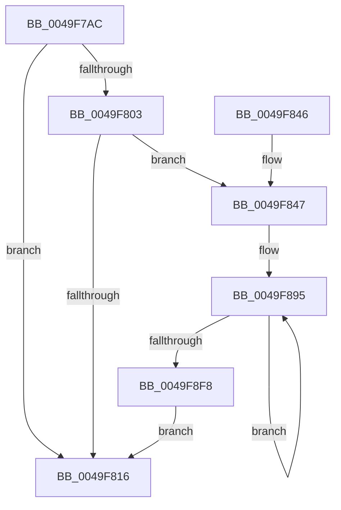

# PpmEventQosClassPerfSelection

- RVA: `0x0049F7AC`–`0x0049F974` (길이 `456` bytes)
- VA: `0x000000014049F7AC`
- 실행 섹션: `.text`
- PDB 이름 있음: `예`; PDB Function 태그: `아니요`
- unwind 정보 RVA: `0x000B54E4`
- 디코드: `109`개 명령, `456/456` bytes 표시
- 미해석 바이트: `0` (있으면 어셈블리에 `.byte`로 보존)

> 이 문서는 커널 이미지의 기계어와 PDB 기호를 분석해 생성했습니다. 4번과 5번은 함수 원형과 자료형을 바이너리 사용 방식에서 추정한 C 해석이며 원본 소스 복구 결과는 아닙니다.

## 1. Dependencies

- 직접 호출 지점: **3**; 고유 호출 대상: **3**
- 직접 호출자로 확인된 함수: **2**
- RIP 상대 이미지 참조: **5**

### Outgoing calls
- `0x0049F80D` → [EtwEventEnabled](../39/EtwEventEnabled_function_00392450.md) (function, `0x00392450`)
- `0x0049F820` → [_security_check_cookie](../6A/_security_check_cookie_function_006AC640.md) (function, `0x006AC640`)
- `0x0049F96A` → [EtwWriteEx](../25/EtwWriteEx_function_0025F0D0.md) (function, `0x0025F0D0`)

### Direct callers
- [PpmPerfApplyDomainState](../2C/PpmPerfApplyDomainState_function_002CD470.md) at `0x002CDB55`
- [PpmEventTraceControlCallback](../../page/A5/PpmEventTraceControlCallback_function_00A51F60.md) at `0x00A5207F`

### Static image references
- `0x0049F7D2` → RVA `0x00E0A740` (`.data`; read)
- `0x0049F7E5` → RVA `0x0001AFB8` (`.rdata`; read)
- `0x0049F7EC` → RVA `0x0001AFA8` (`.rdata`; read)
- `0x0049F7FA` → RVA `0x00E67A39` (`.data`; read)
- `0x0049F803` → RVA `0x00F083E8` (`.data`; read)

## 2. Other-region calls and transfers

- 다른 실행 섹션으로 향하는 call: **0**
- 별도 외부 분기/꼬리 이동을 확인하지 못했습니다.

## 3. Assembly (complete function range)

```asm
0049F7AC  48 8B C4                        mov rax, rsp
0049F7AF  48 89 58 08                     mov qword ptr [rax + 8], rbx
0049F7B3  48 89 70 10                     mov qword ptr [rax + 0x10], rsi
0049F7B7  48 89 78 18                     mov qword ptr [rax + 0x18], rdi
0049F7BB  4C 89 60 20                     mov qword ptr [rax + 0x20], r12
0049F7BF  55                              push rbp
0049F7C0  41 56                           push r14
0049F7C2  41 57                           push r15
0049F7C4  48 8D A8 C8 FE FF FF            lea rbp, [rax - 0x138]
0049F7CB  48 81 EC 20 02 00 00            sub rsp, 0x220
0049F7D2  48 8B 05 67 AF 96 00            mov rax, qword ptr [rip + 0x96af67]
0049F7D9  48 33 C4                        xor rax, rsp
0049F7DC  48 89 85 10 01 00 00            mov qword ptr [rbp + 0x110], rax
0049F7E3  84 D2                           test dl, dl
0049F7E5  48 8D 05 CC B7 B7 FF            lea rax, [rip - 0x484834]
0049F7EC  48 8D 1D B5 B7 B7 FF            lea rbx, [rip - 0x48484b]
0049F7F3  48 8B F9                        mov rdi, rcx
0049F7F6  48 0F 44 D8                     cmove rbx, rax
0049F7FA  80 3D 38 82 9C 00 00            cmp byte ptr [rip + 0x9c8238], 0
0049F801  74 13                           je 0x14049f816
0049F803  48 8B 0D DE 8B A6 00            mov rcx, qword ptr [rip + 0xa68bde]
0049F80A  48 8B D3                        mov rdx, rbx
0049F80D  E8 3E 2C EF FF                  call 0x140392450
0049F812  84 C0                           test al, al
0049F814  75 31                           jne 0x14049f847
0049F816  48 8B 8D 10 01 00 00            mov rcx, qword ptr [rbp + 0x110]
0049F81D  48 33 CC                        xor rcx, rsp
0049F820  E8 1B CE 20 00                  call 0x1406ac640
0049F825  4C 8D 9C 24 20 02 00 00         lea r11, [rsp + 0x220]
0049F82D  49 8B 5B 20                     mov rbx, qword ptr [r11 + 0x20]
0049F831  49 8B 73 28                     mov rsi, qword ptr [r11 + 0x28]
0049F835  49 8B 7B 30                     mov rdi, qword ptr [r11 + 0x30]
0049F839  4D 8B 63 38                     mov r12, qword ptr [r11 + 0x38]
0049F83D  49 8B E3                        mov rsp, r11
0049F840  41 5F                           pop r15
0049F842  41 5E                           pop r14
0049F844  5D                              pop rbp
0049F845  C3                              ret
0049F846  CC                              int3
0049F847  48 8D 87 28 03 00 00            lea rax, [rdi + 0x328]
0049F84E  41 BB 07 00 00 00               mov r11d, 7
0049F854  48 8D 55 80                     lea rdx, [rbp - 0x80]
0049F858  44 89 5C 24 40                  mov dword ptr [rsp + 0x40], r11d
0049F85D  4C 8D 45 88                     lea r8, [rbp - 0x78]
0049F861  48 2B D0                        sub rdx, rax
0049F864  4C 8D 4D 8C                     lea r9, [rbp - 0x74]
0049F868  4C 2B C0                        sub r8, rax
0049F86B  4C 8D 55 90                     lea r10, [rbp - 0x70]
0049F86F  4C 2B C8                        sub r9, rax
0049F872  48 8D 75 84                     lea rsi, [rbp - 0x7c]
0049F876  4C 2B D0                        sub r10, rax
0049F879  4C 8D 75 94                     lea r14, [rbp - 0x6c]
0049F87D  48 2B F0                        sub rsi, rax
0049F880  4C 8D 7D 98                     lea r15, [rbp - 0x68]
0049F884  4C 2B F0                        sub r14, rax
0049F887  4C 2B F8                        sub r15, rax
0049F88A  4C 8D 65 A0                     lea r12, [rbp - 0x60]
0049F88E  4C 2B E0                        sub r12, rax
0049F891  48 8D 48 14                     lea rcx, [rax + 0x14]
0049F895  48 8B 41 EC                     mov rax, qword ptr [rcx - 0x14]
0049F899  48 89 44 11 EC                  mov qword ptr [rcx + rdx - 0x14], rax
0049F89E  8B 41 FC                        mov eax, dword ptr [rcx - 4]
0049F8A1  42 89 44 01 EC                  mov dword ptr [rcx + r8 - 0x14], eax
0049F8A6  8B 01                           mov eax, dword ptr [rcx]
0049F8A8  42 89 44 09 EC                  mov dword ptr [rcx + r9 - 0x14], eax
0049F8AD  8B 41 04                        mov eax, dword ptr [rcx + 4]
0049F8B0  42 89 44 11 EC                  mov dword ptr [rcx + r10 - 0x14], eax
0049F8B5  8B 41 08                        mov eax, dword ptr [rcx + 8]
0049F8B8  89 04 11                        mov dword ptr [rcx + rdx], eax
0049F8BB  8B 41 0C                        mov eax, dword ptr [rcx + 0xc]
0049F8BE  89 04 31                        mov dword ptr [rcx + rsi], eax
0049F8C1  8B 41 10                        mov eax, dword ptr [rcx + 0x10]
0049F8C4  42 89 04 01                     mov dword ptr [rcx + r8], eax
0049F8C8  8B 41 14                        mov eax, dword ptr [rcx + 0x14]
0049F8CB  42 89 04 09                     mov dword ptr [rcx + r9], eax
0049F8CF  0F B6 41 1C                     movzx eax, byte ptr [rcx + 0x1c]
0049F8D3  42 89 04 11                     mov dword ptr [rcx + r10], eax
0049F8D7  0F B6 41 1D                     movzx eax, byte ptr [rcx + 0x1d]
0049F8DB  42 89 04 31                     mov dword ptr [rcx + r14], eax
0049F8DF  48 8B 41 F4                     mov rax, qword ptr [rcx - 0xc]
0049F8E3  4A 89 04 39                     mov qword ptr [rcx + r15], rax
0049F8E7  8B 41 18                        mov eax, dword ptr [rcx + 0x18]
0049F8EA  42 89 04 21                     mov dword ptr [rcx + r12], eax
0049F8EE  48 8D 49 38                     lea rcx, [rcx + 0x38]
0049F8F2  49 83 EB 01                     sub r11, 1
0049F8F6  75 9D                           jne 0x14049f895
0049F8F8  44 21 5C 24 54                  and dword ptr [rsp + 0x54], r11d
0049F8FD  48 8D 87 B8 01 00 00            lea rax, [rdi + 0x1b8]
0049F904  44 21 5C 24 64                  and dword ptr [rsp + 0x64], r11d
0049F909  45 33 C9                        xor r9d, r9d
0049F90C  44 21 5C 24 74                  and dword ptr [rsp + 0x74], r11d
0049F911  45 33 C0                        xor r8d, r8d
0049F914  48 8B 0D CD 8A A6 00            mov rcx, qword ptr [rip + 0xa68acd]
0049F91B  48 8B D3                        mov rdx, rbx
0049F91E  48 89 44 24 48                  mov qword ptr [rsp + 0x48], rax
0049F923  48 8D 44 24 40                  lea rax, [rsp + 0x40]
0049F928  48 89 44 24 58                  mov qword ptr [rsp + 0x58], rax
0049F92D  48 8D 45 80                     lea rax, [rbp - 0x80]
0049F931  48 89 44 24 68                  mov qword ptr [rsp + 0x68], rax
0049F936  48 8D 44 24 48                  lea rax, [rsp + 0x48]
0049F93B  48 89 44 24 38                  mov qword ptr [rsp + 0x38], rax
0049F940  C7 44 24 30 03 00 00 00         mov dword ptr [rsp + 0x30], 3
0049F948  4C 21 5C 24 28                  and qword ptr [rsp + 0x28], r11
0049F94D  4C 21 5C 24 20                  and qword ptr [rsp + 0x20], r11
0049F952  C7 44 24 50 04 00 00 00         mov dword ptr [rsp + 0x50], 4
0049F95A  C7 44 24 60 02 00 00 00         mov dword ptr [rsp + 0x60], 2
0049F962  C7 44 24 70 88 01 00 00         mov dword ptr [rsp + 0x70], 0x188
0049F96A  E8 61 F7 DB FF                  call 0x14025f0d0
0049F96F  E9 A2 FE FF FF                  jmp 0x14049f816
```

## 4. C-style interpretation (structured pseudocode)

```c
__int64 __fastcall PpmEventQosClassPerfSelection(__int64 a1, unsigned __int8 a2)
{
    __int64 result;
    __int64 v_r10;
    __int64 v_r11;
    __int64 v_r12;
    __int64 v_r14;
    __int64 v_r15;
    __int64 v_rbx;
    __int64 v_rsi;
    __int64 v_rsp;
    unsigned __int64 v_stack_m18;
    unsigned int v_stack_m1AC;
    unsigned int v_stack_m1B0;
    unsigned __int64 v_stack_m1B8;
    unsigned int v_stack_m1BC;
    unsigned int v_stack_m1C0;
    unsigned __int64 v_stack_m1C8;
    unsigned int v_stack_m1CC;
    unsigned int v_stack_m1D0;
    unsigned __int64 v_stack_m1D8;
    unsigned int v_stack_m1E0;
    unsigned __int64 v_stack_m1E8;
    unsigned int v_stack_m1F0;
    unsigned __int64 v_stack_m1F8;
    unsigned __int64 v_stack_m200;

    *(unsigned __int64 *)(v_rsp + 8) = v_rbx;
    *(unsigned __int64 *)(v_rsp + 16) = v_rsi;
    *(unsigned __int64 *)(v_rsp + 24) = v_rdi;
    *(unsigned __int64 *)(v_rsp + 32) = v_r12;
    v_rsp = (v_rsp) - (544);
    result = (*(unsigned __int64 *)(v_rip + 9875303)) ^ (v_rsp);
    *(unsigned __int64 *)(v_rsp - 312 + 272) = result;
    v_rbx = v_rip - 4737099;
    if (a2 == 0) { v_rbx = v_rip - 4737076; }
    if ((*(unsigned __int8 *)(v_rip + 10256952)) == 0) goto loc_0049F816;
    result = EtwEventEnabled(*(unsigned __int64 *)(v_rip + 10914782), v_rbx, a3, a4);
    if ((unsigned __int8)(result) != 0) goto loc_0049F847;
loc_0049F816:
    a1 = (*(unsigned __int64 *)(v_rsp - 312 + 272)) ^ (v_rsp);
    result = _security_check_cookie(a1, v_rbx, a3, a4);
    return result;
loc_0049F847:
    v_stack_m1E0 = 7;
    a2 = (v_rsp - 312 - 128) - (*(unsigned __int64 *)(v_stack_m18 + 48) + 808);
    a3 = (v_rsp - 312 - 120) - (*(unsigned __int64 *)(v_stack_m18 + 48) + 808);
    a4 = (v_rsp - 312 - 116) - (*(unsigned __int64 *)(v_stack_m18 + 48) + 808);
    v_r10 = (v_rsp - 312 - 112) - (*(unsigned __int64 *)(v_stack_m18 + 48) + 808);
    v_rsi = (v_rsp - 312 - 124) - (*(unsigned __int64 *)(v_stack_m18 + 48) + 808);
    v_r14 = (v_rsp - 312 - 108) - (*(unsigned __int64 *)(v_stack_m18 + 48) + 808);
    v_r15 = (v_rsp - 312 - 104) - (*(unsigned __int64 *)(v_stack_m18 + 48) + 808);
    v_r12 = (v_rsp - 312 - 96) - (*(unsigned __int64 *)(v_stack_m18 + 48) + 808);
loc_0049F895:
    *(unsigned __int64 *)(*(unsigned __int64 *)(v_stack_m18 + 48) + 808 + 20 + a2 * 1 - 20) = *(unsigned __int64 *)(*(unsigned __int64 *)(v_stack_m18 + 48) + 808 + 20 - 20);
    *(unsigned int *)(*(unsigned __int64 *)(v_stack_m18 + 48) + 808 + 20 + a3 * 1 - 20) = (unsigned int)((unsigned int)(*(unsigned int *)(*(unsigned __int64 *)(v_stack_m18 + 48) + 808 + 20 - 4)));
    *(unsigned int *)(*(unsigned __int64 *)(v_stack_m18 + 48) + 808 + 20 + a4 * 1 - 20) = (unsigned int)((unsigned int)(*(unsigned int *)(*(unsigned __int64 *)(v_stack_m18 + 48) + 808 + 20)));
    *(unsigned int *)(*(unsigned __int64 *)(v_stack_m18 + 48) + 808 + 20 + v_r10 * 1 - 20) = (unsigned int)((unsigned int)(*(unsigned int *)(*(unsigned __int64 *)(v_stack_m18 + 48) + 808 + 20 + 4)));
    *(unsigned int *)(*(unsigned __int64 *)(v_stack_m18 + 48) + 808 + 20 + a2 * 1) = (unsigned int)((unsigned int)(*(unsigned int *)(*(unsigned __int64 *)(v_stack_m18 + 48) + 808 + 20 + 8)));
    *(unsigned int *)(*(unsigned __int64 *)(v_stack_m18 + 48) + 808 + 20 + v_rsi * 1) = (unsigned int)((unsigned int)(*(unsigned int *)(*(unsigned __int64 *)(v_stack_m18 + 48) + 808 + 20 + 12)));
    *(unsigned int *)(*(unsigned __int64 *)(v_stack_m18 + 48) + 808 + 20 + a3 * 1) = (unsigned int)((unsigned int)(*(unsigned int *)(*(unsigned __int64 *)(v_stack_m18 + 48) + 808 + 20 + 16)));
    *(unsigned int *)(*(unsigned __int64 *)(v_stack_m18 + 48) + 808 + 20 + a4 * 1) = (unsigned int)((unsigned int)(*(unsigned int *)(*(unsigned __int64 *)(v_stack_m18 + 48) + 808 + 20 + 20)));
    *(unsigned int *)(*(unsigned __int64 *)(v_stack_m18 + 48) + 808 + 20 + v_r10 * 1) = (unsigned int)(*(unsigned __int8 *)(*(unsigned __int64 *)(v_stack_m18 + 48) + 808 + 20 + 28));
    *(unsigned int *)(*(unsigned __int64 *)(v_stack_m18 + 48) + 808 + 20 + v_r14 * 1) = (unsigned int)(*(unsigned __int8 *)(*(unsigned __int64 *)(v_stack_m18 + 48) + 808 + 20 + 29));
    *(unsigned __int64 *)(*(unsigned __int64 *)(v_stack_m18 + 48) + 808 + 20 + v_r15 * 1) = *(unsigned __int64 *)(*(unsigned __int64 *)(v_stack_m18 + 48) + 808 + 20 - 12);
    *(unsigned int *)(*(unsigned __int64 *)(v_stack_m18 + 48) + 808 + 20 + v_r12 * 1) = (unsigned int)((unsigned int)(*(unsigned int *)(*(unsigned __int64 *)(v_stack_m18 + 48) + 808 + 20 + 24)));
    v_r11 = (7) - (1);
    if (condition_is_not_equal) goto loc_0049F895;
    a4 = 0;
    a3 = 0;
    v_stack_m1D8 = *(unsigned __int64 *)(v_stack_m18 + 48) + 440;
    v_stack_m1C8 = v_stack_m1E0;
    v_stack_m1B8 = v_rsp - 312 - 128;
    v_stack_m1E8 = v_stack_m1D8;
    v_stack_m1F0 = 3;
    v_stack_m1D0 = 4;
    v_stack_m1C0 = 2;
    v_stack_m1B0 = 392;
    result = EtwWriteEx(*(unsigned __int64 *)(v_rip + 10914509), *(unsigned __int64 *)(v_stack_m18 + 32), a3, a4);
    goto loc_0049F816;
}
```

## 5. (Beta) C Style

```c
int64_t PpmEventQosClassPerfSelection(void *Arg1, uint8_t Arg2)
{
    uint8_t *arg1 = (uint8_t *)Arg1;

    int64_t result;
    int64_t local_r10;
    int64_t local_r11;
    int64_t local_r12;
    int64_t local_r14;
    int64_t local_r15;
    int64_t local_rbx;
    int64_t local_rsi;
    int64_t local_rsp;
    uint64_t v_stack_m18;
    uint32_t v_stack_m1AC;
    uint32_t v_stack_m1B0;
    uint64_t v_stack_m1B8;
    uint32_t v_stack_m1BC;
    uint32_t v_stack_m1C0;
    uint64_t v_stack_m1C8;
    uint32_t v_stack_m1CC;
    uint32_t v_stack_m1D0;
    uint64_t v_stack_m1D8;
    uint32_t v_stack_m1E0;
    uint64_t v_stack_m1E8;
    uint32_t v_stack_m1F0;
    uint64_t v_stack_m1F8;
    uint64_t v_stack_m200;

    *(uint64_t *)(local_rsp + 0x8) = local_rbx;
    *(uint64_t *)(local_rsp + 0x10) = local_rsi;
    *(uint64_t *)(local_rsp + 0x18) = local_rdi;
    *(uint64_t *)(local_rsp + 0x20) = local_r12;
    local_rsp = (local_rsp) - (544);
    result = (*(uint64_t *)(v_rip + 0x96AF67)) ^ (local_rsp);
    *(uint64_t *)(local_rsp - 0x138 + 0x110) = result;
    local_rbx = v_rip - 4737099;
    if (Arg2 == 0) { local_rbx = v_rip - 4737076; }
    if ((*(uint8_t *)(v_rip + 0x9C8238)) == 0) goto loc_0049F816;
    result = EtwEventEnabled(*(uint64_t *)(v_rip + 0xA68BDE), local_rbx, a3, a4);
    if ((uint8_t)(result) != 0) goto loc_0049F847;
loc_0049F816:
    Arg1 = (*(uint64_t *)(local_rsp - 0x138 + 0x110)) ^ (local_rsp);
    result = _security_check_cookie(Arg1, local_rbx, a3, a4);
    return result;
loc_0049F847:
    v_stack_m1E0 = 7;
    Arg2 = (local_rsp - 312 - 128) - (*(uint64_t *)(v_stack_m18 + 0x30) + 808);
    a3 = (local_rsp - 312 - 120) - (*(uint64_t *)(v_stack_m18 + 0x30) + 808);
    a4 = (local_rsp - 312 - 116) - (*(uint64_t *)(v_stack_m18 + 0x30) + 808);
    local_r10 = (local_rsp - 312 - 112) - (*(uint64_t *)(v_stack_m18 + 0x30) + 808);
    local_rsi = (local_rsp - 312 - 124) - (*(uint64_t *)(v_stack_m18 + 0x30) + 808);
    local_r14 = (local_rsp - 312 - 108) - (*(uint64_t *)(v_stack_m18 + 0x30) + 808);
    local_r15 = (local_rsp - 312 - 104) - (*(uint64_t *)(v_stack_m18 + 0x30) + 808);
    local_r12 = (local_rsp - 312 - 96) - (*(uint64_t *)(v_stack_m18 + 0x30) + 808);
loc_0049F895:
    *(uint64_t *)(*(uint64_t *)(v_stack_m18 + 0x30) + 0x328 + 0x14 + Arg2 * 1 - 0x14) = *(uint64_t *)(*(uint64_t *)(v_stack_m18 + 0x30) + 0x328 + 0x14 - 0x14);
    *(uint32_t *)(*(uint64_t *)(v_stack_m18 + 0x30) + 0x328 + 0x14 + a3 * 1 - 0x14) = (uint32_t)((uint32_t)(*(uint32_t *)(*(uint64_t *)(v_stack_m18 + 0x30) + 0x328 + 0x14 - 0x4)));
    *(uint32_t *)(*(uint64_t *)(v_stack_m18 + 0x30) + 0x328 + 0x14 + a4 * 1 - 0x14) = (uint32_t)((uint32_t)(*(uint32_t *)(*(uint64_t *)(v_stack_m18 + 0x30) + 0x328 + 0x14)));
    *(uint32_t *)(*(uint64_t *)(v_stack_m18 + 0x30) + 0x328 + 0x14 + local_r10 * 1 - 0x14) = (uint32_t)((uint32_t)(*(uint32_t *)(*(uint64_t *)(v_stack_m18 + 0x30) + 0x328 + 0x14 + 0x4)));
    *(uint32_t *)(*(uint64_t *)(v_stack_m18 + 0x30) + 0x328 + 0x14 + Arg2 * 1) = (uint32_t)((uint32_t)(*(uint32_t *)(*(uint64_t *)(v_stack_m18 + 0x30) + 0x328 + 0x14 + 0x8)));
    *(uint32_t *)(*(uint64_t *)(v_stack_m18 + 0x30) + 0x328 + 0x14 + local_rsi * 1) = (uint32_t)((uint32_t)(*(uint32_t *)(*(uint64_t *)(v_stack_m18 + 0x30) + 0x328 + 0x14 + 0xC)));
    *(uint32_t *)(*(uint64_t *)(v_stack_m18 + 0x30) + 0x328 + 0x14 + a3 * 1) = (uint32_t)((uint32_t)(*(uint32_t *)(*(uint64_t *)(v_stack_m18 + 0x30) + 0x328 + 0x14 + 0x10)));
    *(uint32_t *)(*(uint64_t *)(v_stack_m18 + 0x30) + 0x328 + 0x14 + a4 * 1) = (uint32_t)((uint32_t)(*(uint32_t *)(*(uint64_t *)(v_stack_m18 + 0x30) + 0x328 + 0x14 + 0x14)));
    *(uint32_t *)(*(uint64_t *)(v_stack_m18 + 0x30) + 0x328 + 0x14 + local_r10 * 1) = (uint32_t)(*(uint8_t *)(*(uint64_t *)(v_stack_m18 + 0x30) + 0x328 + 0x14 + 0x1C));
    *(uint32_t *)(*(uint64_t *)(v_stack_m18 + 0x30) + 0x328 + 0x14 + local_r14 * 1) = (uint32_t)(*(uint8_t *)(*(uint64_t *)(v_stack_m18 + 0x30) + 0x328 + 0x14 + 0x1D));
    *(uint64_t *)(*(uint64_t *)(v_stack_m18 + 0x30) + 0x328 + 0x14 + local_r15 * 1) = *(uint64_t *)(*(uint64_t *)(v_stack_m18 + 0x30) + 0x328 + 0x14 - 0xC);
    *(uint32_t *)(*(uint64_t *)(v_stack_m18 + 0x30) + 0x328 + 0x14 + local_r12 * 1) = (uint32_t)((uint32_t)(*(uint32_t *)(*(uint64_t *)(v_stack_m18 + 0x30) + 0x328 + 0x14 + 0x18)));
    local_r11 = (7) - (1);
    if (condition_is_not_equal) goto loc_0049F895;
    a4 = 0;
    a3 = 0;
    v_stack_m1D8 = *(uint64_t *)(v_stack_m18 + 0x30) + 440;
    v_stack_m1C8 = v_stack_m1E0;
    v_stack_m1B8 = local_rsp - 312 - 128;
    v_stack_m1E8 = v_stack_m1D8;
    v_stack_m1F0 = 3;
    v_stack_m1D0 = 4;
    v_stack_m1C0 = 2;
    v_stack_m1B0 = 392;
    result = EtwWriteEx(*(uint64_t *)(v_rip + 0xA68ACD), *(uint64_t *)(v_stack_m18 + 0x20), a3, a4);
    goto loc_0049F816;
}
```

### 관측된 메모리 오프셋

구조체 형식이 확인되지 않은 접근은 인자 기준의 오프셋으로만 기록했습니다.

| 기준 인자 | 오프셋 표현 | 폭 (bit) | 접근 |
|---|---:|---:|---|
| `Arg1` | `- 0x14` | `64` | `R` |
| `Arg1` | `- 0x14 + r10*1` | `32` | `W` |
| `Arg1` | `- 0x14 + r8*1` | `32` | `W` |
| `Arg1` | `- 0x14 + r9*1` | `32` | `W` |
| `Arg1` | `- 0x14 + rdx*1` | `64` | `W` |
| `Arg1` | `- 0xC` | `64` | `R` |
| `Arg1` | `- 0x4` | `32` | `R` |
| `Arg1` | `+ 0x0` | `32` | `R` |
| `Arg1` | `+ 0x0 + r10*1` | `32` | `W` |
| `Arg1` | `+ 0x0 + r12*1` | `32` | `W` |
| `Arg1` | `+ 0x0 + r14*1` | `32` | `W` |
| `Arg1` | `+ 0x0 + r15*1` | `64` | `W` |
| `Arg1` | `+ 0x0 + r8*1` | `32` | `W` |
| `Arg1` | `+ 0x0 + r9*1` | `32` | `W` |
| `Arg1` | `+ 0x0 + rdx*1` | `32` | `W` |
| `Arg1` | `+ 0x0 + rsi*1` | `32` | `W` |
| `Arg1` | `+ 0x4` | `32` | `R` |
| `Arg1` | `+ 0x8` | `32` | `R` |
| `Arg1` | `+ 0xC` | `32` | `R` |
| `Arg1` | `+ 0x10` | `32` | `R` |
| `Arg1` | `+ 0x14` | `32` | `R` |
| `Arg1` | `+ 0x14` | `64` | `R` |
| `Arg1` | `+ 0x18` | `32` | `R` |
| `Arg1` | `+ 0x1C` | `8` | `R` |
| `Arg1` | `+ 0x1D` | `8` | `R` |
| `Arg1` | `+ 0x38` | `64` | `R` |
| `Arg1` | `+ 0x1B8` | `64` | `R` |
| `Arg1` | `+ 0x328` | `64` | `R` |

## 6. Execution-region graph

[열기: 2D/3D 그래프와 함수 탐색 컨트롤 패널](../../../control-panel.html?section=text&rva=0x0049F7AC&view=graph)

- 2D 그래프는 위에서 아래로 흐르고, 3D 그래프는 빈 공간을 드래그해 회전합니다. Shift+드래그는 이동, 휠은 확대·축소, 함수 노드 선택은 대상 보고서 이동입니다.

### Static fallback


