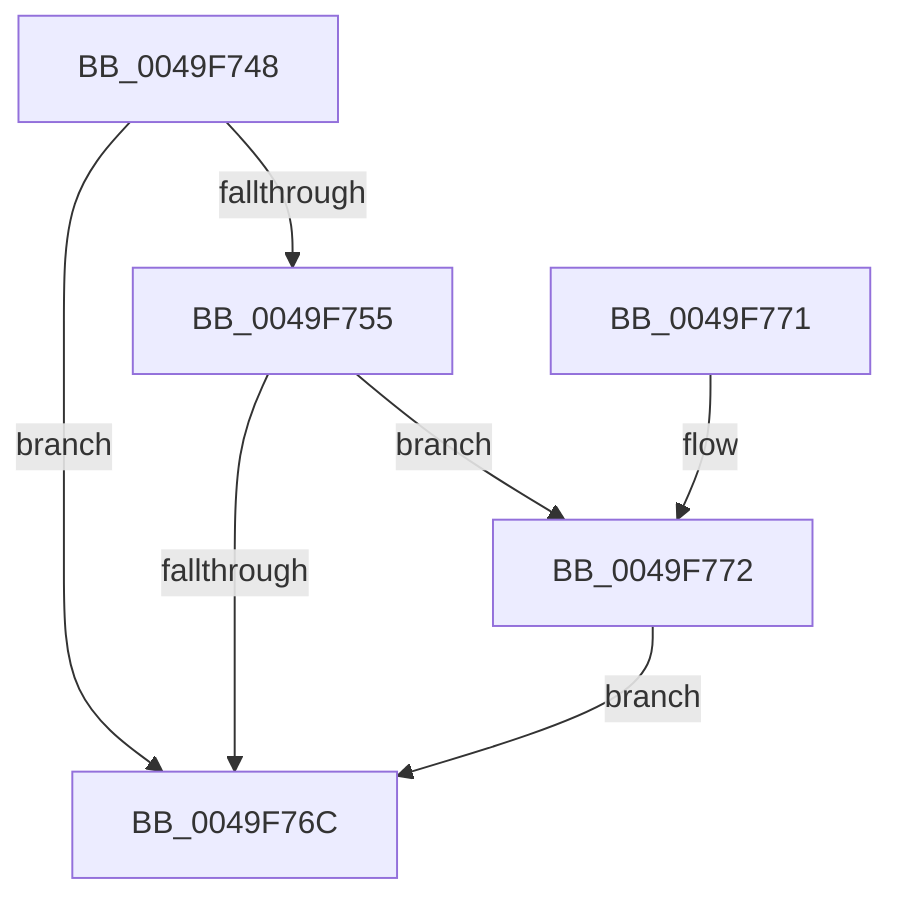

# PpmEventTraceMakeupPerfCheck

- RVA: `0x0049F748`–`0x0049F7A4` (길이 `92` bytes)
- VA: `0x000000014049F748`
- 실행 섹션: `.text`
- PDB 이름 있음: `예`; PDB Function 태그: `아니요`
- unwind 정보 RVA: `0x0009748C`
- 디코드: `21`개 명령, `92/92` bytes 표시
- 미해석 바이트: `0` (있으면 어셈블리에 `.byte`로 보존)

> 이 문서는 커널 이미지의 기계어와 PDB 기호를 분석해 생성했습니다. 4번과 5번은 함수 원형과 자료형을 바이너리 사용 방식에서 추정한 C 해석이며 원본 소스 복구 결과는 아닙니다.

## 1. Dependencies

- 직접 호출 지점: **2**; 고유 호출 대상: **2**
- 직접 호출자로 확인된 함수: **1**
- RIP 상대 이미지 참조: **3**

### Outgoing calls
- `0x0049F763` → [EtwEventEnabled](../39/EtwEventEnabled_function_00392450.md) (function, `0x00392450`)
- `0x0049F79D` → [EtwWriteEx](../25/EtwWriteEx_function_0025F0D0.md) (function, `0x0025F0D0`)

### Direct callers
- [PpmCheckMakeupSkippedChecks](../2D/PpmCheckMakeupSkippedChecks_function_002DA1D0.md) at `0x002DA215`

### Static image references
- `0x0049F74C` → RVA `0x00E67A39` (`.data`; read)
- `0x0049F755` → RVA `0x00F083E8` (`.data`; read)
- `0x0049F75C` → RVA `0x0001AF98` (`.rdata`; read)

## 2. Other-region calls and transfers

- 다른 실행 섹션으로 향하는 call: **0**
- 별도 외부 분기/꼬리 이동을 확인하지 못했습니다.

## 3. Assembly (complete function range)

```asm
0049F748  48 83 EC 48                     sub rsp, 0x48
0049F74C  80 3D E6 82 9C 00 00            cmp byte ptr [rip + 0x9c82e6], 0
0049F753  74 17                           je 0x14049f76c
0049F755  48 8B 0D 8C 8C A6 00            mov rcx, qword ptr [rip + 0xa68c8c]
0049F75C  48 8D 15 35 B8 B7 FF            lea rdx, [rip - 0x4847cb]
0049F763  E8 E8 2C EF FF                  call 0x140392450
0049F768  84 C0                           test al, al
0049F76A  75 06                           jne 0x14049f772
0049F76C  48 83 C4 48                     add rsp, 0x48
0049F770  C3                              ret
0049F771  CC                              int3
0049F772  48 83 64 24 38 00               and qword ptr [rsp + 0x38], 0
0049F778  48 8D 15 19 B8 B7 FF            lea rdx, [rip - 0x4847e7]
0049F77F  83 64 24 30 00                  and dword ptr [rsp + 0x30], 0
0049F784  45 33 C9                        xor r9d, r9d
0049F787  48 83 64 24 28 00               and qword ptr [rsp + 0x28], 0
0049F78D  45 33 C0                        xor r8d, r8d
0049F790  48 83 64 24 20 00               and qword ptr [rsp + 0x20], 0
0049F796  48 8B 0D 4B 8C A6 00            mov rcx, qword ptr [rip + 0xa68c4b]
0049F79D  E8 2E F9 DB FF                  call 0x14025f0d0
0049F7A2  EB C8                           jmp 0x14049f76c
```

## 4. C-style interpretation (structured pseudocode)

```c
__int64 __fastcall PpmEventTraceMakeupPerfCheck(__int64 a1, __int64 a2, int a3, int a4)
{
    __int64 result;
    __int64 v_rsp;
    unsigned __int64 v_stack_p20;
    unsigned __int64 v_stack_p28;
    unsigned int v_stack_p30;
    unsigned __int64 v_stack_p38;

    v_rsp = (v_rsp) - (72);
    if ((*(unsigned __int8 *)(v_rip + 10257126)) == 0) goto loc_0049F76C;
    result = EtwEventEnabled(*(unsigned __int64 *)(v_rip + 10914956), v_rip - 4736971, a3, a4);
    if ((unsigned __int8)(result) != 0) goto loc_0049F772;
loc_0049F76C:
    v_rsp = (v_rsp) + (72);
    return result;
loc_0049F772:
    a4 = 0;
    a3 = 0;
    result = EtwWriteEx(*(unsigned __int64 *)(v_rip + 10914891), v_rip - 4736999, a3, a4);
    goto loc_0049F76C;
}
```

## 5. (Beta) C Style

```c
int64_t PpmEventTraceMakeupPerfCheck(int64_t Arg1, int64_t Arg2, int32_t Arg3, int32_t Arg4)
{
    int64_t result;
    int64_t local_rsp;
    uint64_t v_stack_p20;
    uint64_t v_stack_p28;
    uint32_t v_stack_p30;
    uint64_t v_stack_p38;

    local_rsp = (local_rsp) - (72);
    if ((*(uint8_t *)(v_rip + 0x9C82E6)) == 0) goto loc_0049F76C;
    result = EtwEventEnabled(*(uint64_t *)(v_rip + 0xA68C8C), v_rip - 4736971, Arg3, Arg4);
    if ((uint8_t)(result) != 0) goto loc_0049F772;
loc_0049F76C:
    local_rsp = (local_rsp) + (72);
    return result;
loc_0049F772:
    Arg4 = 0;
    Arg3 = 0;
    result = EtwWriteEx(*(uint64_t *)(v_rip + 0xA68C4B), v_rip - 4736999, Arg3, Arg4);
    goto loc_0049F76C;
}
```

## 6. Execution-region graph

[열기: 2D/3D 그래프와 함수 탐색 컨트롤 패널](../../../control-panel.html?section=text&rva=0x0049F748&view=graph)

- 2D 그래프는 위에서 아래로 흐르고, 3D 그래프는 빈 공간을 드래그해 회전합니다. Shift+드래그는 이동, 휠은 확대·축소, 함수 노드 선택은 대상 보고서 이동입니다.

### Static fallback


