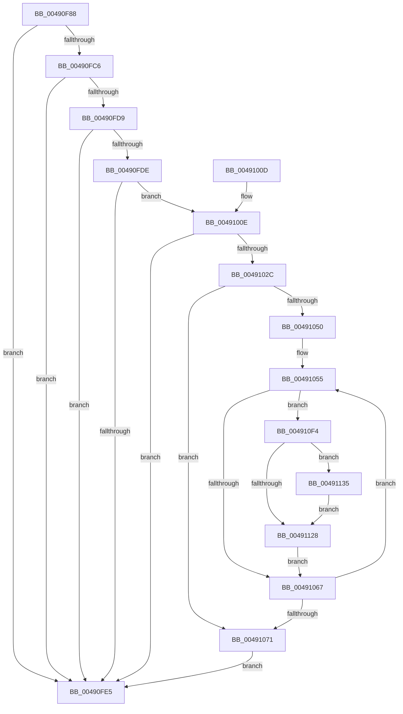

# PpmEventTracePreVetoAccounting

- RVA: `0x00490F88`–`0x00491149` (길이 `449` bytes)
- VA: `0x0000000140490F88`
- 실행 섹션: `.text`
- PDB 이름 있음: `예`; PDB Function 태그: `아니요`
- unwind 정보 RVA: `0x000B2C0C`
- 디코드: `120`개 명령, `449/449` bytes 표시
- 미해석 바이트: `0` (있으면 어셈블리에 `.byte`로 보존)

> 이 문서는 커널 이미지의 기계어와 PDB 기호를 분석해 생성했습니다. 4번과 5번은 함수 원형과 자료형을 바이너리 사용 방식에서 추정한 C 해석이며 원본 소스 복구 결과는 아닙니다.

## 1. Dependencies

- 직접 호출 지점: **8**; 고유 호출 대상: **8**
- 직접 호출자로 확인된 함수: **2**
- RIP 상대 이미지 참조: **4**

### Outgoing calls
- `0x00490FD0` → [EtwEventEnabled](../39/EtwEventEnabled_function_00392450.md) (function, `0x00392450`)
- `0x00490FEC` → [_security_check_cookie](../6A/_security_check_cookie_function_006AC640.md) (function, `0x006AC640`)
- `0x0049101F` → [ExAllocatePool2](../../poolcode/B8/ExAllocatePool2_function_00B820F0.md) (function, `0x00B820F0`)
- `0x00491033` → [KeAcquireSpinLockRaiseToDpc](../20/KeAcquireSpinLockRaiseToDpc_function_00208470.md) (function, `0x00208470`)
- `0x0049103F` → [RtlGetInterruptTimePrecise](../20/RtlGetInterruptTimePrecise_function_0020A4C0.md) (function, `0x0020A4C0`)
- `0x0049107B` → [KeReleaseSpinLock](../39/KeReleaseSpinLock_function_00392BA0.md) (function, `0x00392BA0`)
- `0x004910DD` → [EtwWriteEx](../25/EtwWriteEx_function_0025F0D0.md) (function, `0x0025F0D0`)
- `0x004910EA` → [ExFreePoolWithTag](../../poolcode/B8/ExFreePoolWithTag_function_00B82870.md) (function, `0x00B82870`)

### Direct callers
- [PpmEventPlatformVetoRundown](PpmEventPlatformVetoRundown_function_00490C38.md) at `0x00490CD2`
- [PpmEventProcessorVetoRundown](PpmEventProcessorVetoRundown_function_00490D88.md) at `0x00490E27`

### Static image references
- `0x00490FA6` → RVA `0x00E0A740` (`.data`; read)
- `0x00490FB4` → RVA `0x00E67A39` (`.data`; read)
- `0x00490FC9` → RVA `0x00F083E8` (`.data`; read)
- `0x0049102C` → RVA `0x00F0CA68` (`.data`; read)

## 2. Other-region calls and transfers

- 다른 실행 섹션으로 향하는 call: **2**
  - `0x0049101F` → [ExAllocatePool2](../../poolcode/B8/ExAllocatePool2_function_00B820F0.md) (`.text` → `POOLCODE`)
  - `0x004910EA` → [ExFreePoolWithTag](../../poolcode/B8/ExFreePoolWithTag_function_00B82870.md) (`.text` → `POOLCODE`)
- 별도 외부 분기/꼬리 이동을 확인하지 못했습니다.

## 3. Assembly (complete function range)

```asm
00490F88  48 89 5C 24 10                  mov qword ptr [rsp + 0x10], rbx
00490F8D  48 89 74 24 20                  mov qword ptr [rsp + 0x20], rsi
00490F92  55                              push rbp
00490F93  57                              push rdi
00490F94  41 54                           push r12
00490F96  41 56                           push r14
00490F98  41 57                           push r15
00490F9A  48 8D 6C 24 C9                  lea rbp, [rsp - 0x37]
00490F9F  48 81 EC 90 00 00 00            sub rsp, 0x90
00490FA6  48 8B 05 93 97 97 00            mov rax, qword ptr [rip + 0x979793]
00490FAD  48 33 C4                        xor rax, rsp
00490FB0  48 89 45 27                     mov qword ptr [rbp + 0x27], rax
00490FB4  80 3D 7E 6A 9D 00 00            cmp byte ptr [rip + 0x9d6a7e], 0
00490FBB  49 8B F0                        mov rsi, r8
00490FBE  4C 8B FA                        mov r15, rdx
00490FC1  4C 8B F1                        mov r14, rcx
00490FC4  74 1F                           je 0x140490fe5
00490FC6  48 8B D1                        mov rdx, rcx
00490FC9  48 8B 0D 18 74 A7 00            mov rcx, qword ptr [rip + 0xa77418]
00490FD0  E8 7B 14 F0 FF                  call 0x140392450
00490FD5  84 C0                           test al, al
00490FD7  74 0C                           je 0x140490fe5
00490FD9  48 85 F6                        test rsi, rsi
00490FDC  74 07                           je 0x140490fe5
00490FDE  8B 5E 1C                        mov ebx, dword ptr [rsi + 0x1c]
00490FE1  85 DB                           test ebx, ebx
00490FE3  75 29                           jne 0x14049100e
00490FE5  48 8B 4D 27                     mov rcx, qword ptr [rbp + 0x27]
00490FE9  48 33 CC                        xor rcx, rsp
00490FEC  E8 4F B6 21 00                  call 0x1406ac640
00490FF1  4C 8D 9C 24 90 00 00 00         lea r11, [rsp + 0x90]
00490FF9  49 8B 5B 38                     mov rbx, qword ptr [r11 + 0x38]
00490FFD  49 8B 73 48                     mov rsi, qword ptr [r11 + 0x48]
00491001  49 8B E3                        mov rsp, r11
00491004  41 5F                           pop r15
00491006  41 5E                           pop r14
00491008  41 5C                           pop r12
0049100A  5F                              pop rdi
0049100B  5D                              pop rbp
0049100C  C3                              ret
0049100D  CC                              int3
0049100E  8D 14 9B                        lea edx, [rbx + rbx*4]
00491011  B9 40 00 00 00                  mov ecx, 0x40
00491016  C1 E2 02                        shl edx, 2
00491019  41 B8 50 50 4D 65               mov r8d, 0x654d5050
0049101F  E8 CC 10 6F 00                  call 0x140b820f0
00491024  48 8B F8                        mov rdi, rax
00491027  48 85 C0                        test rax, rax
0049102A  74 B9                           je 0x140490fe5
0049102C  48 8D 0D 35 BA A7 00            lea rcx, [rip + 0xa7ba35]
00491033  E8 38 74 D7 FF                  call 0x140208470
00491038  48 8D 4D EF                     lea rcx, [rbp - 0x11]
0049103C  44 8A E0                        mov r12b, al
0049103F  E8 7C 94 D7 FF                  call 0x14020a4c0
00491044  33 C9                           xor ecx, ecx
00491046  4C 8B D8                        mov r11, rax
00491049  89 4D E7                        mov dword ptr [rbp - 0x19], ecx
0049104C  85 DB                           test ebx, ebx
0049104E  74 21                           je 0x140491071
00491050  33 D2                           xor edx, edx
00491052  4C 8B CB                        mov r9, rbx
00491055  4C 8B 46 20                     mov r8, qword ptr [rsi + 0x20]
00491059  46 8B 54 02 10                  mov r10d, dword ptr [rdx + r8 + 0x10]
0049105E  45 85 D2                        test r10d, r10d
00491061  0F 85 8D 00 00 00               jne 0x1404910f4
00491067  48 83 C2 40                     add rdx, 0x40
0049106B  49 83 E9 01                     sub r9, 1
0049106F  75 E4                           jne 0x140491055
00491071  41 8A D4                        mov dl, r12b
00491074  48 8D 0D ED B9 A7 00            lea rcx, [rip + 0xa7b9ed]
0049107B  E8 20 1B F0 FF                  call 0x140392ba0
00491080  41 0F 10 07                     movups xmm0, xmmword ptr [r15]
00491084  83 65 13 00                     and dword ptr [rbp + 0x13], 0
00491088  48 8D 45 E7                     lea rax, [rbp - 0x19]
0049108C  83 65 23 00                     and dword ptr [rbp + 0x23], 0
00491090  45 33 C9                        xor r9d, r9d
00491093  48 89 45 07                     mov qword ptr [rbp + 7], rax
00491097  45 33 C0                        xor r8d, r8d
0049109A  8B 45 E7                        mov eax, dword ptr [rbp - 0x19]
0049109D  49 8B D6                        mov rdx, r14
004910A0  F3 0F 7F 45 F7                  movdqu xmmword ptr [rbp - 9], xmm0
004910A5  C7 45 0F 04 00 00 00            mov dword ptr [rbp + 0xf], 4
004910AC  48 89 7D 17                     mov qword ptr [rbp + 0x17], rdi
004910B0  8D 0C 80                        lea ecx, [rax + rax*4]
004910B3  C1 E1 02                        shl ecx, 2
004910B6  48 8D 45 F7                     lea rax, [rbp - 9]
004910BA  48 89 44 24 38                  mov qword ptr [rsp + 0x38], rax
004910BF  C7 44 24 30 03 00 00 00         mov dword ptr [rsp + 0x30], 3
004910C7  48 83 64 24 28 00               and qword ptr [rsp + 0x28], 0
004910CD  48 83 64 24 20 00               and qword ptr [rsp + 0x20], 0
004910D3  89 4D 1F                        mov dword ptr [rbp + 0x1f], ecx
004910D6  48 8B 0D 0B 73 A7 00            mov rcx, qword ptr [rip + 0xa7730b]
004910DD  E8 EE DF DC FF                  call 0x14025f0d0
004910E2  BA 50 50 4D 65                  mov edx, 0x654d5050
004910E7  48 8B CF                        mov rcx, rdi
004910EA  E8 81 17 6F 00                  call 0x140b82870
004910EF  E9 F1 FE FF FF                  jmp 0x140490fe5
004910F4  48 8D 0C 89                     lea rcx, [rcx + rcx*4]
004910F8  44 89 14 8F                     mov dword ptr [rdi + rcx*4], r10d
004910FC  8B 45 E7                        mov eax, dword ptr [rbp - 0x19]
004910FF  48 8D 0C 80                     lea rcx, [rax + rax*4]
00491103  4A 8B 44 02 18                  mov rax, qword ptr [rdx + r8 + 0x18]
00491108  48 89 44 8F 04                  mov qword ptr [rdi + rcx*4 + 4], rax
0049110D  8B 45 E7                        mov eax, dword ptr [rbp - 0x19]
00491110  48 8D 0C 80                     lea rcx, [rax + rax*4]
00491114  4A 8B 44 02 28                  mov rax, qword ptr [rdx + r8 + 0x28]
00491119  48 89 44 8F 0C                  mov qword ptr [rdi + rcx*4 + 0xc], rax
0049111E  4E 8B 54 02 20                  mov r10, qword ptr [rdx + r8 + 0x20]
00491123  4D 85 D2                        test r10, r10
00491126  75 0D                           jne 0x140491135
00491128  8B 4D E7                        mov ecx, dword ptr [rbp - 0x19]
0049112B  FF C1                           inc ecx
0049112D  89 4D E7                        mov dword ptr [rbp - 0x19], ecx
00491130  E9 32 FF FF FF                  jmp 0x140491067
00491135  8B 45 E7                        mov eax, dword ptr [rbp - 0x19]
00491138  48 8D 0C 80                     lea rcx, [rax + rax*4]
0049113C  49 8B C3                        mov rax, r11
0049113F  49 2B C2                        sub rax, r10
00491142  48 01 44 8F 0C                  add qword ptr [rdi + rcx*4 + 0xc], rax
00491147  EB DF                           jmp 0x140491128
```

## 4. C-style interpretation (structured pseudocode)

```c
__int64 __fastcall PpmEventTracePreVetoAccounting(__int64 a1, __int64 a2, __int64 a3)
{
    __int64 result;
    __int64 v_rsp;
    unsigned __int64 v_stack_m28;
    unsigned __int64 v_stack_m38;
    unsigned int v_stack_m3C;
    unsigned int v_stack_m40;
    unsigned __int64 v_stack_m48;
    unsigned int v_stack_m4C;
    unsigned int v_stack_m50;
    unsigned __int64 v_stack_m58;
    unsigned __int64 v_stack_m5F;
    unsigned int v_stack_m60;
    unsigned __int64 v_stack_m68;
    unsigned __int64 v_stack_m70;
    unsigned int v_stack_m78;
    unsigned __int64 v_stack_p10;
    unsigned __int64 v_stack_p20;

    v_stack_p10 = v_rbx;
    v_stack_p20 = v_rsi;
    v_rsp = (v_rsp) - (144);
    result = (*(unsigned __int64 *)(v_rip + 9934739)) ^ (v_rsp);
    v_stack_m38 = result;
    if ((*(unsigned __int8 *)(v_rip + 10316414)) == 0) goto loc_00490FE5;
    result = EtwEventEnabled(*(unsigned __int64 *)(v_rip + 10974232), a1, a3, a4);
    if ((unsigned __int8)(result) == 0) goto loc_00490FE5;
    if (a3 == 0) goto loc_00490FE5;
    if ((unsigned int)((unsigned int)(*(unsigned int *)(a3 + 28))) != 0) goto loc_0049100E;
loc_00490FE5:
    a1 = (v_stack_m38) ^ (v_rsp);
    result = _security_check_cookie(a1, a1, a3, a4);
    return result;
loc_0049100E:
    a2 = (unsigned int)((*(unsigned __int64 *)(v_stack_m28 + 56) + *(unsigned __int64 *)(v_stack_m28 + 56) * 4) << (2));
    result = ExAllocatePool2(64, a2, (unsigned int)(0x654D5050ULL), a4);
    if (result == 0) goto loc_00490FE5;
    result = KeAcquireSpinLockRaiseToDpc(v_rip + 10992181, a2, (unsigned int)(0x654D5050ULL), a4);
    result = RtlGetInterruptTimePrecise(v_stack_m70, a2, (unsigned int)(0x654D5050ULL), a4);
    a1 = 0;
    v_stack_m78 = 0;
    if ((unsigned int)(*(unsigned __int64 *)(v_stack_m28 + 56)) == 0) goto loc_00491071;
    a2 = 0;
loc_00491055:
    if ((unsigned int)((unsigned int)(*(unsigned int *)(a2 + *(unsigned __int64 *)(*(unsigned __int64 *)(v_stack_m28 + 72) + 32) * 1 + 16))) != 0) goto loc_004910F4;
loc_00491067:
    a2 = (a2) + (64);
    a4 = (*(unsigned __int64 *)(v_stack_m28 + 56)) - (1);
    if (condition_is_not_equal) goto loc_00491055;
loc_00491071:
    result = KeReleaseSpinLock(v_rip + 10992109, (unsigned __int8)((unsigned __int8)(result)), *(unsigned __int64 *)(*(unsigned __int64 *)(v_stack_m28 + 72) + 32), a4);
    a4 = 0;
    v_stack_m58 = v_stack_m78;
    a3 = 0;
    v_stack_m68 = v_xmm0;
    v_stack_m50 = 4;
    v_stack_m48 = result;
    a1 = (unsigned int)(((unsigned int)(v_stack_m78) + (unsigned int)(v_stack_m78) * 4) << (2));
    v_stack_m58 = v_stack_m68;
    v_stack_m60 = 3;
    v_stack_m40 = (unsigned int)(a1);
    result = EtwWriteEx(*(unsigned __int64 *)(v_rip + 10973963), 0, a3, a4);
    result = ExFreePoolWithTag(result, (unsigned int)(0x654D5050ULL), a3, a4);
    goto loc_00490FE5;
loc_004910F4:
    *(unsigned int *)(result + result + result * 4 * 4) = (unsigned int)((unsigned int)(*(unsigned int *)(a2 + *(unsigned __int64 *)(*(unsigned __int64 *)(v_stack_m28 + 72) + 32) * 1 + 16)));
    *(unsigned __int64 *)(result + (unsigned int)(v_stack_m78) + (unsigned int)(v_stack_m78) * 4 * 4 + 4) = *(unsigned __int64 *)((unsigned int)(0x654D5050ULL) + a3 * 1 + 24);
    *(unsigned __int64 *)(result + (unsigned int)(v_stack_m78) + (unsigned int)(v_stack_m78) * 4 * 4 + 12) = *(unsigned __int64 *)((unsigned int)(0x654D5050ULL) + a3 * 1 + 40);
    if (*(unsigned __int64 *)((unsigned int)(0x654D5050ULL) + a3 * 1 + 32) != 0) goto loc_00491135;
loc_00491128:
    a1 = (unsigned int)(((unsigned int)(v_stack_m78)) + 1);
    v_stack_m78 = (unsigned int)(a1);
    goto loc_00491067;
loc_00491135:
    result = (result) - (*(unsigned __int64 *)((unsigned int)(0x654D5050ULL) + a3 * 1 + 32));
    goto loc_00491128;
}
```

## 5. (Beta) C Style

```c
int64_t PpmEventTracePreVetoAccounting(int64_t Arg1, void *Arg2, int64_t Arg3)
{
    uint8_t *arg2 = (uint8_t *)Arg2;

    int64_t result;
    int64_t local_rsp;
    uint64_t v_stack_m28;
    uint64_t v_stack_m38;
    uint32_t v_stack_m3C;
    uint32_t v_stack_m40;
    uint64_t v_stack_m48;
    uint32_t v_stack_m4C;
    uint32_t v_stack_m50;
    uint64_t v_stack_m58;
    uint64_t v_stack_m5F;
    uint32_t v_stack_m60;
    uint64_t v_stack_m68;
    uint64_t v_stack_m70;
    uint32_t v_stack_m78;
    uint64_t v_stack_p10;
    uint64_t v_stack_p20;

    v_stack_p10 = local_rbx;
    v_stack_p20 = local_rsi;
    local_rsp = (local_rsp) - (144);
    result = (*(uint64_t *)(v_rip + 0x979793)) ^ (local_rsp);
    v_stack_m38 = result;
    if ((*(uint8_t *)(v_rip + 0x9D6A7E)) == 0) goto loc_00490FE5;
    result = EtwEventEnabled(*(uint64_t *)(v_rip + 0xA77418), Arg1, Arg3, a4);
    if ((uint8_t)(result) == 0) goto loc_00490FE5;
    if (Arg3 == 0) goto loc_00490FE5;
    if ((uint32_t)((uint32_t)(*(uint32_t *)(Arg3 + 0x1C))) != 0) goto loc_0049100E;
loc_00490FE5:
    Arg1 = (v_stack_m38) ^ (local_rsp);
    result = _security_check_cookie(Arg1, Arg1, Arg3, a4);
    return result;
loc_0049100E:
    Arg2 = (uint32_t)((*(uint64_t *)(v_stack_m28 + 0x38) + *(uint64_t *)(v_stack_m28 + 0x38) * 4) << (2));
    result = ExAllocatePool2(64, Arg2, (uint32_t)(0x654D5050ULL), a4);
    if (result == 0) goto loc_00490FE5;
    result = KeAcquireSpinLockRaiseToDpc(v_rip + 10992181, Arg2, (uint32_t)(0x654D5050ULL), a4);
    result = RtlGetInterruptTimePrecise(v_stack_m70, Arg2, (uint32_t)(0x654D5050ULL), a4);
    Arg1 = 0;
    v_stack_m78 = 0;
    if ((uint32_t)(*(uint64_t *)(v_stack_m28 + 0x38)) == 0) goto loc_00491071;
    Arg2 = 0;
loc_00491055:
    if ((uint32_t)((uint32_t)(*(uint32_t *)(arg2 + *(uint64_t *)(*(uint64_t *)(v_stack_m28 + 0x48) + 0x20) * 1 + 0x10))) != 0) goto loc_004910F4;
loc_00491067:
    Arg2 = (Arg2) + (64);
    a4 = (*(uint64_t *)(v_stack_m28 + 0x38)) - (1);
    if (condition_is_not_equal) goto loc_00491055;
loc_00491071:
    result = KeReleaseSpinLock(v_rip + 10992109, (uint8_t)((uint8_t)(result)), *(uint64_t *)(*(uint64_t *)(v_stack_m28 + 0x48) + 0x20), a4);
    a4 = 0;
    v_stack_m58 = v_stack_m78;
    Arg3 = 0;
    v_stack_m68 = v_xmm0;
    v_stack_m50 = 4;
    v_stack_m48 = result;
    Arg1 = (uint32_t)(((uint32_t)(v_stack_m78) + (uint32_t)(v_stack_m78) * 4) << (2));
    v_stack_m58 = v_stack_m68;
    v_stack_m60 = 3;
    v_stack_m40 = (uint32_t)(Arg1);
    result = EtwWriteEx(*(uint64_t *)(v_rip + 0xA7730B), 0, Arg3, a4);
    result = ExFreePoolWithTag(result, (uint32_t)(0x654D5050ULL), Arg3, a4);
    goto loc_00490FE5;
loc_004910F4:
    *(uint32_t *)(result + result + result * 4 * 4) = (uint32_t)((uint32_t)(*(uint32_t *)(arg2 + *(uint64_t *)(*(uint64_t *)(v_stack_m28 + 0x48) + 0x20) * 1 + 0x10)));
    *(uint64_t *)(result + (uint32_t)(v_stack_m78) + (uint32_t)(v_stack_m78) * 4 * 4 + 0x4) = *(uint64_t *)((uint32_t)(0x654D5050ULL) + Arg3 * 1 + 0x18);
    *(uint64_t *)(result + (uint32_t)(v_stack_m78) + (uint32_t)(v_stack_m78) * 4 * 4 + 0xC) = *(uint64_t *)((uint32_t)(0x654D5050ULL) + Arg3 * 1 + 0x28);
    if (*(uint64_t *)((uint32_t)(0x654D5050ULL) + Arg3 * 1 + 0x20) != 0) goto loc_00491135;
loc_00491128:
    Arg1 = (uint32_t)(((uint32_t)(v_stack_m78)) + 1);
    v_stack_m78 = (uint32_t)(Arg1);
    goto loc_00491067;
loc_00491135:
    result = (result) - (*(uint64_t *)((uint32_t)(0x654D5050ULL) + Arg3 * 1 + 0x20));
    goto loc_00491128;
}
```

### 관측된 메모리 오프셋

구조체 형식이 확인되지 않은 접근은 인자 기준의 오프셋으로만 기록했습니다.

| 기준 인자 | 오프셋 표현 | 폭 (bit) | 접근 |
|---|---:|---:|---|
| `Arg2` | `+ 0x0` | `128` | `R` |

## 6. Execution-region graph

[열기: 2D/3D 그래프와 함수 탐색 컨트롤 패널](../../../control-panel.html?section=text&rva=0x00490F88&view=graph)

- 2D 그래프는 위에서 아래로 흐르고, 3D 그래프는 빈 공간을 드래그해 회전합니다. Shift+드래그는 이동, 휠은 확대·축소, 함수 노드 선택은 대상 보고서 이동입니다.

### Static fallback


