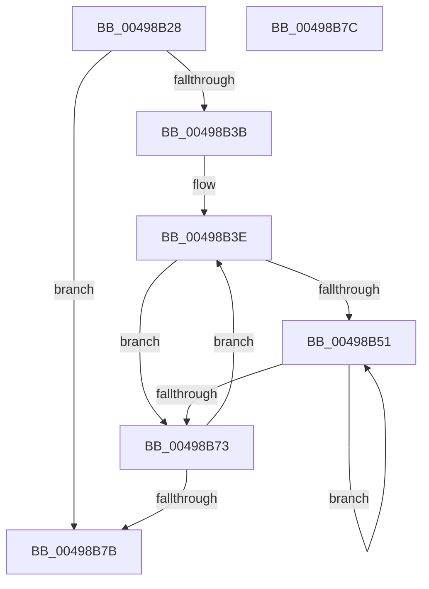

# PpmPerfClearResponsivenessHints

- RVA: `0x00498B28`–`0x00498B7D` (길이 `85` bytes)
- VA: `0x0000000140498B28`
- 실행 섹션: `.text`
- PDB 이름 있음: `예`; PDB Function 태그: `아니요`
- unwind 정보 RVA: `0x000DB714`
- 디코드: `21`개 명령, `85/85` bytes 표시
- 미해석 바이트: `0` (있으면 어셈블리에 `.byte`로 보존)

> 이 문서는 커널 이미지의 기계어와 PDB 기호를 분석해 생성했습니다. 4번과 5번은 함수 원형과 자료형을 바이너리 사용 방식에서 추정한 C 해석이며 원본 소스 복구 결과는 아닙니다.

## 1. Dependencies

- 직접 호출 지점: **0**; 고유 호출 대상: **0**
- 직접 호출자로 확인된 함수: **1**
- RIP 상대 이미지 참조: **1**

### Outgoing calls
- 직접 디코드된 call 명령이 없습니다.

### Direct callers
- [PpmCheckReInit](../../page/A8/PpmCheckReInit_function_00A84DD8.md) at `0x00A84F0A`

### Static image references
- `0x00498B28` → RVA `0x00FC6BA8` (`ALMOSTRO`; read)

## 2. Other-region calls and transfers

- 다른 실행 섹션으로 향하는 call: **0**
- 별도 외부 분기/꼬리 이동을 확인하지 못했습니다.

## 3. Assembly (complete function range)

```asm
00498B28  48 8B 15 79 E0 B2 00            mov rdx, qword ptr [rip + 0xb2e079]
00498B2F  4C 8D 15 72 E0 B2 00            lea r10, [rip + 0xb2e072]
00498B36  49 3B D2                        cmp rdx, r10
00498B39  74 40                           je 0x140498b7b
00498B3B  45 33 C9                        xor r9d, r9d
00498B3E  45 8B C1                        mov r8d, r9d
00498B41  44 88 8A 14 02 00 00            mov byte ptr [rdx + 0x214], r9b
00498B48  44 39 8A 28 01 00 00            cmp dword ptr [rdx + 0x128], r9d
00498B4F  76 22                           jbe 0x140498b73
00498B51  41 8B C0                        mov eax, r8d
00498B54  41 FF C0                        inc r8d
00498B57  48 69 C8 A8 04 00 00            imul rcx, rax, 0x4a8
00498B5E  48 8B 82 38 01 00 00            mov rax, qword ptr [rdx + 0x138]
00498B65  44 88 4C 01 3C                  mov byte ptr [rcx + rax + 0x3c], r9b
00498B6A  44 3B 82 28 01 00 00            cmp r8d, dword ptr [rdx + 0x128]
00498B71  72 DE                           jb 0x140498b51
00498B73  48 8B 12                        mov rdx, qword ptr [rdx]
00498B76  49 3B D2                        cmp rdx, r10
00498B79  75 C3                           jne 0x140498b3e
00498B7B  C3                              ret
00498B7C  CC                              int3
```

## 4. C-style interpretation (structured pseudocode)

```c
__int64 __fastcall PpmPerfClearResponsivenessHints(__int64 a1, __int64 a2, __int64 a3, int a4)
{
    if ((*(unsigned __int64 *)(v_rip + 11722873)) == (v_rip + 11722866)) goto loc_00498B7B;
    a4 = 0;
loc_00498B3E:
    *(unsigned __int8 *)(*(unsigned __int64 *)(v_rip + 11722873) + 532) = 0;
    if ((*(unsigned int *)(*(unsigned __int64 *)(v_rip + 11722873) + 296)) <= 0) goto loc_00498B73;
loc_00498B51:
    a3 = (unsigned int)((0) + 1);
    a1 = (a1) * (0);
    *(unsigned __int8 *)(a1 + *(unsigned __int64 *)(*(unsigned __int64 *)(v_rip + 11722873) + 312) * 1 + 60) = 0;
    if (((unsigned int)(a3)) < (*(unsigned int *)(*(unsigned __int64 *)(v_rip + 11722873) + 296))) goto loc_00498B51;
loc_00498B73:
    if ((*(unsigned __int64 *)(*(unsigned __int64 *)(v_rip + 11722873))) != (v_rip + 11722866)) goto loc_00498B3E;
loc_00498B7B:
    return *(unsigned __int64 *)(*(unsigned __int64 *)(v_rip + 11722873) + 312);
}
```

## 5. (Beta) C Style

```c
int64_t PpmPerfClearResponsivenessHints(void *Arg1, int64_t Arg2, int64_t Arg3, int32_t Arg4)
{
    uint8_t *arg1 = (uint8_t *)Arg1;

    if ((*(uint64_t *)(v_rip + 0xB2E079)) == (v_rip + 11722866)) goto loc_00498B7B;
    Arg4 = 0;
loc_00498B3E:
    *(uint8_t *)(*(uint64_t *)(v_rip + 0xB2E079) + 0x214) = 0;
    if ((*(uint32_t *)(*(uint64_t *)(v_rip + 0xB2E079) + 0x128)) <= 0) goto loc_00498B73;
loc_00498B51:
    Arg3 = (uint32_t)((0) + 1);
    Arg1 = (Arg1) * (0);
    *(uint8_t *)(arg1 + *(uint64_t *)(*(uint64_t *)(v_rip + 0xB2E079) + 0x138) * 1 + 0x3C) = 0;
    if (((uint32_t)(Arg3)) < (*(uint32_t *)(*(uint64_t *)(v_rip + 0xB2E079) + 0x128))) goto loc_00498B51;
loc_00498B73:
    if ((*(uint64_t *)(*(uint64_t *)(v_rip + 0xB2E079))) != (v_rip + 11722866)) goto loc_00498B3E;
loc_00498B7B:
    return *(uint64_t *)(*(uint64_t *)(v_rip + 0xB2E079) + 0x138);
}
```

### 관측된 메모리 오프셋

구조체 형식이 확인되지 않은 접근은 인자 기준의 오프셋으로만 기록했습니다.

| 기준 인자 | 오프셋 표현 | 폭 (bit) | 접근 |
|---|---:|---:|---|
| `Arg1` | `+ 0x3C + rax*1` | `8` | `W` |

## 6. Execution-region graph

[열기: 2D/3D 그래프와 함수 탐색 컨트롤 패널](../../../control-panel.html?section=text&rva=0x00498B28&view=graph)

- 2D 그래프는 위에서 아래로 흐르고, 3D 그래프는 빈 공간을 드래그해 회전합니다. Shift+드래그는 이동, 휠은 확대·축소, 함수 노드 선택은 대상 보고서 이동입니다.

### Static fallback


