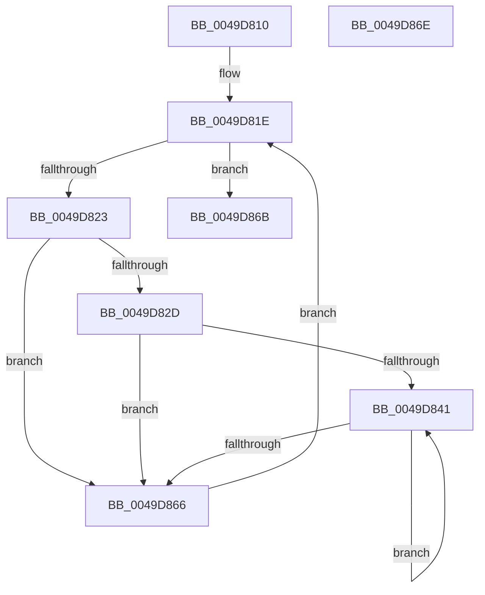

# PpmPerfForceDomainStates

- RVA: `0x0049D810`–`0x0049D86F` (길이 `95` bytes)
- VA: `0x000000014049D810`
- 실행 섹션: `.text`
- PDB 이름 있음: `예`; PDB Function 태그: `아니요`
- unwind 정보 RVA: `0x000DB714`
- 디코드: `22`개 명령, `95/95` bytes 표시
- 미해석 바이트: `0` (있으면 어셈블리에 `.byte`로 보존)

> 이 문서는 커널 이미지의 기계어와 PDB 기호를 분석해 생성했습니다. 4번과 5번은 함수 원형과 자료형을 바이너리 사용 방식에서 추정한 C 해석이며 원본 소스 복구 결과는 아닙니다.

## 1. Dependencies

- 직접 호출 지점: **0**; 고유 호출 대상: **0**
- 직접 호출자로 확인된 함수: **0**
- RIP 상대 이미지 참조: **1**

### Outgoing calls
- 직접 디코드된 call 명령이 없습니다.

### Direct callers
- 이 함수 시작 RVA로 연결되는 직접 call은 확인되지 않았습니다. 간접 호출은 완전히 역산할 수 없습니다.

### Static image references
- `0x0049D810` → RVA `0x00FC6BA8` (`ALMOSTRO`; read)

## 2. Other-region calls and transfers

- 다른 실행 섹션으로 향하는 call: **0**
- 별도 외부 분기/꼬리 이동을 확인하지 못했습니다.

## 3. Assembly (complete function range)

```asm
0049D810  4C 8B 05 91 93 B2 00            mov r8, qword ptr [rip + 0xb29391]
0049D817  4C 8D 15 8A 93 B2 00            lea r10, [rip + 0xb2938a]
0049D81E  4D 3B C2                        cmp r8, r10
0049D821  74 48                           je 0x14049d86b
0049D823  41 80 B8 BD 04 00 00 00         cmp byte ptr [r8 + 0x4bd], 0
0049D82B  74 39                           je 0x14049d866
0049D82D  45 33 C9                        xor r9d, r9d
0049D830  41 C6 80 BC 04 00 00 01         mov byte ptr [r8 + 0x4bc], 1
0049D838  45 39 88 28 01 00 00            cmp dword ptr [r8 + 0x128], r9d
0049D83F  76 25                           jbe 0x14049d866
0049D841  49 8B 88 38 01 00 00            mov rcx, qword ptr [r8 + 0x138]
0049D848  41 8B C1                        mov eax, r9d
0049D84B  41 FF C1                        inc r9d
0049D84E  48 69 D0 A8 04 00 00            imul rdx, rax, 0x4a8
0049D855  C6 84 0A 8C 00 00 00 01         mov byte ptr [rdx + rcx + 0x8c], 1
0049D85D  45 3B 88 28 01 00 00            cmp r9d, dword ptr [r8 + 0x128]
0049D864  72 DB                           jb 0x14049d841
0049D866  4D 8B 00                        mov r8, qword ptr [r8]
0049D869  EB B3                           jmp 0x14049d81e
0049D86B  B0 01                           mov al, 1
0049D86D  C3                              ret
0049D86E  CC                              int3
```

## 4. C-style interpretation (structured pseudocode)

```c
__int64 __fastcall PpmPerfForceDomainStates(__int64 a1, __int64 a2, __int64 a3, int a4)
{
loc_0049D81E:
    if ((*(unsigned __int64 *)(v_rip + 11703185)) == (v_rip + 11703178)) goto loc_0049D86B;
    if ((*(unsigned __int8 *)(*(unsigned __int64 *)(v_rip + 11703185) + 1213)) == 0) goto loc_0049D866;
    a4 = 0;
    *(unsigned __int8 *)(*(unsigned __int64 *)(v_rip + 11703185) + 1212) = 1;
    if ((*(unsigned int *)(*(unsigned __int64 *)(v_rip + 11703185) + 296)) <= 0) goto loc_0049D866;
loc_0049D841:
    a4 = (unsigned int)((a4) + 1);
    a2 = (a2) * (0);
    *(unsigned __int8 *)(a2 + *(unsigned __int64 *)(*(unsigned __int64 *)(v_rip + 11703185) + 312) * 1 + 140) = 1;
    if (a4 < (*(unsigned int *)(*(unsigned __int64 *)(v_rip + 11703185) + 296))) goto loc_0049D841;
loc_0049D866:
    goto loc_0049D81E;
loc_0049D86B:
    return 1;
}
```

## 5. (Beta) C Style

```c
int64_t PpmPerfForceDomainStates(int64_t Arg1, void *Arg2, int64_t Arg3, int32_t Arg4)
{
    uint8_t *arg2 = (uint8_t *)Arg2;

loc_0049D81E:
    if ((*(uint64_t *)(v_rip + 0xB29391)) == (v_rip + 11703178)) goto loc_0049D86B;
    if ((*(uint8_t *)(*(uint64_t *)(v_rip + 0xB29391) + 0x4BD)) == 0) goto loc_0049D866;
    Arg4 = 0;
    *(uint8_t *)(*(uint64_t *)(v_rip + 0xB29391) + 0x4BC) = 1;
    if ((*(uint32_t *)(*(uint64_t *)(v_rip + 0xB29391) + 0x128)) <= 0) goto loc_0049D866;
loc_0049D841:
    Arg4 = (uint32_t)((Arg4) + 1);
    Arg2 = (Arg2) * (0);
    *(uint8_t *)(arg2 + *(uint64_t *)(*(uint64_t *)(v_rip + 0xB29391) + 0x138) * 1 + 0x8C) = 1;
    if (Arg4 < (*(uint32_t *)(*(uint64_t *)(v_rip + 0xB29391) + 0x128))) goto loc_0049D841;
loc_0049D866:
    goto loc_0049D81E;
loc_0049D86B:
    return 1;
}
```

### 관측된 메모리 오프셋

구조체 형식이 확인되지 않은 접근은 인자 기준의 오프셋으로만 기록했습니다.

| 기준 인자 | 오프셋 표현 | 폭 (bit) | 접근 |
|---|---:|---:|---|
| `Arg2` | `+ 0x8C + rcx*1` | `8` | `W` |

## 6. Execution-region graph

[열기: 2D/3D 그래프와 함수 탐색 컨트롤 패널](../../../control-panel.html?section=text&rva=0x0049D810&view=graph)

- 2D 그래프는 위에서 아래로 흐르고, 3D 그래프는 빈 공간을 드래그해 회전합니다. Shift+드래그는 이동, 휠은 확대·축소, 함수 노드 선택은 대상 보고서 이동입니다.

### Static fallback


