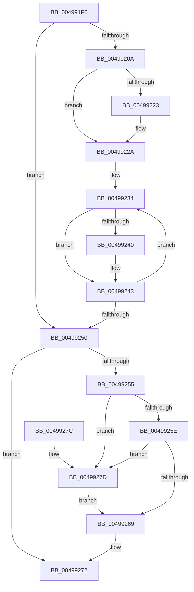

# PpmPerfUpdateQosDisableReasons

- RVA: `0x004991F0`–`0x00499281` (길이 `145` bytes)
- VA: `0x00000001404991F0`
- 실행 섹션: `.text`
- PDB 이름 있음: `예`; PDB Function 태그: `아니요`
- unwind 정보 RVA: `0x000DB714`
- 디코드: `37`개 명령, `145/145` bytes 표시
- 미해석 바이트: `0` (있으면 어셈블리에 `.byte`로 보존)

> 이 문서는 커널 이미지의 기계어와 PDB 기호를 분석해 생성했습니다. 4번과 5번은 함수 원형과 자료형을 바이너리 사용 방식에서 추정한 C 해석이며 원본 소스 복구 결과는 아닙니다.

## 1. Dependencies

- 직접 호출 지점: **0**; 고유 호출 대상: **0**
- 직접 호출자로 확인된 함수: **4**
- RIP 상대 이미지 참조: **9**

### Outgoing calls
- 직접 디코드된 call 명령이 없습니다.

### Direct callers
- [PpmCheckPausePpmEngineForSx](PpmCheckPausePpmEngineForSx_function_00499104.md) at `0x00499116`
- [PpmCheckResumePpmEngineFromSx](PpmCheckResumePpmEngineFromSx_function_00499148.md) at `0x004991CB`
- [PpmPerfTelemetryWorker](../../page/75/PpmPerfTelemetryWorker_function_0075AED0.md) at `0x0075AF0B`
- [PpmPerfUpdateDomainPolicy](../../page/A9/PpmPerfUpdateDomainPolicy_function_00A97030.md) at `0x00A97157`

### Static image references
- `0x00499202` → RVA `0x00FC77C8` (`ALMOSTRO`; read)
- `0x0049920D` → RVA `0x00FC7710` (`ALMOSTRO`; read)
- `0x00499214` → RVA `0x00FC7718` (`ALMOSTRO`; read/write)
- `0x0049921B` → RVA `0x00FC6AA6` (`ALMOSTRO`; read)
- `0x00499223` → RVA `0x00FC7728` (`ALMOSTRO`; read/write)
- `0x0049922D` → RVA `0x00FC7738` (`ALMOSTRO`; read)
- `0x00499234` → RVA `0x00FC6DA4` (`ALMOSTRO`; read)
- `0x0049926C` → RVA `0x00FC6DA4` (`ALMOSTRO`; write)
- `0x00499272` → RVA `0x00FC7710` (`ALMOSTRO`; write)

## 2. Other-region calls and transfers

- 다른 실행 섹션으로 향하는 call: **0**
- 별도 외부 분기/꼬리 이동을 확인하지 못했습니다.

## 3. Assembly (complete function range)

```asm
004991F0  49 BB 08 00 00 00 80 F7 FF FF   movabs r11, 0xfffff78000000008
004991FA  33 D2                           xor edx, edx
004991FC  4C 8B D1                        mov r10, rcx
004991FF  4D 8B 1B                        mov r11, qword ptr [r11]
00499202  38 15 C0 E5 B2 00               cmp byte ptr [rip + 0xb2e5c0], dl
00499208  75 46                           jne 0x140499250
0049920A  4D 8B C3                        mov r8, r11
0049920D  4C 2B 05 FC E4 B2 00            sub r8, qword ptr [rip + 0xb2e4fc]
00499214  4C 01 05 FD E4 B2 00            add qword ptr [rip + 0xb2e4fd], r8
0049921B  38 15 85 D8 B2 00               cmp byte ptr [rip + 0xb2d885], dl
00499221  74 07                           je 0x14049922a
00499223  4C 01 05 FE E4 B2 00            add qword ptr [rip + 0xb2e4fe], r8
0049922A  44 8B CA                        mov r9d, edx
0049922D  48 8D 0D 04 E5 B2 00            lea rcx, [rip + 0xb2e504]
00499234  8B 05 6A DB B2 00               mov eax, dword ptr [rip + 0xb2db6a]
0049923A  44 0F A3 C8                     bt eax, r9d
0049923E  73 03                           jae 0x140499243
00499240  4C 01 01                        add qword ptr [rcx], r8
00499243  41 FF C1                        inc r9d
00499246  48 83 C1 08                     add rcx, 8
0049924A  41 83 F9 09                     cmp r9d, 9
0049924E  72 E4                           jb 0x140499234
00499250  4D 85 D2                        test r10, r10
00499253  74 1D                           je 0x140499272
00499255  48 39 15 B4 E4 B2 00            cmp qword ptr [rip + 0xb2e4b4], rdx
0049925C  74 1F                           je 0x14049927d
0049925E  41 8B 02                        mov eax, dword ptr [r10]
00499261  39 05 3D DB B2 00               cmp dword ptr [rip + 0xb2db3d], eax
00499267  75 14                           jne 0x14049927d
00499269  41 8B 02                        mov eax, dword ptr [r10]
0049926C  89 05 32 DB B2 00               mov dword ptr [rip + 0xb2db32], eax
00499272  4C 89 1D 97 E4 B2 00            mov qword ptr [rip + 0xb2e497], r11
00499279  8A C2                           mov al, dl
0049927B  C3                              ret
0049927C  CC                              int3
0049927D  B2 01                           mov dl, 1
0049927F  EB E8                           jmp 0x140499269
```

## 4. C-style interpretation (structured pseudocode)

```c
__int64 __fastcall PpmPerfUpdateQosDisableReasons(__int64 a1, int a2)
{
    a2 = 0;
    if ((*(unsigned __int8 *)(v_rip + 11724224)) != 0) goto loc_00499250;
    a3 = (*(unsigned __int64 *)(v_r11)) - (*(unsigned __int64 *)(v_rip + 11724028));
    if ((*(unsigned __int8 *)(v_rip + 11720837)) != 0) {
    }
loc_00499234:
    if ((*(unsigned __int8 *)(v_rip + 11720837)) < 0) {
    }
    a4 = (unsigned int)((0) + 1);
    a1 = (v_rip + 11724036) + (8);
    if (((unsigned int)(a4)) < 9) goto loc_00499234;
loc_00499250:
    if (a1 == 0) goto loc_00499272;
    if ((*(unsigned __int64 *)(v_rip + 11723956)) == 0) goto loc_0049927D;
    if ((*(unsigned int *)(v_rip + 11721533)) != ((unsigned int)((unsigned int)(*(unsigned int *)(a1))))) goto loc_0049927D;
loc_00499269:
    *(unsigned int *)(v_rip + 11721522) = (unsigned int)((unsigned int)(*(unsigned int *)(a1)));
loc_00499272:
    *(unsigned __int64 *)(v_rip + 11723927) = *(unsigned __int64 *)(v_r11);
    return 0;
loc_0049927D:
    goto loc_00499269;
}
```

## 5. (Beta) C Style

```c
int64_t PpmPerfUpdateQosDisableReasons(int64_t Arg1, int32_t Arg2)
{
    Arg2 = 0;
    if ((*(uint8_t *)(v_rip + 0xB2E5C0)) != 0) goto loc_00499250;
    a3 = (*(uint64_t *)(local_r11)) - (*(uint64_t *)(v_rip + 0xB2E4FC));
    if ((*(uint8_t *)(v_rip + 0xB2D885)) != 0) {
    }
loc_00499234:
    if ((*(uint8_t *)(v_rip + 0xB2D885)) < 0) {
    }
    a4 = (uint32_t)((0) + 1);
    Arg1 = (v_rip + 11724036) + (8);
    if (((uint32_t)(a4)) < 9) goto loc_00499234;
loc_00499250:
    if (Arg1 == 0) goto loc_00499272;
    if ((*(uint64_t *)(v_rip + 0xB2E4B4)) == 0) goto loc_0049927D;
    if ((*(uint32_t *)(v_rip + 0xB2DB3D)) != ((uint32_t)((uint32_t)(*(uint32_t *)(Arg1))))) goto loc_0049927D;
loc_00499269:
    *(uint32_t *)(v_rip + 0xB2DB32) = (uint32_t)((uint32_t)(*(uint32_t *)(Arg1)));
loc_00499272:
    *(uint64_t *)(v_rip + 0xB2E497) = *(uint64_t *)(local_r11);
    return 0;
loc_0049927D:
    goto loc_00499269;
}
```

## 6. Execution-region graph

[열기: 2D/3D 그래프와 함수 탐색 컨트롤 패널](../../../control-panel.html?section=text&rva=0x004991F0&view=graph)

- 2D 그래프는 위에서 아래로 흐르고, 3D 그래프는 빈 공간을 드래그해 회전합니다. Shift+드래그는 이동, 휠은 확대·축소, 함수 노드 선택은 대상 보고서 이동입니다.

### Static fallback


