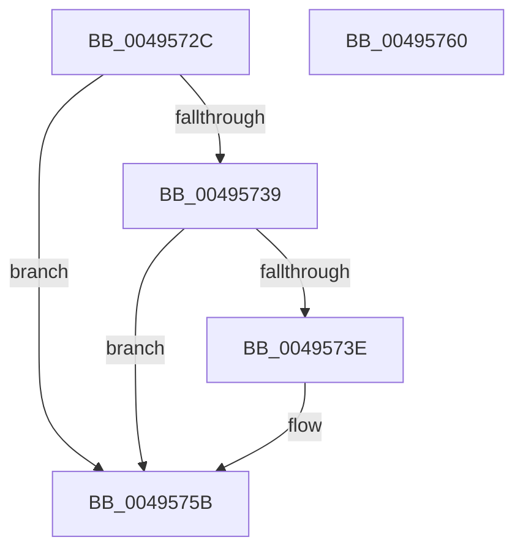

# ProcessForExeModule

- RVA: `0x0049572C`–`0x00495761` (길이 `53` bytes)
- VA: `0x000000014049572C`
- 실행 섹션: `.text`
- PDB 이름 있음: `예`; PDB Function 태그: `아니요`
- unwind 정보 RVA: `0x0005C788`
- 디코드: `15`개 명령, `53/53` bytes 표시
- 미해석 바이트: `0` (있으면 어셈블리에 `.byte`로 보존)

> 이 문서는 커널 이미지의 기계어와 PDB 기호를 분석해 생성했습니다. 4번과 5번은 함수 원형과 자료형을 바이너리 사용 방식에서 추정한 C 해석이며 원본 소스 복구 결과는 아닙니다.

## 1. Dependencies

- 직접 호출 지점: **1**; 고유 호출 대상: **1**
- 직접 호출자로 확인된 함수: **1**
- RIP 상대 이미지 참조: **0**

### Outgoing calls
- `0x00495756` → [EtwpCovSampModuleReference](../../page/8D/EtwpCovSampModuleReference_function_008D9814.md) (function, `0x008D9814`)

### Direct callers
- [EtwpCovSampContextGetModule](../../page/8D/EtwpCovSampContextGetModule_function_008D7FEC.md) at `0x008D819C`
- [EtwpCovSampContextGetModule](../../page/8D/EtwpCovSampContextGetModule_function_008D7FEC.md) at `0x008D8877`
- [EtwpCovSampContextGetModule](../../page/8D/EtwpCovSampContextGetModule_function_008D7FEC.md) at `0x008D8D84`

### Static image references
- 디코드된 RIP-relative 메모리 참조가 없습니다.

## 2. Other-region calls and transfers

- 다른 실행 섹션으로 향하는 call: **1**
  - `0x00495756` → [EtwpCovSampModuleReference](../../page/8D/EtwpCovSampModuleReference_function_008D9814.md) (`.text` → `PAGE`)
- 별도 외부 분기/꼬리 이동을 확인하지 못했습니다.

## 3. Assembly (complete function range)

```asm
0049572C  48 83 EC 28                     sub rsp, 0x28
00495730  F7 41 08 00 04 00 00            test dword ptr [rcx + 8], 0x400
00495737  74 22                           je 0x14049575b
00495739  45 85 C9                        test r9d, r9d
0049573C  74 1D                           je 0x14049575b
0049573E  4C 89 42 30                     mov qword ptr [rdx + 0x30], r8
00495742  41 8B 40 7C                     mov eax, dword ptr [r8 + 0x7c]
00495746  89 42 28                        mov dword ptr [rdx + 0x28], eax
00495749  41 8B 80 80 00 00 00            mov eax, dword ptr [r8 + 0x80]
00495750  89 42 2C                        mov dword ptr [rdx + 0x2c], eax
00495753  49 8B D0                        mov rdx, r8
00495756  E8 B9 40 44 00                  call 0x1408d9814
0049575B  48 83 C4 28                     add rsp, 0x28
0049575F  C3                              ret
00495760  CC                              int3
```

## 4. C-style interpretation (structured pseudocode)

```c
__int64 __fastcall ProcessForExeModule(__int64 a1, __int64 a2, __int64 a3, int a4)
{
    __int64 result;
    __int64 v_rsp;

    v_rsp = (v_rsp) - (40);
    if (((*(unsigned int *)(a1 + 8)) & (0x400ULL)) == 0) goto loc_0049575B;
    if (a4 != 0) {
        *(unsigned __int64 *)(a2 + 48) = a3;
        result = *(unsigned int *)(a3 + 124);
        *(unsigned int *)(a2 + 40) = (unsigned int)(result);
        result = *(unsigned int *)(a3 + 128);
        *(unsigned int *)(a2 + 44) = (unsigned int)(result);
        a2 = a3;
        result = EtwpCovSampModuleReference(a1, a2, a3, a4);
    }
    v_rsp = (v_rsp) + (40);
    return result;
}
```

## 5. (Beta) C Style

```c
int64_t ProcessForExeModule(void *Arg1, void *Arg2, void *Arg3, int32_t Arg4)
{
    uint8_t *arg1 = (uint8_t *)Arg1;
    uint8_t *arg2 = (uint8_t *)Arg2;
    uint8_t *arg3 = (uint8_t *)Arg3;

    int64_t result;
    int64_t local_rsp;

    local_rsp = (local_rsp) - (40);
    if (((*(uint32_t *)(arg1 + 0x8)) & (0x400ULL)) == 0) goto loc_0049575B;
    if (Arg4 != 0) {
        *(void **)(arg2 + 0x30) = Arg3;
        result = *(uint32_t *)(arg3 + 0x7C);
        *(uint32_t *)(arg2 + 0x28) = (uint32_t)(result);
        result = *(uint32_t *)(arg3 + 0x80);
        *(uint32_t *)(arg2 + 0x2C) = (uint32_t)(result);
        Arg2 = Arg3;
        result = EtwpCovSampModuleReference(Arg1, Arg2, Arg3, Arg4);
    }
    local_rsp = (local_rsp) + (40);
    return result;
}
```

### 관측된 메모리 오프셋

구조체 형식이 확인되지 않은 접근은 인자 기준의 오프셋으로만 기록했습니다.

| 기준 인자 | 오프셋 표현 | 폭 (bit) | 접근 |
|---|---:|---:|---|
| `Arg1` | `+ 0x8` | `32` | `R` |
| `Arg2` | `+ 0x28` | `32` | `W` |
| `Arg2` | `+ 0x2C` | `32` | `W` |
| `Arg2` | `+ 0x30` | `64` | `W` |
| `Arg3` | `+ 0x7C` | `32` | `R` |
| `Arg3` | `+ 0x80` | `32` | `R` |

## 6. Execution-region graph

[열기: 2D/3D 그래프와 함수 탐색 컨트롤 패널](../../../control-panel.html?section=text&rva=0x0049572C&view=graph)

- 2D 그래프는 위에서 아래로 흐르고, 3D 그래프는 빈 공간을 드래그해 회전합니다. Shift+드래그는 이동, 휠은 확대·축소, 함수 노드 선택은 대상 보고서 이동입니다.

### Static fallback


