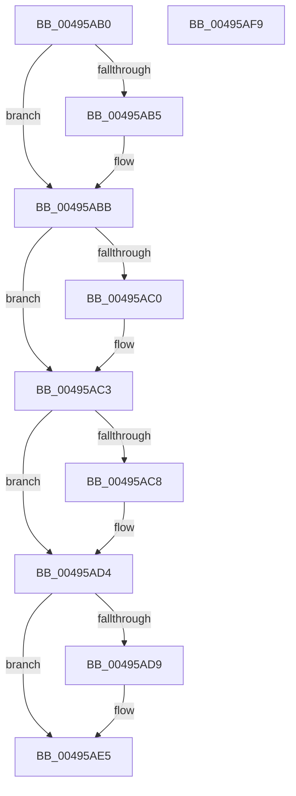

# PsGetVersion

- RVA: `0x00495AB0`–`0x00495AFA` (길이 `74` bytes)
- VA: `0x0000000140495AB0`
- 실행 섹션: `.text`
- PDB 이름 있음: `예`; PDB Function 태그: `아니요`
- unwind 정보 RVA: `0x000DB714`
- 디코드: `21`개 명령, `74/74` bytes 표시
- 미해석 바이트: `0` (있으면 어셈블리에 `.byte`로 보존)

> 이 문서는 커널 이미지의 기계어와 PDB 기호를 분석해 생성했습니다. 4번과 5번은 함수 원형과 자료형을 바이너리 사용 방식에서 추정한 C 해석이며 원본 소스 복구 결과는 아닙니다.

## 1. Dependencies

- 직접 호출 지점: **0**; 고유 호출 대상: **0**
- 직접 호출자로 확인된 함수: **4**
- RIP 상대 이미지 참조: **2**

### Outgoing calls
- 직접 디코드된 call 명령이 없습니다.

### Direct callers
- [DifPsGetVersionWrapper](../63/DifPsGetVersionWrapper_function_0063AAC0.md) at `0x0063ABB3`
- [Win7PsGetVersion](../../page/74/Win7PsGetVersion_function_0074BA60.md) at `0x0074BA88`
- [Win81PsGetVersion](../../page/74/Win81PsGetVersion_function_0074BB40.md) at `0x0074BB68`
- [Win8PsGetVersion](../../page/74/Win8PsGetVersion_function_0074BC20.md) at `0x0074BC48`

### Static image references
- `0x00495AC8` → RVA `0x00E0A74C` (`.data`; read)
- `0x00495AD9` → RVA `0x00FC41B0` (`.data`; read)

## 2. Other-region calls and transfers

- 다른 실행 섹션으로 향하는 call: **0**
- 별도 외부 분기/꼬리 이동을 확인하지 못했습니다.

## 3. Assembly (complete function range)

```asm
00495AB0  48 85 C9                        test rcx, rcx
00495AB3  74 06                           je 0x140495abb
00495AB5  C7 01 0A 00 00 00               mov dword ptr [rcx], 0xa
00495ABB  48 85 D2                        test rdx, rdx
00495ABE  74 03                           je 0x140495ac3
00495AC0  83 22 00                        and dword ptr [rdx], 0
00495AC3  4D 85 C0                        test r8, r8
00495AC6  74 0C                           je 0x140495ad4
00495AC8  8B 05 7E 4C 97 00               mov eax, dword ptr [rip + 0x974c7e]
00495ACE  0F B7 C8                        movzx ecx, ax
00495AD1  41 89 08                        mov dword ptr [r8], ecx
00495AD4  4D 85 C9                        test r9, r9
00495AD7  74 0C                           je 0x140495ae5
00495AD9  0F 10 05 D0 E6 B2 00            movups xmm0, xmmword ptr [rip + 0xb2e6d0]
00495AE0  F3 41 0F 7F 01                  movdqu xmmword ptr [r9], xmm0
00495AE5  8B 05 61 4C 97 00               mov eax, dword ptr [rip + 0x974c61]
00495AEB  25 00 00 00 F0                  and eax, 0xf0000000
00495AF0  3D 00 00 00 C0                  cmp eax, 0xc0000000
00495AF5  0F 94 C0                        sete al
00495AF8  C3                              ret
00495AF9  CC                              int3
```

## 4. C-style interpretation (structured pseudocode)

```c
__int64 __fastcall PsGetVersion(__int64 a1, __int64 a2, __int64 a3, __int64 a4)
{
    __int64 result;

    if (a1 != 0) {
        *(unsigned int *)(a1) = 10;
    }
    if (a2 != 0) {
    }
    if (a3 != 0) {
        result = *(unsigned int *)(v_rip + 9915518);
        a1 = (unsigned __int16)(result);
        *(unsigned int *)(a3) = (unsigned int)(a1);
    }
    if (a4 != 0) {
        *(unsigned __int64 *)(a4) = v_xmm0;
    }
    result = (unsigned int)(((unsigned int)(*(unsigned int *)(v_rip + 9915489))) & (0xF0000000ULL));
    result = (((unsigned int)(result)) == 0xC0000000ULL) ? 1 : 0;
    return result;
}
```

## 5. (Beta) C Style

```c
int64_t PsGetVersion(int64_t Arg1, int64_t Arg2, int64_t Arg3, int64_t Arg4)
{
    int64_t result;

    if (Arg1 != 0) {
        *(uint32_t *)(Arg1) = 10;
    }
    if (Arg2 != 0) {
    }
    if (Arg3 != 0) {
        result = *(uint32_t *)(v_rip + 0x974C7E);
        Arg1 = (uint16_t)(result);
        *(uint32_t *)(Arg3) = (uint32_t)(Arg1);
    }
    if (Arg4 != 0) {
        *(uint64_t *)(Arg4) = v_xmm0;
    }
    result = (uint32_t)(((uint32_t)(*(uint32_t *)(v_rip + 0x974C61))) & (0xF0000000ULL));
    result = (((uint32_t)(result)) == 0xC0000000ULL) ? 1 : 0;
    return result;
}
```

## 6. Execution-region graph

[열기: 2D/3D 그래프와 함수 탐색 컨트롤 패널](../../../control-panel.html?section=text&rva=0x00495AB0&view=graph)

- 2D 그래프는 위에서 아래로 흐르고, 3D 그래프는 빈 공간을 드래그해 회전합니다. Shift+드래그는 이동, 휠은 확대·축소, 함수 노드 선택은 대상 보고서 이동입니다.

### Static fallback


