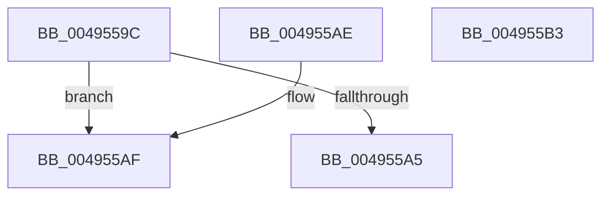

# PspIoRateEntryVolumeCompare

- RVA: `0x0049559C`–`0x004955B4` (길이 `24` bytes)
- VA: `0x000000014049559C`
- 실행 섹션: `.text`
- PDB 이름 있음: `예`; PDB Function 태그: `아니요`
- unwind 정보 RVA: `0x000DB714`
- 디코드: `11`개 명령, `24/24` bytes 표시
- 미해석 바이트: `0` (있으면 어셈블리에 `.byte`로 보존)

> 이 문서는 커널 이미지의 기계어와 PDB 기호를 분석해 생성했습니다. 4번과 5번은 함수 원형과 자료형을 바이너리 사용 방식에서 추정한 C 해석이며 원본 소스 복구 결과는 아닙니다.

## 1. Dependencies

- 직접 호출 지점: **0**; 고유 호출 대상: **0**
- 직접 호출자로 확인된 함수: **3**
- RIP 상대 이미지 참조: **0**

### Outgoing calls
- 직접 디코드된 call 명령이 없습니다.

### Direct callers
- [PspJobIoRateVolumeEntryInsert](../5E/PspJobIoRateVolumeEntryInsert_function_005E39C8.md) at `0x005E3A29`
- [PspJobIoRateVolumeEntryReference](../5E/PspJobIoRateVolumeEntryReference_function_005E3AA8.md) at `0x005E3B01`
- [PspJobIoRateVolumeEntryRemove](../5E/PspJobIoRateVolumeEntryRemove_function_005E3B6C.md) at `0x005E3BC7`

### Static image references
- 디코드된 RIP-relative 메모리 참조가 없습니다.

## 2. Other-region calls and transfers

- 다른 실행 섹션으로 향하는 call: **0**
- 별도 외부 분기/꼬리 이동을 확인하지 못했습니다.

## 3. Assembly (complete function range)

```asm
0049559C  4C 8B 42 18                     mov r8, qword ptr [rdx + 0x18]
004955A0  49 3B C8                        cmp rcx, r8
004955A3  72 0A                           jb 0x1404955af
004955A5  33 C0                           xor eax, eax
004955A7  49 3B C8                        cmp rcx, r8
004955AA  0F 97 C0                        seta al
004955AD  C3                              ret
004955AE  CC                              int3
004955AF  83 C8 FF                        or eax, 0xffffffff
004955B2  C3                              ret
004955B3  CC                              int3
```

## 4. C-style interpretation (structured pseudocode)

```c
__int64 __fastcall PspIoRateEntryVolumeCompare(__int64 a1, __int64 a2)
{
    __int64 result;

    if (a1 < (*(unsigned __int64 *)(a2 + 24))) goto loc_004955AF;
    result = 0;
    result = (a1 > (*(unsigned __int64 *)(a2 + 24))) ? 1 : 0;
    return result;
loc_004955AF:
    result = (unsigned int)((result) | (0xFFFFFFFFULL));
    return result;
}
```

## 5. (Beta) C Style

```c
int64_t PspIoRateEntryVolumeCompare(int64_t Arg1, void *Arg2)
{
    uint8_t *arg2 = (uint8_t *)Arg2;

    int64_t result;

    if (Arg1 < (*(uint64_t *)(arg2 + 0x18))) goto loc_004955AF;
    result = 0;
    result = (Arg1 > (*(uint64_t *)(arg2 + 0x18))) ? 1 : 0;
    return result;
loc_004955AF:
    result = (uint32_t)((result) | (0xFFFFFFFFULL));
    return result;
}
```

### 관측된 메모리 오프셋

구조체 형식이 확인되지 않은 접근은 인자 기준의 오프셋으로만 기록했습니다.

| 기준 인자 | 오프셋 표현 | 폭 (bit) | 접근 |
|---|---:|---:|---|
| `Arg2` | `+ 0x18` | `64` | `R` |

## 6. Execution-region graph

[열기: 2D/3D 그래프와 함수 탐색 컨트롤 패널](../../../control-panel.html?section=text&rva=0x0049559C&view=graph)

- 2D 그래프는 위에서 아래로 흐르고, 3D 그래프는 빈 공간을 드래그해 회전합니다. Shift+드래그는 이동, 휠은 확대·축소, 함수 노드 선택은 대상 보고서 이동입니다.

### Static fallback


