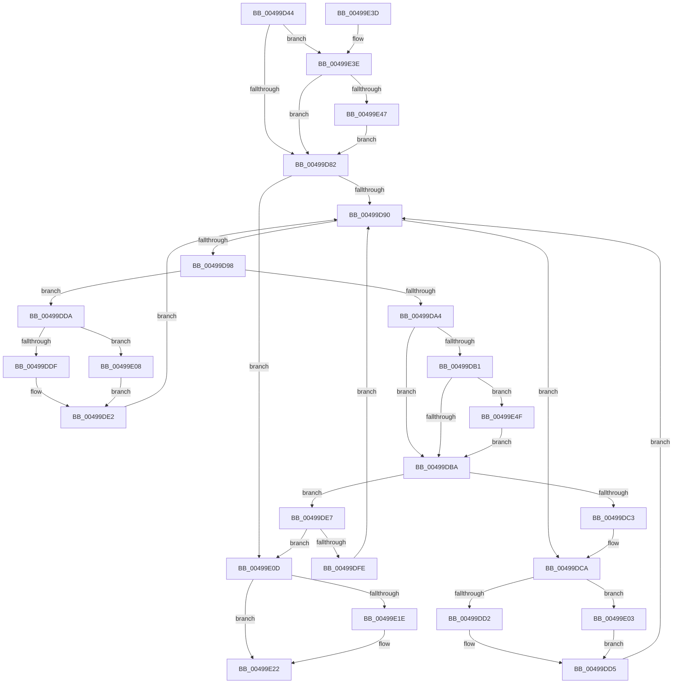

# PspJobIoRateVolumeEntryRemoveAll

- RVA: `0x00499D44`–`0x00499E57` (길이 `275` bytes)
- VA: `0x0000000140499D44`
- 실행 섹션: `.text`
- PDB 이름 있음: `예`; PDB Function 태그: `아니요`
- unwind 정보 RVA: `0x00093A14`
- 디코드: `82`개 명령, `275/275` bytes 표시
- 미해석 바이트: `0` (있으면 어셈블리에 `.byte`로 보존)

> 이 문서는 커널 이미지의 기계어와 PDB 기호를 분석해 생성했습니다. 4번과 5번은 함수 원형과 자료형을 바이너리 사용 방식에서 추정한 C 해석이며 원본 소스 복구 결과는 아닙니다.

## 1. Dependencies

- 직접 호출 지점: **2**; 고유 호출 대상: **2**
- 직접 호출자로 확인된 함수: **1**
- RIP 상대 이미지 참조: **0**

### Outgoing calls
- `0x00499D63` → [ExAcquireSpinLockExclusive](../24/ExAcquireSpinLockExclusive_function_00248690.md) (function, `0x00248690`)
- `0x00499E28` → [ExReleaseSpinLockExclusive](../2C/ExReleaseSpinLockExclusive_function_002C0EF0.md) (function, `0x002C0EF0`)

### Direct callers
- [PspJobIoRateControlDisable](../../page/A7/PspJobIoRateControlDisable_function_00A76854.md) at `0x00A76888`

### Static image references
- 디코드된 RIP-relative 메모리 참조가 없습니다.

## 2. Other-region calls and transfers

- 다른 실행 섹션으로 향하는 call: **0**
- 별도 외부 분기/꼬리 이동을 확인하지 못했습니다.

## 3. Assembly (complete function range)

```asm
00499D44  48 89 5C 24 10                  mov qword ptr [rsp + 0x10], rbx
00499D49  48 89 74 24 18                  mov qword ptr [rsp + 0x18], rsi
00499D4E  57                              push rdi
00499D4F  48 83 EC 20                     sub rsp, 0x20
00499D53  48 8D B1 98 06 00 00            lea rsi, [rcx + 0x698]
00499D5A  48 8B D9                        mov rbx, rcx
00499D5D  48 8B CE                        mov rcx, rsi
00499D60  48 8B FA                        mov rdi, rdx
00499D63  E8 28 E9 DA FF                  call 0x140248690
00499D68  48 81 C3 A0 06 00 00            add rbx, 0x6a0
00499D6F  45 33 DB                        xor r11d, r11d
00499D72  44 8A D0                        mov r10b, al
00499D75  F6 43 08 01                     test byte ptr [rbx + 8], 1
00499D79  48 8B 0B                        mov rcx, qword ptr [rbx]
00499D7C  0F 85 BC 00 00 00               jne 0x140499e3e
00499D82  44 0F B6 43 08                  movzx r8d, byte ptr [rbx + 8]
00499D87  41 83 E0 01                     and r8d, 1
00499D8B  48 85 C9                        test rcx, rcx
00499D8E  74 7D                           je 0x140499e0d
00499D90  48 8B 01                        mov rax, qword ptr [rcx]
00499D93  48 85 C0                        test rax, rax
00499D96  75 32                           jne 0x140499dca
00499D98  4C 8D 49 08                     lea r9, [rcx + 8]
00499D9C  49 8B 01                        mov rax, qword ptr [r9]
00499D9F  48 85 C0                        test rax, rax
00499DA2  75 36                           jne 0x140499dda
00499DA4  48 8B 41 10                     mov rax, qword ptr [rcx + 0x10]
00499DA8  48 83 E0 FC                     and rax, 0xfffffffffffffffc
00499DAC  45 85 C0                        test r8d, r8d
00499DAF  74 09                           je 0x140499dba
00499DB1  48 85 C0                        test rax, rax
00499DB4  0F 85 95 00 00 00               jne 0x140499e4f
00499DBA  48 8B 57 08                     mov rdx, qword ptr [rdi + 8]
00499DBE  48 39 3A                        cmp qword ptr [rdx], rdi
00499DC1  74 24                           je 0x140499de7
00499DC3  B9 03 00 00 00                  mov ecx, 3
00499DC8  CD 29                           int 0x29
00499DCA  48 8B D1                        mov rdx, rcx
00499DCD  45 85 C0                        test r8d, r8d
00499DD0  74 31                           je 0x140499e03
00499DD2  48 33 C8                        xor rcx, rax
00499DD5  4C 89 1A                        mov qword ptr [rdx], r11
00499DD8  EB B6                           jmp 0x140499d90
00499DDA  45 85 C0                        test r8d, r8d
00499DDD  74 29                           je 0x140499e08
00499DDF  48 33 C8                        xor rcx, rax
00499DE2  4D 89 19                        mov qword ptr [r9], r11
00499DE5  EB A9                           jmp 0x140499d90
00499DE7  48 89 39                        mov qword ptr [rcx], rdi
00499DEA  49 89 11                        mov qword ptr [r9], rdx
00499DED  48 89 0A                        mov qword ptr [rdx], rcx
00499DF0  48 89 4F 08                     mov qword ptr [rdi + 8], rcx
00499DF4  48 83 49 10 FF                  or qword ptr [rcx + 0x10], 0xffffffffffffffff
00499DF9  48 85 C0                        test rax, rax
00499DFC  74 0F                           je 0x140499e0d
00499DFE  48 8B C8                        mov rcx, rax
00499E01  EB 8D                           jmp 0x140499d90
00499E03  48 8B C8                        mov rcx, rax
00499E06  EB CD                           jmp 0x140499dd5
00499E08  48 8B C8                        mov rcx, rax
00499E0B  EB D5                           jmp 0x140499de2
00499E0D  0F B6 43 08                     movzx eax, byte ptr [rbx + 8]
00499E11  4C 89 1B                        mov qword ptr [rbx], r11
00499E14  4C 89 5B 08                     mov qword ptr [rbx + 8], r11
00499E18  0F BA E0 00                     bt eax, 0
00499E1C  73 04                           jae 0x140499e22
00499E1E  C6 43 08 01                     mov byte ptr [rbx + 8], 1
00499E22  41 8A D2                        mov dl, r10b
00499E25  48 8B CE                        mov rcx, rsi
00499E28  E8 C3 70 E2 FF                  call 0x1402c0ef0
00499E2D  48 8B 5C 24 38                  mov rbx, qword ptr [rsp + 0x38]
00499E32  48 8B 74 24 40                  mov rsi, qword ptr [rsp + 0x40]
00499E37  48 83 C4 20                     add rsp, 0x20
00499E3B  5F                              pop rdi
00499E3C  C3                              ret
00499E3D  CC                              int3
00499E3E  48 85 C9                        test rcx, rcx
00499E41  0F 84 3B FF FF FF               je 0x140499d82
00499E47  48 33 CB                        xor rcx, rbx
00499E4A  E9 33 FF FF FF                  jmp 0x140499d82
00499E4F  48 33 C1                        xor rax, rcx
00499E52  E9 63 FF FF FF                  jmp 0x140499dba
```

## 4. C-style interpretation (structured pseudocode)

```c
__int64 __fastcall PspJobIoRateVolumeEntryRemoveAll(__int64 a1, __int64 a2)
{
    __int64 result;
    __int64 v_r11;
    __int64 v_rbx;
    __int64 v_rsp;
    unsigned __int64 v_stack_p10;
    unsigned __int64 v_stack_p18;

    v_stack_p10 = v_rbx;
    v_stack_p18 = v_rsi;
    v_rsp = (v_rsp) - (32);
    result = ExAcquireSpinLockExclusive(a1 + 1688, a2, a3, a4);
    v_rbx = (a1) + (0x6A0ULL);
    v_r11 = 0;
    if (((*(unsigned __int8 *)(v_rbx + 8)) & (1)) != 0) goto loc_00499E3E;
loc_00499D82:
    a3 = (unsigned int)((*(unsigned __int8 *)(v_rbx + 8)) & (1));
    if (*(unsigned __int64 *)(v_rbx) == 0) goto loc_00499E0D;
loc_00499D90:
    if (*(unsigned __int64 *)(*(unsigned __int64 *)(v_rbx)) != 0) goto loc_00499DCA;
    if (*(unsigned __int64 *)(*(unsigned __int64 *)(v_rbx) + 8) != 0) goto loc_00499DDA;
    result = (*(unsigned __int64 *)(*(unsigned __int64 *)(v_rbx) + 16)) & (-4);
    if ((unsigned int)(a3) == 0) goto loc_00499DBA;
    if (result != 0) goto loc_00499E4F;
loc_00499DBA:
    if ((*(unsigned __int64 *)(*(unsigned __int64 *)(a2 + 8))) == a2) goto loc_00499DE7;
loc_00499DCA:
    if ((unsigned int)(a3) == 0) goto loc_00499E03;
    a1 = (3) ^ (result);
loc_00499DD5:
    *(unsigned __int64 *)(3) = 0;
    goto loc_00499D90;
loc_00499DDA:
    if ((unsigned int)(a3) == 0) goto loc_00499E08;
    a1 = (a1) ^ (result);
loc_00499DE2:
    *(unsigned __int64 *)(*(unsigned __int64 *)(v_rbx) + 8) = 0;
    goto loc_00499D90;
loc_00499DE7:
    *(unsigned __int64 *)(a1) = a2;
    *(unsigned __int64 *)(*(unsigned __int64 *)(v_rbx) + 8) = 3;
    *(unsigned __int64 *)(3) = a1;
    *(unsigned __int64 *)(a2 + 8) = a1;
    if (result == 0) goto loc_00499E0D;
    goto loc_00499D90;
loc_00499E03:
    goto loc_00499DD5;
loc_00499E08:
    goto loc_00499DE2;
loc_00499E0D:
    *(unsigned __int64 *)(v_rbx) = 0;
    *(unsigned __int64 *)(v_rbx + 8) = 0;
    if (!(condition_is_above_or_equal)) {
        *(unsigned __int8 *)(v_rbx + 8) = 1;
    }
    result = ExReleaseSpinLockExclusive(a1 + 1688, (unsigned __int8)((unsigned __int8)(result)), a3, *(unsigned __int64 *)(v_rbx) + 8);
    v_rsp = (v_rsp) + (32);
    return result;
loc_00499E3E:
    if (a1 + 1688 == 0) goto loc_00499D82;
    a1 = (a1 + 1688) ^ (v_stack_p10);
    goto loc_00499D82;
loc_00499E4F:
    result = (result) ^ (a1);
    goto loc_00499DBA;
}
```

## 5. (Beta) C Style

```c
int64_t PspJobIoRateVolumeEntryRemoveAll(void *Arg1, void *Arg2)
{
    uint8_t *arg1 = (uint8_t *)Arg1;
    uint8_t *arg2 = (uint8_t *)Arg2;

    int64_t result;
    int64_t local_r11;
    int64_t local_rbx;
    int64_t local_rsp;
    uint64_t v_stack_p10;
    uint64_t v_stack_p18;

    v_stack_p10 = local_rbx;
    v_stack_p18 = local_rsi;
    local_rsp = (local_rsp) - (32);
    result = ExAcquireSpinLockExclusive(Arg1 + 1688, Arg2, a3, a4);
    local_rbx = (Arg1) + (0x6A0ULL);
    local_r11 = 0;
    if (((*(uint8_t *)(local_rbx + 0x8)) & (1)) != 0) goto loc_00499E3E;
loc_00499D82:
    a3 = (uint32_t)((*(uint8_t *)(local_rbx + 0x8)) & (1));
    if (*(uint64_t *)(local_rbx) == 0) goto loc_00499E0D;
loc_00499D90:
    if (*(uint64_t *)(*(uint64_t *)(local_rbx)) != 0) goto loc_00499DCA;
    if (*(uint64_t *)(*(uint64_t *)(local_rbx) + 0x8) != 0) goto loc_00499DDA;
    result = (*(uint64_t *)(*(uint64_t *)(local_rbx) + 0x10)) & (-4);
    if ((uint32_t)(a3) == 0) goto loc_00499DBA;
    if (result != 0) goto loc_00499E4F;
loc_00499DBA:
    if ((*(uint64_t *)(*(uint64_t *)(arg2 + 0x8))) == Arg2) goto loc_00499DE7;
loc_00499DCA:
    if ((uint32_t)(a3) == 0) goto loc_00499E03;
    Arg1 = (3) ^ (result);
loc_00499DD5:
    *(uint64_t *)(3) = 0;
    goto loc_00499D90;
loc_00499DDA:
    if ((uint32_t)(a3) == 0) goto loc_00499E08;
    Arg1 = (Arg1) ^ (result);
loc_00499DE2:
    *(uint64_t *)(*(uint64_t *)(local_rbx) + 0x8) = 0;
    goto loc_00499D90;
loc_00499DE7:
    *(void **)(arg1) = Arg2;
    *(uint64_t *)(*(uint64_t *)(local_rbx) + 0x8) = 3;
    *(void **)(3) = Arg1;
    *(void **)(arg2 + 0x8) = Arg1;
    if (result == 0) goto loc_00499E0D;
    goto loc_00499D90;
loc_00499E03:
    goto loc_00499DD5;
loc_00499E08:
    goto loc_00499DE2;
loc_00499E0D:
    *(uint64_t *)(local_rbx) = 0;
    *(uint64_t *)(local_rbx + 0x8) = 0;
    if (!(condition_is_above_or_equal)) {
        *(uint8_t *)(local_rbx + 0x8) = 1;
    }
    result = ExReleaseSpinLockExclusive(Arg1 + 1688, (uint8_t)((uint8_t)(result)), a3, *(uint64_t *)(local_rbx) + 8);
    local_rsp = (local_rsp) + (32);
    return result;
loc_00499E3E:
    if (Arg1 + 1688 == 0) goto loc_00499D82;
    Arg1 = (Arg1 + 1688) ^ (v_stack_p10);
    goto loc_00499D82;
loc_00499E4F:
    result = (result) ^ (Arg1);
    goto loc_00499DBA;
}
```

### 관측된 메모리 오프셋

구조체 형식이 확인되지 않은 접근은 인자 기준의 오프셋으로만 기록했습니다.

| 기준 인자 | 오프셋 표현 | 폭 (bit) | 접근 |
|---|---:|---:|---|
| `Arg1` | `+ 0x0` | `64` | `R` |
| `Arg1` | `+ 0x0` | `64` | `W` |
| `Arg1` | `+ 0x8` | `8` | `R` |
| `Arg1` | `+ 0x8` | `8` | `W` |
| `Arg1` | `+ 0x8` | `64` | `W` |
| `Arg1` | `+ 0x698` | `64` | `R` |
| `Arg2` | `+ 0x8` | `64` | `R` |
| `Arg2` | `+ 0x8` | `64` | `W` |

## 6. Execution-region graph

[열기: 2D/3D 그래프와 함수 탐색 컨트롤 패널](../../../control-panel.html?section=text&rva=0x00499D44&view=graph)

- 2D 그래프는 위에서 아래로 흐르고, 3D 그래프는 빈 공간을 드래그해 회전합니다. Shift+드래그는 이동, 휠은 확대·축소, 함수 노드 선택은 대상 보고서 이동입니다.

### Static fallback


