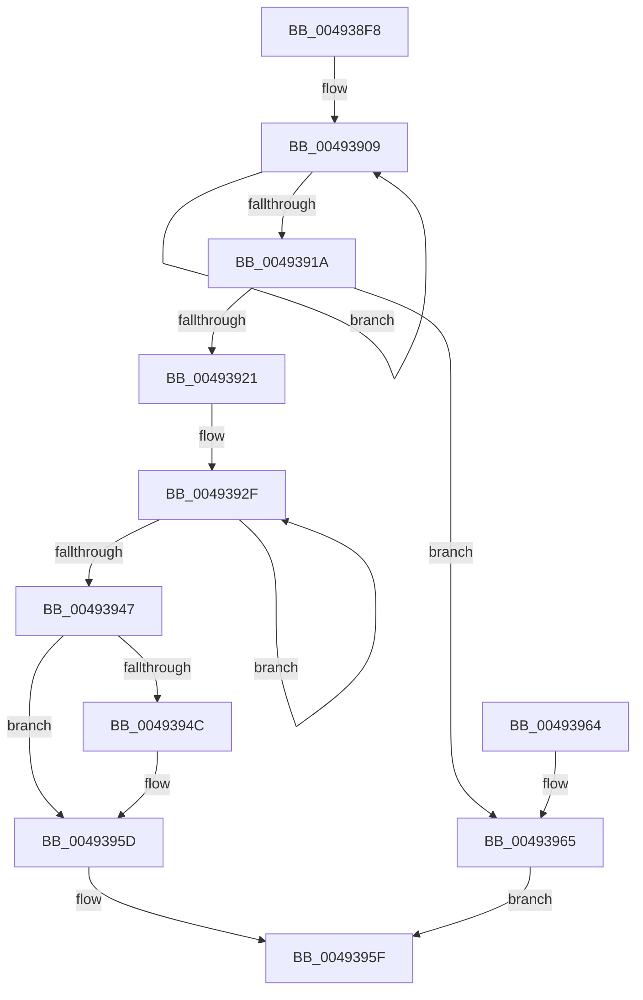

# PspRequestDeferredJobNotification

- RVA: `0x004938F8`–`0x00493969` (길이 `113` bytes)
- VA: `0x00000001404938F8`
- 실행 섹션: `.text`
- PDB 이름 있음: `예`; PDB Function 태그: `아니요`
- unwind 정보 RVA: `0x00069B1C`
- 디코드: `27`개 명령, `113/113` bytes 표시
- 미해석 바이트: `0` (있으면 어셈블리에 `.byte`로 보존)

> 이 문서는 커널 이미지의 기계어와 PDB 기호를 분석해 생성했습니다. 4번과 5번은 함수 원형과 자료형을 바이너리 사용 방식에서 추정한 C 해석이며 원본 소스 복구 결과는 아닙니다.

## 1. Dependencies

- 직접 호출 지점: **1**; 고유 호출 대상: **1**
- 직접 호출자로 확인된 함수: **3**
- RIP 상대 이미지 참조: **2**

### Outgoing calls
- `0x00493958` → [ExQueueWorkItem](../2F/ExQueueWorkItem_function_002F9520.md) (function, `0x002F9520`)

### Direct callers
- [PspJobCycleTimeNotificationDpcRoutine](../5E/PspJobCycleTimeNotificationDpcRoutine_function_005E3980.md) at `0x005E39A2`
- [PspChargeJobWakeCounter](../../page/9D/PspChargeJobWakeCounter_function_009D5D20.md) at `0x009D5FA9`
- [PspSendWakeNotification](../../page/9F/PspSendWakeNotification_function_009FB394.md) at `0x009FB40B`

### Static image references
- `0x00493921` → RVA `0x00F06598` (`.data`; read)
- `0x00493951` → RVA `0x00F065C0` (`.data`; read)

## 2. Other-region calls and transfers

- 다른 실행 섹션으로 향하는 call: **0**
- 별도 외부 분기/꼬리 이동을 확인하지 못했습니다.

## 3. Assembly (complete function range)

```asm
004938F8  48 83 EC 28                     sub rsp, 0x28
004938FC  0F 0D 89 10 06 00 00            prefetchw byte ptr [rcx + 0x610]
00493903  8B 81 10 06 00 00               mov eax, dword ptr [rcx + 0x610]
00493909  44 8B C0                        mov r8d, eax
0049390C  44 0B C2                        or r8d, edx
0049390F  F0 44 0F B1 81 10 06 00 00      lock cmpxchg dword ptr [rcx + 0x610], r8d
00493918  75 EF                           jne 0x140493909
0049391A  A9 00 20 02 00                  test eax, 0x22000
0049391F  75 44                           jne 0x140493965
00493921  0F 0D 0D 70 2C A7 00            prefetchw byte ptr [rip + 0xa72c70]
00493928  48 8B 05 69 2C A7 00            mov rax, qword ptr [rip + 0xa72c69]
0049392F  48 8B D0                        mov rdx, rax
00493932  48 89 81 B0 04 00 00            mov qword ptr [rcx + 0x4b0], rax
00493939  F0 48 0F B1 0D 56 2C A7 00      lock cmpxchg qword ptr [rip + 0xa72c56], rcx
00493942  48 3B C2                        cmp rax, rdx
00493945  75 E8                           jne 0x14049392f
00493947  48 85 D2                        test rdx, rdx
0049394A  75 11                           jne 0x14049395d
0049394C  BA 03 00 00 00                  mov edx, 3
00493951  48 8D 0D 68 2C A7 00            lea rcx, [rip + 0xa72c68]
00493958  E8 C3 5B E6 FF                  call 0x1402f9520
0049395D  B0 01                           mov al, 1
0049395F  48 83 C4 28                     add rsp, 0x28
00493963  C3                              ret
00493964  CC                              int3
00493965  32 C0                           xor al, al
00493967  EB F6                           jmp 0x14049395f
```

## 4. C-style interpretation (structured pseudocode)

```c
__int64 __fastcall PspRequestDeferredJobNotification(__int64 a1, int a2)
{
    __int64 result;
    __int64 v_rsp;

    v_rsp = (v_rsp) - (40);
loc_00493909:
    a3 = (unsigned int)(((unsigned int)((unsigned int)((unsigned int)(*(unsigned int *)(a1 + 1552))))) | (a2));
    if (condition_is_not_equal) goto loc_00493909;
    if ((((unsigned int)((unsigned int)(*(unsigned int *)(a1 + 1552)))) & (0x22000ULL)) != 0) goto loc_00493965;
loc_0049392F:
    *(unsigned __int64 *)(a1 + 1200) = *(unsigned __int64 *)(v_rip + 10955881);
    if ((*(unsigned __int64 *)(v_rip + 10955881)) != (*(unsigned __int64 *)(v_rip + 10955881))) goto loc_0049392F;
    result = *(unsigned __int64 *)(v_rip + 10955881);
    if (*(unsigned __int64 *)(v_rip + 10955881) == 0) {
        a2 = 3;
        a1 = v_rip + 10955880;
        result = ExQueueWorkItem(a1, a2, a3, a4);
    }
loc_0049395F:
    v_rsp = (v_rsp) + (40);
    return 1;
loc_00493965:
    result = 0;
    goto loc_0049395F;
}
```

## 5. (Beta) C Style

```c
int64_t PspRequestDeferredJobNotification(void *Arg1, int32_t Arg2)
{
    uint8_t *arg1 = (uint8_t *)Arg1;

    int64_t result;
    int64_t local_rsp;

    local_rsp = (local_rsp) - (40);
loc_00493909:
    a3 = (uint32_t)(((uint32_t)((uint32_t)((uint32_t)(*(uint32_t *)(arg1 + 0x610))))) | (Arg2));
    if (condition_is_not_equal) goto loc_00493909;
    if ((((uint32_t)((uint32_t)(*(uint32_t *)(arg1 + 0x610)))) & (0x22000ULL)) != 0) goto loc_00493965;
loc_0049392F:
    *(uint64_t *)(arg1 + 0x4B0) = *(uint64_t *)(v_rip + 0xA72C69);
    if ((*(uint64_t *)(v_rip + 0xA72C69)) != (*(uint64_t *)(v_rip + 0xA72C69))) goto loc_0049392F;
    result = *(uint64_t *)(v_rip + 0xA72C69);
    if (*(uint64_t *)(v_rip + 0xA72C69) == 0) {
        Arg2 = 3;
        Arg1 = v_rip + 10955880;
        result = ExQueueWorkItem(Arg1, Arg2, a3, a4);
    }
loc_0049395F:
    local_rsp = (local_rsp) + (40);
    return 1;
loc_00493965:
    result = 0;
    goto loc_0049395F;
}
```

### 관측된 메모리 오프셋

구조체 형식이 확인되지 않은 접근은 인자 기준의 오프셋으로만 기록했습니다.

| 기준 인자 | 오프셋 표현 | 폭 (bit) | 접근 |
|---|---:|---:|---|
| `Arg1` | `+ 0x4B0` | `64` | `W` |
| `Arg1` | `+ 0x610` | `8` | `R` |
| `Arg1` | `+ 0x610` | `32` | `R` |

## 6. Execution-region graph

[열기: 2D/3D 그래프와 함수 탐색 컨트롤 패널](../../../control-panel.html?section=text&rva=0x004938F8&view=graph)

- 2D 그래프는 위에서 아래로 흐르고, 3D 그래프는 빈 공간을 드래그해 회전합니다. Shift+드래그는 이동, 휠은 확대·축소, 함수 노드 선택은 대상 보고서 이동입니다.

### Static fallback


