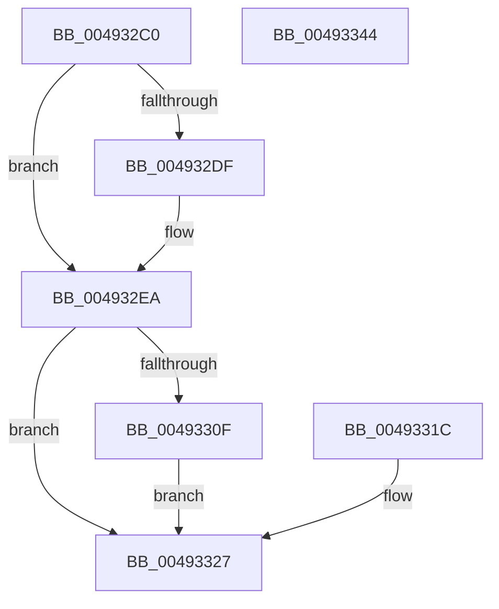

# PspSystemThreadStartup

- RVA: `0x004932C0`–`0x00493345` (길이 `133` bytes)
- VA: `0x00000001404932C0`
- 실행 섹션: `.text`
- PDB 이름 있음: `예`; PDB Function 태그: `아니요`
- unwind 정보 RVA: `0x000B30CC`
- 디코드: `38`개 명령, `133/133` bytes 표시
- 미해석 바이트: `0` (있으면 어셈블리에 `.byte`로 보존)

> 이 문서는 커널 이미지의 기계어와 PDB 기호를 분석해 생성했습니다. 4번과 5번은 함수 원형과 자료형을 바이너리 사용 방식에서 추정한 C 해석이며 원본 소스 복구 결과는 아닙니다.

## 1. Dependencies

- 직접 호출 지점: **5**; 고유 호출 대상: **5**
- 직접 호출자로 확인된 함수: **0**
- RIP 상대 이미지 참조: **1**

### Outgoing calls
- `0x004932E5` → [KiLowerIrqlProcessIrqlFlags](../4F/KiLowerIrqlProcessIrqlFlags_function_004F5698.md) (function, `0x004F5698`)
- `0x004932FA` → [PspDisablePrimaryTokenExchange](../../page/8D/PspDisablePrimaryTokenExchange_function_008D5C10.md) (function, `0x008D5C10`)
- `0x00493315` → [guard_dispatch_icall](../6B/guard_dispatch_icall_function_006BAAD0.md) (function, `0x006BAAD0`)
- `0x00493321` → [KeBugCheck](../4F/KeBugCheck_function_004FD640.md) (function, `0x004FD640`)
- `0x0049332F` → [PspTerminateThreadByPointer](../../page/90/PspTerminateThreadByPointer_function_00905E80.md) (function, `0x00905E80`)

### Direct callers
- 이 함수 시작 RVA로 연결되는 직접 call은 확인되지 않았습니다. 간접 호출은 완전히 역산할 수 없습니다.

### Static image references
- `0x004932D7` → RVA `0x00FC6D20` (`ALMOSTRO`; read)

## 2. Other-region calls and transfers

- 다른 실행 섹션으로 향하는 call: **2**
  - `0x004932FA` → [PspDisablePrimaryTokenExchange](../../page/8D/PspDisablePrimaryTokenExchange_function_008D5C10.md) (`.text` → `PAGE`)
  - `0x0049332F` → [PspTerminateThreadByPointer](../../page/90/PspTerminateThreadByPointer_function_00905E80.md) (`.text` → `PAGE`)
- 별도 외부 분기/꼬리 이동을 확인하지 못했습니다.

## 3. Assembly (complete function range)

```asm
004932C0  48 89 5C 24 08                  mov qword ptr [rsp + 8], rbx
004932C5  48 89 74 24 10                  mov qword ptr [rsp + 0x10], rsi
004932CA  57                              push rdi
004932CB  48 83 EC 40                     sub rsp, 0x40
004932CF  48 8B FA                        mov rdi, rdx
004932D2  48 8B F1                        mov rsi, rcx
004932D5  33 DB                           xor ebx, ebx
004932D7  39 1D 43 3A B3 00               cmp dword ptr [rip + 0xb33a43], ebx
004932DD  74 0B                           je 0x1404932ea
004932DF  44 0F 20 C1                     mov rcx, cr8
004932E3  33 D2                           xor edx, edx
004932E5  E8 AE 23 06 00                  call 0x1404f5698
004932EA  44 0F 22 C3                     mov cr8, rbx
004932EE  65 48 8B 1C 25 88 01 00 00      mov rbx, qword ptr gs:[0x188]
004932F7  48 8B CB                        mov rcx, rbx
004932FA  E8 11 29 44 00                  call 0x1408d5c10
004932FF  8B 83 A0 05 00 00               mov eax, dword ptr [rbx + 0x5a0]
00493305  83 F0 01                        xor eax, 1
00493308  83 E0 03                        and eax, 3
0049330B  3C 03                           cmp al, 3
0049330D  75 18                           jne 0x140493327
0049330F  48 8B CF                        mov rcx, rdi
00493312  48 8B C6                        mov rax, rsi
00493315  E8 B6 77 22 00                  call 0x1406baad0
0049331A  EB 0B                           jmp 0x140493327
0049331C  B9 1E 00 00 00                  mov ecx, 0x1e
00493321  E8 1A A3 06 00                  call 0x1404fd640
00493326  90                              nop
00493327  41 B0 01                        mov r8b, 1
0049332A  33 D2                           xor edx, edx
0049332C  48 8B CB                        mov rcx, rbx
0049332F  E8 4C 2B 47 00                  call 0x140905e80
00493334  48 8B 5C 24 50                  mov rbx, qword ptr [rsp + 0x50]
00493339  48 8B 74 24 58                  mov rsi, qword ptr [rsp + 0x58]
0049333E  48 83 C4 40                     add rsp, 0x40
00493342  5F                              pop rdi
00493343  C3                              ret
00493344  CC                              int3
```

## 4. C-style interpretation (structured pseudocode)

```c
__int64 __fastcall PspSystemThreadStartup(__int64 a1, __int64 a2)
{
    __int64 result;
    __int64 v_rbx;
    __int64 v_rsp;
    unsigned __int64 v_stack_p10;
    unsigned __int64 v_stack_p8;

    v_stack_p8 = v_rbx;
    v_stack_p10 = v_rsi;
    v_rsp = (v_rsp) - (64);
    v_rbx = 0;
    if ((*(unsigned int *)(v_rip + 11745859)) != 0) {
        a1 = v_cr8;
        a2 = 0;
        result = KiLowerIrqlProcessIrqlFlags(a1, a2, a3, a4);
    }
    result = PspDisablePrimaryTokenExchange(*(unsigned __int64 *)(gs_base + (0 + 392)), a2, a3, a4);
    result = (unsigned int)(((unsigned int)(*(unsigned int *)(*(unsigned __int64 *)(gs_base + (0 + 392)) + 1440))) ^ (1));
    result = (unsigned int)((result) & (3));
    if (((unsigned __int8)(result)) != 3) goto loc_00493327;
    result = guard_dispatch_icall(0, a2, a3, a4);
    goto loc_00493327;
loc_00493327:
    a2 = 0;
    result = PspTerminateThreadByPointer(*(unsigned __int64 *)(gs_base + (0 + 392)), a2, 1, a4);
    v_rsp = (v_rsp) + (64);
    return result;
}
```

## 5. (Beta) C Style

```c
int64_t PspSystemThreadStartup(int64_t Arg1, int64_t Arg2)
{
    int64_t result;
    int64_t local_rbx;
    int64_t local_rsp;
    uint64_t v_stack_p10;
    uint64_t v_stack_p8;

    v_stack_p8 = local_rbx;
    v_stack_p10 = local_rsi;
    local_rsp = (local_rsp) - (64);
    local_rbx = 0;
    if ((*(uint32_t *)(v_rip + 0xB33A43)) != 0) {
        Arg1 = v_cr8;
        Arg2 = 0;
        result = KiLowerIrqlProcessIrqlFlags(Arg1, Arg2, a3, a4);
    }
    result = PspDisablePrimaryTokenExchange(*(uint64_t *)(gs_base + (0 + 0x188)), Arg2, a3, a4);
    result = (uint32_t)(((uint32_t)(*(uint32_t *)(*(uint64_t *)(gs_base + (0 + 0x188)) + 0x5A0))) ^ (1));
    result = (uint32_t)((result) & (3));
    if (((uint8_t)(result)) != 3) goto loc_00493327;
    result = guard_dispatch_icall(0, Arg2, a3, a4);
    goto loc_00493327;
loc_00493327:
    Arg2 = 0;
    result = PspTerminateThreadByPointer(*(uint64_t *)(gs_base + (0 + 0x188)), Arg2, 1, a4);
    local_rsp = (local_rsp) + (64);
    return result;
}
```

## 6. Execution-region graph

[열기: 2D/3D 그래프와 함수 탐색 컨트롤 패널](../../../control-panel.html?section=text&rva=0x004932C0&view=graph)

- 2D 그래프는 위에서 아래로 흐르고, 3D 그래프는 빈 공간을 드래그해 회전합니다. Shift+드래그는 이동, 휠은 확대·축소, 함수 노드 선택은 대상 보고서 이동입니다.

### Static fallback


