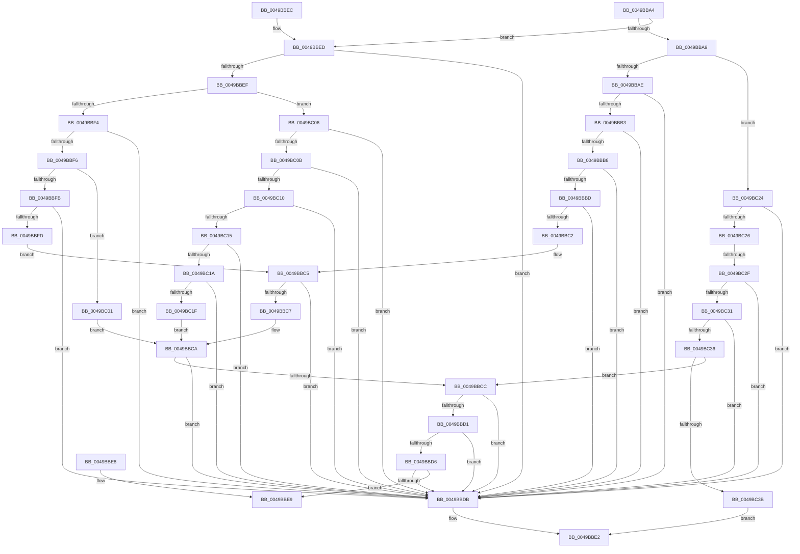

# PspUpdateCalloutParameters

- RVA: `0x0049BBA4`–`0x0049BC3D` (길이 `153` bytes)
- VA: `0x000000014049BBA4`
- 실행 섹션: `.text`
- PDB 이름 있음: `예`; PDB Function 태그: `예`
- unwind 정보 RVA: `0x000DB714`
- 디코드: `62`개 명령, `153/153` bytes 표시
- 미해석 바이트: `0` (있으면 어셈블리에 `.byte`로 보존)

> 이 문서는 커널 이미지의 기계어와 PDB 기호를 분석해 생성했습니다. 4번과 5번은 함수 원형과 자료형을 바이너리 사용 방식에서 추정한 C 해석이며 원본 소스 복구 결과는 아닙니다.

## 1. Dependencies

- 직접 호출 지점: **0**; 고유 호출 대상: **0**
- 직접 호출자로 확인된 함수: **12**
- RIP 상대 이미지 참조: **0**

### Outgoing calls
- 직접 디코드된 call 명령이 없습니다.

### Direct callers
- [KeUserModeCallback](../../page/8E/KeUserModeCallback_function_008E8A00.md) at `0x008E8D28`
- [PfpQueryGpuUtilization](../../page/90/PfpQueryGpuUtilization_function_00903974.md) at `0x00903A21`
- [PspExitLastThread](../../page/90/PspExitLastThread_function_00904184.md) at `0x0090437E`
- [ExpWin32CloseProcedure](../../page/90/ExpWin32CloseProcedure_function_00904FA0.md) at `0x00905037`
- [ExpWin32OkayToCloseProcedure](../../page/90/ExpWin32OkayToCloseProcedure_function_009050A0.md) at `0x00905158`
- [ExpWin32DeleteProcedure](../../page/90/ExpWin32DeleteProcedure_function_009051E0.md) at `0x00905267`
- [ExpWin32OpenProcedure](../../page/90/ExpWin32OpenProcedure_function_009052D0.md) at `0x0090537C`
- [ExpWin32ParseProcedure](../../page/90/ExpWin32ParseProcedure_function_00905400.md) at `0x0090547E`
- [PspExitThread](../../page/90/PspExitThread_function_00905F60.md) at `0x00906235`
- [PsInvokeWin32Callout](../../page/91/PsInvokeWin32Callout_function_009133C0.md) at `0x009133F3`
- [PsConvertToGuiThread](../../page/A2/PsConvertToGuiThread_function_00A2F8B0.md) at `0x00A2FA75`
- [PsConvertToGuiThread](../../page/A2/PsConvertToGuiThread_function_00A2F8B0.md) at `0x00A2FACF`
- [PsApplyDeepFreezeOptimizations](../../page/AA/PsApplyDeepFreezeOptimizations_function_00AA9EDC.md) at `0x00AA9F3C`

### Static image references
- 디코드된 RIP-relative 메모리 참조가 없습니다.

## 2. Other-region calls and transfers

- 다른 실행 섹션으로 향하는 call: **0**
- call이 아닌 외부 분기/꼬리 이동: **1**
  - `0x0049BC29` → `0x006F7D06` (`tail-transfer`)

## 3. Assembly (complete function range)

```asm
0049BBA4  83 F9 18                        cmp ecx, 0x18
0049BBA7  7E 44                           jle 0x14049bbed
0049BBA9  83 F9 23                        cmp ecx, 0x23
0049BBAC  7E 76                           jle 0x14049bc24
0049BBAE  83 E9 24                        sub ecx, 0x24
0049BBB1  74 28                           je 0x14049bbdb
0049BBB3  83 E9 01                        sub ecx, 1
0049BBB6  74 23                           je 0x14049bbdb
0049BBB8  83 E9 01                        sub ecx, 1
0049BBBB  74 1E                           je 0x14049bbdb
0049BBBD  83 E9 01                        sub ecx, 1
0049BBC0  74 19                           je 0x14049bbdb
0049BBC2  83 E9 01                        sub ecx, 1
0049BBC5  74 14                           je 0x14049bbdb
0049BBC7  83 E9 01                        sub ecx, 1
0049BBCA  74 0F                           je 0x14049bbdb
0049BBCC  83 E9 01                        sub ecx, 1
0049BBCF  74 0A                           je 0x14049bbdb
0049BBD1  83 E9 01                        sub ecx, 1
0049BBD4  74 05                           je 0x14049bbdb
0049BBD6  83 F9 01                        cmp ecx, 1
0049BBD9  75 0E                           jne 0x14049bbe9
0049BBDB  44 89 02                        mov dword ptr [rdx], r8d
0049BBDE  4C 89 4A 08                     mov qword ptr [rdx + 8], r9
0049BBE2  B8 01 00 00 00                  mov eax, 1
0049BBE7  C3                              ret
0049BBE8  CC                              int3
0049BBE9  33 C0                           xor eax, eax
0049BBEB  C3                              ret
0049BBEC  CC                              int3
0049BBED  74 EC                           je 0x14049bbdb
0049BBEF  83 F9 0B                        cmp ecx, 0xb
0049BBF2  7F 12                           jg 0x14049bc06
0049BBF4  74 E5                           je 0x14049bbdb
0049BBF6  83 F9 05                        cmp ecx, 5
0049BBF9  7F 06                           jg 0x14049bc01
0049BBFB  74 DE                           je 0x14049bbdb
0049BBFD  85 C9                           test ecx, ecx
0049BBFF  EB C4                           jmp 0x14049bbc5
0049BC01  83 E9 07                        sub ecx, 7
0049BC04  EB C4                           jmp 0x14049bbca
0049BC06  83 E9 0C                        sub ecx, 0xc
0049BC09  74 D0                           je 0x14049bbdb
0049BC0B  83 E9 01                        sub ecx, 1
0049BC0E  74 CB                           je 0x14049bbdb
0049BC10  83 E9 01                        sub ecx, 1
0049BC13  74 C6                           je 0x14049bbdb
0049BC15  83 E9 01                        sub ecx, 1
0049BC18  74 C1                           je 0x14049bbdb
0049BC1A  83 E9 01                        sub ecx, 1
0049BC1D  74 BC                           je 0x14049bbdb
0049BC1F  83 E9 02                        sub ecx, 2
0049BC22  EB A6                           jmp 0x14049bbca
0049BC24  74 B5                           je 0x14049bbdb
0049BC26  83 F9 1E                        cmp ecx, 0x1e
0049BC29  0F 8F D7 C0 25 00               jg 0x1406f7d06
0049BC2F  74 AA                           je 0x14049bbdb
0049BC31  83 E9 19                        sub ecx, 0x19
0049BC34  74 A5                           je 0x14049bbdb
0049BC36  83 E9 01                        sub ecx, 1
0049BC39  75 91                           jne 0x14049bbcc
0049BC3B  EB A5                           jmp 0x14049bbe2
```

## 4. C-style interpretation (structured pseudocode)

```c
__int64 __fastcall PspUpdateCalloutParameters(int a1, __int64 a2, int a3, __int64 a4)
{
    __int64 result;

    if (a1 <= 24) goto loc_0049BBED;
    if (a1 <= 35) goto loc_0049BC24;
    a1 = (unsigned int)((a1) - (36));
    if (condition_is_equal) goto loc_0049BBDB;
    a1 = (unsigned int)((a1) - (1));
    if (condition_is_equal) goto loc_0049BBDB;
    a1 = (unsigned int)((a1) - (1));
    if (condition_is_equal) goto loc_0049BBDB;
    a1 = (unsigned int)((a1) - (1));
    if (condition_is_equal) goto loc_0049BBDB;
    a1 = (unsigned int)((a1) - (1));
loc_0049BBC5:
    if (condition_is_equal) goto loc_0049BBDB;
    a1 = (unsigned int)((a1) - (1));
loc_0049BBCA:
    if (condition_is_equal) goto loc_0049BBDB;
loc_0049BBCC:
    a1 = (unsigned int)((a1) - (1));
    if (condition_is_equal) goto loc_0049BBDB;
    a1 = (unsigned int)((a1) - (1));
    if (condition_is_equal) goto loc_0049BBDB;
    if (a1 != 1) goto loc_0049BBE9;
loc_0049BBDB:
    *(unsigned int *)(a2) = a3;
    *(unsigned __int64 *)(a2 + 8) = a4;
loc_0049BBE2:
    return 1;
loc_0049BBE9:
    result = 0;
    return result;
loc_0049BBED:
    if (condition_is_equal) goto loc_0049BBDB;
    if (a1 > 11) goto loc_0049BC06;
    if (a1 == 11) goto loc_0049BBDB;
    if (a1 > 5) goto loc_0049BC01;
    if (a1 == 5) goto loc_0049BBDB;
    goto loc_0049BBC5;
loc_0049BC01:
    a1 = (unsigned int)((a1) - (7));
    goto loc_0049BBCA;
loc_0049BC06:
    a1 = (unsigned int)((a1) - (12));
    if (condition_is_equal) goto loc_0049BBDB;
    a1 = (unsigned int)((a1) - (1));
    if (condition_is_equal) goto loc_0049BBDB;
    a1 = (unsigned int)((a1) - (1));
    if (condition_is_equal) goto loc_0049BBDB;
    a1 = (unsigned int)((a1) - (1));
    if (condition_is_equal) goto loc_0049BBDB;
    a1 = (unsigned int)((a1) - (1));
    if (condition_is_equal) goto loc_0049BBDB;
    a1 = (unsigned int)((a1) - (2));
    goto loc_0049BBCA;
loc_0049BC24:
    if (condition_is_equal) goto loc_0049BBDB;
    if (a1 == 30) goto loc_0049BBDB;
    a1 = (unsigned int)((a1) - (25));
    if (condition_is_equal) goto loc_0049BBDB;
    a1 = (unsigned int)((a1) - (1));
    if (condition_is_not_equal) goto loc_0049BBCC;
    goto loc_0049BBE2;
}
```

## 5. (Beta) C Style

```c
int64_t PspUpdateCalloutParameters(int32_t Arg1, void *Arg2, int32_t Arg3, int64_t Arg4)
{
    uint8_t *arg2 = (uint8_t *)Arg2;

    int64_t result;

    if (Arg1 <= 24) goto loc_0049BBED;
    if (Arg1 <= 35) goto loc_0049BC24;
    Arg1 = (uint32_t)((Arg1) - (36));
    if (condition_is_equal) goto loc_0049BBDB;
    Arg1 = (uint32_t)((Arg1) - (1));
    if (condition_is_equal) goto loc_0049BBDB;
    Arg1 = (uint32_t)((Arg1) - (1));
    if (condition_is_equal) goto loc_0049BBDB;
    Arg1 = (uint32_t)((Arg1) - (1));
    if (condition_is_equal) goto loc_0049BBDB;
    Arg1 = (uint32_t)((Arg1) - (1));
loc_0049BBC5:
    if (condition_is_equal) goto loc_0049BBDB;
    Arg1 = (uint32_t)((Arg1) - (1));
loc_0049BBCA:
    if (condition_is_equal) goto loc_0049BBDB;
loc_0049BBCC:
    Arg1 = (uint32_t)((Arg1) - (1));
    if (condition_is_equal) goto loc_0049BBDB;
    Arg1 = (uint32_t)((Arg1) - (1));
    if (condition_is_equal) goto loc_0049BBDB;
    if (Arg1 != 1) goto loc_0049BBE9;
loc_0049BBDB:
    *(uint32_t *)(arg2) = Arg3;
    *(uint64_t *)(arg2 + 0x8) = Arg4;
loc_0049BBE2:
    return 1;
loc_0049BBE9:
    result = 0;
    return result;
loc_0049BBED:
    if (condition_is_equal) goto loc_0049BBDB;
    if (Arg1 > 11) goto loc_0049BC06;
    if (Arg1 == 11) goto loc_0049BBDB;
    if (Arg1 > 5) goto loc_0049BC01;
    if (Arg1 == 5) goto loc_0049BBDB;
    goto loc_0049BBC5;
loc_0049BC01:
    Arg1 = (uint32_t)((Arg1) - (7));
    goto loc_0049BBCA;
loc_0049BC06:
    Arg1 = (uint32_t)((Arg1) - (12));
    if (condition_is_equal) goto loc_0049BBDB;
    Arg1 = (uint32_t)((Arg1) - (1));
    if (condition_is_equal) goto loc_0049BBDB;
    Arg1 = (uint32_t)((Arg1) - (1));
    if (condition_is_equal) goto loc_0049BBDB;
    Arg1 = (uint32_t)((Arg1) - (1));
    if (condition_is_equal) goto loc_0049BBDB;
    Arg1 = (uint32_t)((Arg1) - (1));
    if (condition_is_equal) goto loc_0049BBDB;
    Arg1 = (uint32_t)((Arg1) - (2));
    goto loc_0049BBCA;
loc_0049BC24:
    if (condition_is_equal) goto loc_0049BBDB;
    if (Arg1 == 30) goto loc_0049BBDB;
    Arg1 = (uint32_t)((Arg1) - (25));
    if (condition_is_equal) goto loc_0049BBDB;
    Arg1 = (uint32_t)((Arg1) - (1));
    if (condition_is_not_equal) goto loc_0049BBCC;
    goto loc_0049BBE2;
}
```

### 관측된 메모리 오프셋

구조체 형식이 확인되지 않은 접근은 인자 기준의 오프셋으로만 기록했습니다.

| 기준 인자 | 오프셋 표현 | 폭 (bit) | 접근 |
|---|---:|---:|---|
| `Arg2` | `+ 0x0` | `32` | `W` |
| `Arg2` | `+ 0x8` | `64` | `W` |

## 6. Execution-region graph

[열기: 2D/3D 그래프와 함수 탐색 컨트롤 패널](../../../control-panel.html?section=text&rva=0x0049BBA4&view=graph)

- 2D 그래프는 위에서 아래로 흐르고, 3D 그래프는 빈 공간을 드래그해 회전합니다. Shift+드래그는 이동, 휠은 확대·축소, 함수 노드 선택은 대상 보고서 이동입니다.

### Static fallback


