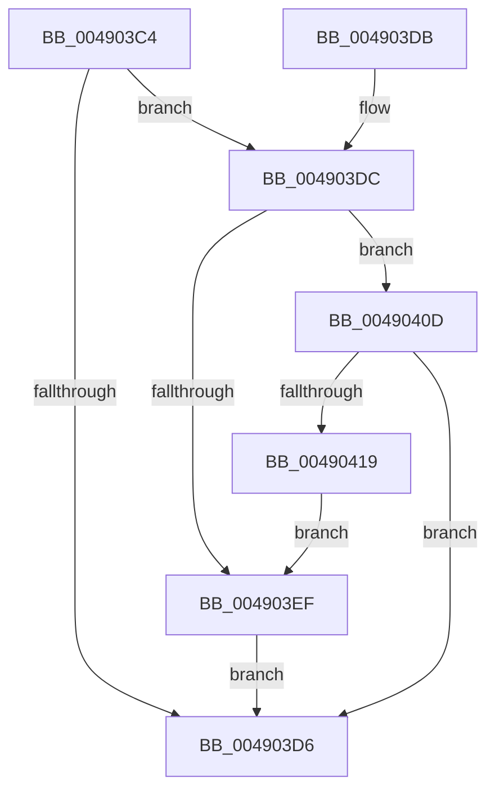

# PspWow64SetupUserProcessAddressSpace

- RVA: `0x004903C4`–`0x0049041B` (길이 `87` bytes)
- VA: `0x00000001404903C4`
- 실행 섹션: `.text`
- PDB 이름 있음: `예`; PDB Function 태그: `아니요`
- unwind 정보 RVA: `0x0005C794`
- 디코드: `22`개 명령, `87/87` bytes 표시
- 미해석 바이트: `0` (있으면 어셈블리에 `.byte`로 보존)

> 이 문서는 커널 이미지의 기계어와 PDB 기호를 분석해 생성했습니다. 4번과 5번은 함수 원형과 자료형을 바이너리 사용 방식에서 추정한 C 해석이며 원본 소스 복구 결과는 아닙니다.

## 1. Dependencies

- 직접 호출 지점: **1**; 고유 호출 대상: **1**
- 직접 호출자로 확인된 함수: **1**
- RIP 상대 이미지 참조: **0**

### Outgoing calls
- `0x00490406` → [PspWow64ThunkProcessParameters](PspWow64ThunkProcessParameters_function_00490424.md) (function, `0x00490424`)

### Direct callers
- [PspSetupUserProcessAddressSpace](../../page/AE/PspSetupUserProcessAddressSpace_function_00AEBDC8.md) at `0x00AEBFBA`

### Static image references
- 디코드된 RIP-relative 메모리 참조가 없습니다.

## 2. Other-region calls and transfers

- 다른 실행 섹션으로 향하는 call: **0**
- 별도 외부 분기/꼬리 이동을 확인하지 못했습니다.

## 3. Assembly (complete function range)

```asm
004903C4  48 83 EC 28                     sub rsp, 0x28
004903C8  4C 8B 81 10 03 00 00            mov r8, qword ptr [rcx + 0x310]
004903CF  33 C0                           xor eax, eax
004903D1  4D 85 C0                        test r8, r8
004903D4  75 06                           jne 0x1404903dc
004903D6  48 83 C4 28                     add rsp, 0x28
004903DA  C3                              ret
004903DB  CC                              int3
004903DC  0F B7 89 EC 06 00 00            movzx ecx, word ptr [rcx + 0x6ec]
004903E3  41 B9 4C 01 00 00               mov r9d, 0x14c
004903E9  66 41 3B C9                     cmp cx, r9w
004903ED  75 1E                           jne 0x14049040d
004903EF  49 8B 08                        mov rcx, qword ptr [r8]
004903F2  4C 8D 82 E8 00 00 00            lea r8, [rdx + 0xe8]
004903F9  89 8A EC 00 00 00               mov dword ptr [rdx + 0xec], ecx
004903FF  48 8B 92 D8 00 00 00            mov rdx, qword ptr [rdx + 0xd8]
00490406  E8 19 00 00 00                  call 0x140490424
0049040B  EB C9                           jmp 0x1404903d6
0049040D  41 B9 C4 01 00 00               mov r9d, 0x1c4
00490413  66 41 3B C9                     cmp cx, r9w
00490417  75 BD                           jne 0x1404903d6
00490419  EB D4                           jmp 0x1404903ef
```

## 4. C-style interpretation (structured pseudocode)

```c
__int64 __fastcall PspWow64SetupUserProcessAddressSpace(__int64 a1, __int64 a2)
{
    __int64 result;
    __int64 v_rsp;

    v_rsp = (v_rsp) - (40);
    result = 0;
    if (*(unsigned __int64 *)(a1 + 784) != 0) goto loc_004903DC;
loc_004903D6:
    v_rsp = (v_rsp) + (40);
    return result;
loc_004903DC:
    if (((unsigned __int16)(*(unsigned __int16 *)(a1 + 1772))) != 332) goto loc_0049040D;
loc_004903EF:
    *(unsigned int *)(a2 + 236) = (unsigned int)(*(unsigned __int64 *)(*(unsigned __int64 *)(a1 + 784)));
    result = PspWow64ThunkProcessParameters(*(unsigned __int64 *)(*(unsigned __int64 *)(a1 + 784)), *(unsigned __int64 *)(a2 + 216), a2 + 232, 332);
    goto loc_004903D6;
loc_0049040D:
    if (((unsigned __int16)(*(unsigned __int64 *)(*(unsigned __int64 *)(a1 + 784)))) != 452) goto loc_004903D6;
    goto loc_004903EF;
}
```

## 5. (Beta) C Style

```c
int64_t PspWow64SetupUserProcessAddressSpace(void *Arg1, void *Arg2)
{
    uint8_t *arg1 = (uint8_t *)Arg1;
    uint8_t *arg2 = (uint8_t *)Arg2;

    int64_t result;
    int64_t local_rsp;

    local_rsp = (local_rsp) - (40);
    result = 0;
    if (*(uint64_t *)(arg1 + 0x310) != 0) goto loc_004903DC;
loc_004903D6:
    local_rsp = (local_rsp) + (40);
    return result;
loc_004903DC:
    if (((uint16_t)(*(uint16_t *)(arg1 + 0x6EC))) != 332) goto loc_0049040D;
loc_004903EF:
    *(uint32_t *)(arg2 + 0xEC) = (uint32_t)(*(uint64_t *)(*(uint64_t *)(arg1 + 0x310)));
    result = PspWow64ThunkProcessParameters(*(uint64_t *)(*(uint64_t *)(arg1 + 0x310)), *(uint64_t *)(arg2 + 0xD8), Arg2 + 232, 332);
    goto loc_004903D6;
loc_0049040D:
    if (((uint16_t)(*(uint64_t *)(*(uint64_t *)(arg1 + 0x310)))) != 452) goto loc_004903D6;
    goto loc_004903EF;
}
```

### 관측된 메모리 오프셋

구조체 형식이 확인되지 않은 접근은 인자 기준의 오프셋으로만 기록했습니다.

| 기준 인자 | 오프셋 표현 | 폭 (bit) | 접근 |
|---|---:|---:|---|
| `Arg1` | `+ 0x310` | `64` | `R` |
| `Arg1` | `+ 0x6EC` | `16` | `R` |
| `Arg2` | `+ 0xD8` | `64` | `R` |
| `Arg2` | `+ 0xE8` | `64` | `R` |
| `Arg2` | `+ 0xEC` | `32` | `W` |

## 6. Execution-region graph

[열기: 2D/3D 그래프와 함수 탐색 컨트롤 패널](../../../control-panel.html?section=text&rva=0x004903C4&view=graph)

- 2D 그래프는 위에서 아래로 흐르고, 3D 그래프는 빈 공간을 드래그해 회전합니다. Shift+드래그는 이동, 휠은 확대·축소, 함수 노드 선택은 대상 보고서 이동입니다.

### Static fallback


