# PspWow64ThunkProcessParameters

- RVA: `0x00490424`–`0x00490B9B` (길이 `1,911` bytes)
- VA: `0x0000000140490424`
- 실행 섹션: `.text`
- PDB 이름 있음: `예`; PDB Function 태그: `아니요`
- unwind 정보 RVA: `0x000B2B88`
- 디코드: `375`개 명령, `1,911/1,911` bytes 표시
- 미해석 바이트: `0` (있으면 어셈블리에 `.byte`로 보존)

> 이 문서는 커널 이미지의 기계어와 PDB 기호를 분석해 생성했습니다. 4번과 5번은 함수 원형과 자료형을 바이너리 사용 방식에서 추정한 C 해석이며 원본 소스 복구 결과는 아닙니다.

## 1. Dependencies

- 직접 호출 지점: **15**; 고유 호출 대상: **2**
- 직접 호출자로 확인된 함수: **1**
- RIP 상대 이미지 참조: **0**

### Outgoing calls
- `0x004904A9` → [ZwAllocateVirtualMemory](../6A/ZwAllocateVirtualMemory_function_006AD3D0.md) (function, `0x006AD3D0`)
- `0x00490636` → [memcpy](../6C/memcpy_function_006C6840.md) (function, `0x006C6840`)
- `0x0049068C` → [memcpy](../6C/memcpy_function_006C6840.md) (function, `0x006C6840`)
- `0x004906D1` → [memcpy](../6C/memcpy_function_006C6840.md) (function, `0x006C6840`)
- `0x00490716` → [memcpy](../6C/memcpy_function_006C6840.md) (function, `0x006C6840`)
- `0x0049076A` → [memcpy](../6C/memcpy_function_006C6840.md) (function, `0x006C6840`)
- `0x004907C1` → [memcpy](../6C/memcpy_function_006C6840.md) (function, `0x006C6840`)
- `0x00490821` → [memcpy](../6C/memcpy_function_006C6840.md) (function, `0x006C6840`)
- `0x00490881` → [memcpy](../6C/memcpy_function_006C6840.md) (function, `0x006C6840`)
- `0x004908E1` → [memcpy](../6C/memcpy_function_006C6840.md) (function, `0x006C6840`)
- `0x00490955` → [memcpy](../6C/memcpy_function_006C6840.md) (function, `0x006C6840`)
- `0x00490A2E` → [memcpy](../6C/memcpy_function_006C6840.md) (function, `0x006C6840`)
- `0x00490A69` → [memcpy](../6C/memcpy_function_006C6840.md) (function, `0x006C6840`)
- `0x00490ABC` → [memcpy](../6C/memcpy_function_006C6840.md) (function, `0x006C6840`)
- `0x00490B64` → [memcpy](../6C/memcpy_function_006C6840.md) (function, `0x006C6840`)

### Direct callers
- [PspWow64SetupUserProcessAddressSpace](PspWow64SetupUserProcessAddressSpace_function_004903C4.md) at `0x00490406`

### Static image references
- 디코드된 RIP-relative 메모리 참조가 없습니다.

## 2. Other-region calls and transfers

- 다른 실행 섹션으로 향하는 call: **0**
- 별도 외부 분기/꼬리 이동을 확인하지 못했습니다.

## 3. Assembly (complete function range)

```asm
00490424  4C 8B DC                        mov r11, rsp
00490427  49 89 4B 08                     mov qword ptr [r11 + 8], rcx
0049042B  53                              push rbx
0049042C  56                              push rsi
0049042D  57                              push rdi
0049042E  41 54                           push r12
00490430  41 55                           push r13
00490432  41 56                           push r14
00490434  41 57                           push r15
00490436  48 83 EC 60                     sub rsp, 0x60
0049043A  4D 8B E8                        mov r13, r8
0049043D  48 8B FA                        mov rdi, rdx
00490440  4C 8B F9                        mov r15, rcx
00490443  48 C7 C0 78 FE FF FF            mov rax, 0xfffffffffffffe78
0049044A  4C 8D 70 04                     lea r14, [rax + 4]
0049044E  45 33 E4                        xor r12d, r12d
00490451  44 39 A2 38 04 00 00            cmp dword ptr [rdx + 0x438], r12d
00490458  4C 0F 46 F0                     cmovbe r14, rax
0049045C  8B 02                           mov eax, dword ptr [rdx]
0049045E  4C 03 F0                        add r14, rax
00490461  48 8B 9A F0 03 00 00            mov rbx, qword ptr [rdx + 0x3f0]
00490468  49 03 DE                        add rbx, r14
0049046B  4D 89 63 10                     mov qword ptr [r11 + 0x10], r12
0049046F  49 89 5B B0                     mov qword ptr [r11 - 0x50], rbx
00490473  65 48 8B 04 25 88 01 00 00      mov rax, qword ptr gs:[0x188]
0049047C  48 8B 88 B8 00 00 00            mov rcx, qword ptr [rax + 0xb8]
00490483  4C 8B 81 68 03 00 00            mov r8, qword ptr [rcx + 0x368]
0049048A  49 FF C8                        dec r8
0049048D  C7 44 24 28 04 00 00 00         mov dword ptr [rsp + 0x28], 4
00490495  C7 44 24 20 00 30 00 00         mov dword ptr [rsp + 0x20], 0x3000
0049049D  4D 8D 4B B0                     lea r9, [r11 - 0x50]
004904A1  49 8D 53 10                     lea rdx, [r11 + 0x10]
004904A5  48 83 C9 FF                     or rcx, 0xffffffffffffffff
004904A9  E8 22 CF 21 00                  call 0x1406ad3d0
004904AE  85 C0                           test eax, eax
004904B0  79 11                           jns 0x1404904c3
004904B2  48 83 C4 60                     add rsp, 0x60
004904B6  41 5F                           pop r15
004904B8  41 5E                           pop r14
004904BA  41 5D                           pop r13
004904BC  41 5C                           pop r12
004904BE  5F                              pop rdi
004904BF  5E                              pop rsi
004904C0  5B                              pop rbx
004904C1  C3                              ret
004904C2  CC                              int3
004904C3  48 8B 84 24 A8 00 00 00         mov rax, qword ptr [rsp + 0xa8]
004904CB  48 8D B0 C8 02 00 00            lea rsi, [rax + 0x2c8]
004904D2  4C 03 F0                        add r14, rax
004904D5  89 18                           mov dword ptr [rax], ebx
004904D7  48 8B 84 24 A8 00 00 00         mov rax, qword ptr [rsp + 0xa8]
004904DF  89 58 04                        mov dword ptr [rax + 4], ebx
004904E2  8B 4F 08                        mov ecx, dword ptr [rdi + 8]
004904E5  48 8B 84 24 A8 00 00 00         mov rax, qword ptr [rsp + 0xa8]
004904ED  89 48 08                        mov dword ptr [rax + 8], ecx
004904F0  8B 4F 0C                        mov ecx, dword ptr [rdi + 0xc]
004904F3  48 8B 84 24 A8 00 00 00         mov rax, qword ptr [rsp + 0xa8]
004904FB  89 48 0C                        mov dword ptr [rax + 0xc], ecx
004904FE  8B 4F 10                        mov ecx, dword ptr [rdi + 0x10]
00490501  48 8B 84 24 A8 00 00 00         mov rax, qword ptr [rsp + 0xa8]
00490509  89 48 10                        mov dword ptr [rax + 0x10], ecx
0049050C  8B 4F 18                        mov ecx, dword ptr [rdi + 0x18]
0049050F  48 8B 84 24 A8 00 00 00         mov rax, qword ptr [rsp + 0xa8]
00490517  89 48 14                        mov dword ptr [rax + 0x14], ecx
0049051A  8B 4F 20                        mov ecx, dword ptr [rdi + 0x20]
0049051D  48 8B 84 24 A8 00 00 00         mov rax, qword ptr [rsp + 0xa8]
00490525  89 48 18                        mov dword ptr [rax + 0x18], ecx
00490528  8B 4F 28                        mov ecx, dword ptr [rdi + 0x28]
0049052B  48 8B 84 24 A8 00 00 00         mov rax, qword ptr [rsp + 0xa8]
00490533  89 48 1C                        mov dword ptr [rax + 0x1c], ecx
00490536  8B 4F 30                        mov ecx, dword ptr [rdi + 0x30]
00490539  48 8B 84 24 A8 00 00 00         mov rax, qword ptr [rsp + 0xa8]
00490541  89 48 20                        mov dword ptr [rax + 0x20], ecx
00490544  8B 8F 88 00 00 00               mov ecx, dword ptr [rdi + 0x88]
0049054A  48 8B 84 24 A8 00 00 00         mov rax, qword ptr [rsp + 0xa8]
00490552  89 48 4C                        mov dword ptr [rax + 0x4c], ecx
00490555  8B 8F 8C 00 00 00               mov ecx, dword ptr [rdi + 0x8c]
0049055B  48 8B 84 24 A8 00 00 00         mov rax, qword ptr [rsp + 0xa8]
00490563  89 48 50                        mov dword ptr [rax + 0x50], ecx
00490566  8B 8F 90 00 00 00               mov ecx, dword ptr [rdi + 0x90]
0049056C  48 8B 84 24 A8 00 00 00         mov rax, qword ptr [rsp + 0xa8]
00490574  89 48 54                        mov dword ptr [rax + 0x54], ecx
00490577  8B 8F 94 00 00 00               mov ecx, dword ptr [rdi + 0x94]
0049057D  48 8B 84 24 A8 00 00 00         mov rax, qword ptr [rsp + 0xa8]
00490585  89 48 58                        mov dword ptr [rax + 0x58], ecx
00490588  8B 8F 98 00 00 00               mov ecx, dword ptr [rdi + 0x98]
0049058E  48 8B 84 24 A8 00 00 00         mov rax, qword ptr [rsp + 0xa8]
00490596  89 48 5C                        mov dword ptr [rax + 0x5c], ecx
00490599  8B 8F 9C 00 00 00               mov ecx, dword ptr [rdi + 0x9c]
0049059F  48 8B 84 24 A8 00 00 00         mov rax, qword ptr [rsp + 0xa8]
004905A7  89 48 60                        mov dword ptr [rax + 0x60], ecx
004905AA  8B 8F A0 00 00 00               mov ecx, dword ptr [rdi + 0xa0]
004905B0  48 8B 84 24 A8 00 00 00         mov rax, qword ptr [rsp + 0xa8]
004905B8  89 48 64                        mov dword ptr [rax + 0x64], ecx
004905BB  8B 8F A4 00 00 00               mov ecx, dword ptr [rdi + 0xa4]
004905C1  48 8B 84 24 A8 00 00 00         mov rax, qword ptr [rsp + 0xa8]
004905C9  89 48 68                        mov dword ptr [rax + 0x68], ecx
004905CC  8B 8F A8 00 00 00               mov ecx, dword ptr [rdi + 0xa8]
004905D2  48 8B 84 24 A8 00 00 00         mov rax, qword ptr [rsp + 0xa8]
004905DA  89 48 6C                        mov dword ptr [rax + 0x6c], ecx
004905DD  8B 8F 0C 04 00 00               mov ecx, dword ptr [rdi + 0x40c]
004905E3  48 8B 84 24 A8 00 00 00         mov rax, qword ptr [rsp + 0xa8]
004905EB  89 88 A0 02 00 00               mov dword ptr [rax + 0x2a0], ecx
004905F1  8B 8F 3C 04 00 00               mov ecx, dword ptr [rdi + 0x43c]
004905F7  48 8B 84 24 A8 00 00 00         mov rax, qword ptr [rsp + 0xa8]
004905FF  89 88 BC 02 00 00               mov dword ptr [rax + 0x2bc], ecx
00490605  48 8B 8C 24 A8 00 00 00         mov rcx, qword ptr [rsp + 0xa8]
0049060D  0F B7 47 38                     movzx eax, word ptr [rdi + 0x38]
00490611  66 89 41 24                     mov word ptr [rcx + 0x24], ax
00490615  0F B7 47 3A                     movzx eax, word ptr [rdi + 0x3a]
00490619  66 89 41 26                     mov word ptr [rcx + 0x26], ax
0049061D  4C 39 67 40                     cmp qword ptr [rdi + 0x40], r12
00490621  0F 84 9B 03 00 00               je 0x1404909c2
00490627  89 71 28                        mov dword ptr [rcx + 0x28], esi
0049062A  44 0F B7 47 3A                  movzx r8d, word ptr [rdi + 0x3a]
0049062F  48 8B 57 40                     mov rdx, qword ptr [rdi + 0x40]
00490633  48 8B CE                        mov rcx, rsi
00490636  E8 05 62 23 00                  call 0x1406c6840
0049063B  0F B7 47 3A                     movzx eax, word ptr [rdi + 0x3a]
0049063F  48 03 C6                        add rax, rsi
00490642  48 8B F0                        mov rsi, rax
00490645  48 89 84 24 B8 00 00 00         mov qword ptr [rsp + 0xb8], rax
0049064D  8B 4F 48                        mov ecx, dword ptr [rdi + 0x48]
00490650  48 8B 84 24 A8 00 00 00         mov rax, qword ptr [rsp + 0xa8]
00490658  89 48 2C                        mov dword ptr [rax + 0x2c], ecx
0049065B  48 8B 8C 24 A8 00 00 00         mov rcx, qword ptr [rsp + 0xa8]
00490663  0F B7 47 50                     movzx eax, word ptr [rdi + 0x50]
00490667  66 89 41 30                     mov word ptr [rcx + 0x30], ax
0049066B  0F B7 47 52                     movzx eax, word ptr [rdi + 0x52]
0049066F  66 89 41 32                     mov word ptr [rcx + 0x32], ax
00490673  4C 39 67 58                     cmp qword ptr [rdi + 0x58], r12
00490677  0F 84 F4 02 00 00               je 0x140490971
0049067D  89 71 34                        mov dword ptr [rcx + 0x34], esi
00490680  44 0F B7 47 52                  movzx r8d, word ptr [rdi + 0x52]
00490685  48 8B 57 58                     mov rdx, qword ptr [rdi + 0x58]
00490689  48 8B CE                        mov rcx, rsi
0049068C  E8 AF 61 23 00                  call 0x1406c6840
00490691  0F B7 47 52                     movzx eax, word ptr [rdi + 0x52]
00490695  48 03 F0                        add rsi, rax
00490698  48 89 B4 24 B8 00 00 00         mov qword ptr [rsp + 0xb8], rsi
004906A0  48 8B 8C 24 A8 00 00 00         mov rcx, qword ptr [rsp + 0xa8]
004906A8  0F B7 47 60                     movzx eax, word ptr [rdi + 0x60]
004906AC  66 89 41 38                     mov word ptr [rcx + 0x38], ax
004906B0  0F B7 47 62                     movzx eax, word ptr [rdi + 0x62]
004906B4  66 89 41 3A                     mov word ptr [rcx + 0x3a], ax
004906B8  4C 39 67 68                     cmp qword ptr [rdi + 0x68], r12
004906BC  0F 84 B8 02 00 00               je 0x14049097a
004906C2  89 71 3C                        mov dword ptr [rcx + 0x3c], esi
004906C5  44 0F B7 47 62                  movzx r8d, word ptr [rdi + 0x62]
004906CA  48 8B 57 68                     mov rdx, qword ptr [rdi + 0x68]
004906CE  48 8B CE                        mov rcx, rsi
004906D1  E8 6A 61 23 00                  call 0x1406c6840
004906D6  0F B7 47 62                     movzx eax, word ptr [rdi + 0x62]
004906DA  48 03 F0                        add rsi, rax
004906DD  48 89 B4 24 B8 00 00 00         mov qword ptr [rsp + 0xb8], rsi
004906E5  48 8B 8C 24 A8 00 00 00         mov rcx, qword ptr [rsp + 0xa8]
004906ED  0F B7 47 70                     movzx eax, word ptr [rdi + 0x70]
004906F1  66 89 41 40                     mov word ptr [rcx + 0x40], ax
004906F5  0F B7 47 72                     movzx eax, word ptr [rdi + 0x72]
004906F9  66 89 41 42                     mov word ptr [rcx + 0x42], ax
004906FD  4C 39 67 78                     cmp qword ptr [rdi + 0x78], r12
00490701  0F 84 7C 02 00 00               je 0x140490983
00490707  89 71 44                        mov dword ptr [rcx + 0x44], esi
0049070A  44 0F B7 47 72                  movzx r8d, word ptr [rdi + 0x72]
0049070F  48 8B 57 78                     mov rdx, qword ptr [rdi + 0x78]
00490713  48 8B CE                        mov rcx, rsi
00490716  E8 25 61 23 00                  call 0x1406c6840
0049071B  0F B7 47 72                     movzx eax, word ptr [rdi + 0x72]
0049071F  48 03 F0                        add rsi, rax
00490722  48 89 B4 24 B8 00 00 00         mov qword ptr [rsp + 0xb8], rsi
0049072A  48 8B 8C 24 A8 00 00 00         mov rcx, qword ptr [rsp + 0xa8]
00490732  0F B7 87 B0 00 00 00            movzx eax, word ptr [rdi + 0xb0]
00490739  66 89 41 70                     mov word ptr [rcx + 0x70], ax
0049073D  0F B7 87 B2 00 00 00            movzx eax, word ptr [rdi + 0xb2]
00490744  66 89 41 72                     mov word ptr [rcx + 0x72], ax
00490748  4C 39 A7 B8 00 00 00            cmp qword ptr [rdi + 0xb8], r12
0049074F  0F 84 37 02 00 00               je 0x14049098c
00490755  89 71 74                        mov dword ptr [rcx + 0x74], esi
00490758  44 0F B7 87 B2 00 00 00         movzx r8d, word ptr [rdi + 0xb2]
00490760  48 8B 97 B8 00 00 00            mov rdx, qword ptr [rdi + 0xb8]
00490767  48 8B CE                        mov rcx, rsi
0049076A  E8 D1 60 23 00                  call 0x1406c6840
0049076F  0F B7 87 B2 00 00 00            movzx eax, word ptr [rdi + 0xb2]
00490776  48 03 F0                        add rsi, rax
00490779  48 89 B4 24 B8 00 00 00         mov qword ptr [rsp + 0xb8], rsi
00490781  48 8B 8C 24 A8 00 00 00         mov rcx, qword ptr [rsp + 0xa8]
00490789  0F B7 87 C0 00 00 00            movzx eax, word ptr [rdi + 0xc0]
00490790  66 89 41 78                     mov word ptr [rcx + 0x78], ax
00490794  0F B7 87 C2 00 00 00            movzx eax, word ptr [rdi + 0xc2]
0049079B  66 89 41 7A                     mov word ptr [rcx + 0x7a], ax
0049079F  4C 39 A7 C8 00 00 00            cmp qword ptr [rdi + 0xc8], r12
004907A6  0F 84 E9 01 00 00               je 0x140490995
004907AC  89 71 7C                        mov dword ptr [rcx + 0x7c], esi
004907AF  44 0F B7 87 C2 00 00 00         movzx r8d, word ptr [rdi + 0xc2]
004907B7  48 8B 97 C8 00 00 00            mov rdx, qword ptr [rdi + 0xc8]
004907BE  48 8B CE                        mov rcx, rsi
004907C1  E8 7A 60 23 00                  call 0x1406c6840
004907C6  0F B7 87 C2 00 00 00            movzx eax, word ptr [rdi + 0xc2]
004907CD  48 03 F0                        add rsi, rax
004907D0  48 89 B4 24 B8 00 00 00         mov qword ptr [rsp + 0xb8], rsi
004907D8  48 8B 8C 24 A8 00 00 00         mov rcx, qword ptr [rsp + 0xa8]
004907E0  0F B7 87 D0 00 00 00            movzx eax, word ptr [rdi + 0xd0]
004907E7  66 89 81 80 00 00 00            mov word ptr [rcx + 0x80], ax
004907EE  0F B7 87 D2 00 00 00            movzx eax, word ptr [rdi + 0xd2]
004907F5  66 89 81 82 00 00 00            mov word ptr [rcx + 0x82], ax
004907FC  4C 39 A7 D8 00 00 00            cmp qword ptr [rdi + 0xd8], r12
00490803  0F 84 95 01 00 00               je 0x14049099e
00490809  89 B1 84 00 00 00               mov dword ptr [rcx + 0x84], esi
0049080F  44 0F B7 87 D2 00 00 00         movzx r8d, word ptr [rdi + 0xd2]
00490817  48 8B 97 D8 00 00 00            mov rdx, qword ptr [rdi + 0xd8]
0049081E  48 8B CE                        mov rcx, rsi
00490821  E8 1A 60 23 00                  call 0x1406c6840
00490826  0F B7 87 D2 00 00 00            movzx eax, word ptr [rdi + 0xd2]
0049082D  48 03 F0                        add rsi, rax
00490830  48 89 B4 24 B8 00 00 00         mov qword ptr [rsp + 0xb8], rsi
00490838  48 8B 8C 24 A8 00 00 00         mov rcx, qword ptr [rsp + 0xa8]
00490840  0F B7 87 10 04 00 00            movzx eax, word ptr [rdi + 0x410]
00490847  66 89 81 A4 02 00 00            mov word ptr [rcx + 0x2a4], ax
0049084E  0F B7 87 12 04 00 00            movzx eax, word ptr [rdi + 0x412]
00490855  66 89 81 A6 02 00 00            mov word ptr [rcx + 0x2a6], ax
0049085C  4C 39 A7 18 04 00 00            cmp qword ptr [rdi + 0x418], r12
00490863  0F 84 41 01 00 00               je 0x1404909aa
00490869  89 B1 A8 02 00 00               mov dword ptr [rcx + 0x2a8], esi
0049086F  44 0F B7 87 12 04 00 00         movzx r8d, word ptr [rdi + 0x412]
00490877  48 8B 97 18 04 00 00            mov rdx, qword ptr [rdi + 0x418]
0049087E  48 8B CE                        mov rcx, rsi
00490881  E8 BA 5F 23 00                  call 0x1406c6840
00490886  0F B7 87 12 04 00 00            movzx eax, word ptr [rdi + 0x412]
0049088D  48 03 F0                        add rsi, rax
00490890  48 89 B4 24 B8 00 00 00         mov qword ptr [rsp + 0xb8], rsi
00490898  48 8B 8C 24 A8 00 00 00         mov rcx, qword ptr [rsp + 0xa8]
004908A0  0F B7 87 20 04 00 00            movzx eax, word ptr [rdi + 0x420]
004908A7  66 89 81 AC 02 00 00            mov word ptr [rcx + 0x2ac], ax
004908AE  0F B7 87 22 04 00 00            movzx eax, word ptr [rdi + 0x422]
004908B5  66 89 81 AE 02 00 00            mov word ptr [rcx + 0x2ae], ax
004908BC  4C 39 A7 28 04 00 00            cmp qword ptr [rdi + 0x428], r12
004908C3  0F 84 ED 00 00 00               je 0x1404909b6
004908C9  89 B1 B0 02 00 00               mov dword ptr [rcx + 0x2b0], esi
004908CF  44 0F B7 87 22 04 00 00         movzx r8d, word ptr [rdi + 0x422]
004908D7  48 8B 97 28 04 00 00            mov rdx, qword ptr [rdi + 0x428]
004908DE  48 8B CE                        mov rcx, rsi
004908E1  E8 5A 5F 23 00                  call 0x1406c6840
004908E6  0F B7 87 22 04 00 00            movzx eax, word ptr [rdi + 0x422]
004908ED  48 03 F0                        add rsi, rax
004908F0  48 89 B4 24 B8 00 00 00         mov qword ptr [rsp + 0xb8], rsi
004908F8  66 44 39 A7 E0 00 00 00         cmp word ptr [rdi + 0xe0], r12w
00490900  0F 85 C5 00 00 00               jne 0x1404909cb
00490906  8B 8F 38 04 00 00               mov ecx, dword ptr [rdi + 0x438]
0049090C  85 C9                           test ecx, ecx
0049090E  0F 84 03 02 00 00               je 0x140490b17
00490914  48 8B 84 24 A8 00 00 00         mov rax, qword ptr [rsp + 0xa8]
0049091C  89 88 B8 02 00 00               mov dword ptr [rax + 0x2b8], ecx
00490922  48 8D 5E 03                     lea rbx, [rsi + 3]
00490926  48 83 E3 FC                     and rbx, 0xfffffffffffffffc
0049092A  48 89 9C 24 B8 00 00 00         mov qword ptr [rsp + 0xb8], rbx
00490932  48 8B 84 24 A8 00 00 00         mov rax, qword ptr [rsp + 0xa8]
0049093A  89 98 B4 02 00 00               mov dword ptr [rax + 0x2b4], ebx
00490940  44 8B 87 38 04 00 00            mov r8d, dword ptr [rdi + 0x438]
00490947  49 C1 E0 03                     shl r8, 3
0049094B  48 8B 97 30 04 00 00            mov rdx, qword ptr [rdi + 0x430]
00490952  48 8B CB                        mov rcx, rbx
00490955  E8 E6 5E 23 00                  call 0x1406c6840
0049095A  8B 87 38 04 00 00               mov eax, dword ptr [rdi + 0x438]
00490960  48 8D 0C C3                     lea rcx, [rbx + rax*8]
00490964  48 89 8C 24 B8 00 00 00         mov qword ptr [rsp + 0xb8], rcx
0049096C  E9 A6 01 00 00                  jmp 0x140490b17
00490971  44 89 61 34                     mov dword ptr [rcx + 0x34], r12d
00490975  E9 26 FD FF FF                  jmp 0x1404906a0
0049097A  44 89 61 3C                     mov dword ptr [rcx + 0x3c], r12d
0049097E  E9 62 FD FF FF                  jmp 0x1404906e5
00490983  44 89 61 44                     mov dword ptr [rcx + 0x44], r12d
00490987  E9 9E FD FF FF                  jmp 0x14049072a
0049098C  44 89 61 74                     mov dword ptr [rcx + 0x74], r12d
00490990  E9 EC FD FF FF                  jmp 0x140490781
00490995  44 89 61 7C                     mov dword ptr [rcx + 0x7c], r12d
00490999  E9 3A FE FF FF                  jmp 0x1404907d8
0049099E  44 89 A1 84 00 00 00            mov dword ptr [rcx + 0x84], r12d
004909A5  E9 8E FE FF FF                  jmp 0x140490838
004909AA  44 89 A1 A8 02 00 00            mov dword ptr [rcx + 0x2a8], r12d
004909B1  E9 E2 FE FF FF                  jmp 0x140490898
004909B6  44 89 A1 B0 02 00 00            mov dword ptr [rcx + 0x2b0], r12d
004909BD  E9 36 FF FF FF                  jmp 0x1404908f8
004909C2  44 89 61 28                     mov dword ptr [rcx + 0x28], r12d
004909C6  E9 82 FC FF FF                  jmp 0x14049064d
004909CB  4C 39 A7 E8 00 00 00            cmp qword ptr [rdi + 0xe8], r12
004909D2  0F 84 2E FF FF FF               je 0x140490906
004909D8  4C 89 64 24 50                  mov qword ptr [rsp + 0x50], r12
004909DD  48 8B 84 24 A8 00 00 00         mov rax, qword ptr [rsp + 0xa8]
004909E5  89 B0 8C 00 00 00               mov dword ptr [rax + 0x8c], esi
004909EB  44 0F B7 BF E0 00 00 00         movzx r15d, word ptr [rdi + 0xe0]
004909F3  B8 04 00 00 00                  mov eax, 4
004909F8  66 41 3B C7                     cmp ax, r15w
004909FC  77 0B                           ja 0x140490a09
004909FE  48 8B 87 E8 00 00 00            mov rax, qword ptr [rdi + 0xe8]
00490A05  8B 18                           mov ebx, dword ptr [rax]
00490A07  EB 03                           jmp 0x140490a0c
00490A09  49 8B DC                        mov rbx, r12
00490A0C  48 8D 04 DD 04 00 00 00         lea rax, [rbx*8 + 4]
00490A14  48 03 C3                        add rax, rbx
00490A17  48 89 44 24 50                  mov qword ptr [rsp + 0x50], rax
00490A1C  4D 8B C7                        mov r8, r15
00490A1F  48 8B 97 E8 00 00 00            mov rdx, qword ptr [rdi + 0xe8]
00490A26  48 8B CE                        mov rcx, rsi
00490A29  4C 3B F8                        cmp r15, rax
00490A2C  73 20                           jae 0x140490a4e
00490A2E  E8 0D 5E 23 00                  call 0x1406c6840
00490A33  0F B7 8F E0 00 00 00            movzx ecx, word ptr [rdi + 0xe0]
00490A3A  48 8B 84 24 A8 00 00 00         mov rax, qword ptr [rsp + 0xa8]
00490A42  66 89 88 88 00 00 00            mov word ptr [rax + 0x88], cx
00490A49  E9 8C 00 00 00                  jmp 0x140490ada
00490A4E  4C 89 64 24 38                  mov qword ptr [rsp + 0x38], r12
00490A53  4C 89 64 24 30                  mov qword ptr [rsp + 0x30], r12
00490A58  4C 89 64 24 40                  mov qword ptr [rsp + 0x40], r12
00490A5D  4C 8D 24 9B                     lea r12, [rbx + rbx*4]
00490A61  66 44 2B F8                     sub r15w, ax
00490A65  4C 8D 43 04                     lea r8, [rbx + 4]
00490A69  E8 D2 5D 23 00                  call 0x1406c6840
00490A6E  48 8B 97 E8 00 00 00            mov rdx, qword ptr [rdi + 0xe8]
00490A75  48 83 C2 04                     add rdx, 4
00490A79  48 03 D3                        add rdx, rbx
00490A7C  48 89 54 24 38                  mov qword ptr [rsp + 0x38], rdx
00490A81  48 8D 4E 04                     lea rcx, [rsi + 4]
00490A85  48 03 CB                        add rcx, rbx
00490A88  48 89 4C 24 30                  mov qword ptr [rsp + 0x30], rcx
00490A8D  45 33 C0                        xor r8d, r8d
00490A90  4C 89 44 24 40                  mov qword ptr [rsp + 0x40], r8
00490A95  4C 3B C3                        cmp r8, rbx
00490A98  73 1B                           jae 0x140490ab5
00490A9A  8B 02                           mov eax, dword ptr [rdx]
00490A9C  89 01                           mov dword ptr [rcx], eax
00490A9E  48 83 C1 04                     add rcx, 4
00490AA2  48 89 4C 24 30                  mov qword ptr [rsp + 0x30], rcx
00490AA7  48 83 C2 08                     add rdx, 8
00490AAB  48 89 54 24 38                  mov qword ptr [rsp + 0x38], rdx
00490AB0  49 FF C0                        inc r8
00490AB3  EB DB                           jmp 0x140490a90
00490AB5  41 0F B7 DF                     movzx ebx, r15w
00490AB9  44 8B C3                        mov r8d, ebx
00490ABC  E8 7F 5D 23 00                  call 0x1406c6840
00490AC1  66 41 83 C4 04                  add r12w, 4
00490AC6  66 44 03 E3                     add r12w, bx
00490ACA  48 8B 84 24 A8 00 00 00         mov rax, qword ptr [rsp + 0xa8]
00490AD2  66 44 89 A0 88 00 00 00         mov word ptr [rax + 0x88], r12w
00490ADA  48 8B 8C 24 A8 00 00 00         mov rcx, qword ptr [rsp + 0xa8]
00490AE2  0F B7 81 88 00 00 00            movzx eax, word ptr [rcx + 0x88]
00490AE9  66 89 81 8A 00 00 00            mov word ptr [rcx + 0x8a], ax
00490AF0  48 8B 84 24 A8 00 00 00         mov rax, qword ptr [rsp + 0xa8]
00490AF8  0F B7 88 88 00 00 00            movzx ecx, word ptr [rax + 0x88]
00490AFF  48 03 F1                        add rsi, rcx
00490B02  48 89 B4 24 B8 00 00 00         mov qword ptr [rsp + 0xb8], rsi
00490B0A  4C 8B BC 24 A0 00 00 00         mov r15, qword ptr [rsp + 0xa0]
00490B12  E9 EF FD FF FF                  jmp 0x140490906
00490B17  48 8B 84 24 A8 00 00 00         mov rax, qword ptr [rsp + 0xa8]
00490B1F  44 89 70 48                     mov dword ptr [rax + 0x48], r14d
00490B23  8B 97 F0 03 00 00               mov edx, dword ptr [rdi + 0x3f0]
00490B29  48 8B 84 24 A8 00 00 00         mov rax, qword ptr [rsp + 0xa8]
00490B31  89 90 90 02 00 00               mov dword ptr [rax + 0x290], edx
00490B37  8B 97 F8 03 00 00               mov edx, dword ptr [rdi + 0x3f8]
00490B3D  48 8B 84 24 A8 00 00 00         mov rax, qword ptr [rsp + 0xa8]
00490B45  89 90 94 02 00 00               mov dword ptr [rax + 0x294], edx
00490B4B  48 8B 84 24 A8 00 00 00         mov rax, qword ptr [rsp + 0xa8]
00490B53  44 8B 80 90 02 00 00            mov r8d, dword ptr [rax + 0x290]
00490B5A  48 8B 97 80 00 00 00            mov rdx, qword ptr [rdi + 0x80]
00490B61  49 8B CE                        mov rcx, r14
00490B64  E8 D7 5C 23 00                  call 0x1406c6840
00490B69  8B 8F 08 04 00 00               mov ecx, dword ptr [rdi + 0x408]
00490B6F  48 8B 84 24 A8 00 00 00         mov rax, qword ptr [rsp + 0xa8]
00490B77  89 88 9C 02 00 00               mov dword ptr [rax + 0x29c], ecx
00490B7D  48 8B 84 24 A8 00 00 00         mov rax, qword ptr [rsp + 0xa8]
00490B85  41 89 47 10                     mov dword ptr [r15 + 0x10], eax
00490B89  EB 05                           jmp 0x140490b90
00490B8B  E9 22 F9 FF FF                  jmp 0x1404904b2
00490B90  41 89 45 00                     mov dword ptr [r13], eax
00490B94  33 C0                           xor eax, eax
00490B96  E9 17 F9 FF FF                  jmp 0x1404904b2
```

## 4. C-style interpretation (structured pseudocode)

```c
__int64 __fastcall PspWow64ThunkProcessParameters(__int64 a1, __int64 a2, __int64 a3)
{
    __int64 result;
    __int64 v_r12;
    __int64 v_r14;
    __int64 v_r15;
    __int64 v_rbx;
    __int64 v_rsi;
    __int64 v_rsp;
    unsigned int v_stack_m70;
    unsigned int v_stack_m78;
    unsigned __int64 v_stack_p30;
    unsigned __int64 v_stack_p38;
    unsigned __int64 v_stack_p40;
    unsigned __int64 v_stack_p50;
    unsigned __int64 v_stack_pA0;
    unsigned __int64 v_stack_pA8;
    unsigned __int64 v_stack_pB8;

    *(unsigned __int64 *)(v_rsp + 8) = a1;
    v_rsp = (v_rsp) - (96);
    v_r12 = 0;
    v_r14 = -392 + 4;
    if ((*(unsigned int *)(a2 + 1080)) <= 0) { v_r14 = -392; }
    v_r14 = (v_r14) + ((unsigned int)(*(unsigned int *)(a2)));
    v_rbx = (*(unsigned __int64 *)(a2 + 1008)) + (v_r14);
    *(unsigned __int64 *)(v_rsp + 16) = 0;
    *(unsigned __int64 *)(v_rsp - 80) = v_rbx;
    a3 = (*(unsigned __int64 *)(*(unsigned __int64 *)(*(unsigned __int64 *)(gs_base + (0 + 392)) + 184) + 872)) - 1;
    v_stack_m70 = 4;
    v_stack_m78 = 0x3000ULL;
    a1 = (*(unsigned __int64 *)(*(unsigned __int64 *)(gs_base + (0 + 392)) + 184)) | (-1);
    result = ZwAllocateVirtualMemory(a1, v_rsp + 16, a3, v_rsp - 80);
    if (!sign_flag) goto loc_004904C3;
loc_004904B2:
    v_rsp = (v_rsp) + (96);
    return result;
loc_004904C3:
    v_r14 = (v_r14) + (v_stack_pA8);
    *(unsigned int *)(v_stack_pA8) = (unsigned int)(v_rbx);
    *(unsigned int *)(v_stack_pA8 + 4) = (unsigned int)(v_rbx);
    *(unsigned int *)(v_stack_pA8 + 8) = (unsigned int)((unsigned int)(*(unsigned int *)(a2 + 8)));
    *(unsigned int *)(v_stack_pA8 + 12) = (unsigned int)((unsigned int)(*(unsigned int *)(a2 + 12)));
    *(unsigned int *)(v_stack_pA8 + 16) = (unsigned int)((unsigned int)(*(unsigned int *)(a2 + 16)));
    *(unsigned int *)(v_stack_pA8 + 20) = (unsigned int)((unsigned int)(*(unsigned int *)(a2 + 24)));
    *(unsigned int *)(v_stack_pA8 + 24) = (unsigned int)((unsigned int)(*(unsigned int *)(a2 + 32)));
    *(unsigned int *)(v_stack_pA8 + 28) = (unsigned int)((unsigned int)(*(unsigned int *)(a2 + 40)));
    *(unsigned int *)(v_stack_pA8 + 32) = (unsigned int)((unsigned int)(*(unsigned int *)(a2 + 48)));
    *(unsigned int *)(v_stack_pA8 + 76) = (unsigned int)((unsigned int)(*(unsigned int *)(a2 + 136)));
    *(unsigned int *)(v_stack_pA8 + 80) = (unsigned int)((unsigned int)(*(unsigned int *)(a2 + 140)));
    *(unsigned int *)(v_stack_pA8 + 84) = (unsigned int)((unsigned int)(*(unsigned int *)(a2 + 144)));
    *(unsigned int *)(v_stack_pA8 + 88) = (unsigned int)((unsigned int)(*(unsigned int *)(a2 + 148)));
    *(unsigned int *)(v_stack_pA8 + 92) = (unsigned int)((unsigned int)(*(unsigned int *)(a2 + 152)));
    *(unsigned int *)(v_stack_pA8 + 96) = (unsigned int)((unsigned int)(*(unsigned int *)(a2 + 156)));
    *(unsigned int *)(v_stack_pA8 + 100) = (unsigned int)((unsigned int)(*(unsigned int *)(a2 + 160)));
    *(unsigned int *)(v_stack_pA8 + 104) = (unsigned int)((unsigned int)(*(unsigned int *)(a2 + 164)));
    *(unsigned int *)(v_stack_pA8 + 108) = (unsigned int)((unsigned int)(*(unsigned int *)(a2 + 168)));
    *(unsigned int *)(v_stack_pA8 + 672) = (unsigned int)((unsigned int)(*(unsigned int *)(a2 + 1036)));
    *(unsigned int *)(v_stack_pA8 + 700) = (unsigned int)((unsigned int)(*(unsigned int *)(a2 + 1084)));
    *(unsigned __int16 *)(v_stack_pA8 + 36) = (unsigned __int16)(*(unsigned __int16 *)(a2 + 56));
    *(unsigned __int16 *)(v_stack_pA8 + 38) = (unsigned __int16)(*(unsigned __int16 *)(a2 + 58));
    if ((*(unsigned __int64 *)(a2 + 64)) == 0) goto loc_004909C2;
    *(unsigned int *)(v_stack_pA8 + 40) = (unsigned int)(v_stack_pA8 + 712);
    result = memcpy(v_stack_pA8 + 712, *(unsigned __int64 *)(a2 + 64), *(unsigned __int16 *)(a2 + 58), v_rsp - 80);
    result = (*(unsigned __int16 *)(a2 + 58)) + (v_stack_pA8 + 712);
    v_stack_pB8 = result;
loc_0049064D:
    *(unsigned int *)(v_stack_pA8 + 44) = (unsigned int)((unsigned int)(*(unsigned int *)(a2 + 72)));
    *(unsigned __int16 *)(v_stack_pA8 + 48) = (unsigned __int16)(*(unsigned __int16 *)(a2 + 80));
    *(unsigned __int16 *)(v_stack_pA8 + 50) = (unsigned __int16)(*(unsigned __int16 *)(a2 + 82));
    if ((*(unsigned __int64 *)(a2 + 88)) == 0) goto loc_00490971;
    *(unsigned int *)(v_stack_pA8 + 52) = (unsigned int)(result);
    result = memcpy(result, *(unsigned __int64 *)(a2 + 88), *(unsigned __int16 *)(a2 + 82), v_rsp - 80);
    v_rsi = (result) + (*(unsigned __int16 *)(a2 + 82));
    v_stack_pB8 = v_rsi;
loc_004906A0:
    *(unsigned __int16 *)(v_stack_pA8 + 56) = (unsigned __int16)(*(unsigned __int16 *)(a2 + 96));
    *(unsigned __int16 *)(v_stack_pA8 + 58) = (unsigned __int16)(*(unsigned __int16 *)(a2 + 98));
    if ((*(unsigned __int64 *)(a2 + 104)) == 0) goto loc_0049097A;
    *(unsigned int *)(v_stack_pA8 + 60) = (unsigned int)(v_rsi);
    result = memcpy(v_rsi, *(unsigned __int64 *)(a2 + 104), *(unsigned __int16 *)(a2 + 98), v_rsp - 80);
    v_rsi = (v_rsi) + (*(unsigned __int16 *)(a2 + 98));
    v_stack_pB8 = v_rsi;
loc_004906E5:
    *(unsigned __int16 *)(v_stack_pA8 + 64) = (unsigned __int16)(*(unsigned __int16 *)(a2 + 112));
    *(unsigned __int16 *)(v_stack_pA8 + 66) = (unsigned __int16)(*(unsigned __int16 *)(a2 + 114));
    if ((*(unsigned __int64 *)(a2 + 120)) == 0) goto loc_00490983;
    *(unsigned int *)(v_stack_pA8 + 68) = (unsigned int)(v_rsi);
    result = memcpy(v_rsi, *(unsigned __int64 *)(a2 + 120), *(unsigned __int16 *)(a2 + 114), v_rsp - 80);
    v_rsi = (v_rsi) + (*(unsigned __int16 *)(a2 + 114));
    v_stack_pB8 = v_rsi;
loc_0049072A:
    *(unsigned __int16 *)(v_stack_pA8 + 112) = (unsigned __int16)(*(unsigned __int16 *)(a2 + 176));
    *(unsigned __int16 *)(v_stack_pA8 + 114) = (unsigned __int16)(*(unsigned __int16 *)(a2 + 178));
    if ((*(unsigned __int64 *)(a2 + 184)) == 0) goto loc_0049098C;
    *(unsigned int *)(v_stack_pA8 + 116) = (unsigned int)(v_rsi);
    result = memcpy(v_rsi, *(unsigned __int64 *)(a2 + 184), *(unsigned __int16 *)(a2 + 178), v_rsp - 80);
    v_rsi = (v_rsi) + (*(unsigned __int16 *)(a2 + 178));
    v_stack_pB8 = v_rsi;
loc_00490781:
    *(unsigned __int16 *)(v_stack_pA8 + 120) = (unsigned __int16)(*(unsigned __int16 *)(a2 + 192));
    *(unsigned __int16 *)(v_stack_pA8 + 122) = (unsigned __int16)(*(unsigned __int16 *)(a2 + 194));
    if ((*(unsigned __int64 *)(a2 + 200)) == 0) goto loc_00490995;
    *(unsigned int *)(v_stack_pA8 + 124) = (unsigned int)(v_rsi);
    result = memcpy(v_rsi, *(unsigned __int64 *)(a2 + 200), *(unsigned __int16 *)(a2 + 194), v_rsp - 80);
    v_rsi = (v_rsi) + (*(unsigned __int16 *)(a2 + 194));
    v_stack_pB8 = v_rsi;
loc_004907D8:
    *(unsigned __int16 *)(v_stack_pA8 + 128) = (unsigned __int16)(*(unsigned __int16 *)(a2 + 208));
    *(unsigned __int16 *)(v_stack_pA8 + 130) = (unsigned __int16)(*(unsigned __int16 *)(a2 + 210));
    if ((*(unsigned __int64 *)(a2 + 216)) == 0) goto loc_0049099E;
    *(unsigned int *)(v_stack_pA8 + 132) = (unsigned int)(v_rsi);
    result = memcpy(v_rsi, *(unsigned __int64 *)(a2 + 216), *(unsigned __int16 *)(a2 + 210), v_rsp - 80);
    v_rsi = (v_rsi) + (*(unsigned __int16 *)(a2 + 210));
    v_stack_pB8 = v_rsi;
loc_00490838:
    *(unsigned __int16 *)(v_stack_pA8 + 676) = (unsigned __int16)(*(unsigned __int16 *)(a2 + 1040));
    *(unsigned __int16 *)(v_stack_pA8 + 678) = (unsigned __int16)(*(unsigned __int16 *)(a2 + 1042));
    if ((*(unsigned __int64 *)(a2 + 1048)) == 0) goto loc_004909AA;
    *(unsigned int *)(v_stack_pA8 + 680) = (unsigned int)(v_rsi);
    result = memcpy(v_rsi, *(unsigned __int64 *)(a2 + 1048), *(unsigned __int16 *)(a2 + 1042), v_rsp - 80);
    v_rsi = (v_rsi) + (*(unsigned __int16 *)(a2 + 1042));
    v_stack_pB8 = v_rsi;
loc_00490898:
    *(unsigned __int16 *)(v_stack_pA8 + 684) = (unsigned __int16)(*(unsigned __int16 *)(a2 + 1056));
    *(unsigned __int16 *)(v_stack_pA8 + 686) = (unsigned __int16)(*(unsigned __int16 *)(a2 + 1058));
    if ((*(unsigned __int64 *)(a2 + 1064)) == 0) goto loc_004909B6;
    *(unsigned int *)(v_stack_pA8 + 688) = (unsigned int)(v_rsi);
    result = memcpy(v_rsi, *(unsigned __int64 *)(a2 + 1064), *(unsigned __int16 *)(a2 + 1058), v_rsp - 80);
    v_rsi = (v_rsi) + (*(unsigned __int16 *)(a2 + 1058));
    v_stack_pB8 = v_rsi;
loc_004908F8:
    if ((*(unsigned __int16 *)(a2 + 224)) != 0) goto loc_004909CB;
loc_00490906:
    if ((unsigned int)((unsigned int)(*(unsigned int *)(a2 + 1080))) == 0) goto loc_00490B17;
    *(unsigned int *)(v_stack_pA8 + 696) = (unsigned int)((unsigned int)(*(unsigned int *)(a2 + 1080)));
    v_rbx = (v_rsi + 3) & (-4);
    v_stack_pB8 = v_rbx;
    *(unsigned int *)(v_stack_pA8 + 692) = (unsigned int)(v_rbx);
    a3 = ((unsigned int)(*(unsigned int *)(a2 + 1080))) << (3);
    result = memcpy(v_rbx, *(unsigned __int64 *)(a2 + 1072), a3, v_rsp - 80);
    v_stack_pB8 = v_rbx + (unsigned int)(*(unsigned int *)(a2 + 1080)) * 8;
    goto loc_00490B17;
loc_00490971:
    *(unsigned int *)(v_rbx + (unsigned int)(*(unsigned int *)(a2 + 1080)) * 8 + 52) = 0;
    goto loc_004906A0;
loc_0049097A:
    *(unsigned int *)(v_rbx + (unsigned int)(*(unsigned int *)(a2 + 1080)) * 8 + 60) = 0;
    goto loc_004906E5;
loc_00490983:
    *(unsigned int *)(v_rbx + (unsigned int)(*(unsigned int *)(a2 + 1080)) * 8 + 68) = 0;
    goto loc_0049072A;
loc_0049098C:
    *(unsigned int *)(v_rbx + (unsigned int)(*(unsigned int *)(a2 + 1080)) * 8 + 116) = 0;
    goto loc_00490781;
loc_00490995:
    *(unsigned int *)(v_rbx + (unsigned int)(*(unsigned int *)(a2 + 1080)) * 8 + 124) = 0;
    goto loc_004907D8;
loc_0049099E:
    *(unsigned int *)(v_rbx + (unsigned int)(*(unsigned int *)(a2 + 1080)) * 8 + 132) = 0;
    goto loc_00490838;
loc_004909AA:
    *(unsigned int *)(v_rbx + (unsigned int)(*(unsigned int *)(a2 + 1080)) * 8 + 680) = 0;
    goto loc_00490898;
loc_004909B6:
    *(unsigned int *)(v_rbx + (unsigned int)(*(unsigned int *)(a2 + 1080)) * 8 + 688) = 0;
    goto loc_004908F8;
loc_004909C2:
    *(unsigned int *)(v_rbx + (unsigned int)(*(unsigned int *)(a2 + 1080)) * 8 + 40) = 0;
    goto loc_0049064D;
loc_004909CB:
    if ((*(unsigned __int64 *)(a2 + 232)) == 0) goto loc_00490906;
    v_stack_p50 = 0;
    *(unsigned int *)(v_stack_pA8 + 140) = (unsigned int)(v_rsi);
    if (4 > ((unsigned __int16)(*(unsigned __int16 *)(a2 + 224)))) goto loc_00490A09;
    goto loc_00490A0C;
loc_00490A09:
loc_00490A0C:
    result = (0 * 8 + 4) + (0);
    v_stack_p50 = result;
    if ((*(unsigned __int16 *)(a2 + 224)) >= result) goto loc_00490A4E;
    result = memcpy(v_rsi, *(unsigned __int64 *)(a2 + 232), *(unsigned __int16 *)(a2 + 224), v_rsp - 80);
    *(unsigned __int16 *)(v_stack_pA8 + 136) = (unsigned __int16)(*(unsigned __int16 *)(a2 + 224));
    goto loc_00490ADA;
loc_00490A4E:
    v_stack_p38 = 0;
    v_stack_p30 = 0;
    v_stack_p40 = 0;
    v_r15 = (unsigned __int16)((*(unsigned __int16 *)(a2 + 224)) - ((unsigned __int16)(v_stack_pA8)));
    result = memcpy(*(unsigned __int16 *)(a2 + 224), *(unsigned __int64 *)(a2 + 232), 0 + 4, v_rsp - 80);
    a2 = (*(unsigned __int64 *)(a2 + 232)) + (4);
    a2 = (a2) + (0);
    v_stack_p38 = a2;
    a1 = (v_rsi + 4) + (0);
    v_stack_p30 = a1;
    a3 = 0;
loc_00490A90:
    v_stack_p40 = 0;
    if (0 >= 0) goto loc_00490AB5;
    *(unsigned int *)(a1) = (unsigned int)((unsigned int)(*(unsigned int *)(a2)));
    a1 = (a1) + (4);
    v_stack_p30 = a1;
    a2 = (a2) + (8);
    v_stack_p38 = a2;
    a3 = (a3) + 1;
    goto loc_00490A90;
loc_00490AB5:
    result = memcpy(a1, a2, (unsigned int)((unsigned int)((unsigned __int16)(v_r15))), v_rsp - 80);
    v_r12 = (unsigned __int16)((0 + 0 * 4) + (4));
    v_r12 = (unsigned __int16)((v_r12) + ((unsigned __int16)((unsigned __int16)(v_r15))));
    *(unsigned __int16 *)(v_stack_pA8 + 136) = (unsigned __int16)(v_r12);
loc_00490ADA:
    *(unsigned __int16 *)(v_stack_pA8 + 138) = (unsigned __int16)(*(unsigned __int16 *)(v_stack_pA8 + 136));
    v_rsi = (v_rsi) + (*(unsigned __int16 *)(v_stack_pA8 + 136));
    v_stack_pB8 = v_rsi;
    goto loc_00490906;
loc_00490B17:
    *(unsigned int *)(v_stack_pA8 + 72) = (unsigned int)(v_r14);
    *(unsigned int *)(v_stack_pA8 + 656) = (unsigned int)((unsigned int)(*(unsigned int *)(a2 + 1008)));
    *(unsigned int *)(v_stack_pA8 + 660) = (unsigned int)((unsigned int)(*(unsigned int *)(a2 + 1016)));
    result = memcpy(v_r14, *(unsigned __int64 *)(a2 + 128), (unsigned int)(*(unsigned int *)(v_stack_pA8 + 656)), v_rsp - 80);
    *(unsigned int *)(v_stack_pA8 + 668) = (unsigned int)((unsigned int)(*(unsigned int *)(a2 + 1032)));
    *(unsigned int *)(v_stack_pA0 + 16) = (unsigned int)(v_stack_pA8);
    goto loc_00490B90;
loc_00490B90:
    *(unsigned int *)(a3) = (unsigned int)(v_stack_pA8);
    result = 0;
    goto loc_004904B2;
}
```

## 5. (Beta) C Style

```c
int64_t PspWow64ThunkProcessParameters(int64_t Arg1, void *Arg2, void *Arg3)
{
    uint8_t *arg2 = (uint8_t *)Arg2;
    uint8_t *arg3 = (uint8_t *)Arg3;

    int64_t result;
    int64_t local_r12;
    int64_t local_r14;
    int64_t local_r15;
    int64_t local_rbx;
    int64_t local_rsi;
    int64_t local_rsp;
    uint32_t v_stack_m70;
    uint32_t v_stack_m78;
    uint64_t v_stack_p30;
    uint64_t v_stack_p38;
    uint64_t v_stack_p40;
    uint64_t v_stack_p50;
    uint64_t v_stack_pA0;
    uint64_t v_stack_pA8;
    uint64_t v_stack_pB8;

    *(uint64_t *)(local_rsp + 0x8) = Arg1;
    local_rsp = (local_rsp) - (96);
    local_r12 = 0;
    local_r14 = -392 + 4;
    if ((*(uint32_t *)(arg2 + 0x438)) <= 0) { local_r14 = -392; }
    local_r14 = (local_r14) + ((uint32_t)(*(uint32_t *)(arg2)));
    local_rbx = (*(uint64_t *)(arg2 + 0x3F0)) + (local_r14);
    *(uint64_t *)(local_rsp + 0x10) = 0;
    *(uint64_t *)(local_rsp - 0x50) = local_rbx;
    Arg3 = (*(uint64_t *)(*(uint64_t *)(*(uint64_t *)(gs_base + (0 + 0x188)) + 0xB8) + 0x368)) - 1;
    v_stack_m70 = 4;
    v_stack_m78 = 0x3000ULL;
    Arg1 = (*(uint64_t *)(*(uint64_t *)(gs_base + (0 + 0x188)) + 0xB8)) | (-1);
    result = ZwAllocateVirtualMemory(Arg1, local_rsp + 16, Arg3, local_rsp - 80);
    if (!sign_flag) goto loc_004904C3;
loc_004904B2:
    local_rsp = (local_rsp) + (96);
    return result;
loc_004904C3:
    local_r14 = (local_r14) + (v_stack_pA8);
    *(uint32_t *)(v_stack_pA8) = (uint32_t)(local_rbx);
    *(uint32_t *)(v_stack_pA8 + 0x4) = (uint32_t)(local_rbx);
    *(uint32_t *)(v_stack_pA8 + 0x8) = (uint32_t)((uint32_t)(*(uint32_t *)(arg2 + 0x8)));
    *(uint32_t *)(v_stack_pA8 + 0xC) = (uint32_t)((uint32_t)(*(uint32_t *)(arg2 + 0xC)));
    *(uint32_t *)(v_stack_pA8 + 0x10) = (uint32_t)((uint32_t)(*(uint32_t *)(arg2 + 0x10)));
    *(uint32_t *)(v_stack_pA8 + 0x14) = (uint32_t)((uint32_t)(*(uint32_t *)(arg2 + 0x18)));
    *(uint32_t *)(v_stack_pA8 + 0x18) = (uint32_t)((uint32_t)(*(uint32_t *)(arg2 + 0x20)));
    *(uint32_t *)(v_stack_pA8 + 0x1C) = (uint32_t)((uint32_t)(*(uint32_t *)(arg2 + 0x28)));
    *(uint32_t *)(v_stack_pA8 + 0x20) = (uint32_t)((uint32_t)(*(uint32_t *)(arg2 + 0x30)));
    *(uint32_t *)(v_stack_pA8 + 0x4C) = (uint32_t)((uint32_t)(*(uint32_t *)(arg2 + 0x88)));
    *(uint32_t *)(v_stack_pA8 + 0x50) = (uint32_t)((uint32_t)(*(uint32_t *)(arg2 + 0x8C)));
    *(uint32_t *)(v_stack_pA8 + 0x54) = (uint32_t)((uint32_t)(*(uint32_t *)(arg2 + 0x90)));
    *(uint32_t *)(v_stack_pA8 + 0x58) = (uint32_t)((uint32_t)(*(uint32_t *)(arg2 + 0x94)));
    *(uint32_t *)(v_stack_pA8 + 0x5C) = (uint32_t)((uint32_t)(*(uint32_t *)(arg2 + 0x98)));
    *(uint32_t *)(v_stack_pA8 + 0x60) = (uint32_t)((uint32_t)(*(uint32_t *)(arg2 + 0x9C)));
    *(uint32_t *)(v_stack_pA8 + 0x64) = (uint32_t)((uint32_t)(*(uint32_t *)(arg2 + 0xA0)));
    *(uint32_t *)(v_stack_pA8 + 0x68) = (uint32_t)((uint32_t)(*(uint32_t *)(arg2 + 0xA4)));
    *(uint32_t *)(v_stack_pA8 + 0x6C) = (uint32_t)((uint32_t)(*(uint32_t *)(arg2 + 0xA8)));
    *(uint32_t *)(v_stack_pA8 + 0x2A0) = (uint32_t)((uint32_t)(*(uint32_t *)(arg2 + 0x40C)));
    *(uint32_t *)(v_stack_pA8 + 0x2BC) = (uint32_t)((uint32_t)(*(uint32_t *)(arg2 + 0x43C)));
    *(uint16_t *)(v_stack_pA8 + 0x24) = (uint16_t)(*(uint16_t *)(arg2 + 0x38));
    *(uint16_t *)(v_stack_pA8 + 0x26) = (uint16_t)(*(uint16_t *)(arg2 + 0x3A));
    if ((*(uint64_t *)(arg2 + 0x40)) == 0) goto loc_004909C2;
    *(uint32_t *)(v_stack_pA8 + 0x28) = (uint32_t)(v_stack_pA8 + 712);
    result = memcpy(v_stack_pA8 + 712, *(uint64_t *)(arg2 + 0x40), *(uint16_t *)(arg2 + 0x3A), local_rsp - 80);
    result = (*(uint16_t *)(arg2 + 0x3A)) + (v_stack_pA8 + 712);
    v_stack_pB8 = result;
loc_0049064D:
    *(uint32_t *)(v_stack_pA8 + 0x2C) = (uint32_t)((uint32_t)(*(uint32_t *)(arg2 + 0x48)));
    *(uint16_t *)(v_stack_pA8 + 0x30) = (uint16_t)(*(uint16_t *)(arg2 + 0x50));
    *(uint16_t *)(v_stack_pA8 + 0x32) = (uint16_t)(*(uint16_t *)(arg2 + 0x52));
    if ((*(uint64_t *)(arg2 + 0x58)) == 0) goto loc_00490971;
    *(uint32_t *)(v_stack_pA8 + 0x34) = (uint32_t)(result);
    result = memcpy(result, *(uint64_t *)(arg2 + 0x58), *(uint16_t *)(arg2 + 0x52), local_rsp - 80);
    local_rsi = (result) + (*(uint16_t *)(arg2 + 0x52));
    v_stack_pB8 = local_rsi;
loc_004906A0:
    *(uint16_t *)(v_stack_pA8 + 0x38) = (uint16_t)(*(uint16_t *)(arg2 + 0x60));
    *(uint16_t *)(v_stack_pA8 + 0x3A) = (uint16_t)(*(uint16_t *)(arg2 + 0x62));
    if ((*(uint64_t *)(arg2 + 0x68)) == 0) goto loc_0049097A;
    *(uint32_t *)(v_stack_pA8 + 0x3C) = (uint32_t)(local_rsi);
    result = memcpy(local_rsi, *(uint64_t *)(arg2 + 0x68), *(uint16_t *)(arg2 + 0x62), local_rsp - 80);
    local_rsi = (local_rsi) + (*(uint16_t *)(arg2 + 0x62));
    v_stack_pB8 = local_rsi;
loc_004906E5:
    *(uint16_t *)(v_stack_pA8 + 0x40) = (uint16_t)(*(uint16_t *)(arg2 + 0x70));
    *(uint16_t *)(v_stack_pA8 + 0x42) = (uint16_t)(*(uint16_t *)(arg2 + 0x72));
    if ((*(uint64_t *)(arg2 + 0x78)) == 0) goto loc_00490983;
    *(uint32_t *)(v_stack_pA8 + 0x44) = (uint32_t)(local_rsi);
    result = memcpy(local_rsi, *(uint64_t *)(arg2 + 0x78), *(uint16_t *)(arg2 + 0x72), local_rsp - 80);
    local_rsi = (local_rsi) + (*(uint16_t *)(arg2 + 0x72));
    v_stack_pB8 = local_rsi;
loc_0049072A:
    *(uint16_t *)(v_stack_pA8 + 0x70) = (uint16_t)(*(uint16_t *)(arg2 + 0xB0));
    *(uint16_t *)(v_stack_pA8 + 0x72) = (uint16_t)(*(uint16_t *)(arg2 + 0xB2));
    if ((*(uint64_t *)(arg2 + 0xB8)) == 0) goto loc_0049098C;
    *(uint32_t *)(v_stack_pA8 + 0x74) = (uint32_t)(local_rsi);
    result = memcpy(local_rsi, *(uint64_t *)(arg2 + 0xB8), *(uint16_t *)(arg2 + 0xB2), local_rsp - 80);
    local_rsi = (local_rsi) + (*(uint16_t *)(arg2 + 0xB2));
    v_stack_pB8 = local_rsi;
loc_00490781:
    *(uint16_t *)(v_stack_pA8 + 0x78) = (uint16_t)(*(uint16_t *)(arg2 + 0xC0));
    *(uint16_t *)(v_stack_pA8 + 0x7A) = (uint16_t)(*(uint16_t *)(arg2 + 0xC2));
    if ((*(uint64_t *)(arg2 + 0xC8)) == 0) goto loc_00490995;
    *(uint32_t *)(v_stack_pA8 + 0x7C) = (uint32_t)(local_rsi);
    result = memcpy(local_rsi, *(uint64_t *)(arg2 + 0xC8), *(uint16_t *)(arg2 + 0xC2), local_rsp - 80);
    local_rsi = (local_rsi) + (*(uint16_t *)(arg2 + 0xC2));
    v_stack_pB8 = local_rsi;
loc_004907D8:
    *(uint16_t *)(v_stack_pA8 + 0x80) = (uint16_t)(*(uint16_t *)(arg2 + 0xD0));
    *(uint16_t *)(v_stack_pA8 + 0x82) = (uint16_t)(*(uint16_t *)(arg2 + 0xD2));
    if ((*(uint64_t *)(arg2 + 0xD8)) == 0) goto loc_0049099E;
    *(uint32_t *)(v_stack_pA8 + 0x84) = (uint32_t)(local_rsi);
    result = memcpy(local_rsi, *(uint64_t *)(arg2 + 0xD8), *(uint16_t *)(arg2 + 0xD2), local_rsp - 80);
    local_rsi = (local_rsi) + (*(uint16_t *)(arg2 + 0xD2));
    v_stack_pB8 = local_rsi;
loc_00490838:
    *(uint16_t *)(v_stack_pA8 + 0x2A4) = (uint16_t)(*(uint16_t *)(arg2 + 0x410));
    *(uint16_t *)(v_stack_pA8 + 0x2A6) = (uint16_t)(*(uint16_t *)(arg2 + 0x412));
    if ((*(uint64_t *)(arg2 + 0x418)) == 0) goto loc_004909AA;
    *(uint32_t *)(v_stack_pA8 + 0x2A8) = (uint32_t)(local_rsi);
    result = memcpy(local_rsi, *(uint64_t *)(arg2 + 0x418), *(uint16_t *)(arg2 + 0x412), local_rsp - 80);
    local_rsi = (local_rsi) + (*(uint16_t *)(arg2 + 0x412));
    v_stack_pB8 = local_rsi;
loc_00490898:
    *(uint16_t *)(v_stack_pA8 + 0x2AC) = (uint16_t)(*(uint16_t *)(arg2 + 0x420));
    *(uint16_t *)(v_stack_pA8 + 0x2AE) = (uint16_t)(*(uint16_t *)(arg2 + 0x422));
    if ((*(uint64_t *)(arg2 + 0x428)) == 0) goto loc_004909B6;
    *(uint32_t *)(v_stack_pA8 + 0x2B0) = (uint32_t)(local_rsi);
    result = memcpy(local_rsi, *(uint64_t *)(arg2 + 0x428), *(uint16_t *)(arg2 + 0x422), local_rsp - 80);
    local_rsi = (local_rsi) + (*(uint16_t *)(arg2 + 0x422));
    v_stack_pB8 = local_rsi;
loc_004908F8:
    if ((*(uint16_t *)(arg2 + 0xE0)) != 0) goto loc_004909CB;
loc_00490906:
    if ((uint32_t)((uint32_t)(*(uint32_t *)(arg2 + 0x438))) == 0) goto loc_00490B17;
    *(uint32_t *)(v_stack_pA8 + 0x2B8) = (uint32_t)((uint32_t)(*(uint32_t *)(arg2 + 0x438)));
    local_rbx = (local_rsi + 3) & (-4);
    v_stack_pB8 = local_rbx;
    *(uint32_t *)(v_stack_pA8 + 0x2B4) = (uint32_t)(local_rbx);
    Arg3 = ((uint32_t)(*(uint32_t *)(arg2 + 0x438))) << (3);
    result = memcpy(local_rbx, *(uint64_t *)(arg2 + 0x430), Arg3, local_rsp - 80);
    v_stack_pB8 = local_rbx + (uint32_t)(*(uint32_t *)(arg2 + 0x438)) * 8;
    goto loc_00490B17;
loc_00490971:
    *(uint32_t *)(local_rbx + (uint32_t)(*(uint32_t *)(arg2 + 0x438)) * 8 + 0x34) = 0;
    goto loc_004906A0;
loc_0049097A:
    *(uint32_t *)(local_rbx + (uint32_t)(*(uint32_t *)(arg2 + 0x438)) * 8 + 0x3C) = 0;
    goto loc_004906E5;
loc_00490983:
    *(uint32_t *)(local_rbx + (uint32_t)(*(uint32_t *)(arg2 + 0x438)) * 8 + 0x44) = 0;
    goto loc_0049072A;
loc_0049098C:
    *(uint32_t *)(local_rbx + (uint32_t)(*(uint32_t *)(arg2 + 0x438)) * 8 + 0x74) = 0;
    goto loc_00490781;
loc_00490995:
    *(uint32_t *)(local_rbx + (uint32_t)(*(uint32_t *)(arg2 + 0x438)) * 8 + 0x7C) = 0;
    goto loc_004907D8;
loc_0049099E:
    *(uint32_t *)(local_rbx + (uint32_t)(*(uint32_t *)(arg2 + 0x438)) * 8 + 0x84) = 0;
    goto loc_00490838;
loc_004909AA:
    *(uint32_t *)(local_rbx + (uint32_t)(*(uint32_t *)(arg2 + 0x438)) * 8 + 0x2A8) = 0;
    goto loc_00490898;
loc_004909B6:
    *(uint32_t *)(local_rbx + (uint32_t)(*(uint32_t *)(arg2 + 0x438)) * 8 + 0x2B0) = 0;
    goto loc_004908F8;
loc_004909C2:
    *(uint32_t *)(local_rbx + (uint32_t)(*(uint32_t *)(arg2 + 0x438)) * 8 + 0x28) = 0;
    goto loc_0049064D;
loc_004909CB:
    if ((*(uint64_t *)(arg2 + 0xE8)) == 0) goto loc_00490906;
    v_stack_p50 = 0;
    *(uint32_t *)(v_stack_pA8 + 0x8C) = (uint32_t)(local_rsi);
    if (4 > ((uint16_t)(*(uint16_t *)(arg2 + 0xE0)))) goto loc_00490A09;
    goto loc_00490A0C;
loc_00490A09:
loc_00490A0C:
    result = (0 * 8 + 4) + (0);
    v_stack_p50 = result;
    if ((*(uint16_t *)(arg2 + 0xE0)) >= result) goto loc_00490A4E;
    result = memcpy(local_rsi, *(uint64_t *)(arg2 + 0xE8), *(uint16_t *)(arg2 + 0xE0), local_rsp - 80);
    *(uint16_t *)(v_stack_pA8 + 0x88) = (uint16_t)(*(uint16_t *)(arg2 + 0xE0));
    goto loc_00490ADA;
loc_00490A4E:
    v_stack_p38 = 0;
    v_stack_p30 = 0;
    v_stack_p40 = 0;
    local_r15 = (uint16_t)((*(uint16_t *)(arg2 + 0xE0)) - ((uint16_t)(v_stack_pA8)));
    result = memcpy(*(uint16_t *)(arg2 + 0xE0), *(uint64_t *)(arg2 + 0xE8), 0 + 4, local_rsp - 80);
    Arg2 = (*(uint64_t *)(arg2 + 0xE8)) + (4);
    Arg2 = (Arg2) + (0);
    v_stack_p38 = Arg2;
    Arg1 = (local_rsi + 4) + (0);
    v_stack_p30 = Arg1;
    Arg3 = 0;
loc_00490A90:
    v_stack_p40 = 0;
    if (0 >= 0) goto loc_00490AB5;
    *(uint32_t *)(Arg1) = (uint32_t)((uint32_t)(*(uint32_t *)(arg2)));
    Arg1 = (Arg1) + (4);
    v_stack_p30 = Arg1;
    Arg2 = (Arg2) + (8);
    v_stack_p38 = Arg2;
    Arg3 = (Arg3) + 1;
    goto loc_00490A90;
loc_00490AB5:
    result = memcpy(Arg1, Arg2, (uint32_t)((uint32_t)((uint16_t)(local_r15))), local_rsp - 80);
    local_r12 = (uint16_t)((0 + 0 * 4) + (4));
    local_r12 = (uint16_t)((local_r12) + ((uint16_t)((uint16_t)(local_r15))));
    *(uint16_t *)(v_stack_pA8 + 0x88) = (uint16_t)(local_r12);
loc_00490ADA:
    *(uint16_t *)(v_stack_pA8 + 0x8A) = (uint16_t)(*(uint16_t *)(v_stack_pA8 + 0x88));
    local_rsi = (local_rsi) + (*(uint16_t *)(v_stack_pA8 + 0x88));
    v_stack_pB8 = local_rsi;
    goto loc_00490906;
loc_00490B17:
    *(uint32_t *)(v_stack_pA8 + 0x48) = (uint32_t)(local_r14);
    *(uint32_t *)(v_stack_pA8 + 0x290) = (uint32_t)((uint32_t)(*(uint32_t *)(arg2 + 0x3F0)));
    *(uint32_t *)(v_stack_pA8 + 0x294) = (uint32_t)((uint32_t)(*(uint32_t *)(arg2 + 0x3F8)));
    result = memcpy(local_r14, *(uint64_t *)(arg2 + 0x80), (uint32_t)(*(uint32_t *)(v_stack_pA8 + 0x290)), local_rsp - 80);
    *(uint32_t *)(v_stack_pA8 + 0x29C) = (uint32_t)((uint32_t)(*(uint32_t *)(arg2 + 0x408)));
    *(uint32_t *)(v_stack_pA0 + 0x10) = (uint32_t)(v_stack_pA8);
    goto loc_00490B90;
loc_00490B90:
    *(uint32_t *)(arg3) = (uint32_t)(v_stack_pA8);
    result = 0;
    goto loc_004904B2;
}
```

### 관측된 메모리 오프셋

구조체 형식이 확인되지 않은 접근은 인자 기준의 오프셋으로만 기록했습니다.

| 기준 인자 | 오프셋 표현 | 폭 (bit) | 접근 |
|---|---:|---:|---|
| `Arg2` | `+ 0x0` | `32` | `R` |
| `Arg2` | `+ 0x8` | `32` | `R` |
| `Arg2` | `+ 0xC` | `32` | `R` |
| `Arg2` | `+ 0x10` | `32` | `R` |
| `Arg2` | `+ 0x18` | `32` | `R` |
| `Arg2` | `+ 0x20` | `32` | `R` |
| `Arg2` | `+ 0x28` | `32` | `R` |
| `Arg2` | `+ 0x30` | `32` | `R` |
| `Arg2` | `+ 0x38` | `16` | `R` |
| `Arg2` | `+ 0x3A` | `16` | `R` |
| `Arg2` | `+ 0x40` | `64` | `R` |
| `Arg2` | `+ 0x48` | `32` | `R` |
| `Arg2` | `+ 0x50` | `16` | `R` |
| `Arg2` | `+ 0x52` | `16` | `R` |
| `Arg2` | `+ 0x58` | `64` | `R` |
| `Arg2` | `+ 0x60` | `16` | `R` |
| `Arg2` | `+ 0x62` | `16` | `R` |
| `Arg2` | `+ 0x68` | `64` | `R` |
| `Arg2` | `+ 0x70` | `16` | `R` |
| `Arg2` | `+ 0x72` | `16` | `R` |
| `Arg2` | `+ 0x78` | `64` | `R` |
| `Arg2` | `+ 0x80` | `64` | `R` |
| `Arg2` | `+ 0x88` | `32` | `R` |
| `Arg2` | `+ 0x8C` | `32` | `R` |
| `Arg2` | `+ 0x90` | `32` | `R` |
| `Arg2` | `+ 0x94` | `32` | `R` |
| `Arg2` | `+ 0x98` | `32` | `R` |
| `Arg2` | `+ 0x9C` | `32` | `R` |
| `Arg2` | `+ 0xA0` | `32` | `R` |
| `Arg2` | `+ 0xA4` | `32` | `R` |
| `Arg2` | `+ 0xA8` | `32` | `R` |
| `Arg2` | `+ 0xB0` | `16` | `R` |

추가 오프셋 25개는 표에서 생략했습니다.

## 6. Execution-region graph

[열기: 2D/3D 그래프와 함수 탐색 컨트롤 패널](../../../control-panel.html?section=text&rva=0x00490424&view=graph)

- 2D 그래프는 위에서 아래로 흐르고, 3D 그래프는 빈 공간을 드래그해 회전합니다. Shift+드래그는 이동, 휠은 확대·축소, 함수 노드 선택은 대상 보고서 이동입니다.

### Static fallback

```mermaid
flowchart TD
  bb_00490424[BB_00490424]
  bb_004904B2[BB_004904B2]
  bb_004904C2[BB_004904C2]
  bb_004904C3[BB_004904C3]
  bb_00490627[BB_00490627]
  bb_0049064D[BB_0049064D]
  bb_0049067D[BB_0049067D]
  bb_004906A0[BB_004906A0]
  bb_004906C2[BB_004906C2]
  bb_004906E5[BB_004906E5]
  bb_00490707[BB_00490707]
  bb_0049072A[BB_0049072A]
  bb_00490755[BB_00490755]
  bb_00490781[BB_00490781]
  bb_004907AC[BB_004907AC]
  bb_004907D8[BB_004907D8]
  bb_00490809[BB_00490809]
  bb_00490838[BB_00490838]
  bb_00490869[BB_00490869]
  bb_00490898[BB_00490898]
  bb_004908C9[BB_004908C9]
  bb_004908F8[BB_004908F8]
  bb_00490906[BB_00490906]
  bb_00490914[BB_00490914]
  bb_00490971[BB_00490971]
  bb_0049097A[BB_0049097A]
  bb_00490983[BB_00490983]
  bb_0049098C[BB_0049098C]
  bb_00490995[BB_00490995]
  bb_0049099E[BB_0049099E]
  bb_004909AA[BB_004909AA]
  bb_004909B6[BB_004909B6]
  bb_004909C2[BB_004909C2]
  bb_004909CB[BB_004909CB]
  bb_004909D8[BB_004909D8]
  bb_004909FE[BB_004909FE]
  bb_00490A09[BB_00490A09]
  bb_00490A0C[BB_00490A0C]
  bb_00490A2E[BB_00490A2E]
  bb_00490A4E[BB_00490A4E]
  bb_00490A90[BB_00490A90]
  bb_00490A9A[BB_00490A9A]
  bb_00490AB5[BB_00490AB5]
  bb_00490ADA[BB_00490ADA]
  bb_00490B17[BB_00490B17]
  bb_00490B8B[BB_00490B8B]
  bb_00490B90[BB_00490B90]
  bb_00490424 -->|branch| bb_004904C3
  bb_00490424 -->|fallthrough| bb_004904B2
  bb_004904C2 -->|flow| bb_004904C3
  bb_004904C3 -->|branch| bb_004909C2
  bb_004904C3 -->|fallthrough| bb_00490627
  bb_00490627 -->|flow| bb_0049064D
  bb_0049064D -->|branch| bb_00490971
  bb_0049064D -->|fallthrough| bb_0049067D
  bb_0049067D -->|flow| bb_004906A0
  bb_004906A0 -->|branch| bb_0049097A
  bb_004906A0 -->|fallthrough| bb_004906C2
  bb_004906C2 -->|flow| bb_004906E5
  bb_004906E5 -->|branch| bb_00490983
  bb_004906E5 -->|fallthrough| bb_00490707
  bb_00490707 -->|flow| bb_0049072A
  bb_0049072A -->|branch| bb_0049098C
  bb_0049072A -->|fallthrough| bb_00490755
  bb_00490755 -->|flow| bb_00490781
  bb_00490781 -->|branch| bb_00490995
  bb_00490781 -->|fallthrough| bb_004907AC
  bb_004907AC -->|flow| bb_004907D8
  bb_004907D8 -->|branch| bb_0049099E
  bb_004907D8 -->|fallthrough| bb_00490809
  bb_00490809 -->|flow| bb_00490838
  bb_00490838 -->|branch| bb_004909AA
  bb_00490838 -->|fallthrough| bb_00490869
  bb_00490869 -->|flow| bb_00490898
  bb_00490898 -->|branch| bb_004909B6
  bb_00490898 -->|fallthrough| bb_004908C9
  bb_004908C9 -->|flow| bb_004908F8
  bb_004908F8 -->|branch| bb_004909CB
  bb_004908F8 -->|fallthrough| bb_00490906
  bb_00490906 -->|branch| bb_00490B17
  bb_00490906 -->|fallthrough| bb_00490914
  bb_00490914 -->|branch| bb_00490B17
  bb_00490971 -->|branch| bb_004906A0
  bb_0049097A -->|branch| bb_004906E5
  bb_00490983 -->|branch| bb_0049072A
  bb_0049098C -->|branch| bb_00490781
  bb_00490995 -->|branch| bb_004907D8
  bb_0049099E -->|branch| bb_00490838
  bb_004909AA -->|branch| bb_00490898
  bb_004909B6 -->|branch| bb_004908F8
  bb_004909C2 -->|branch| bb_0049064D
  bb_004909CB -->|branch| bb_00490906
  bb_004909CB -->|fallthrough| bb_004909D8
  bb_004909D8 -->|branch| bb_00490A09
  bb_004909D8 -->|fallthrough| bb_004909FE
  bb_004909FE -->|branch| bb_00490A0C
  bb_00490A09 -->|flow| bb_00490A0C
  bb_00490A0C -->|branch| bb_00490A4E
  bb_00490A0C -->|fallthrough| bb_00490A2E
  bb_00490A2E -->|branch| bb_00490ADA
  bb_00490A4E -->|flow| bb_00490A90
  bb_00490A90 -->|branch| bb_00490AB5
  bb_00490A90 -->|fallthrough| bb_00490A9A
  bb_00490A9A -->|branch| bb_00490A90
  bb_00490AB5 -->|flow| bb_00490ADA
  bb_00490ADA -->|branch| bb_00490906
  bb_00490B17 -->|branch| bb_00490B90
  bb_00490B8B -->|branch| bb_004904B2
  bb_00490B90 -->|branch| bb_004904B2
```


