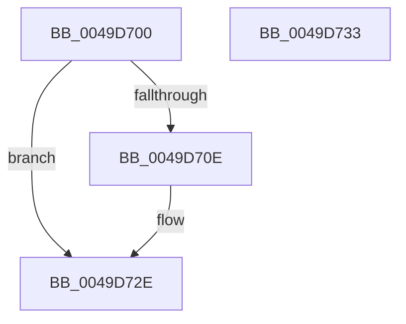

# RtlCopyString

- RVA: `0x0049D700`–`0x0049D734` (길이 `52` bytes)
- VA: `0x000000014049D700`
- 실행 섹션: `.text`
- PDB 이름 있음: `예`; PDB Function 태그: `아니요`
- unwind 정보 RVA: `0x0005C788`
- 디코드: `16`개 명령, `52/52` bytes 표시
- 미해석 바이트: `0` (있으면 어셈블리에 `.byte`로 보존)

> 이 문서는 커널 이미지의 기계어와 PDB 기호를 분석해 생성했습니다. 4번과 5번은 함수 원형과 자료형을 바이너리 사용 방식에서 추정한 C 해석이며 원본 소스 복구 결과는 아닙니다.

## 1. Dependencies

- 직접 호출 지점: **1**; 고유 호출 대상: **1**
- 직접 호출자로 확인된 함수: **0**
- RIP 상대 이미지 참조: **0**

### Outgoing calls
- `0x0049D729` → [memcpy](../6C/memcpy_function_006C6840.md) (function, `0x006C6840`)

### Direct callers
- 이 함수 시작 RVA로 연결되는 직접 call은 확인되지 않았습니다. 간접 호출은 완전히 역산할 수 없습니다.

### Static image references
- 디코드된 RIP-relative 메모리 참조가 없습니다.

## 2. Other-region calls and transfers

- 다른 실행 섹션으로 향하는 call: **0**
- 별도 외부 분기/꼬리 이동을 확인하지 못했습니다.

## 3. Assembly (complete function range)

```asm
0049D700  48 83 EC 28                     sub rsp, 0x28
0049D704  33 C0                           xor eax, eax
0049D706  66 89 01                        mov word ptr [rcx], ax
0049D709  48 85 D2                        test rdx, rdx
0049D70C  74 20                           je 0x14049d72e
0049D70E  0F B7 02                        movzx eax, word ptr [rdx]
0049D711  44 0F B7 41 02                  movzx r8d, word ptr [rcx + 2]
0049D716  49 3B C0                        cmp rax, r8
0049D719  44 0F 46 C0                     cmovbe r8d, eax
0049D71D  66 44 89 01                     mov word ptr [rcx], r8w
0049D721  48 8B 52 08                     mov rdx, qword ptr [rdx + 8]
0049D725  48 8B 49 08                     mov rcx, qword ptr [rcx + 8]
0049D729  E8 12 91 22 00                  call 0x1406c6840
0049D72E  48 83 C4 28                     add rsp, 0x28
0049D732  C3                              ret
0049D733  CC                              int3
```

## 4. C-style interpretation (structured pseudocode)

```c
__int64 __fastcall RtlCopyString(__int64 a1, __int64 a2)
{
    __int64 result;
    __int64 v_rsp;

    v_rsp = (v_rsp) - (40);
    result = 0;
    *(unsigned __int16 *)(a1) = 0;
    if (a2 != 0) {
        result = *(unsigned __int16 *)(a2);
        a3 = *(unsigned __int16 *)(a1 + 2);
        if (result <= a3) { a3 = (unsigned int)(result); }
        *(unsigned __int16 *)(a1) = (unsigned __int16)(a3);
        a2 = *(unsigned __int64 *)(a2 + 8);
        a1 = *(unsigned __int64 *)(a1 + 8);
        result = memcpy(a1, a2, a3, a4);
    }
    v_rsp = (v_rsp) + (40);
    return result;
}
```

## 5. (Beta) C Style

```c
int64_t RtlCopyString(void *Arg1, int64_t Arg2)
{
    uint8_t *arg1 = (uint8_t *)Arg1;

    int64_t result;
    int64_t local_rsp;

    local_rsp = (local_rsp) - (40);
    result = 0;
    *(uint16_t *)(arg1) = 0;
    if (Arg2 != 0) {
        result = *(uint16_t *)(Arg2);
        a3 = *(uint16_t *)(arg1 + 0x2);
        if (result <= a3) { a3 = (uint32_t)(result); }
        *(uint16_t *)(arg1) = (uint16_t)(a3);
        Arg2 = *(uint64_t *)(Arg2 + 0x8);
        Arg1 = *(uint64_t *)(arg1 + 0x8);
        result = memcpy(Arg1, Arg2, a3, a4);
    }
    local_rsp = (local_rsp) + (40);
    return result;
}
```

### 관측된 메모리 오프셋

구조체 형식이 확인되지 않은 접근은 인자 기준의 오프셋으로만 기록했습니다.

| 기준 인자 | 오프셋 표현 | 폭 (bit) | 접근 |
|---|---:|---:|---|
| `Arg1` | `+ 0x0` | `16` | `W` |
| `Arg1` | `+ 0x2` | `16` | `R` |
| `Arg1` | `+ 0x8` | `64` | `R` |

## 6. Execution-region graph

[열기: 2D/3D 그래프와 함수 탐색 컨트롤 패널](../../../control-panel.html?section=text&rva=0x0049D700&view=graph)

- 2D 그래프는 위에서 아래로 흐르고, 3D 그래프는 빈 공간을 드래그해 회전합니다. Shift+드래그는 이동, 휠은 확대·축소, 함수 노드 선택은 대상 보고서 이동입니다.

### Static fallback


