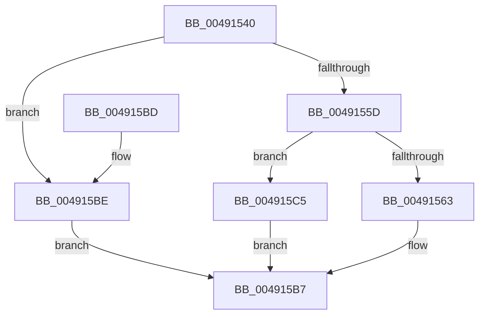

# RtlDecompressFragmentEx

- RVA: `0x00491540`–`0x004915CC` (길이 `140` bytes)
- VA: `0x0000000140491540`
- 실행 섹션: `.text`
- PDB 이름 있음: `예`; PDB Function 태그: `아니요`
- unwind 정보 RVA: `0x000B2D48`
- 디코드: `35`개 명령, `140/140` bytes 표시
- 미해석 바이트: `0` (있으면 어셈블리에 `.byte`로 보존)

> 이 문서는 커널 이미지의 기계어와 PDB 기호를 분석해 생성했습니다. 4번과 5번은 함수 원형과 자료형을 바이너리 사용 방식에서 추정한 C 해석이며 원본 소스 복구 결과는 아닙니다.

## 1. Dependencies

- 직접 호출 지점: **1**; 고유 호출 대상: **1**
- 직접 호출자로 확인된 함수: **0**
- RIP 상대 이미지 참조: **1**

### Outgoing calls
- `0x004915B2` → [guard_dispatch_icall](../6B/guard_dispatch_icall_function_006BAAD0.md) (function, `0x006BAAD0`)

### Direct callers
- 이 함수 시작 RVA로 연결되는 직접 call은 확인되지 않았습니다. 간접 호출은 완전히 역산할 수 없습니다.

### Static image references
- `0x00491574` → RVA `0x00B4CB80` (`RtlDecompressFragmentProcs`; read)

## 2. Other-region calls and transfers

- 다른 실행 섹션으로 향하는 call: **0**
- 별도 외부 분기/꼬리 이동을 확인하지 못했습니다.

## 3. Assembly (complete function range)

```asm
00491540  40 53                           push rbx
00491542  48 83 EC 50                     sub rsp, 0x50
00491546  B8 FF 00 00 00                  mov eax, 0xff
0049154B  4D 8B D1                        mov r10, r9
0049154E  66 23 C8                        and cx, ax
00491551  45 8B D8                        mov r11d, r8d
00491554  48 8B DA                        mov rbx, rdx
00491557  66 83 F9 02                     cmp cx, 2
0049155B  72 61                           jb 0x1404915be
0049155D  66 83 F9 08                     cmp cx, 8
00491561  77 62                           ja 0x1404915c5
00491563  44 8B 8C 24 80 00 00 00         mov r9d, dword ptr [rsp + 0x80]
0049156B  4D 8B C2                        mov r8, r10
0049156E  0F B7 C1                        movzx eax, cx
00491571  41 8B D3                        mov edx, r11d
00491574  48 8D 0D 05 B6 6B 00            lea rcx, [rip + 0x6bb605]
0049157B  48 8B 04 C1                     mov rax, qword ptr [rcx + rax*8]
0049157F  48 8B 8C 24 A0 00 00 00         mov rcx, qword ptr [rsp + 0xa0]
00491587  48 89 4C 24 38                  mov qword ptr [rsp + 0x38], rcx
0049158C  48 8B 8C 24 98 00 00 00         mov rcx, qword ptr [rsp + 0x98]
00491594  48 89 4C 24 30                  mov qword ptr [rsp + 0x30], rcx
00491599  8B 8C 24 90 00 00 00            mov ecx, dword ptr [rsp + 0x90]
004915A0  89 4C 24 28                     mov dword ptr [rsp + 0x28], ecx
004915A4  8B 8C 24 88 00 00 00            mov ecx, dword ptr [rsp + 0x88]
004915AB  89 4C 24 20                     mov dword ptr [rsp + 0x20], ecx
004915AF  48 8B CB                        mov rcx, rbx
004915B2  E8 19 95 22 00                  call 0x1406baad0
004915B7  48 83 C4 50                     add rsp, 0x50
004915BB  5B                              pop rbx
004915BC  C3                              ret
004915BD  CC                              int3
004915BE  B8 0D 00 00 C0                  mov eax, 0xc000000d
004915C3  EB F2                           jmp 0x1404915b7
004915C5  B8 5F 02 00 C0                  mov eax, 0xc000025f
004915CA  EB EB                           jmp 0x1404915b7
```

## 4. C-style interpretation (structured pseudocode)

```c
__int64 __fastcall RtlDecompressFragmentEx(unsigned __int16 a1, __int64 a2, int a3, __int64 a4, unsigned int a5, unsigned int a6, unsigned int a7, __int64 a8, __int64 a9)
{
    __int64 result;
    __int64 v_rsp;
    unsigned __int64 v_stack_m20;
    unsigned __int64 v_stack_m28;
    unsigned int v_stack_m30;
    unsigned int v_stack_m38;

    v_rsp = (v_rsp) - (80);
    a1 = (unsigned __int16)((a1) & (255));
    if (a1 < 2) goto loc_004915BE;
    if (a1 > 8) goto loc_004915C5;
    v_stack_m20 = a9;
    v_stack_m28 = a8;
    v_stack_m30 = (unsigned int)((unsigned int)(a7));
    v_stack_m38 = (unsigned int)((unsigned int)(a6));
    result = guard_dispatch_icall(a2, (unsigned int)((unsigned int)((unsigned int)(a3))), a4, (unsigned int)(a5));
loc_004915B7:
    v_rsp = (v_rsp) + (80);
    return result;
loc_004915BE:
    goto loc_004915B7;
loc_004915C5:
    goto loc_004915B7;
}
```

## 5. (Beta) C Style

```c
int64_t RtlDecompressFragmentEx(uint16_t Arg1, int64_t Arg2, int32_t Arg3, int64_t Arg4, uint32_t Arg5, uint32_t Arg6, uint32_t Arg7, int64_t Arg8, int64_t Arg9)
{
    int64_t result;
    int64_t local_rsp;
    uint64_t v_stack_m20;
    uint64_t v_stack_m28;
    uint32_t v_stack_m30;
    uint32_t v_stack_m38;

    local_rsp = (local_rsp) - (80);
    Arg1 = (uint16_t)((Arg1) & (255));
    if (Arg1 < 2) goto loc_004915BE;
    if (Arg1 > 8) goto loc_004915C5;
    v_stack_m20 = Arg9;
    v_stack_m28 = Arg8;
    v_stack_m30 = (uint32_t)((uint32_t)(Arg7));
    v_stack_m38 = (uint32_t)((uint32_t)(Arg6));
    result = guard_dispatch_icall(Arg2, (uint32_t)((uint32_t)((uint32_t)(Arg3))), Arg4, (uint32_t)(Arg5));
loc_004915B7:
    local_rsp = (local_rsp) + (80);
    return result;
loc_004915BE:
    goto loc_004915B7;
loc_004915C5:
    goto loc_004915B7;
}
```

## 6. Execution-region graph

[열기: 2D/3D 그래프와 함수 탐색 컨트롤 패널](../../../control-panel.html?section=text&rva=0x00491540&view=graph)

- 2D 그래프는 위에서 아래로 흐르고, 3D 그래프는 빈 공간을 드래그해 회전합니다. Shift+드래그는 이동, 휠은 확대·축소, 함수 노드 선택은 대상 보고서 이동입니다.

### Static fallback


